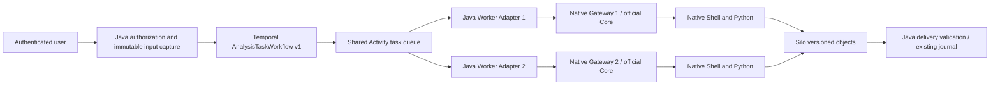

# Native Cline whole-task scheduling

Use `chatchat.runtime.coding.scheduler=temporal` for the unified S3 analysis
entry. The default retains the existing local deployment. Do not enable both
schedulers for the same task. This integration does not replace the official
Cline Core, edit its Agent loop, or wrap individual tools/model turns in
Temporal Activities.

## Roles and state



Temporal persists dispatch, retries, timeouts and cancellation. Its History
contains bounded task/identity/hash references and small lifecycle progress.
Inputs, source files, logs, provider response bodies and reports remain in Silo
and the existing Runtime evidence mechanism. PostgreSQL task partitions protect
lease/fence, event accounting and delivery acceptance in the existing journal.

The existing input allocation `epoch` is immutable because it binds S3 object
paths and authorized snapshots. Each replacement execution has a separate
`executionEpoch` and Native Session. It does not mutate or reconstruct the
original input snapshot. A task ID and stable Workflow ID prevent duplicate
submission. Temporal-owned task IDs use `temporal-native-` so an older local
deployment sharing the evidence database cannot pick them up with its legacy
`native-%` recovery scan. The request-to-task mapping survives scheduler changes;
an incompatible scheduler rejects the old task instead of creating another one.

## Configuration

The private unified connection JSON accepts a fleet in addition to the existing
single-node configuration. Never accept these addresses or keys from a user DTO.

```json
{
  "endpoint": "http://127.0.0.1:18461",
  "defaultNodeId": "cline-worker-1",
  "issuerKey": "OPERATOR_PRIVATE_KEY_AT_LEAST_32_CHARACTERS",
  "dynamicModels": true,
  "nodes": {
    "cline-worker-1": {
      "endpoint": "http://127.0.0.1:18461",
      "recoveryEndpoint": "http://127.0.0.1:18462"
    },
    "cline-worker-2": {
      "endpoint": "http://127.0.0.1:18471",
      "recoveryEndpoint": "http://127.0.0.1:18472"
    }
  }
}
```

Each Java Worker Adapter uses the same Temporal namespace and task queue, an
individual `node-id`, and its own `max-concurrent-tasks`. Match that concurrency
to the local Gateway and restricted Executor capacity. The API process uses
`worker-enabled=false`; Worker Adapters use `true`. Adding another configured
Worker/Native/Executor pair adds a consumer to the standard queue. No Java node
picker, model planner, tool scheduler or model-request count limit is introduced.

Stop/reconciliation Activities use the standard queue `<task-queue>.control`,
with one independent control slot per Java Worker Adapter. That consumer stays
available when the local Native Gateway is offline or analysis slots are full.
It never plans or executes an analysis. `Workflow.getVersion` preserves replay
of pre-control-queue histories; both queues retain the old Activity registration
until old workflows drain. Recorded real cancellation and restart histories are
replayed in the SDK regression suite.

Relevant properties under `chatchat.runtime.coding.temporal`:

| Property | Purpose |
| --- | --- |
| `target` | Trusted Temporal gRPC address |
| `namespace` | Analysis namespace, default `runtime-native` |
| `task-queue` | Shared queue, default `runtime-native-analysis-v1` |
| `worker-enabled` | Enable this process as a consumer |
| `node-id` | This consumer's deployment-owned Native node |
| `max-concurrent-tasks` | Concurrent whole-task Activities, default 1 |
| `tls-enabled` | Validate Temporal server TLS |
| `tls-ca-file` | Operator-managed CA file |
| `tls-certificate-file`, `tls-key-file` | Individual client mTLS identity |
| `api-key-file` | Optional private credential for a compatible authenticated endpoint |

TLS certificate/key pairs are mandatory together. API credentials require TLS.
Never put a model key, Temporal client key or internal account token into an
image or frontend bundle. Rotate candidate certificates before expiration;
production certificate issuance/rotation belongs to the operator's PKI.

## Source build and candidate deployment

Archive the exact committed checkout and upload source only. Keep deployment
secrets and generated evidence outside the source archive. Run
`build-native-images.py --help` for immutable-base and build-tool arguments. The
builder records source-file hashes, exact base IDs, Git revision, logs and image
IDs. The Host image rechecks the official Cline manifest, Native modules and
Python imports. Actual Core Workers retain their independently pinned verified
image in each restricted Executor configuration.

`bootstrap-native-candidate.py --help` generates an independent Compose project
from operator-owned application/Native configuration. It creates a separate
PostgreSQL role and two databases on the existing PostgreSQL instance, individual
mTLS clients, per-process data/log directories, per-node workspaces, independent
Executors and recovery controls. It does not modify existing Compose files or
stop existing services. The generated Compose contains private application
configuration and must stay mode 0600. Do not add it to Git.

Before starting, check port availability, free memory/disk and the exact dedicated
Docker daemon identity. Each Native Core remains network-disabled with task-only
bind mounts, read-only input, no additional capabilities and enforced cgroup
limits. A merged Python/Node image alone is not tenant isolation.

```sh
docker compose -f /OPERATOR_CANDIDATE_ROOT/compose.private.json up -d
```

Processes sharing the candidate API network namespace must be recreated when
that API container is recreated. Compose dependency `restart: true` expresses
this dependency. Never share the original application's RocksDB data directory
between Java processes. Existing MCP/News/document retrieval stays with its
configured authoritative service; create knowledge fixtures at that service,
not in a separate candidate's local RocksDB index.

## Recovery and cancellation

An Activity retry first waits for the previous existing three-minute journal
lease. If its Native Session is still alive, it observes that Session and does
not resend the user's objective. If the Session/Gateway is lost, an independent
restricted recovery service fences the old allocation in the Executor's durable
serialized create/start barrier and actually stops its container. Only a proved
stop permits a new Session/epoch and native execution of the original immutable
inputs. Old events, unknown usage and failure evidence remain recorded.

Delivery selection, Silo upload planning, object version/hash verification and
final acceptance all require the current journal fence. Old Session model/MCP
callbacks fail against the current private binding. A revived Gateway also reads
the durable revocation marker. A late create/start cannot pass the Executor fence.
Uploaded but unaccepted object versions are never a second valid final result.

Cancellation durably closes the output admission boundary, signals Temporal and
Native, and waits for real process-stop reconciliation. A Java process exit is
not a cancellation receipt. An unreachable recovery plane leaves the task in
reconciliation and cannot authorize a replacement execution. Whole physical-host
loss therefore requires an independently reachable trusted fencing/stop authority;
two containers on one host do not establish cross-host high availability.

`native-fault-probe.py` is an explicit operator-only candidate acceptance tool.
It checks exact Compose ownership and actual Python/container state before
killing the selected candidate Gateway/Worker. It refuses arbitrary tasks or
production container names. It also tests old-grant replay after restoration.

## Verification, upgrade and rollback

Use `scripts/verify-native-temporal-live.mjs` with two private test accounts,
explicit candidate origin and a synthetic Parquet. Run identical four-task batches
with one then two consumers. `verify-native-temporal-results.mjs` independently
checks business values, source/report downloads and SHA-256, per-owner refusal,
real provider/command receipts, native execution overlap and throughput increase.
Retain every failed run in its own evidence directory.

The existing authenticated `/monitor/` page and Java APIs show Workflow, node,
Session, execution epoch, actual provider usage, command receipts and Silo files.
The node section queries actual restricted Executor CPU/memory observations.
No monitor request invokes a model or controls a Cline tool loop.

Workflow v1 is a new deterministic type. Future incompatible changes must use
Temporal versioning or a new Workflow type/queue; drain the old workers rather
than deploying incompatible code over running histories. Preserve namespace,
databases, private state roots, Executor ownership keys and Worker image pins
across restarts.

Rollback: stop new submissions, retain Temporal consumers/recovery controls until
their accepted tasks settle, then restore the prior API image/configuration and
explicit local scheduler mode for new requests. Never migrate an in-flight task
to a second local loop. Preserve previous images and private configuration backups.
Remove only stopped, proved-owned test containers and unused test images. Do not
prune globally, remove shared images/volumes, or delete PostgreSQL/Silo directories.
