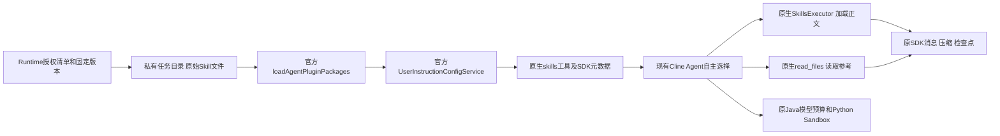

# Coding Node 原生 Skills 集成及回滚

原生调用链：

## 对照与删除清单

| 原实现 | 本轮处理 | 保留的Runtime治理 |
|---|---|---|
| `skills.js`手工catalog合并、名称冲突、Markdown解析、readBuiltin | 删除；发现、解析与命名空间交给官方组件 | `skill-distribution.js`只处理授权分发manifest、路径与来源hash |
| runner自研`skill_read`工具及Schema | 删除；注册官方`skills`、`read_files` | 动态每次读取重查Java授权与固定版本，文件仅限私有清单 |
| `skill-disclosure.js`可见正文索引、复用与自定义Unicode分页 | 删除；模型使用官方Skills工具和文件行范围，原生上下文/压缩继续管理消息 | hash观测只作统计，不再控制正文披露或保留第二份会话 |
| Skills catalog用户消息注入、runner Skills选择引导 | 删除 | SDK发现元数据仅放在原生工具参数说明，任务业务、权限与证据要求保留 |
| Java按显示名称跳过动态Skill | 删除名称选择；授权身份全部固定，由官方插件命名空间区分 | tenant/user/Agent授权、版本冻结、资源hash和原回调签名 |
| Docker镜像全局`.cline/skills`链接及Parser式发现门禁 | 移除；候选镜像使用真实官方发现/加载回归 | 镜像原始包、来源manifest和只读运行边界 |

源码：[原生集成](../../coding-agent-node/src/native-skills.js)、[分发治理](../../coding-agent-node/src/skill-distribution.js)、[现有入口](../../coding-agent-node/src/runner.js)。读取回调仍是Runtime内部的包分发/授权接口，不再是模型工具。Java保留历史`skill_read`授权识别用于旧合同兼容；新合同只发布原生工具，Node没有旧自研工具执行路径。

## 治理与运行时限制

每个任务、租户、用户、run和SDK session形成独立稳定目录。Node重启后从固定版本重新分发，原生组件重新发现，同一检查点资源路径保持稳定。没有共享HOME扫描、跨Agent资源目录、全局授权缓存或额外Agent入口。准备期间也拒绝对同一run对象重复启动；取消及截止时间使用原入口。

只启用两个原生工具。`read_files`的文件读取执行器由官方提供，Runtime仅在读取前检查精确manifest、canonical path、符号链接和hash；已授权Skill不能借其示例取得宿主Shell、网络、数据库或其他数据文件访问。所有数据分析与Python修复仍走已授权Sandbox工具。只授予`read_files`不能启动独立宿主文件阅读器。

原生SDK工具返回格式和分页行为保持。SDK发现失败或原始包不符合规范时显式失败，不回退自研Loader。动态授权撤销后即使原生service已缓存正文，也必须先通过Java活授权检查才可返回给模型。生成的旧领域方法外壳属于分发格式适配，不解析或改写其方法正文。

兼容注意：八个自有Skill只改元数据位置；第三方原始文件保持。官方Strict Agent Skills规范的原始包可直接发现，非规范包不能以兼容名义自动改写。其他目录布局或不支持的二进制内容会显示明确能力限制。元数据描述投影的删除条件见[API调查](cline-native-skills-api-review.md)。

## 发布与回滚要求

Worker与Java授权合同配套发布。候选先通过只读、禁网、去capabilities的Linux Node回归及真实Docker Sandbox门禁，再验证签名回调和原HostConfig/Mounts。Java使用正常编译产物，只替换审核过的必要class，保留前端与依赖；共享API网络命名空间的回调代理须一并绑定新API容器。

旧合同的`skill_read`检查点不能在新Node上静默重放或转换成新任务。发布前检查父任务、Node和Python均空闲；仍活跃的旧合同必须由原Worker完成或走原Runtime停止/恢复流程。原生格式检查点在新版本内继续使用同一SDK session和资源路径。

回滚先停止新准入并等待原Runtime确认无执行，恢复发布目录保存的API、代理及Worker镜像和容器配置；API与共享网络代理成对恢复。重新登录、重载原网络白名单，验证签名通过、未签名拒绝及认证健康。未知模型/执行操作不重放。具体镜像hash、备份容器和发布结果以本轮[验收记录](../testing/cline-native-skills-acceptance.md)为准；尚未完成的门禁或真实模型场景不得列为通过。
