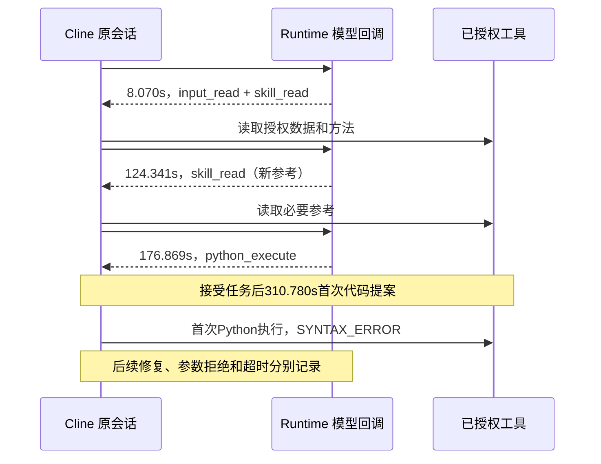
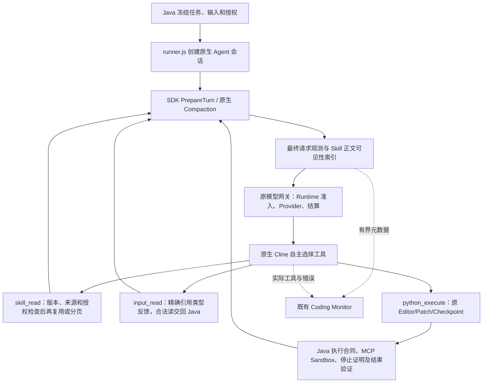

# 首次代码生成：事件与源码复核

本轮以远端最新 `refactor/cline-sdk-reuse-20261105` 的 `1ecf091dfce757d5ff7933fec4049c8de2f67196` 为基准，
新分支 `perf/cline-precode-context-20261106`。基准生产实现为 `2813524e8`，其后的提交仅为证据和收集口径补充。
SDK 五个包均固定0.0.93。Worker 实现 `f09cb4b5d`（中间版本6487e5867），Java 冻结任务整改 `c97962110`；不重做 Editor、Patch、Checkpoint，不升级 SDK，不新增 Agent Loop。

## 已确认的真实事件

`analysis-coding-e24ee39f2fcefdd6349607ece6fdb205f810666339c8d41b175a32132e6fc2e2` 的完整跨 fence 时序
见 [原始专项诊断](coding-progress-root-cause.md) 和 [脱敏事件](../testing/evidence/coding-progress-20261105/original-timeline.json)。
前4次请求约90秒，读取6个不同 Skill/参考文件及2次输入；第一次把精确的任务快照绑定误作数据集引用。
第五次请求约300秒超时，未收到 Provider 完成响应、usage 或代码。上下文 Skill 约63KB。
该任务没有有效代码提案/Python执行/结果；首次提案耗时只能记为未观测，约390秒后仍无代码，不能填0。
Python Schema 已完整披露，无 tool_describe；不重新推测为 Schema 未加载或反复完整规划。
供应商内部等待原因仍未知，正文大小与超时同时出现不是因果证明。

## 本轮新增的真实反例

中间版本 complex-0（analysis-coding-09ad22e4c1486405c7450c53787cfdc14146973c7816f877da45afab4db2788e）
首次有效代码提案310,780ms，之前3次模型调用：#1 8,070ms读取数据和分析方法，#2 124,341ms读取另一个必要参考，
#3 176,869ms提交程序。#2 Provider输出7,718 Tokens，其中 reasoningTokens 7,642；#3输出11,164，其中 reasoningTokens 4,932。
两次 Skills 均是新内容，不能标记为重复规划或强制减少为固定次数；读取工具本身不是124秒耗时的来源。
已知较长模型响应与较大推理用量并存，但非流式响应仍无法拆出供应商排队、首Token及生成耗时。

首次执行后出现真实 SyntaxError、两次 PROGRAM_ERROR、#4 MODEL_TOOL_ARGUMENTS_INVALID（约200秒）和一次代码提案拒绝。
第9次模型调用301,301ms失败，随后 Java 进入既有 fenced recovery；不得把所有修复和恢复时间记成“0代码的准备”。
完整样本保留在性能数据中，没有因异常耗时剔除。

## 当前源码对应关系

基准 runner 已允许直接编码，但不能据此认定整个调用链已经按需加载。联机 Monitor 展示的冻结任务仍含 Java 生成的强制前置要求。
复核 CodingAnalysisService 后确认两处：传输 Parquet 读取前必须查阅 Skill 映射参考；资源首次查询前必须 skill_read。
这与 Node 的按需选择叠加。`c97962110` 删除这两整句，不添加替代规则，保留传输字段映射、presence、Decimal、证据引用和授权边界。
此前仅修改 Node 的两轮试验属于中间状态，不能用来证明 Java 残留要求已解决。
类文件常量池仅两项字符串改变，所有方法反汇编相同；API 包仅替换该类，其他条目保持原样。
没有再添加一条“先不读 Skills”的常驻规则。
真正仍存在的叠加包括：基础提示与追加提示重复说明结果复核；重复推荐多个报告 Skills；
workspace 的 Skills 自主选择重复出现；重复 Skill 请求再次交付全文；通用分析 Skill 正文包含特定金融配方用法。

当前对照基准 CSV 首请求的任务/输入部分18,069 UTF-8字节，另有4,931字节 Skills 卡片与4,080字节系统提示。
输入上下文同时包含 manifest、字段定义、实际 files/fileLayout、输出合同和有界预览。
这些文件与业务信息不是可随意删除的冗余：此前传输映射缺失已经导致真实 Parquet 失败。
本轮保留完整 Python 核心工具合同与输入描述，仅去除重复的引导和交付相同 Skill 正文的负担。
当前 FILE_INPUT_GUIDANCE 的格式/路径细节已经位于 python_execute 工具 description，系统提示仅作简短引用；本轮没有把它重新追加进常驻系统提示，也不将已有机制冒充新整改。
Java 的可视化输出合同与金融表现约束仍占较多任务上下文，其中包含业务精度、单位与证据要求。本轮只删除已确认相互冲突的 Skill 前置句；未以删去这些业务要求换取体积下降。后续迁移须先证明原生 Skill 的适用发现与质量保持，本轮账户反例尚不支持宣称这项迁移已安全完成。

## 实际调用链

这是现有 SDK Agent 的调用链；新增披露层仅有 hash/引用索引，不生成计划、不压缩正文、不重试或决定执行。
源码：[runner](../../coding-agent-node/src/runner.js)、[Skill 披露](../../coding-agent-node/src/skill-disclosure.js)、
[进展](../../coding-agent-node/src/coding-progress.js)、[模型传输](../../coding-agent-node/src/server.js)。

## 修改边界

- runner 缩短已有重复句，取消多 Skill 名称推荐；默认 reviewed-analysis 仅保留基础提示已有的结果复核说明。
- 大型参考文件通过现有 skill_read 增加可选 offset/limit，不再要求整份读取；SKILL.md 原文仍完整交付。
- 内容复用检查实际 SDK PrepareTurn/Compaction 后的请求。没有独立压缩器或摘要模型。
- 原先准备轮数提醒仅在确实没有新结果时触发；新 Skill/新证据仍是有效进展。原提示反馈字段精简，不追加新规则。
- 输入引用错误在现有 SDK 工具结果中结构化返回；合法读取仍由 Java 做数据授权、预算和读取。
- 仅增加实际读取、体积、前置用量及传输观测；未知 Provider 阶段不填0，不改 errorRetryable:false。

具体实现、回归及最终真实模型数据见 [Skills 审查](cline-skills-loading-review.md)、
[引用合同](cline-input-reference-contract.md)、[性能报告](../testing/cline-precode-performance.md) 和 [验收](../testing/cline-precode-e2e-acceptance.md)。

## 上游核对

2026-11-06 查阅 [官方 SDK changelog](https://github.com/cline/cline/blob/main/sdk/CHANGELOG.md)：
0.0.94/0.2.0 包含流中错误重试和压缩改进，不能据此宣称本仓库的 Runtime callback 自动获得这些能力。
当前实际版本0.0.93已具备原生 PrepareTurn、基本压缩、Abort、截断恢复、完成保护；现有回归直接验证这些公开接口。
[官方 Issue #14314](https://github.com/cline/cline/issues/14314) 是 Desktop 压缩注册问题，本仓库显式接入 compactor，不能套用该问题作本任务根因。
不盲目升级或启用隐藏重试：未知供应商执行仍保留待核对的预算，实际重试必须独立准入和结算。
