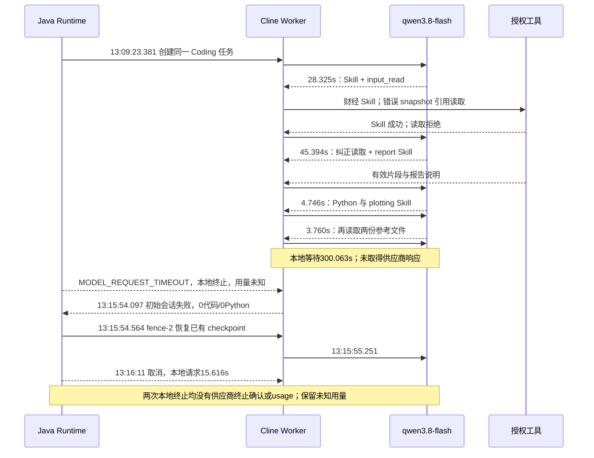

# Coding 首次代码延迟：真实任务诊断

诊断基线：`80ef890966240f72ac3613986ff503c45a2e4165`，分支 `refactor/cline-sdk-reuse-20261105`，SDK 五包 0.0.93。
任务：`analysis-coding-e24ee39f2fcefdd6349607ece6fdb205f810666339c8d41b175a32132e6fc2e2`。
原始请求为数据探索空间使用 `financial-news-agent` 分析华是科技最新行情，模型保持 Agent 配置 `qwen3.8-flash`。
本文件先记录修改前的事实；不把拟议 Prompt 调整当成已经证实的性能收益。

## 证据来源

从 Java `JdbcRuntimeEvidenceStore` 的 owner partition 读取并校验 `coding.tasks.v1` 分块内容 hash，
保存完整 task journal（contract、operations、events、SDK canonical checkpoint）和本任务不可变模型响应/本地终止回执。
读取 Node 持久化 Monitor 中本任务各 fencing token 的事件。原文仅留在部署主机私有发布目录，
不提交授权 token、原始输入数据或模型生成的完整业务内容。
脱敏模型时序见 `docs/testing/evidence/coding-progress-20261105/original-timeline.json`。

## 五次调用到底做了什么

以下为 UTC；界面北京时间为 UTC+8。初始 Worker 于 13:09:23.381 接受任务。
父级财经 Agent 于13:07:04左右提交，先经历约126秒规划，随后授权 web_search 用时4.104秒、交付18个结构化数据集，才进入 Coding。
这些属于父级规划和数据获取，不能计作 Coding 的五次模型调用或将其归因于 Editor。
完整私有采集包含初始 fence 的42条 Node 事件、恢复 fence 的8条事件，以及91条 Java 执行事件。

| 调用 | 供应商调用开始—结束 | 供应商耗时 | 输入/输出 Token | finish reason | 实际工具及结果 |
|---|---|---:|---:|---|---|
| 1 | 13:09:24.229—13:09:52.555 | 28,325 ms | 14,430 / 2,325 | TOOL_EXECUTION | `skill_read(financial-market-analysis)`；`input_read(inputSnapshotRef,0,3000)` 被 Runtime 拒绝，错误 `Invalid Coding callback binding` |
| 2 | 13:09:54.133—13:10:39.527 | 45,394 ms | 15,411 / 2,217 | TOOL_EXECUTION | `input_read(mcp_chatchat_mcp_server_web_search,0,4000)` 成功但仅返回片段；读取 `runtime-report-delivery` |
| 3 | 13:10:41.580—13:10:46.326 | 4,746 ms | 18,180 / 238 | TOOL_EXECUTION | 读取 `python-data-analysis` 和 `cline:plotting` 两个 Skill |
| 4 | 13:10:48.016—13:10:51.777 | 3,760 ms | 24,361 / 188 | TOOL_EXECUTION | 读取 Python Skill 的 `data-methods.md` 与 `financial-reporting.md` |
| 5 | Node 13:10:53.200 开始；13:15:53.743 失败 | 本地请求 300,063 ms；Node 回调总计 300,738 ms | 未知，不能记为 0 | 无供应商返回 | `MODEL_REQUEST_TIMEOUT`；没有返回工具调用、代码或可用用量 |
| 6（恢复） | Node 13:15:55.251 开始；13:16:11.352 失败 | Java 本地 15,616 ms；Node 回调 16,434 ms | 未知 | 无供应商返回 | fence-2 恢复原 checkpoint 后收到取消；没有新增代码或工具结果 |

前四次已知总 Token 为 **77,350**。第五次未知用量保持预算保留，不能把它当作无成本调用。
首次有效代码提案、首次 Python、首次结果均**未发生**，耗时必须记为缺失/删失，而不是 0 ms。
初始 Node 会话于 13:15:54.097 失败，经历约 **390.7 秒**。
随后 Java 从已有 SDK checkpoint 建立 fence-2 并发起 model-6，本地约 15,616 ms 后取消，
回执为 MODEL_CANCELLED，供应商终止和用量仍未确认。它不是初始 Node 内部隐式重试。

## 排除项与可归因问题

- **未发现 Schema 缺失**：初始请求就有 6 个工具的完整 Schema，包含 Python；无 `tool_describe` 调用。
  Python、input_read、skill_read 都可直接选择。不能用强制增加工具发现轮次解决本例。
- **不是五轮重复规划**：首轮含简短计划，后续是实际不同的读取；Skill/参考文件读取共 6 次，输入读取 2 次。
  应区分准备工作与无效循环，不能达到固定调用次数就终止合法任务。
- **没有代码提案被拒绝**：此时尚无 `python_execute` 调用，没有 CODE_PROPOSAL_REJECTED 或实际 Python。
  不能继续改 Editor/Patch 来修复“0代码”。
- **没有已知截断/无效 JSON 修复**：前四轮为正常 TOOL_EXECUTION，没有 MODEL_OUTPUT_TRUNCATED、
  MODEL_TOOL_ARGUMENTS_INVALID；第五轮没有响应，无法断言供应商内部在生成什么或为何超时。
- **明确的路径开销**：第一轮用了错误数据集引用；runner 常驻提示把 Skills 阅读放在编码前，
  自有 Python Skill 又要求金融图表读取包含大量交易核对配方的参考文件。
  实际 Skill 上下文从 0 增至 **62,767 B**，第五轮整个请求 **130,333 B**。
  SDK 压缩次数为0，输入估算32,584 Tokens，低于65,536软预算；估算不能替代供应商用量或证明其内部状态。
  这证明准备材料变多；不能证明它是供应商超时的唯一原因。
- **监控解释缺口**：原事件有模型用量/时间和工具 timing，但没有逐轮工具列表、finish reason、
  首次提案耗时、重复失败/新证据计数及当前等待环节，需要人工串联 Java 与 Node 才能解释。

## 基于证据的整改边界

移除“编码前必须读取 Skill”的普遍前置要求，保留自主选择和真实任务需要的读取。
收敛自有 Python Skill 对金融参考的强制跳转，按方法适用性阅读；不修改上游 plotting Skill。
澄清快照绑定与 `inputVersions.datasetReference` 的区别，保持 Java 原有授权校验。
核心 Python 工具对已授权任务可直接披露 Schema；其余动态工具仍按任务授权和按需发现。
无进展反馈只进入现有 SDK 会话，不自行调用模型、不终止复杂任务、不改变预算/取消/证据权威。
监控记录真实返回工具、finish reason 和未知用量；目的只能标为根据已知状态推断的阶段，不能伪称读取模型思考。

性能验收必须以多任务、多重复的真实模型前后数据另行记录，失败与超时保留在分母中。
本例不是可用的成功率或 p95 基准，Prompt 收敛也不能替代供应商超时治理。

## 源码调用链与已实现行为

`runner.run → Cline Agent → beforeModel / model.stream → Java budget + model admission → provider`
仍是唯一模型调用链。每个真实 stream attempt 在原准入边界调用 `codingProgress.model`；如需提醒，
仅向本次现有请求追加有限的进展摘要。它不调用模型，不保存消息，不恢复/创建任务，不作终止决策。
Java 的实际预算、deadline、取消、未知用量保留、原生 SDK prepared-request 恢复边界均保持原状。

`Cline beforeTool → SDK_TOOL_STARTED → python_execute → SDK Editor propose → Java preparePython → CodeHistory.record → CODE_READY → Java executePython`
沿用已有 Editor/Patch/Checkpoint 实现。新增 CODE_PROPOSED 记录尝试；拒绝和有效代码分别计数。
Python 派发与 Java 确认 `executorStopped` 分开计数；HTTP 失败不能证明执行已停止。
首次有效结果基于 Python 结果可用回执，不等于业务验收。

`afterTool → codingProgress.tool → TOOL_TIMING → MonitorStore whitelist → Monitor overview/models`
只保存有限计数、散列及工具名；不增加第二份 transcript。相同成功结果不会重置无进展计数，
相同调用/错误可识别重复失败，新增读取会重置停滞窗口。
Skills 阅读和核心 Schema 披露始终不能扩大 immutable task grants。
`python_execute` 仅在原授权工具集合内直接披露；其它动态工具仍自主按需发现。

可配置环境变量 `CLINE_PROGRESS_PREPARATION_CALLS` 默认 4、`CLINE_PROGRESS_STALLED_CALLS` 默认 3，
取值 0..32，0 关闭相应提醒。前者表示当前会话还没有有效代码，后者表示没有新工具结果；
两者都是周期性建议，不是复杂分析的硬上限。Node 恢复后的进展计数从本次 SDK run 开始，
原累计用量/预算仍以 Java 为准；界面明确标注统计范围、按事件推断的目的及最近准入前预算快照。

Monitor 新增当前序号/状态、准备/探索/编写/执行/验证/修复阶段、当前等待环节、
首提案/有效代码/Python/结果耗时、提案接受/拒绝、确认执行次数、Skills/发现次数、
新证据/重复失败、已知 Token/剩余预算及逐轮实际工具、finish reason、响应诊断码。
旧历史无新指标时保持缺失；不能回填为真实的 0。

## 真实回归暴露的补充问题

首轮候选 `a64c8be51` 的关联样本 `analysis-coding-a1c3220e0d35f8960610a66be3f6b073ce02437567a5ad07d04fb1498985b8eb`
在第二轮生成22,702字节程序，模型回调140,282ms；实际第33行用 `pq.read_table(..., columns=["datasetReference","record"])`
直接选择传输逻辑列，忽略 schema 的物理列映射。Runtime 回执诊断为 UNKNOWN、repair.allowed=false、action=STOP，任务失败。
保留原失败及安全停止，不把 UNKNOWN 改成可自动重试。

调查确认，详细 transport mapping 原先主要位于默认分析系统提示；TEXT_OR_CODE 分支只得到较短的工具描述。
最终候选把完整文件路径、storageName/type、JSON 解码、presence/null、精度和 hash/行数检查放在已授权 Python 工具说明，
加条件式物理列映射例子，同时移除默认系统提示中的长篇重复传输说明。Skills 仍由模型自主选择，不借此强制加载参考文件。
另对两种分析模式强调任务专用的简洁代码，避免生成通用框架或重复整份 manifest/schema/环境/回执；全部必要核验保留。
这提供可检验的改善假设，实际性能仍以最终多任务试验为准，不从一次失败推断普遍收益。

恢复会话已有代码时，进展建议从已有 canonical code lineage 派生“已有代码”状态，
避免当前 run 的零提案计数误导模型重新生成初始程序；没有增加 checkpoint 或恢复控制器。

## 计划文本被误当作会话完成

第二轮候选 `6f494d918` 的复杂样本 `analysis-coding-02a264d9cbb64684c8ec80cd1f868536f2d3b4f418befce8d7c4ef1d70450f9f`
第一轮通过 input_read 读取完整56行 CSV；第二轮返回 `STOP`、一段 `<initial_plan>` 和零工具调用。
原 SDK 会话将这个无工具响应视为 completed，外层 afterRun 随后因 `REVIEWED_RESULT_NOT_AVAILABLE` 拒绝完成。
全过程约109.7秒，无代码提案、无 Python，亦非 Schema 缺失或模型截断。

当前 `@cline/agents` 0.0.93 的公开 `completionPolicy.completionGuard` 正是处理该边界的能力：
SDK 在无工具的结束响应后读取 guard；存在反馈时将提醒加入自己的 canonical messages，并在自己的循环内继续。
最终修订只为 reviewed-analysis 且尚无真实已复核结果的会话提供该反馈，明确计划不能替代结果，
允许模型继续自主选择必要工具、代码或任务授权的证据不足报告路径。
没有调用 agent.continue、创建新会话、拼装第二份历史或建立外部重试循环。
每次继续仍经过原 Java admission、deadline 和 maxModelCalls，Runtime STOP 保持优先。

两项新增原生 SDK 回归分别复现“计划 STOP→真实 Python→结果复核”及“连续只给计划时仍受原2次预算限制且不能认证成功”。
此前两轮候选全部样本保留，最终 SDK guard 版本另用独立 `verified` 批次验证。

最终真实回归也保留了模型未遵循已有指令的情况：`verified/parquet-0` 首轮生成2,537字节程序，
`verified/join-0` 首轮生成3,870字节程序，均仅打印检查信息，未写 rows.jsonl；实际进程退出码0，但结果合同正确拒绝为 REQUIRED_OUTPUT_MISSING。
这两项分别在首轮约43.9秒与57.0秒提交了代码，不能把它们算作首次有效分析结果。
检查实际请求确认，常驻提示已明确禁止 print-only 检查程序并要求同次执行写完整报告；工具说明也已写明输出路径。
因此没有证据把这些样本再归因于 Schema 未披露，也不能通过继续堆叠同义提示证明已修复模型行为。
按原 Runtime 回执进入同一 SDK 内修复，保留失败及成本，不放宽输出要求或返回原始 stdout 充当报告。

其它中间失败也未排除：首轮 candidate/parquet-1 在第一轮返回 STOP 且无工具，同样被原外层结果完成校验拒绝；
第二轮 final/parquet-0 则已经多次取得可用报告，仍继续代码读取、复核和修订，最终耗尽原有12次模型预算。
其工具序列为 `input_read+python → code_read → python → code_read → python+artifact_read → code_read → input_read → python → python → code_read → python → python`。
这个失败是后续复核/修订路径耗尽预算，不能归为“从未产出代码”，也不能通过删除结果复核或增加预算使基准看起来成功。

## 最终验证边界

最终源码 `2813524e8` 已部署，40项真实模型试验包含基线及三批候选，各有5类任务×2次。
最终批执行完成10/10，但首次新代码中位数107.2→142.0秒，首次可用结果155.6→429.0秒，模型调用总数56→59。
因此这次修改不能被称为已解决产出延迟；原供应商超时的内部原因也尚未查明。
新的华是科技财经 Agent 验证在前置模型等待约300秒后失败，尚无 Coding task；不能作为 Coding 修复成功的证据。
完整性能表、报告业务错误及财经事件见 [最终验证报告](../testing/coding-progress-regression.md)。
