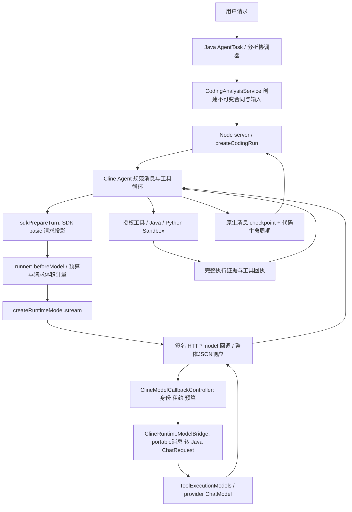

# Coding 上下文调用链

| 位置 | 输入/输出 | 序列化与副本 | 额外模型调用 |
|---|---|---|---|
| Java合同 | 用户目标、工具允许列表、快照、输出Schema、预算 | JSON合同，绑定hash与作用域 | planner视任务产生；不等同Coding调用 |
| runner.run | 目标、输入元数据、Skill目录 | 初始user消息包含配置快照；workspace可预取有界上下文 | 预取不调用模型 |
| SDK Agent | 单份规范消息、工具结果、恢复消息 | Agent拥有规范历史；prepareTurn仅投影 | 每轮模型调用；必要修复仍在同一循环 |
| sdk-adapter | canonical → SDK tool_use/tool_result → portable | 工具结果JSON序列化；旧实现工具输出可能再次JSON编码；当前源码/报告受保护绑定 | basic无额外模型；agentic会产生摘要模型调用，未启用 |
| request-context | 最终system/messages/tools | 仅统计，不输出原文；UTF8/4不等于真实Token | 无 |
| runtime-model/server | portable消息与工具schema | 签名完整回调JSON；响应整体缓冲 | 每个实际stream请求单独预算准入 |
| Java bridge | JSON → User/Ai/Tool消息 | tool output再JSON编码，需保持类型语义避免叠加引号 | 单次provider.chat；不另加业务审核LLM |
| 工具 | Cline参数 → Java授权操作 | 完整证据独立存储；tool回执与调用ID对应 | 工具执行不应隐藏模型调用 |
| checkpoint | SDK规范消息、代码版本、已执行操作 | 私有有界快照；不在只读监控泄露 | 恢复仅重用已验证状态，不能重执行未知副作用 |

Cline原生部分：Agent Loop、消息、prepareTurn、basic/state-aware压缩、工具调用配对。
Runtime附加部分：固定合同/元数据/Skill目录、受保护代码版本、不可变报告、预算准入与签名回调。

时间层次必须分开：Node准入→Java HTTP连接→响应头→响应体完成；Java本地排队→provider调用整体；仅流式provider真正观测到的首内容事件→生成结束。供应商内部排队未提供时为未知。
