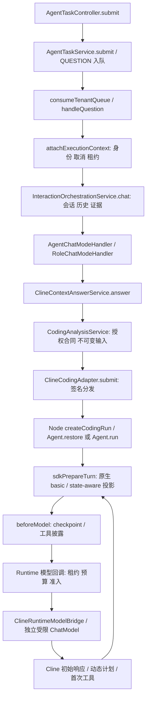

# Runtime OS / Cline 启动、上下文与进度审查

审查从 `feature/cline-context-performance-optimization` 的干净提交 `727da53612201f1d65fbba052dc814989abf33fb` 开始。SDK 为仓库锁定的 `@cline/{agents,core,sdk}@0.0.93`，依据本地实现及公开类型接口修改。本文是本轮增量审查，既有压缩、预算、执行核对设计见 [上下文审查](coding-context-performance-audit.md)、[完成预算](coding-completion-budget.md)。

**结论：本轮默认优化的真实输入 Token 降低，尚未通过整套性能验收。** 简单源码生成四个配对任务均完成，调用总数保持 11，输入从 39,753 降为 28,619（约 -28.0%）；整体完成耗时和首次工具耗时并未一致改善。按需工具 Schema 在这组小工具集上反而增加消耗，因此实现保留、默认关闭。没有发布本轮代码到生产，也没有重放原股票分析操作。

## 真实调用链及职责

| 源码位置 | 已确认行为 | 本轮观测或处理 |
|---|---|---|
| `chatchat-api/.../agent/task/AgentTaskController.java:86`；`chatchat-chat/.../task/core/AgentTaskService.java:145,1133,1170,1368` | 提交、队列消费、可信执行身份附加；不是一次模型调用 | 修正把整个交互耗时称为“model inference”的日志名称。旧 `WAIT_MODEL` 状态兼容保留，说明改为准备或执行任务。 |
| `chatchat-chat/.../interaction/service/InteractionOrchestrationService.java:78` | 会话、摘要、证据投影及 recent history 同步准备，再进入 handler | 增加 `CONVERSATION_INITIALIZATION`、`HISTORY_AND_EVIDENCE_PREPARATION`、`HANDLER_EXECUTION` 单调时钟日志，关联 taskId。没有在缺少授权历史读取替代能力时直接删除历史供给。 |
| `.../handler/RoleChatModeHandler.java:92` | 解析 Agent、有效授权、技能目录，构造补充角色材料，再交给 Coding | 增加 Agent 定义、授权、技能目录、参考材料阶段耗时。修正补充材料中禁止规划/选择工具的旧提示，明确由 Cline 自主执行。 |
| `chatchat-api/.../analysis/ClineContextAnswerService.java:77` | 普通资源/附件路径直达 Coding；原始用户材料及约束保存为授权输入 | 普通路径没有额外 Java 全局语义计划。显式 SQL 源码的意图判定及受治理依赖仍保留。 |
| `.../analysis/CodingAnalysisService.java`、`.../workspace/CodingWorkspaceService.java` | 冻结权限、数据引用、输出及预算 | 可配置地协商 `tool_describe` 元数据能力；没有新增数据读写或代码执行权限。 |
| `.../cline/ClineCodingAdapter.java` | worker 能力协商、签名请求、原任务恢复 | 新能力必须由 worker 明确宣告，旧合同不会被隐式扩大；保留原 taskId、fence、operationId。 |
| `coding-agent-node/src/runner.js:77`、`sdk-adapter.js:96` | 同一个原生 Cline Agent、prepareTurn、模型及工具循环 | 增加构造、restore、context preparation 计时，分离预取与 Cline 工具来源；未引入第二套规划循环。 |
| `.../cline/ClineRuntimeModelBridge.java`、`RuntimeStreamingChatModel.java` | Java 模型边界、物理调用、实际 usage、可选供应商流 | 分离首 Token 与总请求截止；按类型记录限流、网络、请求过大、首 Token 超时等可观察事实。 |

`InteractionExecution` 还记录每阶段 startedAt、finishedAt、durationMs、state；异常同样留日志。新增方法级时长需要部署后采集，不能倒填为旧生产请求的逐方法实测值。

## 只读生产样本

现有合成 CSV 任务 `1f10b257-5573-3312-881f-6a2c709e772f` 的 137 条持久事件见 [脱敏时间线](coding-startup-parent-baseline-20261105.json)。没有为了诊断重新执行它。

| 相对 QUESTION | 事实 |
|---:|---|
| 114 ms | 第一条持久 STATUS；不等于浏览器收到反馈的时刻 |
| 1,839 ms | RUNTIME_STARTED |
| 1,942 ms | FILE_REFERENCES_PREPARING |
| 2,134 ms | CODING_REQUEST_VALIDATED |
| 2,353 → 3,446 ms | CODING_INPUT_PREPARING → CODING_INPUT_READY，区间 1,093 ms |
| 4,327 ms | Node CONTEXT_READY |
| 4,883 ms | 第一轮 MODEL_STARTED |

六轮 Java 模型记录耗时分别为 **9,421 / 16,331 / 3,598 / 71,907 / 34,524 / 4,742 ms**。这些记录支持“存在长模型请求”，不能证明供应商内部排队、慢推理或网络分别用了多久。没有证据支持把这条样本描述为“两分钟 Agent 初始化”。

| 轮次 | 回执实际输入 Token | 实际输出 Token | Java 模型耗时 |
|---:|---:|---:|---:|
| 1 | 11,245 | 460 | 9,421 ms |
| 2 | 11,708 | 958 | 16,331 ms |
| 3 | 15,891 | 147 | 3,598 ms |
| 4 | 16,725 | 4,398 | 71,907 ms |
| 5 | 21,229 | 2,053 | 34,524 ms |
| 6 | 14,179 | 216 | 4,742 ms |

以上来自既有授权 Runtime 模型回执。公开事件中的计数被通用脱敏器误遮蔽为 `***`，不代表底层回执丢失。本轮仅放行明确数值型/未知 null 的公开计量字段，访问令牌、密码和伪装成计量的字符串仍遮蔽，并有专项测试。

原失败任务 `analysis-coding-767792a242a56a9d574d92b827287042fd56e2a825b9fada6aa3781557deecb0` 的既有诊断及核对限制继续有效：原期限已过，第六轮缺少历史真实终止证明；不创建替代任务、不扩展预算、不重放 Python，也不把本轮独立合成源码任务冒充其恢复成功。

## 已实施的优化

### 最小目录及懒加载

- 启动仅构建全部 15 个基础技能的目录；无资源授权的技能仍可发现，方法发现不授予数据工具权限。正文、引用资料在 `skill_read` 时读取、解析和校验。
- 首轮技能卡仅含 ID、名称、**完整原说明**；版本、来源、哈希、冲突等仍保存在真实目录及按需披露/审计中。没有按业务关键词筛选技能。
- 包内容缓存以路径、大小、mtime、ctime、预期哈希失效；仍校验路径边界、禁止符号链接、校验原生技能完整性。解析结果随同一已验证 Buffer 复用。
- 新工具目录与完整 Schema 分离。`tool_describe` 可一次披露多个授权工具；详细 Schema 进入下一轮原生工具定义，不再同时复制到工具结果历史中。披露集合按实际元数据 fingerprint 恢复；元数据变化或权限缩小时旧集合失效。
- `chatchat.coding.cline.deferred-tools-enabled=false` 为默认值。开启时 Runtime 合同必须同时包含对应 profile 与元数据工具授权，worker 必须完成协议协商。未披露工具不能直接产生执行副作用。

本地 10 次独立 Node 进程、OS 热缓存测试：启动发现从读取 **15 份正文 + 33 份引用、419,307 字节**变为 **0 / 0 / 0**。import P50 从 687.98 到 688.89 ms，P95 从 712.35 到 717.31 ms，**没有证明进程导入变快**；SDK 依赖导入仍占主要时间。见 [before](coding-startup-local-before-20261105.json)、[after](coding-startup-local-after-20261105.json)。另一次与 Maven 并行的 832 ms 样本受本机负载影响，不作配对结论。

### 模型预算、超时与执行安全

- 部署配置可按模型实例提供 `contextWindowTokens`、`firstTokenTimeoutSeconds`；发布实例继承相同实例的传输元数据。窗口未知保持 `NOT_CONFIGURED`，不能把 128k 软压缩回退值称为供应商物理窗口。
- 已声明窗口的输入额度为窗口减输出预留及 10% 安全余量，并与任务剩余预算、完成预留、冗余及保护材料共同决定原生压缩额度。工具披露后的真实 Schema 集合参与估算。保留用户目标、权限、最新完整工具反馈、代码绑定、执行记忆和完整待复核报告。
- `request-context.js` 单独归因系统、工具 Schema、工具索引、任务、技能、代码、报告、历史、封装字节。UTF8/4 是估算，**不是分类真实 Token**；实际总输入/输出采用供应商回执，二者不混用。
- 首 Token 截止在流式边界生效；文本、思考或工具参数/名称均计真实模型活动。首事件后仍服从原请求总截止，不重新开始计时；取消会关闭订阅，晚到响应不能转为成功。
- 限流/网络/413/首 Token 超时按异常类型及状态码记录；没有结构化证据时不猜测“上下文过大”或“模型慢推理”。非流式回调 TTFT 保持 null。
- 保留独立 Coding 物理请求零自动重试。未知结果不能盲目退避重放；局部终止证明不等于供应商用量已知。没有新增可无条件重试 429 的策略，也未解除核对、租约或幂等限制。
- 移除“最后固定三轮禁止探索”的限制；Runtime 准入与权威剩余预算决定边界，完成预留提示 Cline 自主选择交付或必要修复。

### 初始计划与用户进度

同一轮请求允许 Cline 输出简短 `<initial_plan>` 后调用工具，不额外发起 Java 规划。只有实际返回该内容才记录 `PLAN_READY`，不把普通响应冒充计划。最终四个样本中 **2 个**有独立计划回执，另外两个直接调用工具；这两项指标保持缺失，不能记为零毫秒计划。

默认进度为需求理解、计划生成、数据探索、编码分析、结果交付，按最新真实动作可回退。显示阶段实际耗时、当前动作、验证操作数量；不再用已完成阶段分数暗示固定流水线。一个操作的开始/完成在同一行更新，保留两个原始回执；连续等价业务记录聚合并显示次数。错误、权限拒绝和确认独立显著显示。英文技术异常在默认业务区显示中文解释，原文留在可展开诊断；完整原始日志按需分页展示。所有处理只改变投影，不删持久审计和恢复记录。

## 实测结果与不通过项

四个相同 workload hash、相同 `qwen3.8-omni-flash`、同一隔离 Java/Node/H2/解析器环境，分别为 MySQL/Python 源码候选的完整读取与已授权预取模式。每任务预算 8 次模型、262,144 Token、300 秒；输出上限、工具权限及数据相同。生成代码只作静态解析，未执行；业务验证状态仍为 INCONCLUSIVE。

| 指标 | 对照 | 最终默认候选 |
|---|---:|---:|
| Runtime COMPLETED / 样本数 | 4 / 4 | 4 / 4 |
| 实际模型调用总数 | 11 | 11 |
| 实际输入 Token | 39,753 | 28,619 |
| 实际输出 Token | 5,283 | 4,499 |
| 完成耗时 P50 | 18,089 ms | 19,912 ms |
| 完成耗时 P95 / P99 | 50,804 / 50,804 ms | 43,430 / 43,430 ms |
| 首次 Cline 有效工具完成 P50 | 5,136 ms | 6,377 ms |
| 首次 Cline 有效工具完成 P95 / P99 | 18,023 / 18,023 ms | 19,798 / 19,798 ms |
| 供应商首 Token 延迟样本 | 0 | 0 |

P50/P95/P99 采用 nearest-rank，四个异构短任务只是描述值，P95/P99 等于最大样本；**不能据此宣称生产尾延迟提升**。授权数据预取与 Cline 发起的首次工具单独区分，不能用模型调用之前的几十毫秒预取时间冒充首次自主执行时间。

按需 Schema 两版均 4/4 完成，但输入分别 55,399、55,633；小工具集新增披露轮次的成本高于节省，因此不全量启用。中间仅精简目录的输入为 27,792；最终增加计划观测后为 28,619。保留所有中间版本，详见 [逐任务用量、分类、时长及缺失项](coding-startup-benchmark-20261105.json)。

调试阶段另有一条**失败观测接入样本**：SESSION_TIMING 未加入 Java 白名单，Worker 在模型前停止，任务 302,166 ms 后 BUDGET_EXCEEDED，实际模型/Token 为 0；另一条测试由诊断主动中断。它们不是有效性能基线，不删除、不伪装为成功。已补协议白名单和可选计时发送失败隔离，并通过真实 Java/Node 回归；中断样本不纳入完整用量结论。上述 4/4 仅指明确列出的最终版本配对队列，不能代表所有调试尝试的总成功率。

## 回归、复现及剩余验收

- Node 全量 210 项通过，包括原生 Cline 动态工具披露、恢复状态失效、预算、压缩后完整报告/最新回执、禁止盲重试、取消及未知执行身份保护。
- 相关 Java 145 项通过，包括 5 个真实签名 Java/Node/H2/解析器用例；覆盖窗口配置、发布元数据、独立流式截止、同步晚到响应拒绝、异常分类及数字计量脱敏。
- 前端全量 758 项通过，包括开始/完成合并相关回归；前端生产构建通过。本地 Node 25 测试使用 `NODE_OPTIONS=--no-webstorage`，避免 Node 内置 storage 与 jsdom 冲突；生产 Node 版本没有因此变更。
- 启动本地微基准：`cd coding-agent-node` 后运行 `node scripts/benchmark-startup.mjs ../target/startup.json 10`。
- 真实模型基准：`scripts/benchmark-coding-startup.py` 要求显式传入隔离模型配置、模型名、解析器 Python、输出目录；`scripts/summarize-coding-startup.py` 校验配对 workload/model，真实缺失用量保留 null。私有配置与原始材料不进入报告。

| 要求的场景 | 当前证据 | 验收状态 |
|---|---|---|
| 简单 Python 代码生成 | 四组对照中的两种模式；真实模型、静态解析、候选存档 | 短样本通过，缺规模化样本 |
| SQL / ETL 脚本生成 | MySQL 两种模式真实模型；Oracle→Hive 元数据探索有确定性集成回归 | ETL 真实配对仍待补齐 |
| 授权数据 Coding 分析 | 旧生产合成 CSV 的只读基线及既有 r3 验证 | 缺本轮候选配对；不能拿旧 r3 当新代码结果 |
| 多数据集图文报告 | 现有单元/集成回归、完整报告保护 | 缺本轮真实模型配对 |
| 联网及知识检索 | 权限隔离、按需技能、真实 Cline SDK 工具循环回归 | 缺本轮真实模型配对 |
| 长任务压缩及恢复 | SDK prefix-hash 恢复、保护目标/回执/报告、失效测试 | 缺代表性长任务配对与分位数 |
| 超时/限流/工具失败/取消 | 真实本地 SSE 首 Token/总截止取消、类型分类、未知操作回归 | 不能替代供应商真实限流与完整恢复验收 |

本机 Docker daemon 不可用，因此未把跳过的 Docker Python 执行称为通过，也未启用宿主机执行来绕过原工具授权。完整七场景配对、生产逐方法计时、代表性 P95/P99、首计划覆盖率和有停止/用量证明的安全重试仍为 **PENDING**；这些证据补齐前，不将本次源码改造标记为完整性能验收通过。
