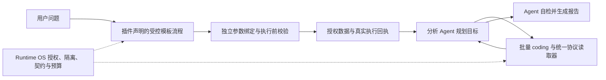

# 受控模板、Runtime OS 边界与批量分析修复

## 职责边界

Runtime OS 管理授权、受控模板拓扑、参数契约、不可变输入、执行隔离、资源预算、真实执行回执和结果结构。分析 Agent 负责业务解释、计算方法、结论、自检及报告。执行成功不等于业务正确，结果继续标注 `businessValidation=NOT_EVALUATED`。

本次报告被退回的直接调用方是 `ModelNativeAnalysisHarness` 中的 `ComputedReportAdmission`。该组件额外调用模型，随后由 Runtime 根据 `SUPPORTED` 决定是否允许结束。另一处 `CodingAnalysisService` 中的 `CodingSemanticAdmission` 根据模型意见决定是否交付编码结果。两者均将业务语义裁决变成 OS 强制准入，属于职责越界。已经删除两个组件及生产调用链；测试明确要求没有额外业务审查模型调用。此前以加强此类审查为方向的诊断，不再作为最终设计。

保留的检查针对权限、参数 schema、来源身份/哈希、文件与输出结构、原始数据访问边界、停止状态和预算，不判断容器状态、客户交易偏好、盈亏公式或业务勾稽结论。

## 故障与性能依据

原始任务 `af2af3c9-0139-416c-a857-abac8f386fcb` 在资产发现后仍将模型生成的旧 `target` 传给模板发现。名称与登记名称的空格不同，被解释为额外资产条件，导致 `NO_MATCHING_TEMPLATE`。正式鉴权只读探针证明，原条件返回 0，使用已确认资产范围返回 20 个授权候选。

第七轮任务 `a45c5780-9995-3178-9d98-a21d5443e944`，运行 `att-1-13fa241d-8951-4cf9-979c-aace60ec02cf`，最终 `SUCCEEDED`，观察耗时 **1721.9 秒（28 分 41.9 秒）**。受控模板执行成功 4 项，缺少必填容器参数的 3 项被阻断。没有通过临时命令绕开模板。

该轮建立 6 个 coding 子任务，累计 21 次 coding 模型调用（按持久化回执复核；此前口头合计 23 次有误）。一项聚合程序将 Parquet 存储列当作逻辑列读取，触发 `KeyError`，之后又创建任务修正。最终报告还经历 Runtime 强制语义退回。这证明流程可以结束，但效率不合格，不能作为性能验收通过。

另一个协议缺陷是 MCP 返回的 `ssh_steps.v1` 已声明命令流，但外层 `resultKind=UNDECLARED`，导致整个执行图被当作数据集。修复按已有协议 schema 分派到命令流适配器，仅将 stdout/stderr 交付分析，执行图留在审计中。没有根据 Docker 命令或业务字段猜测类型。

## 通用修复

- 六类插件 API、SQL、Python、SSH、HTTP、LegacyRoleOnly 共享 `TemplateAssetScope`。模板发现使用同一工作流已经提交的资产 ID、名称及环境，清除冲突的模型范围别名。API 提供方同步支持严格 `assetIds`；未知 ID 不扩大查询。
- 参数统一经 `SchemaDrivenTemplateParameterBinder`，不再复用候选 reviewer 生成的执行参数，也不在原生绑定不可用时绕过。空对象 schema 直接绑定 `{}`；非空绑定缺失在执行前阻断，不编造业务参数。
- 完整候选身份目录独立于可截断说明，避免目录缺页导致反复搜索。类型化 MCP 返回先解包，再读取候选与分页。
- `CodingRequestBatch` 将同轮 2–4 个独立、输入已交付的 RUN_CODING 请求组合为一次执行。输入并集最多 8 份，各目标保留来源范围、instruction 和 outputSchema，输出分别放入 `result_N` 数组。稳定摘要决定批次身份。混合操作、未知输入、重复请求 ID、超出并集或指令大小上限时不组合。不推断业务依赖或公式。
- Agent 优先直接用一项 RUN_CODING 和 `datasetReferences` 覆盖相关的解析、指标及跨源分析，避免先逐份解析再单独聚合。批量输入逐行保留 `{datasetReference,record}`，各源表示声明独立传递。
- 沙箱只读安装 `runtime_input.py`。`load_rows(manifestPath, expectedManifestSha256)` 验证 manifest/part 哈希、大小和行数，映射存储列到逻辑列，解码 JSON 单元格，保留整数/Decimal 及缺失与 null。SDK 只处理传输协议，不解析业务文本、不补业务默认值、不认证结论。
- coding 子任务可在契约中显式声明 `runtime-coding:bounded-input-observation:v1`，由当前租约 worker 获得所选不可变输入的有界格式预览：最多 8 个来源、各 1 条记录的 1024 个 Unicode 码点前缀，样本 JSON 总计不超过 16 KiB。输入文件逐一校验哈希、schema 与行数；不是任意 stdout 转发，也不取得新数据权限。预览标记 `complete=false`，只用于识别格式，统计仍读取完整文件。主 Agent 的目录与报告接口不获得原文预览，旧任务不带声明时不提供此能力。
- SDK 会话结束后，仅打印而未生成结果文件的执行不能被恢复成已完成分析。恢复路径捕获“缺少结果文件/结构不符”，通过真实停止证据生成失败回执，由 Agent 决定后续处理；不再将此类异常直接抛给父任务。

生产代码未加入客户号、服务器资产名、模板 ID、容器名或业务公式分支。部署地址及业务问题仅用于验证。

## 验证与部署

本轮 Java 构建与最后回归均为 `BUILD SUCCESS`。最后回归 247 项通过；连同前一构建中未重复的测试，本轮共 275 项通过，2 项按平台条件跳过。服务器现有 Python 镜像内执行 SDK 测试 3 项通过，覆盖 CSV/Parquet、精度、缺失/null、JSON、篡改、行数不符和路径越界。记录：`target/template-controlled-20261020/os-boundary-batch-tests-r2.log`、`os-boundary-final-regression.log`、服务器 `runtime-input-sdk-tests.log`。

部署前要求活动父任务为零。第七轮全部 coding 子任务已确认停止且无需对账。保留回滚配置，检查页面字节不变、无关容器不变、网关路由及 coding-agent 品牌。

本轮包 SHA-256：

- API：`b1d90944d5855bc67b708c0c4f76cc987c5a24bd819012e5b09c3bb3342a87ec`
- MCP：`efe1dcbfb54f68864f88e44302dd44e483dacb06ad3116790a81657953c53719`

部署回执、原始请求及每轮证据保存在服务器 `/opt/runtime-os-docker-stage/evidence/template-controlled-20261020/`。

第八轮 `20c01c6a-74ec-35e4-acc5-6a433591de18` 已验证 4 份来源交付同一 coding 任务、SDK 成功读取。该轮最终 `FAILED`，679.6 秒，不能作为验收通过。模型连续 3 次只打印而未生成结果文件；第 4 次模型回执返回非法工具参数，输出 token 为 16384，达到响应上限。恢复代码又将缺少结果文件异常抛出，导致父任务失败。此轮促成上面的显式有界观察及恢复修复。已通过正式停止/对账路径确认全部子执行停止。

最终完整验证以修复后的新轮次真实终态及回执为准，不能用单测或代码归档状态代替。
