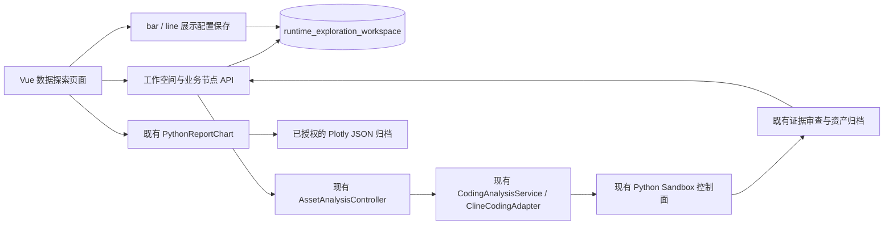

# 最小架构与具体修改文件

## 接口

均以 `/api/v1/data-science/explorations` 为前缀，owner 从当前认证读取，继承既有 `/data-science/**` API 权限策略。

| 方法 | 路径 | 作用 |
|---|---|---|
| GET / POST | `/` | 当前 owner 工作空间列表 / 创建 |
| GET | `/{id}` | 恢复全部业务节点和图表配置 |
| POST | `/{id}/nodes` | 带 version、parentId、fileIds、question 准备节点；先持久化，尚不执行 AI |
| POST | `/{id}/nodes/{nodeId}/execute` | 复用原文件分析链路；相同 nodeId/requestId 可恢复；已取得结果时直接返回 |
| PUT | `/{id}/nodes/{nodeId}` | version 乐观锁更新 saved、chartTypes；不调用模型或执行 Python |

服务端记录每个节点的问题、父节点、数据文件、历史上下文、模型偏好、执行状态、可信 receipt、保存状态、chartTypes。客户端不能写 receipt，也不能改写已冻结节点的输入。跨 owner 资源返回404；CAS 冲突返回409。单空间最多100节点、状态最多400万字符；最近四份历史上下文继承，原数据文件继续完整送入。

图表和结果数据继续由既有资产系统永久归档，工作空间保存不可变引用和服务端回执。当前空间/节点通过 URL 的 exploration/node 参数恢复，数据和配置不依赖浏览器 localStorage。柱状/折线转换保留同一实际数列，不改变源产物、单位、顺序和计算结果。仅支持可转换的纵向 X/Y 图，PNG/SVG 和其他图形保留原图。

## 文件变更

| 文件（相对仓库根目录） | 变更 |
|---|---|
| `chatchat-api/src/main/java/com/chatchat/api/exploration/ExplorationWorkspaceStore.java` | 新增 owner 隔离与 CAS 的 JDBC 存储 |
| `chatchat-api/src/main/java/com/chatchat/api/exploration/ExplorationWorkspaceController.java` | 新增业务节点与展示配置 API，显式声明 PathVariable 名称 |
| `chatchat-api/src/main/java/com/chatchat/api/exploration/ExplorationWorkspaceMigration.java` | 增量表、导航与等价菜单权限迁移，保留自定义 manifest |
| `chatchat-api/src/main/java/com/chatchat/api/assets/AssetAnalysisController.java` | 新增 visual 调用方法，保留原 POST 协议 |
| `chatchat-api/src/main/resources/workspace/data-science.json` | 注册页面声明 |
| `chatchat-api/web-app/src/js/App.js`、`src/js/utils/workspaceContext.js` | 注册动态页面和数据车间路由归属 |
| `chatchat-api/web-app/src/views/DataExplorationView.vue` | 三栏模板 |
| `chatchat-api/web-app/src/js/views/DataExplorationView.js` | 创建、选择、执行、恢复、继承与展示交互 |
| `chatchat-api/web-app/src/styles/pages/data-exploration.css` | 独立响应式样式 |
| `chatchat-api/web-app/src/services/explorationApi.js` | 既有鉴权 apiRequest 的业务适配 |
| `chatchat-api/web-app/src/js/utils/explorationPresentation.js` | 受限展示转换 |
| `chatchat-api/web-app/src/js/components/PythonReportChart.js` | presentation 属性及变化监听，仍走原产物读取与隔离渲染 |
| `chatchat-api/src/test/java/com/chatchat/api/exploration/` | H2 存储、迁移、隔离、继承、HTTP 路由测试 |
| `chatchat-api/src/test/java/com/chatchat/api/assets/AssetAnalysisControllerTest.java` | 复用链路及请求级视觉契约回归 |
| `chatchat-api/web-app/src/js/views/DataExplorationView.test.js`、`src/js/utils/explorationPresentation.test.js` | 页面编排与数列保持测试 |
| `chatchat-api/web-app/scripts/test-data-exploration-live.mjs` | 无 mock 的实际部署浏览器验收；凭据/明细/截图保存在 target |

## 运行与部署

入口：`/index.html#/w/data-science/dataExploration`。需要已有 assets、coding、coding.analysis 功能配置和可用的原 Coding/Python 服务。`npm run test:exploration` 运行前端定向回归；真实验收用 `npm run test:exploration:live`，环境变量约定见脚本头部。

部署使用仓库既有 `scripts/deploy-studio-remediation.py`：先核对基线 JAR、活动任务、Coding 会话、Sandbox，保存数据库与容器/配置回滚，再仅更新 API/前端；不重建现有 Coding Agent、MCP 或 Python 服务。最终部署哈希、回滚位置和真实验收结果见测试报告。
