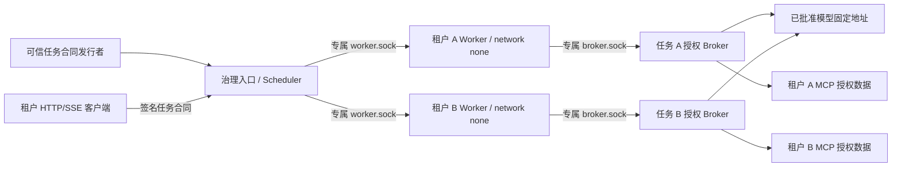

# P3 第一阶段：任务身份与容器隔离设计

基线 `62ce5d9e5`。本设计落地单机基础调度及双租户隔离，保留官方 Cline v4.1.26 原生执行链。不是完整企业级服务、恢复协议或模型预算方案。测试与停点见 [本轮报告](../testing/cline-server-p3-stage1-20261108.md)。

## 边界



Worker 只有 loopback。`isolated-worker.mjs` 将本地 HTTP 请求传输到自己挂载的 broker.sock；broker 在控制面，检查不可变任务合同，再转固定模型地址或 MCP。没有通用 CONNECT/任意 URL/宿主 Shell 代理。Worker 不挂 Docker socket、控制面签名密钥、真实 provider key、其他租户目录或共享 MCP token。原生 HostBridge/ProtoBus 继续在 Worker 自己的 loopback 工作。

模型转发是禁网隔离所需的最小传输设施；不选择模型回合、不排序工具、不编排 Skills、不实现 Agent loop。累计预算与正式 Runtime 模型网关接入明确延期。

## 身份和 API

入口 `Authorization: Bearer <base64url(JSON).HMAC-SHA256>`；发行密钥只在控制面和可信发行方。没有对外签名接口。示例合同（不含真实凭据）：

```json
{
  "version": 1,
  "tenantId": "tenant-a", "userId": "user-a", "taskId": "task-a",
  "sessionId": "session-a", "workspaceRef": "project", "modelProfile": "qwen",
  "budgetPolicy": {"status": "DEFERRED_STAGE_2_REVIEW"},
  "toolPermissions": ["read_files", "search_codebase", "editor", "apply_patch", "run_commands", "tenant_data__read_dataset"],
  "dataPermissions": ["dataset-a"], "networkPolicy": "broker-only",
  "expiresAt": 1794140000000
}
```

expiresAt 是 Unix 毫秒，必须未过期且不超过24小时。示例时间只说明格式，发行时必须计算实际期限。HMAC 校验后还要匹配服务端租户/user/ref/profile/tool/dataset 目录，不接受任意宿主路径。续签、JWKS、管理员角色及 Runtime 实际身份发行集成尚未实现。

| API | 行为 |
|---|---|
| POST /v1/sessions + Idempotency-Key，body仅editTool可选 | 合同决定公开 Session ID/ref/profile；同 key/合同/内容返回原记录，冲突409；容量不足429 |
| GET /v1/sessions/{id}、/status | 先核对 tenant/user/task/session，再查询。含 workerState/taskState/native；启动中 native=null；其他租户404 |
| POST /messages | 转官方 TaskService；回执中的 taskId 是原生回合 ID，合同 taskId 为 Runtime 身份，两者不混用 |
| GET /events、/messages、/diff、/artifacts | 仅所属合同可访问；SSE 原样转发，Last-Event-ID 原样提交，不改写原生工具回执 |
| POST /v1/permissions/{id}/respond | 只发到本合同 Worker；外国 resolver ID 不会路由到另一 Worker |
| POST /cancel、/revoke | 先失效授权/在途请求，再本地 native cancel、Docker stop/inspect；remoteStopConfirmed=false |

撤权后仍允许有效所属合同读取该 Session 的状态/停止证明，其他消息、事件和审批被拒绝。过期 token 不能访问历史状态。SSE 到期限关闭；断线不会取消原生任务。工具上限在 native.permission 边界执行，客户端批准不能覆盖合同 deny。

异步读取正文后、真正向 Worker 转发前再次校验任务 live lease；create 读完正文后复查期限。已撤权任务不接受晚到的 native status 覆盖停止状态。该保护只覆盖本地控制请求，并不提供外部副作用 fencing。

## Worker 生命周期和持久状态

每任务独立容器：UID1000、network=none、只读 rootfs、cap-drop ALL、no-new-privileges、3GiB、2CPU、独立 cpuset、PID256。四个挂载仅是自己的 workspace、state、bridge、只读 config。模板由服务端目录选择，复制前拒绝 symlink，复制后将任务副本交给 UID1000；不共享可变 HOME/Session/MCP 配置。

CREATED/STARTING/READY/RUNNING/WAITING_APPROVAL/COMPLETED 与 STOPPING/STOPPED/START_FAILED/RECOVERABLE 分开记录。COMPLETED 表示原生回合结束，容器仍可继续本任务，仍占资源。taskState=AGENT_TURN_COMPLETED 不是业务交付成功；本地停止用 CANCELLED_LOCAL_ONLY。没有远端证明时不发布企业级 CANCELLED。

全局和租户配额在 await 之前预留；满额拒绝，不在本阶段增加持久队列。未知状态保留容量，直到获得 Docker 实际停止证明。control registry 保存合同、映射、分配状态和容器身份，原子文件替换；控制审计及原生事件各自 JSONL。registry 尚未构成 PostgreSQL 事务/外部 Operation Journal，也没有断电级全链事务保证。

启动遇到旧活动记录时只做 fail-closed：撤权、标 UNKNOWN、核对自己的 container label 并停止旧容器。没有自动续跑或副作用重放。这是安全停机底线，**不满足硬门槛2的操作完成判定**。

## MCP 范围及风险

server.mjs 写独立 `data/settings/cline_mcp_settings.json`，官方 SdkController/McpHub 负责加载、工具注册与自主调用。broker 只允许已授予的 MCP 方法/tool/dataset，使用控制面私有的上游 token；不把管理 token 给 Worker。

本轮安全 fixture 使用官方 MCP SDK 和真实独立租户文件，不是模拟 Agent 工具。它仅证明基础协议与授权边界，不代表已经接通生产 Runtime MCP 的全部用户、数据源或动态授权。Python Sandbox 未接。修改共享模型/MCP/Sandbox 配置需后续明确确认。

控制面持有 Docker socket，等同宿主高权限，必须作为可信管理面，只绑定宿主回环；严禁 Agent 或租户代码在此进程执行。尚缺正式 Runtime 身份发行、TLS/运营权限、磁盘配额、资源压力/内核攻击测试和完整审计防篡改。普通 UID1000 容器攻击与 API 越权是本轮威胁模型，宿主 root/内核漏洞不在证明范围。
