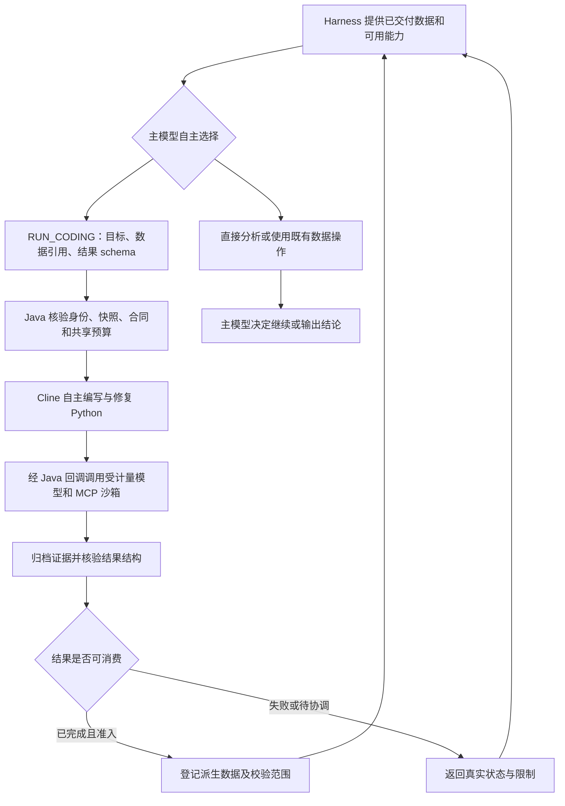

# 本地 Harness / Cline 数据分析优化计划

## 源码分析

当前 `AnalysisCoverageCoordinator` 已将可选 `AnalysisCodingPort` 注入 `ModelNativeAnalysisHarness`，后者在 L2 暴露 `RUN_CODING`。模型自行决定请求、计算目标及结果 schema；Java `CodingAnalysisService` 负责授权输入快照、版本化合同、同一父任务预算、父模型计量绑定、Node Cline 分发及证据结果准入。因此本次沿现有通路优化，不另建编程代理或业务分析分支。

当前发现的具体缺口：

1. Harness 的执行身份、模型和 metadata 与 Coding context 没有一致性检查；直接调用本地 Harness 时可能误接另一任务的 context。
2. 模型写错 datasetReference 时，服务层以安全异常拒绝，但 Harness 会直接终止，模型无法根据“当前数据未交付”反馈纠正引用。
3. Coding 回执主要只包含状态与用量，缺少停止原因、执行摘要和限制；`COMPLETED` 与可消费结果的关系不够明确。
4. 后续轮次只保留最近一轮 L3 receipts；Coding 的结果描述未携带完整校验范围，模型可能在继续分析时丢失状态与业务校验限制。
5. 服务只调用 cancellationGuard，未独立检查 Request 的 cancellationCheck；等待过程中父截止时间变化也没有明确检查。异常路径还可能对已经完成的子任务发送取消。
6. 现有本地集成测试主要覆盖一次正常委托，缺少自主不调用、关闭能力、错误引用纠正、状态连续性、取消与失败不准入等分支。

## 实施顺序

1. **接线与模型自主性。** 在执行前校验受信 Coding context 与当前 Harness 的 scope/model/metadata 一致。模型仍自由选择已有数据运算、直接分析或 RUN_CODING。仅将未交付引用转为可纠正的请求拒绝；真实授权异常继续拒绝执行。
2. **回执与结果血缘。** 回传执行原因、摘要、限制与显式 resultAvailable。已注册的派生 Dataset 保留原句柄、输入血缘、校验状态和六项证据；未完成、待协调或校验失败不加入数据集合。
3. **轮次连续性与资源控制。** Harness 保存 Runtime 返回的 Coding 任务摘要，并向下一轮提供有界、精简的状态目录，避免依赖模型自行抄写任务身份。检查父取消与截止时间；结束后不对终态任务发取消。沿用现有有界等待，不宣称异步调度或活跃会话恢复已经实现。
4. **验证。** 用真实 ChatRequest 协议进行主循环测试，覆盖模型不调用、能力未开启、纠正引用、结果后续读取、失败/待协调不准入、上下文隔离、取消、截止时间与合同幂等。运行相关既有回归，记录实际结果。

## 验收边界

- 不在 Runtime OS 写入统计公式、金融口径、预期答案、业务关键词路由或强制 Coding 决策。
- 不开放 SQL 执行、新资产发现、任意网络或宿主路径。SQL Studio 不在本次实施范围。
- 沿用固定输入快照的 Coding v1；增量供给 v2、活跃 SDK 会话持久化和历史 provider 超时仍是独立待办。
- 结构校验与业务正确性分开记录；不将未知结果或 INCONCLUSIVE 解释成业务验证通过。
- 本轮以本地代码优化与测试为交付；任何新部署的验收结论须另有实际证据。

运行时通过现有 `chatchat.coding.enabled`、`chatchat.coding.cline.enabled` 和 `chatchat.coding.analysis.enabled` 组合启用；未注入 Coding port 时，Harness 的 L2 能力目录不提供 Coding。Python 环境必须由部署配置选择已发布、无网络的环境，详见[配置示例](../deploy/docker/coding-agent/runtime-coding.properties.example)。

## 实施与本地验收结果

上述四项优化已实施，未新增业务计算分支。主要变更位于：

- `ModelNativeAnalysisHarness`：执行身份与模型/状态绑定校验；未交付引用的可纠正拒绝；Runtime 任务摘要目录，提示中只保留最近 8 项，完整本轮目录保留在有界 Harness metadata 中。
- `ModelAnalysisPrompt`：明确 Coding 可选、使用可消费结果及保留校验限制，保留主模型的继续分析与最终输出决定权。
- `CodingAnalysisService`：取消与父截止时间检查覆盖输入准备前、分发前、等待中和结果准入前；截止时间先交 A2 核对，避免错误标为人工取消；终态读取失败不再触发取消。回执增加 resultAvailable、原因、停止原因、摘要和限制；派生 Dataset 保留原句柄、输入引用、校验范围和六项证据。

最终执行 `mvn -o -s target/coding-maven-settings.xml -pl chatchat-api -am package`，配合定向 test 参数与前端跳过参数，结果 **BUILD SUCCESS**。10 个相关测试类共 **78 项通过，失败、错误、跳过均为 0**：

| 测试范围 | 项数 |
| --- | --- |
| Harness 自主选择、计划先行、能力关闭、引用纠正、状态连续性、隔离和目录上限 | 10 |
| 既有数据工作区与规划提示回归 | 12 |
| Coding 服务幂等、预算、取消、截止时间、结果准入与异常清理 | 11 |
| 回调认证与父模型桥接 | 10 |
| 证据归集、输入快照和校验计划 | 6 |
| Coding 持久化、预算与恢复回归 | 29 |

日志：`target/harness-cline-analysis-final.log`。`git diff --check` 通过。本次验证使用本地测试模型与控制面替身，持久化测试包含其原有的数据库/恢复场景；没有将这些测试算作新的真实模型、Node、Docker 或生产端到端验收，也未宣称历史全量 Harness 测试已通过。

API 本地构件 `chatchat-api/target/chatchat-api-1.0.0-SNAPSHOT.jar` 的 SHA-256 为 `4456a99534f5f5d2d6347dddb9e384b4f30db20c6957c31c94555769efdfe39e`。已检查成品包含更新后的 Coding 服务与嵌套 agents JAR 中的 Harness，未打包测试专用业务校验器。构件记录保存于 `target/harness-cline-analysis-artifacts.json`。

本轮没有更新生产 JAR、Node 容器或 SQL Studio。当前交付为本地代码、优化计划、相关回归与可部署构件；生产仍使用先前独立验收的版本。
