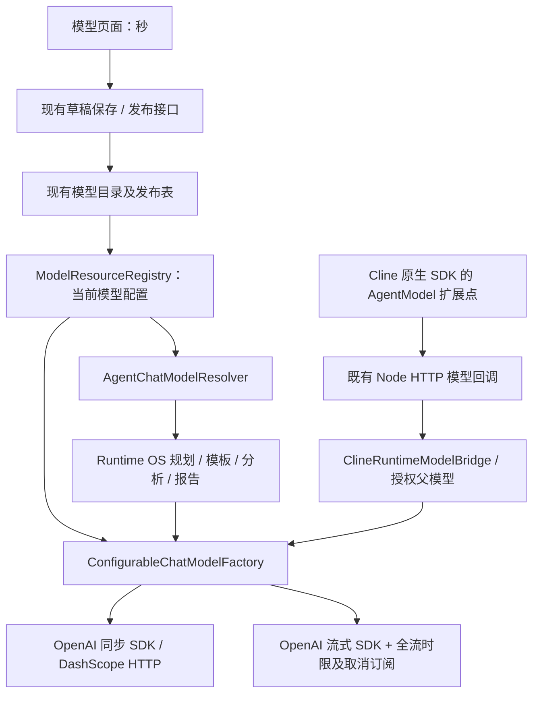

# 模型请求超时统一化交付

基线：`338f2f935`。实施前的调用链和覆盖清单见 [审查记录](model-request-timeout-audit-20261028.md)。本轮完成代码和本地验证，尚未向 192.168.195.221 发布此后端变更；该服务器仍运行此前的工作台页面版本。

## 配置和生效规则

每个模型配置实例增加 `requestTimeoutSeconds`，缺失/空值为 **300 秒**；允许 **1–1200 秒整数**。上限为 20 分钟，为当前 30 分钟的 HTTP/Servlet 通道留出余量，没有调整任何任务总时限。

沿用模型管理页面及 `/api/v1/platform/models`：保存草稿后点击发布生效。刷新页面会读回原值。草稿和发布表幂等增加 `request_timeout_seconds INTEGER DEFAULT 300`，存量空值回填 300，不猜测旧 `timeout` 的秒/毫秒单位。正整数在页面和后端同时校验，JSON 小数、字符串、零、负数及超上限值均拒绝。

发布后，新请求重新读取当前模型配置。默认 Chat 客户端签名包含新超时；Agent 发布模型缓存比较完整配置，已持有的 Agent 模型绑定也在下一次调用时刷新。Coding 构建物理请求客户端时重新读取原授权模型；超时不作为模型授权身份，也不复制到 Coding 配置快照作为另一配置源。已经发出的请求保留开始时的设置。

模型名称精确匹配优先于服务端模型 ID 别名；两个配置使用相同供应商和相同服务端模型 ID 时，不会因为发布先后而串用超时。没有改变默认模型、模型别名或供应商选择规则。

## 传递链路

Cline SDK 使用现有 `runtime-model.js`，供应商请求实际上在 Java 侧执行，因此 Node 不增加第二份超时配置。Java→Node 的 5 秒请求是异步任务提交/控制，不等待整轮生成；Node→Java 的模型回调使用任务剩余时间，普通回调的 90 秒上限不用于模型推理。

SDK `.timeout` 和 DashScope `HttpRequest.timeout` 接收统一值。流式调用同时对从开始到完整响应的整个流计时，超时/取消会取消订阅，持续有 token 也不能无限延长单次请求。

任务/工具的实际截止时间继续有效。Coding 的实际 SDK 时限取模型超时和剩余工具/父任务预算的较小值；Runtime 任务包装在父截止时间到达时中断同步请求或取消流。重试继续使用模型配置，Runtime 的已有单次物理尝试和计量机制不变。

## 清理和保留

| 项目 | 改造结果 |
| --- | --- |
| 旧模型 `timeout` | 兼容旧 API/YAML 的读取结构，退出模型请求超时解析；不再按 1000 分界猜测单位 |
| YAML 1800000/300000/300 及页面毫秒默认值 | 改为每实例 `request-timeout-seconds: 300` 和页面秒字段 |
| 工具结果审查 60 秒 | 删除独立模型阶段预算，QA 和 Coding 都使用已选模型及父任务预算 |
| 答案审查系统属性、启动默认模型超时快照 | 删除；不允许默认模型覆盖本次所选模型 |
| 答案 critic / 网页增强独立阶段上限 | 删除闲置配置及会截断模型调用的包装；网页工具仍有工具自身预算 |
| Coding analysis / Cline `max-model-call-millis` | 删除独立模型请求上限，保留完整 Coding 任务预算 |
| 查询关键词模型优化 3 秒 | 删除 `refinement-timeout-ms`；保留检索任务完整生命周期剩余预算 |
| 评估脚本固定 600000 毫秒 | 从已发布模型读取统一秒字段 |
| 向量模型 | 发布时将秒转换为已有 API/MCP embedding 请求协议需要的毫秒，无新增配置源 |
| 数据库、MCP/Python 执行、容量排队、连接、健康检查、租约/心跳、普通控制回调 | 保留 |

Cline 对模型请求超时返回明确原因并保留异常链。客户端超时不代表供应商已停止计算或 token 用量已知，因此继续保留已有耐久记录、预算预留及 reconciliation 机制，不伪造完成回执或清空日志/产物。

## 文件清单

完整清单见 [changed-files.json](model-request-timeout-20261028-evidence/changed-files.json)。主要文件：

- 配置和持久化：`ModelsConfig.java`、`PlatformModelCatalogService.java`。
- 实际 SDK/HTTP：`ConfigurableChatModelFactory.java`、`RuntimeStreamingChatModel.java`。
- 缓存与 Runtime：`LangChain4jConfig.java`、`AgentChatModelResolver.java`、`CapacityGovernedChatModel.java`、`AgentOrchestrationEngine.java`、答案审查相关类。
- Coding/Cline：`CodingAnalysisProperties.java`、`CodingAnalysisService.java`、`CodingConfigurationSnapshot.java`、`ClineRuntimeModelBridge.java`、`ClineModelCallbackController.java`。
- 页面：`ModelManagementView.js/.vue`。
- 重复预算清理：`QueryOptimizationBudget.java`、`SearchQueryOptimizer.java`、配置模板和评估脚本。
- 测试：`ModelRequestTimeoutTest.java`、模型目录及 Cline 测试、模型页面测试及原有审查测试的语义更新。

此前工作台的转圈/滚动页面修改独立保留，未计入本次超时文件清单。

## 验证证据

验证使用真实 LangChain4j 客户端、原生 Cline SDK 和本地 HTTP 供应商测试服务；没有调用商业供应商等待真实 120/600 秒，也没有把模拟供应商的结果宣称为生产验收。

| 场景 | 证据 |
| --- | --- |
| 新建/存量缺失字段 → 300 | H2 旧表初始化、迁移、JSON DTO 默认值和页面新增测试 |
| A=120，B=600，同供应商模型 ID | 反射读取实际 SDK HTTP 客户端 `readTimeout`，同时发出真实 HTTP 请求；目录精确匹配测试 |
| 发布更新 → 900 | 数据库草稿/发布、重开目录、已持有 Runtime 绑定刷新测试 |
| Cline B=600，多轮调用 | 原生 `@cline/agents` → `runtime-model.js` → `httpGateway` → Java bridge → 本地供应商；每轮实际 Java SDK 的 `readTimeout=600s` |
| 模型单次请求超时 | 配置 1 秒，供应商延迟响应，实际请求约 1 秒失败并保留 Timeout 异常链 |
| 持续流超时 | 测试服务不断发送 token，1 秒整体时限到达后失败，供应商连接关闭 |
| 取消与任务先到期 | 原有流订阅/Node AbortSignal 回归，以及真实请求的 250ms Runtime 父截止时间测试 |
| 页面保存、重新加载及移动布局 | 生产前端构建的 Chrome 验证；页面 API 为明确的浏览器夹具，实际数据库验证由 Java 测试完成 |

结果文件：[Java](model-request-timeout-20261028-evidence/java-results.json)、[页面](model-request-timeout-20261028-evidence/browser-verification.json)、[桌面截图](model-request-timeout-20261028-evidence/desktop.png)、[手机截图](model-request-timeout-20261028-evidence/mobile.png)。

- Java 定向集合：542 项，522 项通过，20 项按现有 Docker/外部环境 gate 跳过；0 失败、0 错误。
- Cline/Node 原有集合：102 项通过。
- 前端模型管理及聊天进度相关：89 项通过；生产构建通过。
- 扩大 Runtime 编排回归的两个类共 182 项，其中 82 项失败。在独立工作树的未修改基线 `338f2f935` 完整运行相同两类，失败测试集合完全相同，本次新增失败为 0。详见 [基线比较](model-request-timeout-20261028-evidence/baseline-comparison.json)。没有将该扩大集合标为全通过。

## 限制和发布事项

第三方 SDK 源码未修改；Cline 的公开模型扩展点足以接入，无需新编排组件。现有 Docker gate 跳过的测试和目标服务器上的发布/验收尚未执行，不能据本地通过推断为线上已生效。用户自建外部代理若短于模型超时，仍可能提前断开；现有内置 30 分钟通道与本次 20 分钟字段上限相容。

上线应先备份两张模型表，再发布包含配置类、common/agents/API 类及前端的完整一致版本。首次启动自动迁移并为存量模型采用 300 秒；要保留不同于默认值的业务需要，应在模型页面逐项设置并发布。任务总截止时间继续单独管理，不能为让模型等待更久而放大父任务预算。
