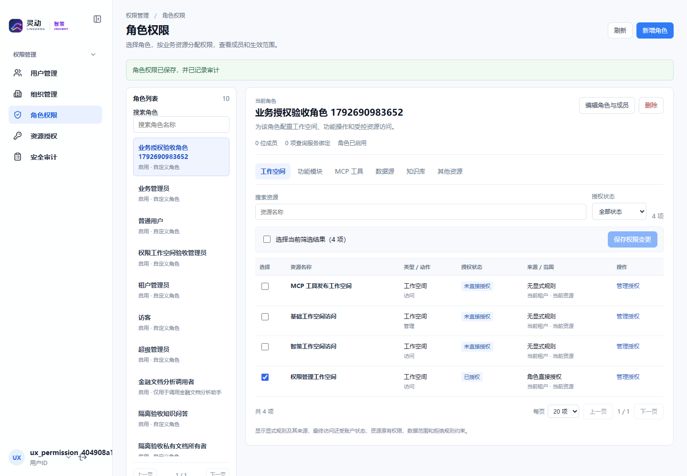
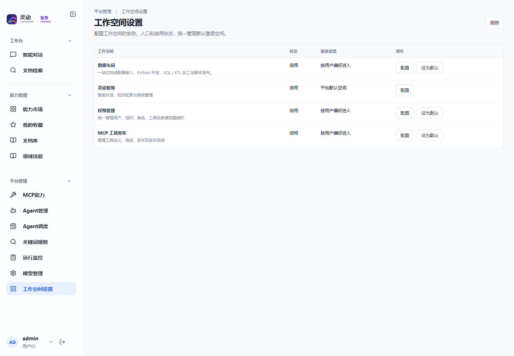

# 权限管理工作空间整改验收报告

2026-10-23，分支 `feature/unified-management-workspaces`。已部署 **2.2.0-rc2**，应用源码提交 `0df5151c8d27c024dc2a93833aa008c509ec3c83`。MCP 保持 **2.1.0-rc1**，运行包哈希未变化。

- [权限管理入口](http://192.168.195.221:18100/#/w/permissions/systemRoles)
- [平台管理 → 工作空间设置](http://192.168.195.221:18100/#/w/zhice/workspaces)
- [现状审查](review.md)、[新旧菜单对比、页面/删除/依赖/数据迁移及保留项说明](implementation.md)

## 验证结果

| 检查 | 结果 | 证据 |
| --- | --- | --- |
| 前端自动化 | 29 个测试文件，280 项通过 | [自动化报告](evidence/automated-tests.json) |
| Vue 结构与生产构建 | 62 个组件结构检查通过，Vite 构建成功 | 同上 |
| 后端编译与选定回归 | 14 个测试类，49 项通过，无失败、错误或跳过 | 同上 |
| PostgreSQL 迁移与回滚 | 独立测试库 13 项通过，未使用业务库数据 | [迁移报告](evidence/postgresql-validation.json) |
| 真实浏览器端到端 | Edge，16 项通过，无页面脚本错误 | [浏览器报告](evidence/browser-acceptance.json) |
| 控制面接口联调 | 28 项通过 | [接口报告](evidence/control-plane-acceptance.json) |
| 最终授权/身份/菜单/包核对 | 17 项通过 | [最终核对](evidence/reconciliation.json) |
| 测试数据清理 | 临时身份、组织及授权清理完成 | [浏览器清理](evidence/browser-cleanup.json)、最终核对 |
| 运行包与部署 | API 哈希一致，MCP 未替换，业务授权无变更 | [发布清单](evidence/release-manifest.json)、[部署记录](evidence/deployment.json) |

后端选定范围覆盖工作空间访问与配置、租户隔离、角色授权、任务调度到 MCP 的身份传递、资源授权、统一权限目录、API 策略及成功/失败审计、导航迁移和此前专业 Agent 退役迁移。报告列出实际执行的测试类，不计入其他日期残留的 Surefire 报告，也不宣称执行了仓库全量测试。

本轮验证实际调用了受控 MCP 固定模板：普通管理员在页面添加用户拒绝规则后，Runtime/MCP 调用立即失败；页面撤销后，同一登录会话立即恢复成功。没有用模拟返回替代工具调用。控制面回归另验证撤权无需重新登录、伪造租户被拒、跨租户测试被拒、发布/回滚/下线及数据库版本不可变约束。

本轮没有调用真实通用模型或重跑完整报告生成任务；相关 Runtime/Coding Agent/Python Sandbox 链路未改动，上一版本证据见[专业 Agent 退役验收](../retire-professional-agents/tests.md)。工作空间默认值与正式配置未在浏览器测试中修改：配置保存/并发冲突由前端测试及后端工作空间集成测试覆盖，浏览器验证真实设置入口、配置弹窗和取消操作。

## 浏览器操作与布局

使用不含 `system:api:all` 的合成普通管理员，完成以下操作：新增角色、保存工作空间权限、新增用户并分配角色、反查角色/用户继承关系、添加及撤销工具拒绝规则、查看登录审计与授权变更、新增及编辑组织。再使用现有平台管理员验证工作空间设置菜单及弹窗。

1366、1440、1920px 均无页面横向溢出，详情操作区宽度充足。角色/资源页保持各自选择状态。旧 `systemSkillRoles` 和 `permissionTools` 地址归一到唯一资源页；平台工作空间设置不出现聊天侧栏、历史记录或悬浮新建对话按钮。

其他截图：[1366px 角色页](screenshots/roles-1366.png)、[1440px](screenshots/roles-1440.png)、[1920px](screenshots/roles-1920.png)、[资源拒绝规则](screenshots/resource-denial.png)、[组织操作](screenshots/organizations.png)、[授权审计](screenshots/security-audit.png)、[工作空间设置](screenshots/workspace-settings.png)。截图中的验收角色、组织和用户均为合成数据，截图后已清理。

资源名称目录仍受既有业务接口权限约束；缺少目录读取权限时，页面明确列出不可读取的目录，保留现有规则并允许在技术详情核对标识。不会为了展示名称绕过业务访问授权。

## 数据与版本保护

最终临时用户、角色、租户、组织、旧菜单、重复权限/菜单代码计数均为 0。角色权限、用户角色关系、工具授权、资源授权的指纹与部署前一致。排除合成验收命名空间后，原 MCP 模板绑定指纹一致。3 条有真实角色绑定的查询服务限定授权全部保留。

合成工具已下线，发布版本作为审计历史保留，不再能通过旧工具标识执行。原专业 Agent 的受限归档继续保留；不恢复旧授权页面、注册接口或编排链路。原生查询服务及其绑定仍有业务调用，保留原因见交付说明。

保留原基线 `baseline/runtime-os-unified-management-20261022`（解引用提交 `5d5bc834fbe414755a99e38bcb03b6a69471c8a2`）以及既有发布 Tag，未覆盖。

## 回滚记录

- 首次整改前完整备份：服务器 `/opt/runtime-os-docker-stage/evidence/permission-workspace-2.2.0-rc1/backup-1792689658`，包含 API/MCP 数据库、原运行 JAR、compose 和环境配置。
- 修正版部署前备份：`/opt/runtime-os-docker-stage/evidence/permission-workspace-2.2.0-rc2/backup-1792690729`。
- 只回退修正版：恢复修正版部署前的 compose/环境配置并运行旧 API 镜像；保留已迁移导航。部署脚本已识别此情况，避免二次升级失败时撤销先前成功迁移。
- 完整回退整改：确认没有运行中分析任务，停止 API，执行 [R20261023_01](../../database/rollback/postgresql/R20261023_01__permission_workspace_ux.sql)，恢复首次整改前 compose/环境配置及原 API 镜像，启动并核验网关。若菜单或 manifest 后续发生修改，回滚脚本会停止，需先对比归档与当前配置，不能强制覆盖。
- 数据库完整备份用于灾难恢复；有后续业务写入时，不直接用旧备份覆盖业务库。本次没有执行业务库回滚，回滚行为已在独立 PostgreSQL 测试库验证。

原始会话和凭据仅保存在受限验收文件中，未纳入代码、截图或本报告。
