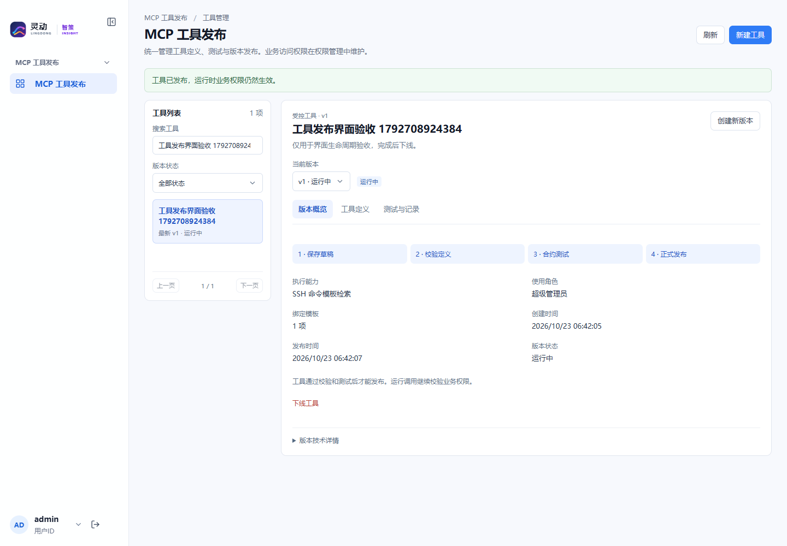
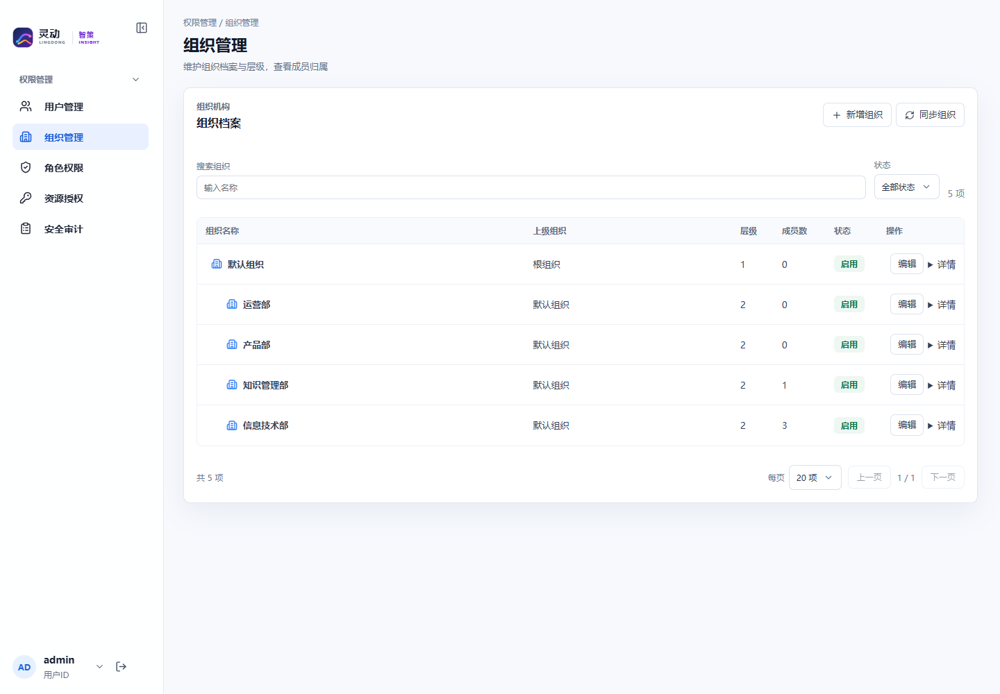

# MCP 工具发布与权限管理统一整改验收

2026-10-23，已部署 **2.2.1-rc1** 至验收环境。分支 `feature/unified-management-workspaces`，构建源码提交 `ce8ea1033c733113a639d4401a5cf7d566dfa65e`。MCP 保持 `2.1.0-rc1`，没有数据库迁移或业务授权变更。

- [MCP 工具发布](http://192.168.195.221:18100/#/w/mcp-publication/toolPublications)
- [权限管理](http://192.168.195.221:18100/#/w/permissions/systemRoles)
- [设计与实现清单](design.md)
- 发布 Tag：`release/runtime-os-publication-workspace-ux-2.2.1-rc1`。原基线与 `2.2.0-rc2` Tag 保留。

## 已完成

1. MCP 工具发布采用与权限管理一致的页面标题、面包屑、主从布局、搜索、筛选、分页、操作反馈及管理区域。按逻辑工具聚合历史版本，详情提供版本概览、工具定义、测试与记录，完整保留草稿、校验、测试、发布、下线及回滚。
2. 用户、组织、角色、资源和审计页面的按钮、输入框及下拉框复用统一 CSS。组织页不再出现原生细边输入框和未设置样式的编辑按钮；下拉框统一圆角、间距、箭头、焦点与禁用样式。
3. 登录审计移除管理区域中的固定最小宽度，工具栏可换行，终端等长字段省略并提供完整提示，避免右侧控件与表格截断。
4. “其他资源”统一改为“领域技能”，保留原有授权及查询服务范围。
5. ChatChat MCP Server 的内部基础能力从授权目录中隐藏，不再以重复服务名呈现可授权项。真实业务工具使用业务名称，继续受统一的工具、模板和数据范围授权约束。没有删除旧权限数据或增加运行时免校验通道。

## 验证结果

| 验证 | 结果 | 证据 |
| --- | --- | --- |
| 前端回归 | 30 个测试文件、286 项通过 | [自动化报告](evidence/automated-tests.json) |
| Vue 结构、Vite 构建、API 打包 | 62 个组件结构检查通过，构建成功 | 同上 |
| 后端专项 | 发布控制器、权限目录、API 策略共 11 项通过 | 同上 |
| 发布工作空间真实浏览器 | 15 项通过 | [发布页验收](evidence/publication-browser.json) |
| 普通管理员权限工作空间回归 | 16 项通过 | [权限页验收](evidence/permission-browser.json) |
| 控制面接口回归 | 28 项通过 | [接口报告](evidence/control-plane.json) |
| 授权、身份、菜单及运行包核对 | 17 项通过 | [最终核对](evidence/reconciliation.json) |
| 测试工具及身份清理 | 合成工具全部下线，临时身份与授权清理完成 | [发布清理](evidence/publication-cleanup.json)、[权限清理](evidence/permission-cleanup.json)及最终核对 |
| 部署 | 运行包 SHA256 一致，业务授权指纹保持不变 | [发布清单](evidence/release-manifest.json)、[部署记录](evidence/deployment.json) |

浏览器在真实验收地址验证新建草稿、非法 JSON 反馈、校验、实际合约测试、发布及 Runtime 调用；确认保存下一版本草稿不会影响运行版本，状态筛选能找到匹配版本，回滚恢复指定历史定义，下线后工具退出运行目录。

权限回归使用不含 `system:api:all` 的普通管理员账号完成角色授权、用户创建、组织新增编辑、角色/资源双向查询、登录及授权审计。页面添加业务工具拒绝规则后真实 MCP 调用立即失败，撤销后同一登录会话恢复成功。内部基础能力的隐藏没有改变业务授权的实际效果。

1366、1440、1920px 均通过布局检查，无文档横向溢出。控件检查直接读取浏览器计算样式，核验边框、圆角、自定义下拉箭头及 `appearance`；审计表右边界位于可用内容区域内。所有本轮浏览器页面脚本错误为 0。

本轮未运行全仓库全部测试，也未调用真实通用模型；合约测试和受控 MCP/Runtime 调用均真实执行。此前完整分析链路不在本次 UI 改动范围内。

## 页面截图

其他截图：[草稿编辑](screenshots/publication-editor.png)、[1366px](screenshots/publication-1366.png)、[1920px](screenshots/publication-1920.png)、[登录审计](screenshots/login-audit-layout.png)、[业务工具授权目录](screenshots/business-tool-permissions.png)。

截图中的合成用户和角色已清理，测试发布版本及登录/授权记录作为审计历史保留，不代表仍在使用的临时身份。

## 部署、数据及回滚

API 镜像 `runtime-os-api:2.2.1-rc1`；此前的 `runtime-os-api:2.2.0-rc2` 镜像、发布包和完整备份均保留。此次备份位于服务器 `/opt/runtime-os-docker-stage/evidence/publication-ui-2.2.1-rc1/backup-1792708721`，包含 API 数据库快照、原 compose/环境文件、旧不可变镜像 ID 及运行包哈希。

部署脚本支持自动恢复原 compose/环境与旧 API 镜像，并重新加载代理。手动回滚时先确认没有运行中任务，再按该备份恢复旧配置并重新创建 API/代理；本次无需执行数据库或导航回滚。未变更的 MCP 继续使用原镜像。

最终角色权限、用户角色关系、工具授权、资源授权指纹均恢复到部署前值，原 MCP 模板绑定保持不变。临时用户、角色、组织、租户、重复权限/菜单代码计数均为 0，原有 3 条有查询服务绑定的限定授权继续保留。

环境可用磁盘约 **1.6GB**，容量仍偏紧。本次已删除传输与镜像构建副本，并在核验 SHA256 一致后清理一个早期候选版本的冗余 JAR；对应备份与旧镜像仍保留，没有删除基线、已交付的 2.2.0-rc2 发布包或业务数据。

凭据及登录会话未纳入代码、截图和报告。
