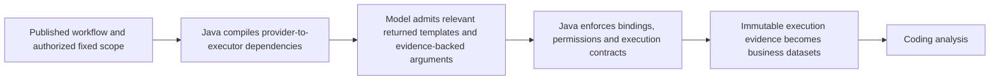

# Published data supply contract

## Observed failure

Task `451d8133-ea9d-4bb7-b388-da48678289d4` failed at 19:05:48 Asia/Shanghai.
Its published template query returned nine template descriptors, not database records.
The executor instead depended on a generic capability bridge whose response was
`asset_query_result.v1`, with zero returned assets. The edge required
`$.templates[0].templateId`, so execution stopped at `STEP_OUTPUT_CONTRACT_FAILED`.
There was no successful data execution and therefore no business dataset. Rejecting
analysis in that situation is correct; treating the template directory as data is not.

The invariant acquisition path existed but was restricted to exactly two visible tools.
The actual Agent has additional optional capabilities. A published fixed query declares
the generic authorized-template protocol and the canonical `sql_datasource` asset type;
the SQL plugin did not recognize that canonical asset type. SSH had the analogous
`ssh_host` mismatch. Scope resolution also read only the nested MCP metadata envelope,
although direct tool descriptors publish the same contract at the top level.

## Ownership and correction

- `TemplateWorkflowMetadata` supplies one view of the publisher contract for both
  descriptor envelopes. The workflow decision engine and optimizer use the same scope.
- Protocol plugins recognize the publisher's canonical SQL and SSH asset types.
  These are transport contract identifiers, not database names, template IDs, user IDs,
  business keywords, model names, or business-specific selection rules.
- `PublishedDataAcquisitionPlanner` compiles an unambiguous configured fixed provider
  and executor even when unrelated optional tools are available. It does not execute
  those optional tools, widen the publication scope, or select a template literal.
  Ambiguous providers, extra required operations, missing authorization and staged
  asset selection retain the existing governed planning path.
- Existing runtime admission, pagination, template parameter defaults, permissions,
  execution confirmation, checkpointing and dataset projection remain authoritative.
- Acquisition failures retain their failed steps and original cause. A transport success
  or a discovery result cannot satisfy the business-data prerequisite.

## Verification and rollout

The initial regression reproduced retention of the generic bridge. Tests exercise both
metadata envelopes, actual published protocol shapes, redirected bindings, configured
dependency edges, optional tools, missing tool authorization, cross-protocol rejection,
existing plan validation and failure provenance.

The release patches eight compiled classes onto the exact deployed API artifact.
`prepare-published-data-supply-release.mjs` records the source revision and baseline;
`patch-published-data-supply.py` verifies the baseline and byte equality of every
unrelated JAR entry. The existing API deployment helper backs up the database and
configuration, checks task idleness, preserves previous images, verifies permissions
and template bindings, and rolls back the API image on verification failure.
No Agent model binding, business workflow configuration, authorization data, MCP
publication, SQL template, or business identifier is changed by this release.
