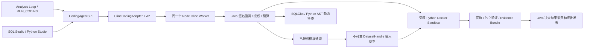

# Runtime OS AI Coding 数据分析升级实施报告

日期：2026-10-16。代码基线：`6c208aa7`。本报告取代前轮报告中“动态补数、SDK 活跃循环恢复、D3/G3 未实施”的现状描述；历史报告保留原验收日期及范围。

本轮已把动态补数、SDK 检查点恢复、多数据集分析、SQL 静态诊断、Python Studio Coding 入口接到同一个 `CodingAgentSPI → ClineCodingAdapter → Node Worker`。Java 继续控制授权、预算、执行、证据及结果消费。

后续针对“数据留在执行环境”的源码复查、摘要优先改动和分步容量计划，见 [`runtime-os-data-stays-in-execution-upgrade-plan-20261016.md`](runtime-os-data-stays-in-execution-upgrade-plan-20261016.md)。本报告的验收计数属于改动前的那次运行，不能替代后续回归。

附件中的“Docker 当前不可用”在复查时发生变化：本机 Docker Engine 29.6.2 已恢复。随后真实测试发现并修复 Windows 工作区 POSIX 所有权调用失败，并实际重跑 G1、G2、G3。最终结果见本文验收表及机器报告，不能从 A1 文档推导这些结果。

## 验收结果与范围

最终统一命令输出：`G1/G2/G3 PASSED`。

| 检查 | 最终结果 | 证据范围 |
| --- | --- | --- |
| Java 定向回归 | 315 项，失败/错误/跳过均为 0 | 公共契约、A2、Harness、授权、回执、动态补数、Studio、真实容器 |
| Node | 22 项通过 | 真实 `@cline/agents@0.0.93`，含异常退出后跨进程恢复 |
| 前端 | 71 项通过 | 既有 SQL Studio 61 项，以及 Python Coding / Workbench 10 项 |
| 前端构建 | 通过 | 独立输出目录；保留既有大 chunk 提示 |
| G1 | PASSED | 真实 Python Docker、JDBC、取消、fencing、子 JVM 崩溃恢复 |
| G2 | PASSED | 真实容器回执、归档、独立验证、六类证据、事务发布及恢复 |
| G3 本地确定性 PoC | PASSED | 真实 SDK 子进程、签名 HTTP、Java/A2、真实 Python 容器；模型和业务模板源为测试替身 |

最终机器报告：[`gates.json`](../target/coding-gates/20261016-122421/gates.json)。同目录保存 `java-gates.log`、`node.log`、前端测试日志、构建日志及构建产物。脚本只读取本次运行产生的 Surefire 报告，要求必要测试有实际执行且无跳过；G1/G2 未通过时不会把 G3 标为通过。

这里的 G3 是上述本地可复现范围。真实模型质量、真实业务数据库/MCP 模板源、生产 MySQL/PostgreSQL 以及生产 Node Docker 网络拓扑没有因此获得验收结论。Node 在跨进程测试中以独立进程运行，Python 执行边界使用真实 Docker；没有把 Node 子进程说成已经验证过生产容器网络隔离。

## 共享执行链路



没有第二套 Node Worker、MCP 执行器、数据权限系统或任务生命周期。扩展状态保存在原 A2 journal 的私有字段中，与租约、fencing、预算和停止请求使用同一事务边界。

冻结 v1 仍保持单输入 Python/JSONL 行为；原 v1 Schema 和跨语言契约哈希用例继续通过。v2 `WORKSPACE_FILES` 保留 SQL 入口，并增加独立 `python-studio.output.v1` 文件提案配置。新 v3 `runtime_os.coding.v3` 用于有受控补数或 SQL 诊断能力的分析任务；JSONL 结果及原终态枚举保持一致。

## 动态补数

调用链：SDK `data_request` → `/internal/coding/cline/data-request` → `CodingDataSupplyService` → 现有 `SkillExecutionScopePort` 和 `PreauthorizedStructuredDataOperator` → 现有 `RegisteredToolAnalysisOperator / Tool Runtime` → 输入快照 → A2 回执核对/预算结算 → 同一 SDK 循环继续。

Java 下发已授权模板 ID、显式参数取值集合及可请求字段。请求必须包含 `taskId`、`requestId`、`operationId`、`datasetRefs`、`authorizedTemplateId`、`parameterBindings`、`requiredFields`、`reason`、`expectedUsage`。Node 不能传 SQL、数据库地址、凭证、MCP 工具名或扩大权限。

每次请求及重复回执读取均重新解析当前 Skill 权限和部署授权。请求使用稳定的源调用 requestId，验证当前任务/租约/模板/参数/已交付数据引用，并在外部调用前落 A2 预算和 start intent。补数专用上下文把原 Tool Runtime 的自动重试次数设为 0，普通分析原策略保留。相同请求读取原回执；JSON 对象属性顺序不改变请求身份。相同 ID 改内容会冲突。未知外部结果不会重发查询。

成功补数形成新的不可变 `DatasetHandle` 和 MCP 输入文件。原始 `inputSnapshotRef` 与任务哈希不修改；A2 记录输入版本集合，每次 Python 操作绑定自己的输入版本，后续补数不能改变旧操作的输入。结果记录、Code/Result lineage 和 Bundle 包含所有使用过的输入快照及补数回执。

空数据返回 `EMPTY`；已知字段缺失/不完整结果形成可追溯失败回执且不引入输入版本；外部结果未知时保持待核对，阻止新模型及代码操作。补数轮数、工具调用及后续模型/执行继续扣同一个任务预算。内部等待没有新增公共终态。

目前参数策略为部署配置的字符串枚举，补数沿用已有模板通道每次最多 100 行的限制。没有开放任意日期范围、自由查询或模型生成的取数规则。外部调用已发生但没有任何可核对回执时，会保留未知状态；不保证通过重新查询自动恢复。

## SDK 恢复

核对实际 SDK 声明和实测：该版本有 `snapshot()`、`restore(messages)`、`continue()`，没有供本工程使用的跨进程 reconnect API。

Java 私有检查点绑定实际配置的 SDK agentId、任务哈希、输入、工作区、完整消息、模型 ordinal、事件 ordinal、最新可收集操作以及 A2 操作数。检查点只在整轮工具结果齐全、所有已有操作均有停止证明的边界提交；未配对的 tool-call/result、旧 fence、冲突 CAS 和取消状态会被拒绝。

恢复先查询原 Worker。仍活跃的原 SDK 实例继续使用；Worker 丢失时，只有与当前已结算操作集合一致的检查点才能创建新 SDK 并 `restore + continue`，返回 `CHECKPOINT_RESTORED_NEW_SDK`。没有把新实例恢复说成原实例重连。模型序号、事件序号、绝对 deadline 和预算都不重置。

真实 G3 测试在首轮工具回执落库后终止 Node，重建 Java 服务对象、读取相同 JDBC 数据、模拟租约到期并取得新 fence，再启动新的真实 Node/SDK。最终模型调用 4 次、代码执行 2 次，与未崩溃链路一致。A2 的并发测试另验证重复检查点、冲突、旧 fence、取消和未知操作不能回退重放。

## AI Coding 数据分析

保留普通 Analysis Loop，并通过原 `RUN_CODING` 能力选择 Coding 分析。支持单数据集或 `datasetReferences` 多数据集输入；多输入包装保留各自引用、内容哈希与行数，不能通过传入别的引用取得未交付数据。

循环可以规划和检查数据、生成完整 Python、读取真实归档 stdout/stderr、检查结构化结果、修复技术错误、请求已授权补数并继续执行。每次 Python 调用仍是新 Sandbox，旧变量或输出不能假装继续存在；代码版本和每次执行的回执保留在证据中。

SQL 分析增加 `sql_validate`：真实 SQLGlot 只返回静态诊断，计入相同工具预算。SQL 的实际数据处理通过 `python_execute` 在受控 Sandbox 中运行 SQLite，不能连接外部数据库。G3 新增实际 SQLGlot → Sandbox SQLite → 独立验证用例，检查返回的 `sandbox_sqlite_rows 3` stdout 和 3 次工具/1 次代码执行计费。

通用 Python 路径可用于质量诊断、聚合、时序、资产/现金/收益、关联、统计和图表数据准备；模型分析质量没有通过这些替身测试得到认证。输出字段和图表配置必须符合请求的结构化行 Schema，最终结果由 Java 登记后再交给主分析消费。默认结构校验仍是 `businessValidation=NOT_EVALUATED`，不会因为程序成功而变成业务正确。

未完成且需核对的 Coding 调用可返回 pending receipt，保留原任务用于恢复，不再把一次查询未知结果自动变成用户取消。父任务取消和 deadline 仍传播。验证为 `FAILED` 的结果保留六类证据，但不加入主分析可消费数据集。

## SQL Studio 与 Python Studio

SQL Studio 保留原工程、Mapping、元数据授权、文件版本及 Diff 应用流程。增加显式恢复入口并在恢复前重新验证工程和元数据权限。

Python Studio 增加异步 Coding 提交、状态/事件读取、取消和恢复接口。先校验已接受计划，再把当前已打开文件上下文交给同一 Workspace profile；生成多个 `.py` 文件，逐轮修复真实 AST 语法诊断。API 从当前认证用户推导任务 scope，模型不能绑定别人的任务或读任意路径。

前端复用现有 Monaco 和 `CodeChangeReview`。候选多个文件整体展示 Diff；应用前检查所有受影响缓冲区是否变化或出现路径冲突。确认后更新/创建未保存缓冲区，再由原保存入口持久化。解释、问答、续写和旧测试生成仍保留既有入口；功能未启用时保留原助手。

Workspace 合同的 `maxCodeExecutions=0`，只做提案和静态验证，不执行用户工程。Python Studio 手动运行继续走原受控 Runtime 通道；自动分析执行通过 `RUN_CODING` 的 Sandbox 合同。没有以静态解析通过代替运行通过，也没有增加 SQL 直连执行。

## D3 数据与断言

显式交易日：2026-10-12、13、14；期初资产 `100.00`；资产 `110.00 / 121.00 / 133.10`；净流入均 `0.00`；收益率 `0.10000000`；金额 2 位、收益 8 位、`HALF_EVEN`。独立公式为 `(assets - previousAssets - netFlow) / previousAssets`。缺少 13 日时通过授权模板补数；不会推测交易日历。

| 样例 | 注入与实际断言 |
| --- | --- |
| 无故障 | 独立验证 PASSED、零故障、所有源值对账一致 |
| 字段类型 | 原输入金额为 JSON 数值；检测 `FIELD_TYPE`，原始字节不改 |
| 缺失交易日 | 额外缺少 14 日；检测 `MISSING_TRADING_DATE`，不填造记录 |
| 重复 | 保留重复行并检测 `DUPLICATE_DATE`，不自动业务去重 |
| 精度 | 金额 `133.101`；检测 `DECIMAL_PRECISION`，不自动舍入业务数值 |
| 收益/对账 | 保留错误收益率 `0.20000000`；检测 `RETURN_RECONCILIATION` |
| 组合 | 同时检测上述五类；失败仍有完整证据 |

真实模型替身固定先生成一次 `ValueError`，读取真实容器 stderr，补数后提交修复后的完整程序。格式转换仅用于满足 JSONL 的同列类型约束；Java 从所有原始输入文件独立读取并核对类型及源值，类型异常不会因此被当成业务修复成功。

每个 D3 案例断言模型调用 4 次、工具调用 3 次、真实代码执行 2 次；六类引用可解析、两个输入版本保留、源值逐条对账一致。独立验证器在 Java，模型不能改规则或替换验证器。该组证明控制链和确定性故障处理，不证明真实模型自主发现问题的质量。

## 取消、资源与环境差异

修复 Windows 在调用 `unix:uid/gid` 时容器尚未创建便失败的问题：POSIX 保留原 owner-only 权限；NTFS 使用服务所有者 ACL。真实容器仍使用固定非 root UID、只读根文件系统、无网络和资源限制。Windows ACL 与 Linux UID 的语义区别没有被掩盖。

修复启动前取消缺少归档停止证明的问题：MCP 的持久终态和 start gate 阻止后续启动，保存 `dispatchPrevented` 回执、输入和代码，Java 才能核对停止。未知容器不被假装停止。另修复 Python 工具调用实际计费遗漏，以及输出结构错误不应变成整任务用户取消的问题。

真实运行中取消用例检查 Docker `NetworkMode=none`、只读根目录、用户 `10001:10001`、256 MiB 内存、1 CPU 和 PID 上限 256，再验证取消后 executorStopped 且无发布数据集。没有声称硬磁盘配额、精确 CPU/费用计量或生产网络拓扑已被证明；未知计量继续保留预算预留。

## 运行与部署

在仓库根目录执行：

```powershell
powershell.exe -NoProfile -ExecutionPolicy Bypass -File scripts/verify-coding-gates.ps1 -Offline
```

`-ExecutionPolicy` 仅作用于这个新建 PowerShell 进程，不修改机器执行策略。SQLGlot 解释器默认使用 `target/sql-toolchain-venv/Scripts/python.exe`，也可传 `-SqlGlotPython <path>`。脚本不启动 Docker Desktop、不修改生产配置、不清理其他容器；Docker 不可用时生成 `ENVIRONMENT_BLOCKED` 报告并以退出码 2 结束。测试失败退出 1，完整通过退出 0。

生产配置参考 [`runtime-coding.properties.example`](../deploy/docker/coding-agent/runtime-coding.properties.example)。需选择真实已发布且禁止网络的 Python 环境、配置共享密钥与 Java 模型连接，并显式配置补数 grants。Workspace 和补数默认关闭；示例不会自动修改线上部署。SQL/Python Studio 使用同一 `workspace.enabled` 开关和同一 Worker。

## 当前未验收项与风险

- 无“Docker 引擎不可用”的剩余阻塞；真实 Sandbox 相关测试已运行。生产 Node Docker 网络边界脚本仍需在目标 Linux 拓扑验证；本地 Windows 的子进程测试不替代该验收。
- 未调用真实大模型、真实业务模板源和生产数据库。不能据此宣传模型财务分析质量或生产授权/拓扑已验收。
- Workspace 的文件解析、Diff 和保存，与运行合同分离。多文件 Python 工程的实际依赖和运行环境需由部署环境提供；静态通过不代表工程已运行。
- 检查点限制为 64 条消息、262,144 字符；只恢复完整工具边界。未知模型/执行/外部取数结果没有可靠回执时保持待核对，不自动重放。
- 现有 owner journal、输入/结果大小、补数行数及资源预算上限仍适用；未实现模型自选依赖安装或任意外部取数。

## Git diff 摘要及源码清单

改动集中在原 A2 journal、Cline 回调/Adapter、分析入口、证据/验证、Workspace profile、MCP 工作区兼容与取消证明，以及现有两套 Studio 的最小接入。`CodingEvidenceDockerIntegrationTest` 的共享真实容器 fixture 提取到 `CodingDockerFixture`，原有三个验收测试保留；没有删除原 G2 断言。未提交 Git commit，也未部署生产。

本轮涉及 62 个文件（包含新增文件、测试、配置和文档）。

- [`chatchat-agents/src/main/java/com/chatchat/agents/runtime/coding/CodingJournal.java`](../chatchat-agents/src/main/java/com/chatchat/agents/runtime/coding/CodingJournal.java)
- [`chatchat-agents/src/main/java/com/chatchat/agents/runtime/coding/DurableCodingTaskService.java`](../chatchat-agents/src/main/java/com/chatchat/agents/runtime/coding/DurableCodingTaskService.java)
- [`chatchat-api/src/main/java/com/chatchat/api/controller/datascience/PythonDataScienceController.java`](../chatchat-api/src/main/java/com/chatchat/api/controller/datascience/PythonDataScienceController.java)
- [`chatchat-api/src/main/java/com/chatchat/api/controller/datascience/SqlStudioController.java`](../chatchat-api/src/main/java/com/chatchat/api/controller/datascience/SqlStudioController.java)
- [`chatchat-api/src/main/java/com/chatchat/api/datascience/python/PythonCodeAssistantService.java`](../chatchat-api/src/main/java/com/chatchat/api/datascience/python/PythonCodeAssistantService.java)
- [`chatchat-api/src/main/java/com/chatchat/api/datascience/sql/SqlOutputBundle.java`](../chatchat-api/src/main/java/com/chatchat/api/datascience/sql/SqlOutputBundle.java)
- [`chatchat-api/src/main/java/com/chatchat/api/datascience/sql/SqlStudioService.java`](../chatchat-api/src/main/java/com/chatchat/api/datascience/sql/SqlStudioService.java)
- [`chatchat-api/src/main/java/com/chatchat/api/runtime/ClineCodingAdapter.java`](../chatchat-api/src/main/java/com/chatchat/api/runtime/ClineCodingAdapter.java)
- [`chatchat-api/src/main/java/com/chatchat/api/runtime/ClineCodingConfiguration.java`](../chatchat-api/src/main/java/com/chatchat/api/runtime/ClineCodingConfiguration.java)
- [`chatchat-api/src/main/java/com/chatchat/api/runtime/ClineModelCallbackController.java`](../chatchat-api/src/main/java/com/chatchat/api/runtime/ClineModelCallbackController.java)
- [`chatchat-api/src/main/java/com/chatchat/api/runtime/ClinePythonCallbackController.java`](../chatchat-api/src/main/java/com/chatchat/api/runtime/ClinePythonCallbackController.java)
- [`chatchat-api/src/main/java/com/chatchat/api/runtime/ClineRuntimeModelBridge.java`](../chatchat-api/src/main/java/com/chatchat/api/runtime/ClineRuntimeModelBridge.java)
- [`chatchat-api/src/main/java/com/chatchat/api/runtime/CodingAnalysisService.java`](../chatchat-api/src/main/java/com/chatchat/api/runtime/CodingAnalysisService.java)
- [`chatchat-api/src/main/java/com/chatchat/api/runtime/CodingAnalysisSqlService.java`](../chatchat-api/src/main/java/com/chatchat/api/runtime/CodingAnalysisSqlService.java)
- [`chatchat-api/src/main/java/com/chatchat/api/runtime/CodingDataSupplyProofVerifier.java`](../chatchat-api/src/main/java/com/chatchat/api/runtime/CodingDataSupplyProofVerifier.java)
- [`chatchat-api/src/main/java/com/chatchat/api/runtime/CodingDataSupplyProperties.java`](../chatchat-api/src/main/java/com/chatchat/api/runtime/CodingDataSupplyProperties.java)
- [`chatchat-api/src/main/java/com/chatchat/api/runtime/CodingDataSupplyService.java`](../chatchat-api/src/main/java/com/chatchat/api/runtime/CodingDataSupplyService.java)
- [`chatchat-api/src/main/java/com/chatchat/api/runtime/CodingEvidenceCollector.java`](../chatchat-api/src/main/java/com/chatchat/api/runtime/CodingEvidenceCollector.java)
- [`chatchat-api/src/main/java/com/chatchat/api/runtime/CodingFinancialResultVerifier.java`](../chatchat-api/src/main/java/com/chatchat/api/runtime/CodingFinancialResultVerifier.java)
- [`chatchat-api/src/main/java/com/chatchat/api/runtime/CodingInputSnapshotService.java`](../chatchat-api/src/main/java/com/chatchat/api/runtime/CodingInputSnapshotService.java)
- [`chatchat-api/src/main/java/com/chatchat/api/runtime/CodingPythonExecutionBridge.java`](../chatchat-api/src/main/java/com/chatchat/api/runtime/CodingPythonExecutionBridge.java)
- [`chatchat-api/src/main/java/com/chatchat/api/runtime/CodingResultVerifier.java`](../chatchat-api/src/main/java/com/chatchat/api/runtime/CodingResultVerifier.java)
- [`chatchat-api/src/main/java/com/chatchat/api/runtime/CodingValidationPlanService.java`](../chatchat-api/src/main/java/com/chatchat/api/runtime/CodingValidationPlanService.java)
- [`chatchat-api/src/main/java/com/chatchat/api/runtime/CodingWorkspaceService.java`](../chatchat-api/src/main/java/com/chatchat/api/runtime/CodingWorkspaceService.java)
- [`chatchat-api/src/main/java/com/chatchat/api/runtime/RegisteredToolAnalysisOperator.java`](../chatchat-api/src/main/java/com/chatchat/api/runtime/RegisteredToolAnalysisOperator.java)
- [`chatchat-api/src/main/resources/sql-toolchain/validate.py`](../chatchat-api/src/main/resources/sql-toolchain/validate.py)
- [`chatchat-api/src/test/java/com/chatchat/api/datascience/python/PythonCodeAssistantServiceTest.java`](../chatchat-api/src/test/java/com/chatchat/api/datascience/python/PythonCodeAssistantServiceTest.java)
- [`chatchat-api/src/test/java/com/chatchat/api/runtime/ClinePythonCallbackControllerTest.java`](../chatchat-api/src/test/java/com/chatchat/api/runtime/ClinePythonCallbackControllerTest.java)
- [`chatchat-api/src/test/java/com/chatchat/api/runtime/CodingAnalysisDockerGateTest.java`](../chatchat-api/src/test/java/com/chatchat/api/runtime/CodingAnalysisDockerGateTest.java)
- [`chatchat-api/src/test/java/com/chatchat/api/runtime/CodingDataSupplyServiceTest.java`](../chatchat-api/src/test/java/com/chatchat/api/runtime/CodingDataSupplyServiceTest.java)
- [`chatchat-api/src/test/java/com/chatchat/api/runtime/CodingDockerFixture.java`](../chatchat-api/src/test/java/com/chatchat/api/runtime/CodingDockerFixture.java)
- [`chatchat-api/src/test/java/com/chatchat/api/runtime/CodingEvidenceDockerIntegrationTest.java`](../chatchat-api/src/test/java/com/chatchat/api/runtime/CodingEvidenceDockerIntegrationTest.java)
- [`chatchat-api/src/test/java/com/chatchat/api/runtime/CodingFinancialResultVerifierTest.java`](../chatchat-api/src/test/java/com/chatchat/api/runtime/CodingFinancialResultVerifierTest.java)
- [`chatchat-api/src/test/java/com/chatchat/api/runtime/CodingNodeHttpFixture.java`](../chatchat-api/src/test/java/com/chatchat/api/runtime/CodingNodeHttpFixture.java)
- [`chatchat-api/src/test/java/com/chatchat/api/runtime/CodingTaskPersistenceTest.java`](../chatchat-api/src/test/java/com/chatchat/api/runtime/CodingTaskPersistenceTest.java)
- [`chatchat-api/src/test/java/com/chatchat/api/runtime/CodingWorkspaceNodeIntegrationTest.java`](../chatchat-api/src/test/java/com/chatchat/api/runtime/CodingWorkspaceNodeIntegrationTest.java)
- [`chatchat-api/src/test/java/com/chatchat/api/runtime/RegisteredToolAnalysisOperatorTest.java`](../chatchat-api/src/test/java/com/chatchat/api/runtime/RegisteredToolAnalysisOperatorTest.java)
- [`chatchat-api/web-app/src/components/sql-studio/SqlAssistantPanel.vue`](../chatchat-api/web-app/src/components/sql-studio/SqlAssistantPanel.vue)
- [`chatchat-api/web-app/src/js/views/DataScienceView.js`](../chatchat-api/web-app/src/js/views/DataScienceView.js)
- [`chatchat-api/web-app/src/js/views/SqlStudioView.js`](../chatchat-api/web-app/src/js/views/SqlStudioView.js)
- [`chatchat-api/web-app/src/services/pythonCoding.js`](../chatchat-api/web-app/src/services/pythonCoding.js)
- [`chatchat-api/web-app/src/services/pythonCoding.test.js`](../chatchat-api/web-app/src/services/pythonCoding.test.js)
- [`chatchat-api/web-app/src/services/sqlStudioApi.js`](../chatchat-api/web-app/src/services/sqlStudioApi.js)
- [`chatchat-api/web-app/src/services/studioCodePlanning.js`](../chatchat-api/web-app/src/services/studioCodePlanning.js)
- [`chatchat-api/web-app/src/views/DataScienceView.vue`](../chatchat-api/web-app/src/views/DataScienceView.vue)
- [`chatchat-common/src/main/java/com/chatchat/common/runtime/coding/CodingProtocol.java`](../chatchat-common/src/main/java/com/chatchat/common/runtime/coding/CodingProtocol.java)
- [`chatchat-common/src/main/java/com/chatchat/common/runtime/coding/CodingTaskContract.java`](../chatchat-common/src/main/java/com/chatchat/common/runtime/coding/CodingTaskContract.java)
- [`chatchat-common/src/main/resources/runtime/coding/coding-analysis.schema.json`](../chatchat-common/src/main/resources/runtime/coding/coding-analysis.schema.json)
- [`chatchat-common/src/test/java/com/chatchat/common/runtime/coding/CodingContractsTest.java`](../chatchat-common/src/test/java/com/chatchat/common/runtime/coding/CodingContractsTest.java)
- [`chatchat-mcp-server/src/main/java/com/chatchat/mcpserver/python/PythonManagedExecutionService.java`](../chatchat-mcp-server/src/main/java/com/chatchat/mcpserver/python/PythonManagedExecutionService.java)
- [`chatchat-mcp-server/src/main/java/com/chatchat/mcpserver/python/PythonOperationWorkspace.java`](../chatchat-mcp-server/src/main/java/com/chatchat/mcpserver/python/PythonOperationWorkspace.java)
- [`coding-agent-node/fixtures/recovery-worker.mjs`](../coding-agent-node/fixtures/recovery-worker.mjs)
- [`coding-agent-node/src/runner.js`](../coding-agent-node/src/runner.js)
- [`coding-agent-node/src/runtime-model.js`](../coding-agent-node/src/runtime-model.js)
- [`coding-agent-node/src/server.js`](../coding-agent-node/src/server.js)
- [`coding-agent-node/test/recovery.test.js`](../coding-agent-node/test/recovery.test.js)
- [`deploy/docker/coding-agent/install-network-boundary.sh`](../deploy/docker/coding-agent/install-network-boundary.sh)
- [`deploy/docker/coding-agent/runtime-coding.properties.example`](../deploy/docker/coding-agent/runtime-coding.properties.example)
- [`docs/coding-agent-continuation-audit.md`](../docs/coding-agent-continuation-audit.md)
- [`docs/coding-agent-unfinished-work-matrix.md`](../docs/coding-agent-unfinished-work-matrix.md)
- [`docs/runtime-ai-coding-upgrade-20261016.md`](../docs/runtime-ai-coding-upgrade-20261016.md)
- [`scripts/verify-coding-gates.ps1`](../scripts/verify-coding-gates.ps1)
