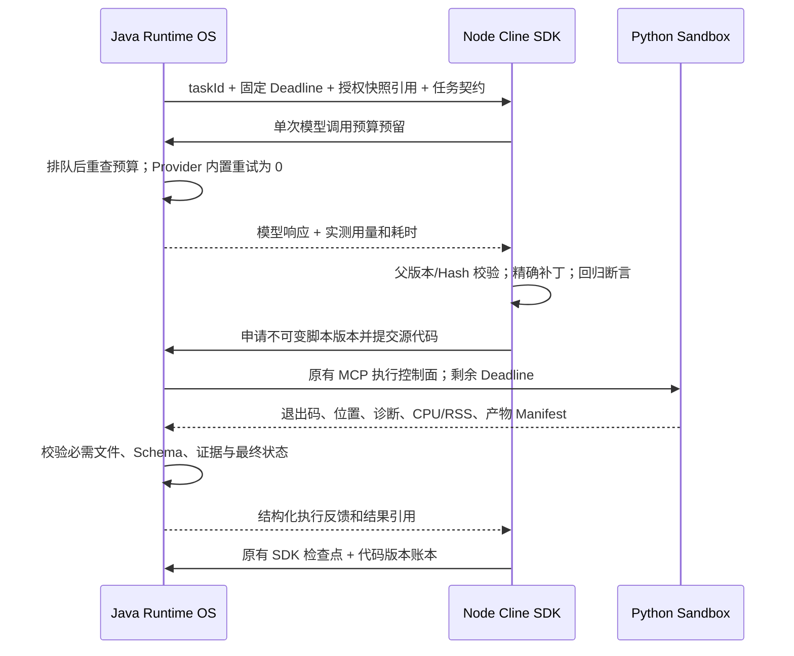

# Runtime OS Coding 稳定性整改

## 改造前审查

基线 `e0271b164`，保留上一轮尚未提交的修复和部署验收记录。
历史 `153fabcdf` 已实现 Node 模型回调按工具 Deadline 等待和 Java 租约续期；
`f847b83a1` 已实现模型输出修复协商。不得把这些已有能力计为本次新增。

| 问题 | 真实实现 | 影响范围 |
| --- | --- | --- |
| 工具延长父任务时间 | CodingAnalysisService.budget + ToolExecutionTimeScope 对 AtomicLong 加时间 | 父任务无法保持固定全局 Deadline |
| Java 隐式重试 | AgentChatModelResolver → ConfigurableChatModelFactory → maxRetries | Node 已禁重试，Java 仍可能在一次 durable start 内重复请求 |
| 取消仅靠外层等待和事后检查 | DeadlineAwareChatModel / ClineModelCallbackController | 运行中的 provider 请求可能继续消耗资源 |
| 修复只校验最新源码 Hash | code-repair.prepareProgram / runner.previousProgram | 后续完整重写可丢失已验证修改，无代码版本回滚账本 |
| 修复携带完整 SDK 历史 | runner → runtime-model | 多次传递完整旧代码和工具回执，增加 Token、延迟 |
| 产物校验已有 | CodingEvidenceCollector + PythonManagedExecutionService + ExecutionFeedback | 已拒绝缺失产物；EMPTY JSONL、Manifest、Schema、Hash 校验应复用 |
| 固定 IP 认证 | ClineCallbackAuthFilter.allowedPeers + compose.yaml | 容器替换后的动态地址可导致 401 |
| 性能证据不完整 | MeteredChatModel / ClineRuntimeModelBridge / monitor.ts | 同步非流式调用无首 Token 数据，不得把总耗时当成 TTFT |
| 完成归档与轮询存在竞争 | PythonManagedExecutionService.finalizeStopped / writeOnce / ClinePythonCallbackController.get | 并发处理同一停止事件可使归档收据暂不可验证，继而过早终止 SDK |

## 最小改造边界

沿用 Java A2 事务、契约、租约、Evidence，Node Cline SDK 和现有 Sandbox。
统一 Deadline、取消与 provider admission；为新契约协商代码生命周期策略，保留旧契约兼容；
复用 SDK 检查点保存版本账本和最后有效源码；仅压缩发送给模型的修复上下文，保留审计历史；
保留 Sandbox 现有校验职责；回调身份仍要求签名，不通过放宽授权规避部署错误。

后续章节只记录实际测试结果。真实生产模型耗时不与确定性测试混合统计。

## 架构与协议变更



Java 仍负责授权、数据供给、预算、持久化租约、Python 提交和最终成功判定；Node 不直接读取数据库或建立第二个调度器。Parquet/CSV 快照、共享输入目录、MCP 执行服务和证据登记均复用现有实现。

### 生命周期和截止时间

- 新 Coding 契约的截止时间取父任务 Deadline 与 Coding 策略上限的较早值，持久化后不续期。删除唯一调用点已移除的 `ToolExecutionTimeScope` 及对应测试，消除通过工具等待给父任务加时的逻辑。
- 展开模型包装器时仅移除重复 Token 计费，保留父级更严格的 Deadline、取消信号和单次调用上限。模型等待同时检查取消与剩余时间，过期/取消中断 Future、清理队列；排队后和返回前再检查一次。
- 发布模型目录使用冻结配置创建单次 Provider 请求，OpenAI/DashScope 原生适配器重试为 0；Node SDK 工具与模型响应同样关闭内部自动重试。受控修复仍需新的 Java durable admission 和预算预留。
- 晚到响应可以保留真实用量收据，但返回执行权前必须重新核验租约、fencing token、取消状态和持久化 Deadline，不能把终态改回成功。复用现有取消、停止证明、租约恢复和未知操作协调流程。

### 代码版本与修复

新契约通过 `runtimeContext.codingLifecycle` 协商 `runtime_os.code_lifecycle.v1`；Java 分派前检查 Worker 能力。旧持久化契约保留原 Hash 和兼容路径。

每次实际提交记录 Java 分配的脚本版本、操作 ID、源代码 SHA-256、父版本/Hash、变更类型、执行验证状态和补丁摘要。首次可提交完整程序，后续要求精确补丁及匹配的父版本。旧版本源文件、执行产物和 Java 证据不被覆盖。

Java 返回有效执行及证据引用后，补丁新增片段形成保留断言，已移除片段形成禁止回归断言。后续违反断言的提案在申请 Python 执行前拒绝，记录提案 Hash 和诊断码。回滚仅可指向最后有效检查点，仍生成新脚本版本并重新执行、校验，不能凭旧收据发布成功。

原 SDK 私有检查点增加任务/输入绑定的版本账本、当前源代码和最近有效源代码；恢复时核对 Hash 链。发送模型的修复上下文收敛为原始任务、当前代码、结构化错误、断言和必要授权工具观察，完整旧代码不反复放进模型历史。Java/Python 的原始执行源和既有事件日志继续用于审计。每个被拒提案和工具耗时也进入现有事件白名单。

这些是源代码片段断言，不能证明任意 Python 程序的语义等价，也不替代 Schema/业务验证。对已验证片段的重命名或改写会被保守拒绝。版本上限 64、断言各 128 条，提案超过可恢复上限即拒绝；既有 256 KB 私有检查点限额继续生效，大程序/较大输入描述仍可能触发容量失败。

### 执行结果和测量

复用 `ExecutionFeedback`、`CodingEvidenceCollector` 的退出码、堆栈位置、代码版本/Hash、耗时、Manifest、必需文件和 Schema 校验。已有测试覆盖退出 0 但缺产物失败，以及有契约证据的合法空 JSONL。不能把本来存在的校验计为本次新增功能。

执行反馈新增可空 `cpuTimeMs`、`maxRssBytes`，旧 JSON 缺少这两个字段仍可读。Linux 使用可信进程包装器的 `getrusage(RUSAGE_CHILDREN)` 记录已回收子进程 CPU 及最大 RSS；Windows/未取得资源数据时保持缺失或 null。它们不代表容器完整生命周期峰值，也不用于替换原有保守预算结算。

同一 MCP 进程的完成、轮询、未分派取消和 fencing 归档按操作串行化，锁条带数量固定，避免无界锁表；收据完整写入临时文件后再发布。终态复查在锁内，避免后续轮询再改已归档文件。Java 暂不能验证停止证明时返回 `RECONCILING`，Node 沿用原操作的轮询和同一 Deadline，不重新执行、不登记结果、不释放未确认的预算。数据库 fencing 和节点重启恢复机制继续复用原实现；这不构成对多副本并发文件写入的新承诺。

模型记录补充队列、首 Token、生成、请求字节数、消息数、工具耗时及重试耗时；非流式调用没有实测首 Token 时明确返回 null。可选流式适配器只在 Provider 边界采集首个文本/思考/工具参数片段，外层仍接收完整最终响应，取消时释放订阅。原有 Token/成本和阶段调用统计继续有效。字节数不能换算为真实 Token 用量。

## 配置与部署

| 配置 | 默认及用途 |
| --- | --- |
| `chatchat.coding.analysis.code-lifecycle-enabled` | `true`；只为新契约增加能力协商，部署时可先关闭并滚动升级 Worker |
| `chatchat.coding.analysis.max-model-call-millis` | `0`；单次模型调用上限，0 表示服从剩余任务预算 |
| `chatchat.coding.cline.max-model-call-millis` | `0`；回调侧额外上限，取所有父级上限中更严格者 |
| `chatchat.models.runtime-streaming-enabled` | `false`；支持流式的 OpenAI 兼容接口可开启；原生非流式接口 TTFT 保持 null |
| `CODING_CALLBACK_URL` / `CODING_CALLBACK_ALLOWED_HOSTS` | `http://api:8080` / `api`，显式配置目标及允许主机 |
| `CODING_CALLBACK_ALLOWED_HOSTNAMES` | `coding-agent`；Java 用 DNS 正向解析核验实际对端，仍要求 HMAC v2、Bearer、时间戳、Nonce 和请求体签名 |
| `CODING_CALLBACK_ALLOWED_ADDRESSES` | 空；兼容明确指定的地址，禁止通过 Forwarded 头绕过 |
| `CODING_NETWORK_SUBNET` | 可外部指定；Compose 不再分配固定 Worker/API IPv4 |

模型名称继续由发布目录和任务配置选择，没有增加业务代码中的模型名称。自定义注入 ChatModel 的内部实现不可由通用包装器证明没有重试；Coding 工具走有界工厂路径，遗留自定义规划适配器应单独核验其内部重试和中断行为。现有模型执行器的线程/排队规模保持原配置，不据此声称提高并发吞吐。

`restrict-coding-worker.sh` 改为读取指定容器在指定网络上的实际地址，在单次 filter-table 提交中替换其专属链及旧源地址跳转，避免动态 IP 更新后遗漏防火墙边界。容器、网络、链、回调端口均可外部配置；检测失败不改规则。`CODING_FIREWALL_VALIDATE_ONLY=1` 使用 `iptables-restore --test`，只验证实际规则而不提交。脚本仍仅放行 Java 回调及已建立连接。Node 代理使用 Docker DNS 动态解析 Worker，避免 Nginx 在启动时固化旧 IP；隔离部署测试强制更换 Worker 地址，验证无需 reload 即可恢复代理。

`scripts/verify-coding-callback.py` 从候选 Worker 内使用现有签名客户端请求 `/internal/coding/cline/preflight`，要求协议版本匹配，并验证无签名请求返回 401。凭据留在容器内。`--report` 保存验证记录；指定 `--promote-gateway` 时只有验证通过后才执行 Nginx 校验和 reload。失败退出且不会调用切流函数。候选路由需由原部署系统预先准备，这个脚本不是完整蓝绿发布系统。

标准流程：升级并验证 Worker 能力；部署兼容 API/MCP 候选；更新专属防火墙；从候选验证回调和授权；最后通过 gate reload 预先准备好的网关配置。历史按日期的部署/回滚脚本用于复现历史，不作为新协议发布入口。当前外部平台渲染库存和已运行容器仍须保持一致，不能只修改消失的 Compose 符号链接。

```bash
python3 scripts/verify-coding-callback.py --worker CANDIDATE_WORKER \
  --report /private/releases/RELEASE/callback-gate.json \
  --promote-gateway CANDIDATE_GATEWAY
```

## 可重复测试与对比口径

本地回归命令：

```bash
mvn -o -pl chatchat-api -am \
  '-Dtest=*Coding*Test,*Cline*Test,*Python*Test,*ExecutionFeedback*Test,*DeadlineAware*Test,*ToolExecutionModels*Test,*AgentChatModelResolver*Test,*ConfigurableChatModelFactory*Test,*RuntimeStreaming*Test,*MeteredChatModel*Test,*ModelInvocationCapacity*Test,RuntimeEventLogTest' \
  -Dsurefire.failIfNoSpecifiedTests=false -Dfrontend.skip=true -Dfrontend.install.skip=true test
cd coding-agent-node && npm test
node scripts/benchmark-lifecycle.mjs
```

Docker 集成用例需 Java 17、现有 Python 镜像和 Node 22.18+，通过 `-Dcoding.realDocker=true -Dcoding.node=/path/to/node` 启用。SQLGlot 用例另需配置现有固定版本解释器，不会因普通测试通过就视为已执行。新增断言包括父 Deadline/取消继承、单次真实 HTTP 失败没有 SDK 重试、流式取消、版本恢复/回滚/回归拒绝、旧反馈 JSON 兼容、部署 gate 阻止切流，以及动态 IP 防火墙更新。

受控比较使用同一语义提案序列：初始错误、修复通过、下一提案重引入旧错误、结束。`before` 是不协商新生命周期的兼容路径，使用精确补丁；`beforeFullSource` 使用相同语义的完整源代码修订；`after` 启用父版本约束和断言。它们在同一新版 SDK Runner 中运行，不是三个历史二进制构建。模型和 Python 网关是固定夹具；SDK 本身是真实 Cline。不能把这个故意注入回归的样本成功率当成生产成功率。

服务器 Node 24 / Linux / 1 CPU / 512 MiB 容器每种模式预热 5 次后的一次 20 轮交错运行记录在 [benchmark-linux.json](runtime-coding-stability-20261026-evidence/benchmark-linux.json)。小样本和共享宿主负载不支持稳定的端到端性能推断：

| 指标 | 兼容路径，补丁 | 兼容路径，完整代码 | 新生命周期 |
| --- | ---: | ---: | ---: |
| 受控样本成功数 | 0/20 | 0/20 | 20/20 |
| 模型调用/任务 | 4 | 4 | 4 |
| Python 执行准入/任务 | 3 | 3 | 2 |
| 模型消息输入字节/任务 | 91,601 | 178,150 | 95,686 |
| SDK 本地耗时 P50 / P95，ms | 2.55 / 57.50 | 2.65 / 82.42 | 2.93 / 15.54 |
| SDK 进程 CPU 均值，ms | 5.14 | 7.47 | 8.28 |

新路径比补丁基线增加约 4.5% 的消息字节，比完整重写减少约 46.3%；新增校验有本地处理开销，本次 P50 略高，CPU 采样受调度影响，不据此声称稳定的增减收益。阻断回归少执行一次，并没有在该样本减少模型调用次数。RSS/heap 差值见 JSON，包含 GC/运行时噪声，不能当成峰值或得出稳定内存收益。Windows 的对照保留在 `benchmark.json`，CPU 采样粒度不足产生 0 时，不解释为零成本。

真实 Provider Token、端到端延迟、生产成功率和 Sandbox 资源前后差异尚无同条件线上样本；保持未测，不给出推测性的性能百分比。

阶段聚合工具：`node coding-agent-node/scripts/summarize-metrics.mjs observations.json [java-coding-outcomes.json]`。输入为现有 Monitor 持久化导出和可选 Java `CodingTaskOutcome[]` 导出；按任务作用域/模型 ordinal 合并恢复记录，输出模型成功率、分阶段延迟/Token 覆盖率、工具边界返回率、Python 退出成功率与产物有效率、修复/回滚次数和资源采样。没有 Java 最终状态时任务成功率为 null；未知 Token/TTFT 不按 0 处理，历史截断显式标注，观测日志不冒充最终执行权威。

## 最终验证记录和交付边界

| 验证 | 实际结果 | 范围 |
| --- | --- | --- |
| 本地 Java 相关模块回归 | 538 项，518 通过，20 条件跳过，0 失败 | 包含契约、生命周期、取消、快照、回调、校验及 Python 工具；不是全仓库全部测试 |
| 本地 Node | 61/61 通过 | 包括 TypeScript 构建、真实 Cline SDK、补丁回归、SDK 进程异常退出与检查点恢复、统计与 HTTP 签名 |
| 本地 Python 诊断/部署保护 | 16/16 通过 | 原有诊断测试继续保留，增加资源反馈、切流阻断与防火墙规则测试 |
| 服务器 Java/Node/Docker 集成 | 24 项，23 通过，1 条件跳过，0 失败 | 实际 Sandbox、MCP 操作账本、Java 证据登记、Node SDK、新生命周期聚合结果、取消、归档竞争、子 JVM 崩溃恢复；Provider 使用测试夹具 |
| 服务器 Node 24 | 61/61 通过 | 独立容器，1 CPU / 512 MiB、只读根目录、无外部网络；测试文件串行运行 |
| 服务器 Compose/Nginx | 7/7 通过 | 真实 Compose 展开、Nginx 语法/端口行为和更换 Worker IP 后的 DNS 代理恢复 |
| 服务器实际防火墙预检 | 通过 | `iptables-restore --test`，没有提交生产防火墙变更 |
| 现有服务 HTTP 健康 | 18100/18101 均 200 | 仅说明原服务仍可访问 |

服务器完整私有日志保存在 `/opt/chatchat-releases/runtime-coding-stability-20261026/`，目录权限 0700。公开到仓库的 [服务器验证记录](runtime-coding-stability-20261026-evidence/server-validation.json) 包含成功数、范围、资源采样和日志 SHA-256；[本地验证记录](runtime-coding-stability-20261026-evidence/local-validation.json) 明确区分通过与跳过。相同测试在本地和服务器重复运行，不将它们相加宣称更多独立覆盖。

真实验收同时修正了旧测试夹具的协议缺口：补齐取消账本迁移和脚本分配回调；原始异常文本断言改为脱敏诊断；原始账本复制按现有规则拒绝，新生命周期成功用例实际计算汇总值。H2 崩溃恢复用例只需顺序打开文件数据库，移除不必要的自动 TCP 服务器，消除主机反向 DNS 导致的测试阻塞；未增加等待时长。

本轮交付是工作区代码、测试、配置、架构说明及服务器隔离验收。没有替换线上 API/MCP/Worker，也没有切换正式流量；新协议的线上签名预检和正式发布尚未执行。正式发布必须将外部部署平台的渲染库存与候选镜像、配置和密钥挂载一致化，再运行上述 gate。SQLGlot 可选解释器相关用例仍未验收，真实业务模型的同条件前后对比仍待采集。不能据本轮测试声称生产任务成功率或端到端延迟已经提升。
