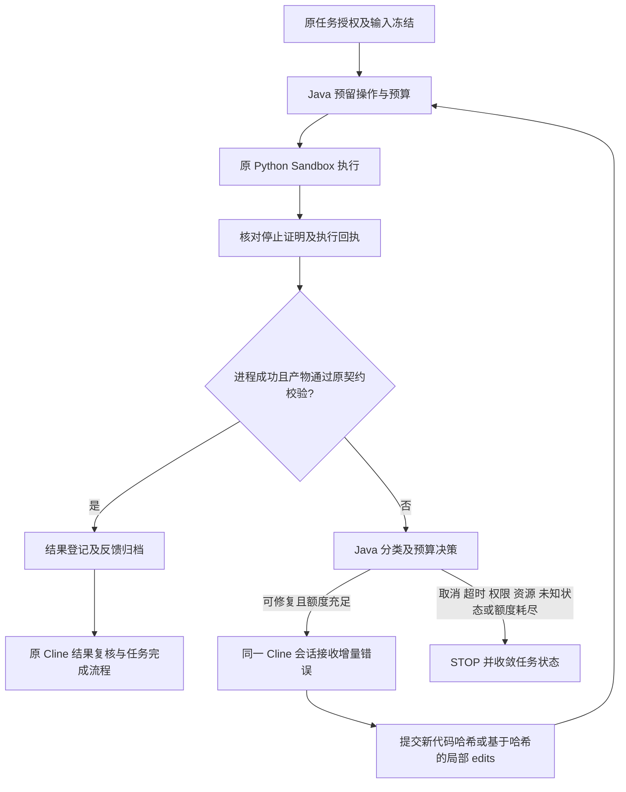

# Runtime OS 执行反馈与自动修复交付报告

版本：1.2.0-20261022；验收日期：2026-10-22。部署业务代码提交：`3ae06d448b642734a58019378d07a4183b51b87f`。后续提交补充部署包校验与交付记录。

## 审查结论与实施范围

编码前的[现状审查及改造设计](runtime-execution-feedback-review-and-design-20261022.md)已记录实际调用链、差异和复用点。本次沿用 Java Runtime OS → Node/Cline SDK → Java 工具回调 → MCP Managed Python → Docker Sandbox → Java EvidenceCollector，不新建执行框架、Agent 或任务数据库。

根因之一是 MCP 已产生的诊断码和修复提示被 API 回调再次过滤，Cline 只能收到不完整异常信息。另一个缺口是不同执行回执缺少统一的 Java 修复决策、持久化反馈和监控投影。修复这些断点后，模型继续在原任务上下文中修改代码，并经过原授权、预算、输入绑定和沙箱链路执行。

## 公共契约

完整契约为 `runtime_os.execution_feedback.v1`：

| 内容 | 字段与语义 |
|---|---|
| 关联 | taskId；executionId 复用 operationId；attemptId 为任务内执行序号；traceId 复用 runId |
| 执行事实 | status、stage、exitCode、durationMs、codeHash；未测得的值允许 null |
| 诊断 | error.category/exceptionType/diagnosticCode/message/stack/detailRef；只保留受限 main.py 定位帧和安全固定消息 |
| 输入 | inputDataRefs、inputFiles 的文件 ID/名称/哈希、inputSchemaSummary、schemaRef；不内嵌客户数据 |
| 输出 | artifactRefs、manifestHash、outputStatus、validationStatus、resultAvailable、businessValidationPassed |
| 流 | stdout/stderr 为明确脱敏表示；stdoutBytes/stderrBytes 为真实捕获字节数，不是脱敏字符串长度 |
| 策略 | repair.allowed/action/reason/attemptsUsed/maxAttempts/baseCodeHash/guidance |

Java record、公共 JSON Schema 和 TypeScript 类型共同描述契约。Python 继续只生成 `runtime_os.python_diagnostic.v1` 诊断片段，完整反馈由 Java 结合真实回执、独立校验、预算和任务状态组装。Python 不具备自主决策或 Agent 能力。

旧 get-python 字段、诊断 policy 和旧事件枚举保留。新增反馈事件复用 `RECOVERY_RECONCILED`，以 `payload.type=EXECUTION_FEEDBACK` 区分，便于回滚及历史任务兼容。旧任务缺少反馈时显示“历史任务未记录”。R1 的 normal/syntax 不可变历史记录保留旧计数语义；R2 起成功代码复核不消耗修复额度，不改写历史证据。

## 状态机与错误分类



| 错误 | 分类 | Java 决策 |
|---|---|---|
| SyntaxError / IndentationError | SYNTAX | 原上下文修复语法 |
| KeyError / IndexError | SCHEMA_ACCESS | 根据已授权输入和 Schema 定向修复 |
| ModuleNotFoundError / ImportError | DEPENDENCY_UNAVAILABLE | 可改用发布环境已有库；不允许安装包或扩大网络权限 |
| AttributeError | PACKAGE_API | 修正已发布环境中可用 API |
| 常见 Type/Value/Name 错误 | PROGRAM | 修复脚本逻辑，不补造业务字段 |
| 必需产物缺失、JSONL/schema 不合约 | OUTPUT_CONTRACT | 即使 exitCode=0，也失败并按额度修复 |
| 输入引用错误 | INPUT_REFERENCE | 只允许修正已授权路径 |
| PermissionError | AUTHORIZATION | STOP |
| MemoryError / OOM | RESOURCE | STOP |
| 超时、取消、未知异常/无法核对执行状态 | TIMEOUT / CANCELLED / UNKNOWN 等 | 停止新代码执行；未知执行先走原 reconciliation |

默认 `chatchat.coding.max-auto-repairs=3`，接入任务时冻结。初始失败不算一次修复，后续最多三次；成功后的结果复核不消耗错误修复额度。仍受原 maxCodeExecutions、模型 Token、工具次数、截止时间及 A2/MCP 预算共同约束。修复不创建新预算，也不变更模板必选工作流、授权文件或沙箱权限。

新执行必须等待前一操作取得停止证明并提交反馈。Java 在原 journal 事务内检查，防止并发绕过额度。重复相同 operationId 复用原操作，不再次启动容器；失败代码哈希未改变时拒绝新操作。Java STOP 会让 Node 在下一次模型/工具调用前终止 SDK，终止反馈写入 checkpoint。取消、租约和 fencing 继续沿用既有机制。

## 持久化、服务端日志与监控

PostgreSQL 原 `runtime_evidence_partition/runtime_evidence_entry` 保存任务 journal、操作状态、反馈、代码哈希、SDK checkpoint、事件及重试决策。大 checkpoint 复用原分块及 SHA256 校验。没有新增平行表或迁移。

原 `RuntimeAssetArchive/RuntimePythonAssetArchiver` 将代码、输入快照、回执、脱敏诊断和新增反馈 JSON 放入既有 Silo 资产体系；`runtime_workspace_file` 保存索引及哈希。反馈 sourceRef 为 `feedback:<operationId>`。本次对九个任务逐一从 PostgreSQL 还原 journal，核对 27 条反馈事件与 27 份归档一致，输入引用跨尝试保持不变。

Java 复用 `RuntimeEventLog` 与现有 SLF4J/滚动文件配置。结构化记录 `TASK_STARTED`、`NODE_RESPONSE`、原调度/代码事件、`PYTHON_EXECUTION_FEEDBACK` 和 `TASK_FINISHED`。反馈字段可检索 taskId、traceId、executionId、codeHash、异常分类、退出码、耗时、校验和修复次数，不记录请求正文或密钥。日志投影只允许受控字段。验收九个任务共查到 1,307 条相关结构化事件，其中 Node 响应 748 条、Python 反馈 27 条。轮询造成的 Node 响应日志数量仍较大，后续可在保留异常和最终状态的前提下降低重复状态日志。

服务器持久日志：`/opt/runtime-os-docker-stage/api/logs/chatchat.log`，沿用已有按日压缩轮转。排查示例：

```sh
rg 'PYTHON_EXECUTION_FEEDBACK|NODE_RESPONSE' /opt/runtime-os-docker-stage/api/logs/chatchat.log
rg 'analysis-coding-f976633e310de69c3dfd010dc2a4b02c60e6df8429018756652aac4631e503e8' /opt/runtime-os-docker-stage/api/logs/chatchat.log
```

监控页面沿用 `CodingTaskMonitor.vue`，增加执行阶段、错误及定位、退出码、执行耗时、真正修复次数和代码版本变化；保留原交互、事件、模型调用、输入、代码和差异展示。真实 Edge 浏览器访问已部署产品，选中 repair-limit 任务，显示 4 条执行记录、5 条模型调用及修复上限提示；页面无 JavaScript 异常。

## 实测结果

完整机器可读证据见 [验收证据](evidence/runtime-execution-feedback-20261022.json)。线上使用真实发布 Agent、实际模型、Node/Cline、MCP 和 Docker Python。数据为专用三行合成 CSV，预期金额为 CNY 33.68；正向场景同时检查实际答案和独立产物校验引用。预期停止场景要求父任务和编程任务真实失败，不以 HTTP 成功代替验收。

| 场景 | 真实结果 | 执行次数 / 模型调用 / Tokens |
|---|---|---|
| 正常分析 | 产物已登记，答案 33.68 | 2 / 5 / 109,077 |
| 语法错误 | 实际 SyntaxError 后换代码修复并完成 | 4 / 9 / 222,061 |
| Pandas 字段错误 | 实际 KeyError，原输入引用不变，修复完成 | 4 / 10 / 266,655 |
| 缺依赖 | 实际 ModuleNotFoundError，经现有发布环境修复完成；未提供安装权限 | 7 / 12 / 399,454 |
| exitCode=0 但产物不合约 | 首次 OUTPUT_CONTRACT 失败，修复后完成 | 3 / 7 / 155,486 |
| 权限拒绝 | AUTHORIZATION，STOP；无下一次模型或执行 | 1 / 1 / 13,642 |
| 资源限制 | 真实 OS RLIMIT_AS 触发 MemoryError，STOP | 1 / 1 / 13,723 |
| 超时 | 真实 OS alarm 触发 TimeoutError，STOP | 1 / 1 / 14,056 |
| 达到修复上限 | 初次执行加 3 次修复后 REPAIR_LIMIT_REACHED | 4 / 5 / 81,935 |

上述资源测试不是容器 OOM kill；上述全链路超时使用 OS 定时器。另以真实 MCP 管理操作验证 3 秒执行截止时间，得到 TIMED_OUT，因此没有用自行抛异常替代全部执行器超时覆盖。

| 用户验收项 | 覆盖与边界 |
|---|---|
| 1–7 正常、语法、字段、依赖、终止、产物校验、修复上限 | 上表九种真实全链路场景通过 |
| 8 重启 | MCP 活跃执行时重启，操作恢复成功且副作用一次；Node 在反馈已提交而任务仍 RUNNING 的边界重启，最终完成且执行 ID 无重复；Java 重启后九个终态任务的全部 27 条反馈保持完全一致。未实测 Java 在模型/执行调用进行中的重启，也未穷举 Node 的每个崩溃窗口 |
| 9 不重复副作用 | MCP 同 operationId 重放及 MCP 重启后均检查专用 sentinel，仅写入一次。此保证针对同一操作；不承诺任意新代码版本的业务副作用恰好一次 |
| 10–11 时间线、Java 日志 | 实际 PG 分块校验、事件、Silo 索引与 Java 日志逐项关联通过 |
| 12 并发隔离 | 真实全链路两队列并行；另以相同操作名、不同 run 的 MCP 并发执行验证不同容器与结果隔离；跨 owner 访问被拒绝 |
| 13 隐私 | 真实 Python 大 stdout、敏感 canary 及异常诊断不回传原文；新结构化日志中没有 canary；受限字段及恶意文本过滤另有单元覆盖。不是对历史所有日志的全面审计 |
| 14 原工作流及权限回归 | 相关 Java/Node/前端回归通过；线上实际发布 Agent、授权附件、默认环境与原 Sandbox/产物链路通过。四个本地 Spring 授权集成用例因 MCP gRPC/语义发布环境缺失未运行通过，不能宣称所有角色与模板组合均已真实端到端通过 |

真实 MCP 组件演练共十二项：正常、语法、Pandas 字段、缺包、权限、内存、受管超时、取消、同操作幂等、并发隔离、跨 owner 拒绝和执行中 MCP 重启。组件结果不冒充完整 Java/Cline 端到端结果。

本地选定 Java 回归范围：ExecutionFeedback、Coding、Cline、Python、RuntimeEventLog、资产、Template、Workflow、Authorization；公共模块 129、Agents 142、API 328、MCP 159，共 758 用例，739 通过、19 个需要本地 Docker 的用例跳过，零失败。两类 Spring 集成测试共四例因本地环境无法启动而明确排除，不计入通过。不是全仓库所有历史测试通过。

Node 46 个测试通过；Python 真实子进程 4 个测试通过；前端监控 7 个测试通过，Vite 构建通过。Node 本地 SDK 测试中的模型响应夹具仅用于分支测试，真实模型验收以上表为准。

## 性能对比与剩余瓶颈

| 项目 | 改造前 / 风险 | 本次结果 |
|---|---|---|
| 终态轮询 | 可能重复远程取日志、下载 manifest、重跑校验 | 缓存已提交权威反馈；复用已归档诊断；归档存在性以 SQL EXISTS 检查，不下载清单 |
| 修复上下文 | 已有 SDK 会话与 hash-bound edits，但错误信息不完整 | 同会话反馈，保留输入快照；真实 syntax/field/output 记录中观察到局部 PATCH |
| 完整源码重复生成 | 模型可能选择整份重写 | 尚未消除；dependency 场景未观察到 PATCH。不能宣称每次修复都采用最小修改，也不强制用不可靠的自动文本补丁替代模型决策 |
| 文件重复传输 | 同一输入反复取数/转换风险 | 授权输入引用跨修复相同；不重新请求完整业务分析。但既有 snapshotAuthorized 仍按操作复制文件并整文件读入计算哈希，大文件 IO/内存尚待优化 |
| 容器初始化 | 每次代码执行创建新沙箱 | 保持原隔离；没有跨任务或代码版本复用脏容器。依赖通过发布镜像提供 |
| 正常样本 | 前次默认环境验收 6 次模型调用、134,722 Tokens | 本次 5 次、109,077 Tokens；两次 Python 执行为 1,488/1,415 ms。模型非确定，样本不同，不能据此推断因果或稳定加速比例 |
| 失败成本 | 多次完整生成可能很贵 | dependency 实测 12 次模型调用、399,454 Tokens、7 次执行，含额外字段修复；这是实际成本，尚未证明低成本目标全面达成 |

未做受控同输入同模型重复压测，不报告吞吐或 p95 提升。CPU/peakMemory 在现有总账中的 0 表示缺少实际计量，不能解读为没有资源使用；容器硬限制和原预算仍生效。

## 部署、兼容及回滚

服务器 `192.168.195.221` 上现有 Compose 项目 `runtime-os-app-stage` 已部署。没有更改业务配置、挂载、默认 Python 镜像或无关服务。保留旧镜像和私有配置/数据库回滚备份。

| 服务 | 实际运行镜像 | 大小 |
|---|---|---|
| API + 页面 | runtime-os-api:1.2.0-20261022-execution-feedback-r2 | 743,670,779 字节 |
| MCP | runtime-os-mcp:1.2.0-20261022-execution-feedback | 584,010,808 字节 |
| Node/Cline | runtime-os-coding-agent:1.2.0-20261022-execution-feedback | 393,630,617 字节 |

应用镜像从纯运行时基底构建，Java 每个镜像只有一层应用 JAR；Node 不叠加旧应用镜像。总大小约 1.72 GB（十进制、共享层未去重），不会因不断覆盖旧 app.jar 而逐版累积到几十 GB。Docker 缓存/保留的回滚镜像仍占磁盘，不能把磁盘总量等同于当前应用镜像大小。

离线包已发布到 `/opt/chatchat-releases/chatchat-1.2.0-20261022-execution-feedback-offline.tar.gz`，大小 898,858,855 字节。SHA256 为 `56907d00a416eb618b8044a47538efcbc627b0fcb5ffbd3c7b67c3bea9008a82`；[包回执](evidence/runtime-execution-feedback-package-20261022.json)记录镜像 ID。包内文件 SHA256 校验、固定镜像身份及原服务健康检查通过。安装步骤见包内 `INSTALL.md`。该包为现有 1.2 部署的三应用镜像更新包，不包含数据库、业务数据、客户配置、凭据、模型或 Python 分析镜像，不是空服务器一键初始化包。包内报告不包含包本身的最终摘要，最终摘要以本回执为准。

主要兼容边界：旧任务无反馈仍可读；旧回执字段保留；回滚不需要撤销表迁移。本次保留原隐私边界，原始业务 stdout/stderr 和任意异常文本不会归档，脱敏技术诊断、堆栈定位、字节数与引用可追溯；若以后要求受控原文保留，需要独立定义授权、加密、访问及保留策略。

独立校验的 INCONCLUSIVE 只表示现有结构及来源检查未失败，不证明所有业务结论正确；本次合成金额另行核对，不将 Python 成功等同于任务完成。尚未覆盖所有重启窗口、所有租户角色/模板组合和大文件性能压测，相关限制保留为后续验收事项。

## 实际代码改动清单

| 模块 | 文件 / 作用 |
|---|---|
| common | ExecutionFeedback.java、ExecutionFailureClassifier.java、execution-feedback.schema.json、ExecutionFeedbackContractTest.java；RuntimeEventLog.java 扩展受限日志字段 |
| agents | DurableCodingTaskService.java：原事务内反馈事件、修复 admission、策略/反馈读取；CodingTaskPersistenceTest.java |
| API | CodingExecutionFeedbackService.java 及测试；ClinePythonCallbackController.java 贯通回执；CodingPythonExecutionBridge.java 复用归档；ClineCodingAdapter.java 记录 Node 响应；ClineModelCallbackController.java 扩展受限事件；CodingTaskMonitorController.java 投影时间线 |
| 资产 | RuntimeAssetArchive.java 存在性查询；RuntimePythonAssetArchiver.java 读取已校验的归档诊断 |
| MCP/Python | PythonExecutionLogBoundary.java 安全分类与定位；runtime_capture.py 受限栈；test_python_runtime_diagnostics.py 实际子进程测试 |
| Node | execution-feedback.ts、runner.js、monitor.ts、runner.test.js；同会话反馈、STOP、修复提示及监控字段 |
| 前端 | CodingTaskMonitor.vue、codingMonitor.ts：执行记录与修复次数/代码版本分别展示 |
| 回归夹具 | AgentWorkflowStateTrackerTest.java 按实际工具元数据；ModelDirectedWorkflowIntegrationTest.java 更新现行输出名；PythonMcpToolPublisherTest.java 显式声明存在的旧工具。没有修改生产模板/工作流规则 |
| 发布 | Dockerfile.coding-agent、recover-java-base.py、deploy-execution-feedback-stage.py、verify-product-release.py；纯基底、离线固定镜像校验、原项目部署与真实故障验收 |

复现建议：先运行 Node `npm test`、Python `py -m unittest discover -s scripts/tests -p test_python_runtime_diagnostics.py` 和选定 Maven 回归；真实联机使用 `scripts/verify-product-release.py --feedback-case <场景> --auth-file <私有文件> --output-dir <独立证据目录>`。验收可能消耗模型配额；应使用合成数据和专用测试窗口，停止类场景预期任务失败。
