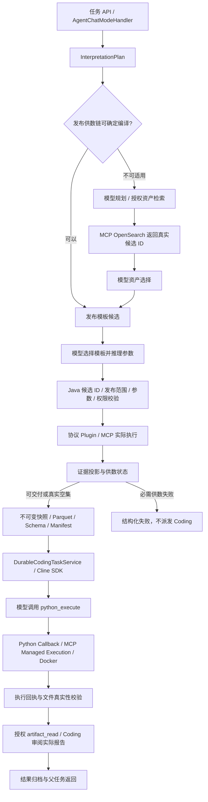

# Runtime OS 架构减法审计与阶段交付

审计日期：2026-10-27。范围：当前运行版本溯源、需求至 Python/报告的实际链路、职责与状态边界，以及已验证的最小整改。本文区分“已修复”“已复现”和“待验证”，不把组件扫描、Mock 测试或一次成功任务当成全部验收。

**当前整体验收未通过。** 审计及第一阶段收敛已提交并部署；最终版本的固定发布供数链真实成功，全局检索用例已验证到 MCP 供数与 Coding 交接，但没有在同一最终版本任务中完成后续报告。多工具批次预算、绑定身份、恢复快照和父任务阶段等 P0 仍未关闭。下文保留全部成功、失败与取消证据。

## 1. 基线及证据口径

- 审计开始时工作区 HEAD：`04a833148290384fc342e6ddac2ea48199b6a72d`。本轮代码整改提交：`7de43570f`（`refactor(runtime): consolidate supply and coding validation boundaries`）。
- 审计开始时服务器运行 `runtime-template-supply-20261027-r6`，JAR SHA-256 为 `af96fe102dfaa8ac5b56e7ea5020fac415c45993c4c976b4e03687809418cef5`。
- 部署记录为 `bb5bf19774e124989dc5f54c95fa97006f3cd407` 加源码补丁，而非一个干净 Commit。已建立独立基线 worktree，应用原部署补丁；17 个生产修改文件经换行归一化后与本地 HEAD 对应文件一致。证据：[deployed-baseline.json](deployed-baseline.json)、[deployed-source.patch](deployed-source.patch)。
- 本轮分阶段部署采用编译 class 与前端资源覆盖既有制品，记录基线、源码差异、class、部署脚本、制品 SHA，保留旧镜像及容器。不能将它表述为由单个新 Commit 全量构建的镜像。
- 最终 API 候选 R4：`73083421ec2353b4f2de39248272a9ac9442328c5d843ae2d28fc84910928a2a`。部署证据：[deployment-api-r4.json](deployment-api-r4.json)。最终 Node R3 与 MCP 见 [deployment-node-r3.json](deployment-node-r3.json)、[deployment-search.json](deployment-search.json)，早期 Node R2 记录单独保留。
- 最初 MCP 的 prod 配置实际使用 **Lucene**。本轮经现有 OpenSearch 实现、现有授权配置切换，之后的真实验收才覆盖 OpenSearch；没有把早期 Lucene 调用计作 OpenSearch 验收。
- 业务行、客户报告、鉴权信息留在服务器和仓库外私有证据目录；本目录仅收录源码与控制证据。
- 用户粘贴的 09:47 历史日志已关联到持久化原始 Run：MCP 成功返回 10 个模板候选，首次模型选择请求超时，Runtime 失败分支却记录候选数 0，再上抛为 MCP 数据不可用。**没有证据表明该次已有完成的模型选择被二次否决**。该时点制品 hash 仍未取得，历史堆栈行号不能当成当前源码行号。原附件 hash、实际候选数与超时事实见 [historical-incident-control.json](historical-incident-control.json)。

## 2. 真实调用链及权责

主要代码入口：

| 阶段 | 路径与定位 | 责任 |
|---|---|---|
| 编译或规划 | `chatchat-agents/.../orchestration/AgentOrchestrationEngine.java:1038,1196`；`runtime/plan/template/PublishedDataAcquisitionPlanner.java:15` | 编译确定流程；不选择业务模板 |
| 检索 | `chatchat-mcp-server/.../search/engine/OpenSearchMcpSearchService.java:520,556,574` | 实际 OpenSearch；记录 requestId/searchRequestId/index/phase/duration |
| 候选选择入口 | `AgentOrchestrationEngine.java:3466,3500,3879` | 模板走统一 selectAndBind；资产保留模型语义选择 |
| 参数推理 | `SchemaDrivenTemplateParameterBinder.java:54,119,261,335` | 模型选择候选并提取参数；支持有输入引文的归一化推理 |
| 确定性校验 | `runtime/plan/selection/SemanticCandidateAdmissionPolicy.java:21`；`runtime/toolcall/TemplateInvocationBridge.java` | 集合成员、拒绝名单、证据、Schema、绑定；不推断 Top1 |
| 执行与选择落地 | `runtime/plan/InterpretationPlanRuntime.java:2939,2998,3407` | 本地事实检查、候选身份应用、执行锁与执行状态 |
| 数据投影 | `orchestration/analysis/dataset/AnalysisEvidenceCoordinator.java`；`runtime/analysis/McpAnalysisPayloadResultAnalysisAdapter.java:119` | 真实业务数据/空集、来源与句柄；不做业务相关性否决 |
| Coding 交接 | `orchestration/analysis/governance/AnalysisCoverageCoordinator.java:91`；`chatchat-api/.../runtime/coding/analysis/CodingAnalysisService.java` | 供数失败停止派发；成功交接不可变数据清单 |
| 实际执行 | `coding-agent-node/src/runner.js:218,274,310,415`；`chatchat-api/.../cline/ClinePythonCallbackController.java:78,174,220` | SDK 调工具，Java 调真实 Python，收集回执及结果 |
| 状态呈现 | `chatchat-api/web-app/src/services/codingMonitor.ts:21,46,66` | 代码已归档、进程成功、结果已验收分别呈现 |

表中 `...` 对应包目录；[组件索引](component-inventory.json) 提供完整文件路径、行号和引用代码。Java 检索不代表 Java 选择；名称含 Review 也不代表执行二次语义审核，必须结合实际分支判断。

### compile() 为什么返回 null

`PublishedDataAcquisitionPlanner.compile()` 在以下情况明确记录原因并返回 null：缺失上下文、必需工具未授权、多组或额外必需能力、没有固定发布权威、未绑定的分阶段发现、协议不兼容。Engine 随后走现有模型规划。

这表示“不适用确定性编译”，不是 MCP 故障，也不能据此挑选一个模板。多工具角色通常不能被编译成唯一的两工具供数链。固定发布关系已经确定资产时无需重新全局发现；但前提是发布关系**确实包含可验证的具体资产绑定**，仅有模板白名单不足以证明这一点。

## 3. 已定位问题、证据及处理

| 编号 | 实际证据与后果 | 本轮处理 / 剩余项 |
|---|---|---|
| D01 双重计划权威 | AgentPlanner 原有精确工具名依赖校验，与 InterpretationPlanValidator 已支持的发布子工具替代规则不一致。运维任务在任何执行前被否决，重复规划 3 次 | 删除重复规则，统一复用既有 Validator；新回归证明发布绑定替代只需一次规划。执行边界仍进行授权/DAG 校验 |
| D02 参数证据越权 | Binder 的字面引文限制拒绝单字符、数组、相对日期归一化；InvocationBridge 再做通用字面包含判断 | 模型返回 `parameterEvidence`；Java 校验真实引文存在、参数 Schema 与候选身份。tool-result 证据仍要求值相等，不用关键词猜参数 |
| D03 供数失败伪装数据 | Coverage 曾生成 DATA_SUPPLY_STATUS 数据行，供数未成功仍启动 Coding | 现有 Evidence owner 汇总状态；无必需业务证据时返回 `DATA_SUPPLY_SELECTION_FAILED/PARAMETER_INVALID/EXECUTION_FAILED`，Coding 派发 0 次。合法空集单独交付 |
| D04 空结果投影丢失 | API-only 真实任务中 MCP 为 SUCCESS/RAW_RECORDS、完整且带 Schema，body.records=[]；Adapter 丢弃空集合，后续归类执行失败 | 只在成功、完整、无错误、有声明 Schema、存在显式空记录集合时保留零行数据集；不从 rawData 镜像复活数据。Schema 文件保留 declaredSourceSchema；Parquet/CSV 独立读取验证零行 |
| D05 Coding 修复协议冲突 | Callback 要完整新程序；Node CodeHistory 要精确 patch、父版本及 hash | 保留原 SDK 循环，统一 source/repair/rollback 契约，修复反馈要求已有版本的精确修改。首次 source 不能与 repair 混用 |
| D06 模型调用前失败悬挂 | 顶层 oneOf 被 LangChain4j 解析为不支持的 JsonRawSchema，Node 失败但父任务等待不明操作 | 移除不兼容 schema；增加真实 SDK 工具 wire → 当前 Java 库兼容检查。本地 chat 调用前失败产生明确 providerDispatched=false 回执，结算零实际调用与保留成本；发出后的未知调用仍需原 ID 对账，不重放 |
| D07 前端提前显示成功 | CODE_COMMITTED 在 Sandbox 启动前发生，旧 UI 显示 EXECUTED_ARCHIVED | 显示 CODE_ARCHIVED；进程成功、结果文件验收分别显示，10 项监控测试通过 |
| D08 无价值旧分支 | Engine 已提前进入统一模板选择，但遗留 Coverage Audit、跨资产 Java 否决、旧 bind-only 方法；PublishedDataSupplyReviewer 无生产调用且会全选无参模板 | 删除已确认不可达/无调用逻辑；保留当前模型选择。不能将死方法当作本次 9 次模型调用的原因 |
| D09 固定绑定身份缺口 | `TemplateQueryMcpToolPublisher.java:173,193,226` 仅按 allowedTemplates 发布候选，却声明 FIXED_BINDING；现有 `TemplateAssetCatalogService.java:63` 已有 BoundTemplate；`TemplateCapabilityService.java:59` 可解析与复核实际绑定 | **待整改**：复用既有 BoundTemplate/key/revision/typed target 执行契约，不能补一个 Java 选主机规则 |
| D10 执行路由混合语义 | `ExecutionTargetRouter.java:260,278,577` 将技术类型 targetType=ssh_host 当作业务标签筛选，真实运维 5 模板全部未命中上下文；登记库存在 DEV 主机 | **待整改**：区分资产类型和业务选择条件；具体绑定 ID 复核授权。保留歧义拒绝，禁止 Top1 |
| D11 重试语义漂移 | `chatchat-chat/.../task/core/AgentTaskService.java:167,202,805,829`：retry 读旧 payload 再 submit，后者用当前 Agent 配置覆盖 workflow 快照；角色模型也可能覆盖旧 selectedModel | **待整改**：恢复使用可信持久化版本，重新校验当前授权；“重新按新配置运行”必须成为明确新任务，不能混作恢复 |
| D12 业务校验仍混在通用层 | `CodingFinancialResultVerifier.java:38,63` 含领域公式，经显式 validationPlan 选择，并非所有任务默认调用；`ComputedResultBoundary.java:35` 对复制源记录采用启发式判断 | **待验证/迁移**：结果 hash/文件/schema 必须保留；领域计算规则应来自显式版本化任务契约。先查历史验证计划与引用，不能盲删 |
| D13 Coding 提示词权责冲突 | `coding-agent-node/src/runner.js` 原系统提示词声称 Runtime OS owns business interpretation/classification；Callback 不返回 stdout/辅助文件内容，print-only 探索会被判缺结果 | 已修正提示词，将业务理解/分析权归模型。独立探索契约仍待收敛：经授权结果契约返回有界发现，不能靠反复 print，也不能直接开放全部 stdout/文件 |
| D14 代码文本伪装回归断言 | 真实 R4/Node R2 中，`code-repair.js` 将成功归档版本的任意 newText 冻结为 protectedFragments；runner 在引用校验失败后仍把版本记为 VALIDATED，修正引用被 REGRESSION_ASSERTION_FAILED 阻断，最终耗尽 12 次模型调用 | 移除自动文本冻结/禁止旧文本重现的启发式；保留 task/input/父版本/hash/精确 patch/代码大小/版本数/真实执行/回滚重验。引用失败的版本不能作为已验证回滚点，也不能宣称结果可用；新 SDK 回归覆盖修改上一补丁中的非法引用并重新执行验收 |
| D15 检索扩词仍受字面语义约束 | `ModelAssistedRetrievalBridge.java:197,265` 在 BILINGUAL_TEMPLATE_PROFILE 下要求 quote 字面包含 proposed keyword，再按源码引文剔除不符合的扩词 | **待整改**：同义词/翻译不必字面存在于引文。模型负责语义扩展，Java 保留可信引文、允许字段、长度/类型、授权过滤和 DSL 结构检查；canonical ID/filter 仍须精确匹配。先补中文→英文扩词及同义召回对照，不能直接取消全部过滤 |
| D16 检索预算与协议错误脱节 | 最终全局多工具真实用例 API 查询展开 20 个批次，超过 16，被 QUERY_BATCH_BUDGET_EXCEEDED 拒绝。`chatchat-common/.../retrieval/query/SearchQueryOptimizer.java:61` 保留必要上限；`OpsCapabilityBridgePublisher.java:446` 已有动态预算提示，API 模板检索与扩词链未形成一致约束 | **待整改**：复用现有 query budget 类型，将批次/别名预算发布给模型；保留结构化 causeCode/diagnostic，将输入预算拒绝区分于模板执行故障。至多一次同范围参数协议修正；不能提高上限、截断业务意图或替模型选择关键词 |
| D17 父任务阶段与实际执行不符 | `chatchat-chat/.../task/core/AgentTaskService.java:1186,1197` 用 WAIT_MODEL 包围整个 orchestrationService.chat；`AgentExecutionState.java:41` 将其映射 PLANNING。真实回归中 Coding/Python 已执行，父任务仍为 WAIT_MODEL/PLANNING；外层 model inference duration 也包含 MCP/Coding。另存有 [父子阶段快照](parent-child-stage-snapshot.json) | **待整改**：复用现有 Runtime 事件和任务状态 owner 投影真实阶段；模型耗时使用独立 model span。保留终态单调、取消和租约 CAS，不再新增状态机。不能因 Coding 子状态细化就宣称父任务阶段已修复 |
| D18 确定流程仍依赖泛化规划 | PublishedDataAcquisitionPlanner 的 `selected.size()!=2` 条件使包含资产检索的三阶段链转入通用 Planner。最终 Flash 全局用例在首次规划约 30 秒超时，未进入 MCP；固定发布链则无需该规划调用 | **待设计验证**：对已有工作流 DAG、协议/绑定路径充分明确的线性链复用现有 Compiler 编译拓扑，继续保留模型资产/模板选择；多义或缺协议的情况保留 Planner。不能仅因有三个工具就推断可编译，也不能仅加超时掩盖重复规划 |
| D19 多资产关联协议仍可能改变决定 | `InterpretationPlanRuntime.java:5702,7494` 对多选资产与模板绑定做笛卡尔展开，只核对资产在返回候选中；Binder `:298,308` 以 templateId 的 putIfAbsent 折叠候选。同模板不同资产的绑定不能完整表达 | **待整改/复现影响**：复用发布的唯一 bindingKey，模型明确选择 asset-template-binding 元组，Java 验证每个元组而不相乘。补“甲资产指标A、乙资产指标B”仅两次执行，以及相同 templateId 多绑定不丢失的真实测试。现有 firstCompletedAssetExecutionContext 对多选有拒绝猜测的 guard，不能仅凭 assets[0] 字样认定所有路径都在选 Top1 |

### 原错误的完整传播

原始 Run `att-1-818cb137-91c5-4b96-b8f5-3a89bce26552` 的真实数据：`customer_service_template_query` 返回 SUCCESS、success=true、templates.size=10；随后 `dev.langchain4j.exception.TimeoutException` / `request timed out`，审核尝试 1 次。选择尚未完成，runtimeTemplateSelectionApplied=false，而 runtimeTemplateCandidateCount=0 是错误统计。此时不能把候选全部放行，也不能声称 MCP 检索或业务模板执行失败。

OpenSearch 返回候选 → 模型资产选择输出缺失或 ID 不属于候选 → `SemanticCandidateAdmissionPolicy` 不作代选 → `InterpretationPlanRuntime.semanticCandidateSelectionError():3407` → 选择步骤不成功 → Evidence 无可供业务数据 → Coverage → Engine/InterpretationAnalysisSession → 父任务失败。

上段是本轮“资产 ID 缺失”复现的分支。原 09:47 事件则走“模板选择超时”分支；两者不能混成同一原始事实。原事件的检索引擎也不能仅凭候选成功就认定为 OpenSearch，本轮显式切换后才验证了 OpenSearch。

原 `CANDIDATE_REVIEW_UNAVAILABLE` 表示审查/选择没有得到有效决定，不能证明业务无匹配，更不能证明 MCP 执行失败。现在供数状态按选择、参数、执行、合法空集、已交付区分。**没有完成首次模型选择时仍停止，不放行全部候选；已完成选择后也不新增具有业务否决权的 Reviewer。**

模板路径中一次 `selectAndBind` 负责业务选择和参数；资产发现仍有一次模型选择。函数名 `reviewInterpretationPlanToolResult` 包含首次选择，不等于已经发生独立二次审核。Coding 所有权分支对非候选的真实执行结果采用确定性接纳，QA 和固定工作流有效检查保留。

## 4. 组件保留、合并、删除与待验证

[完整静态索引](component-inventory.json) 当前列出 109 个组件及生产引用；53 个 `.chat` 静态位置不是实际调用次数。索引同时包含非 Runtime 组件，不对它们凭名称删除。下表是本轮有代码/运行证据的决策，未完成动态可达性核查的项目保留“待验证”。

| 组件 | 调用方 / 当前职责 | 决策、替代机制与影响 | 自动化验证 |
|---|---|---|---|
| PublishedDataAcquisitionPlanner | Engine；编译无歧义发布链 | 保留；只决定流程，不替模型选业务模板 | PublishedTemplateSupplyTest、InterpretationPlanRuntimeTest |
| AgentPlanner / InterpretationPlanValidator | Engine/GraphPlanningPort；计划生成、DAG 与约束检查 | 合并重复依赖规则至现有 Validator；不新增层 | AgentPlannerPublishedBindingTest、ValidatorTest |
| SemanticCandidateAdmissionPolicy | Asset/Template evaluator；候选成员校验 | 保留；选中 ID 必须真实，无 singleton/Top1 推断 | 选择与运行时负例 |
| SchemaDrivenTemplateParameterBinder | Engine；选择、覆盖、参数 | 保留一轮模型决策，协议缺字段最多一次有限纠正；不能另换候选或改业务语义 | TemplateSelectionAndBindingTest、BinderTest |
| LocalToolResultReviewer | PlanRuntime；协议事实与执行状态 | 保留确定性检查；不扩大业务语义否决权 | InterpretationPlanRuntimeTest |
| MandatoryWorkflowResultReviewer | 固定工作流；声明角色与流程完成事实 | 保留；无独立模型调用 | MandatoryWorkflowResultReviewerTest、QA 回归 |
| AnalysisEvidenceCoordinator | Session/Coverage；投影、来源、快照与供数事实 | 保留；承接重复投影与供数统计 | EvidenceCoordinatorTest |
| AnalysisCoverageCoordinator | Session；数据可用性、Coding 派发、回收 | 收敛为调度与结果处理；不以合成数据行补业务证据 | CoverageCoordinatorTest |
| McpResultAnalysisBridge / result Adapters | Evidence；协议投影 | 保留协议差异，合并重复通用推断；来源与 EMPTY 语义不得改变 | Adapter/Bridge/命令流测试 |
| TemplateWorkflowPluginRegistry + API/SQL/SSH/HTTP/Python Plugin | PlanRuntime；协议派发 | 保留薄适配器及歧义拒绝；不各自增加规划审核 | 模板协议单测；API/SQL 真实运行；SSH 负例 |
| McpGatewayClient / 授权 Adapter | 工具执行；传输、租户授权 | 保留；不是业务决策层 | 权限与网关回归，真实 MCP |
| CodingAnalysisService / DurableCodingTaskService | Coverage；交接契约、CAS、租约、取消、恢复 | 保留；不再实现第二个代码推理循环 | CodingAnalysisServiceTest、持久化/恢复测试 |
| ClineCodingAdapter / SDK adapter / runner | CodingService；SDK 运行、工具注册与反馈 | 保留原生 SDK；技术修复统一精确版本协议 | Node 100 项、真实 SDK wire/Java 解析 |
| ClineModelCallbackController / ClineRuntimeModelBridge | Node；授权模型传输、幂等与用量 | 保留；明确调用前失败与调用后未知状态 | 本地拒绝不发 provider、不占成本、未知不重放 |
| Python Callback / ManagedExecutionService | Node 工具；真实 Sandbox、限额、回执 | 保留；code artifact 不等于 process success | 真实 Python operation 与退出码、资源回收证据 |
| CodingInputSnapshotService / FilePublisher | CodingService；不可变数据、Parquet/CSV、Schema、Manifest | 保留；恢复复用原快照，模型不接收完整数据 | 文件独立读取、零行、快照复用测试 |
| CodingEvidenceCollector / artifact_read | Callback/SDK；文件与来源真实性 | 保留；技术验收不充当业务正确性认证 | schema/hash/path/引用负例，真实归档 |
| CodingSkillReader | SDK skill_read；按任务授权加载 | 保留按需读取，不反复注入完整文档 | 权限与撤销测试 |
| PublishedDataSupplyReviewer | 无现行生产调用；可全选无参模板 | 删除；由真实模型选择替代，无“全部放行”替代物 | 引用检查、候选负例、编译 |
| Engine 旧 Coverage Audit / cross-asset / bind-only helpers | 已被提前返回绕过 | 删除死分支；当前统一选择保留多模板能力 | 多模板、多资产、缺参测试 |
| QA AnswerCritic/Quality/Review | 普通问答与旧分析路径 | 保留非 Coding 消费者；不可为 Coding 减法误删 QA | 普通 QA 与 reviewer 测试 |
| AnalysisLoop/Refinement/SemanticClaim/SummaryGovernance | 旧分析及 QA 分支 | 待验证配置/动态引用；Coding 分支应跳过，不能仅凭命名删类 | 旧任务恢复、QA、动态调用覆盖率 |
| AnalysisOutputAdmissionPolicy | 未找到外部生产词法引用 | 待查 Spring/SPI/历史任务；证据充分后删除 | 引用、配置、恢复检查 |
| FinancialResultVerifier / ComputedResultBoundary | Collector/版本化验证计划 | 待迁移显式契约；先保留真实性与安全检查 | 合法行提取、真实计算、禁止批量源数据复制 |

状态所有权：父任务状态由任务服务持久化；计划节点状态由 PlanRuntime 管理；Coding 状态由 DurableCodingTaskService 管理；进程终态由 MCP execution receipt 证明；文件验收由 Collector 证明；前端只投影。它们管理不同实体，不能机械合成单一 enum。应删除重复推断与冲突转换，而不是删除租约、未知状态对账或执行器停止证明。

## 5. 为什么 Coding 会重复请求模型

1. SDK 首次模型调用生成代码并发出 `python_execute`；这才触发真实执行，单独出现 Python 文本不代表执行。
2. Python 回执及授权读取的实际报告返回 SDK；第二次模型调用用于检查结果并完成回答。在成功样本中是 **2 次模型、1 次 Python**，不是重复执行。
3. 运行失败、Schema 不符合、缺报告、非法引用或不支持的结论会触发有限修复轮；不能把所有修复都移除。
4. 原 Callback“重写完整程序”与 Node“精确 patch”冲突，会导致无效修复和更多轮次，本轮已统一。
5. 通用供数失败曾构造状态数据进入 Coding，模型只能反复处理“无数据”，本轮已在交接前阻止。
6. Java 侧仍有规划、上下文建议/检索增强和资产选择调用；按 phase 列出，不能和 SDK 技术修复混计。固定链应省去不必要规划，但复杂多资产任务仍需模型理解。

## 6. 最小执行方案与后续分阶段任务

最小协议应复用现有类型：真实候选 `{assetId, templateId, bindingKey, revision, parameterSchema}` → 一次模型选择 `{selections:[{assetId,templateId,bindingKey,parameters,parameterEvidence}], status}` → Java 验证候选成员、授权、绑定版本、Schema → MCP 按已验证绑定执行 → `{supplyStatus,datasets,schema,manifest,executionReceipts}` → 原有 Coding task contract → SDK/Python → 实际结果验收与发布。字段须来自目录，模型不能创造 ID；发布已确定的资产不得再次语义选择；多个真实绑定由模型选择或澄清。

| 阶段 | 任务与完成条件 | 风险控制 / 测试 | 当前状态 |
|---|---|---|---|
| S0 | 固定运行源码/制品基线；静态索引、真实故障与调用计量 | 不覆盖用户工作；公开控制证据、私有业务文件分离 | 已完成本轮基线与主链审计；全仓动态覆盖仍待补 |
| S1 | 统一计划校验、模型参数证据、供数状态、Coding 修复协议和 UI 状态 | 保留权限、Schema、候选集合、真实结果、限额；异常不伪装 MCP 故障 | 已修改、回归并阶段部署 |
| S2 | 删除不可达审核/旧参数分支；投影归一；真实空集稳定交付 | 不改 QA，有独立读取文件与负例验证 | 已修改并部署 R4 |
| S2b | 修复实际 Coding 回归暴露的假验证和文本冻结；修正 Node 所有权提示 | 同一 SDK 中修改已有补丁、引用失败不建立回滚点、重启不重放；所有变更版本重新执行 | Node 102 项回归通过，部署与真实复测另见回归报告 |
| S3 P0 | 统一发布 BoundTemplate 与执行 target；消除“模板白名单冒充固定资产绑定”、按 templateId 折叠和无明确业务元组的笛卡尔执行 | 同模板多资产、非笛卡尔关联、资产歧义、授权撤销、binding revision 变化；SSH/API/SQL/HTTP/Python 真实协议验收 | 待实施；不得 Java 选 Top1 或代生成业务关联 |
| S3b P0 | 统一检索批次预算元数据、扩词约束和错误 causeCode | 组合别名/关键词超过预算时在执行前返回具体参数错误；同业务范围有限纠正；原 16 批次资源上限保留 | 最终全局多工具真实失败已复现，尚未实施 |
| S3c P1 | 审计既定三阶段 DAG 的元数据可编译性，省去不必要的通用规划调用 | 编译只选流程拓扑；真实资产/模板仍由模型选；协议/绑定缺失时保留原规划且给具体原因 | 有超时与编译条件证据；需补各协议绑定路径后实施 |
| S4 P0 | 冻结恢复的工作流/模型/绑定版本，并重新校验授权；区分新任务与原任务恢复 | 服务重启、角色配置变化、旧版本任务、未知操作不可重放、多租户隔离 | 基础快照单测通过；端到端配置漂移已定位，未宣称解决 |
| S4c P0 | 用现有阶段事件修正父任务 WAIT_MODEL 包围整个编排的状态与计时错误 | 对照正在运行的 Python receipt / Coding / task API；迟到事件不得复活终态，取消优先，普通 QA 保留有效状态语义 | 有代码及运行证据；当前仅修复代码归档提前显示执行成功，尚未修复父任务阶段 |
| S4b P0 | 核实探索反馈与输出契约的一致性；消除无结果 print 探索引发的重复轮次 | 实际 print-only → 有界授权发现 → 精确 patch → 结果归档；保留数据范围、文件边界及修复预算 | 所有权提示词已修正；尚未实施独立探索契约 |
| S5 P1 | 明确领域验证契约；关闭 Coding 不需要的旧分析/重复检索推理；拆开语义扩词与 ID/filter 的字面校验 | QA/历史计划兼容；中文/英文同义召回、分页后候选与同快照语义覆盖比较；无替代框架 | 检索字面约束已有代码证据，待完成召回对照后整改 |
| S6 P1 | 建立固定真实样本基准，补失败路径计量和分页覆盖 | 相同数据/配置/模型；未知 Token 保持未知；至少 20 个可比成功样本再报告 P95 | 当前只有少量不同场景，不能给可信成功率/P95 改善 |

### 回归验收矩阵

已运行的单测覆盖：单/多模板、参数化模板、多资产上下文、无匹配、非法 ID、响应缺字段、参数缺失/非法证据、实际工具失败、合法 EMPTY、Coding 派发边界、快照复用、本地模型拒绝、未知状态与预算、协议与 Schema 约束。Node 覆盖 patch/hash/rollback、工具授权、原生 SDK 事件等。

真实集成覆盖：OpenSearch 查询与控制日志；API 与 SQL 模板供数；Cline SDK 工具调用；Python Docker 执行；结果归档；父子状态一致性。SSH 为真实失败负例，不能列为 SSH 正向通过。HTTP/Python **模板协议**和所有多租户/重启组合尚未完成真实验收；Python **Sandbox 执行**已经真实验证，两者不能混为一谈。

## 7. 部署与回滚

部署前脚本确认：父任务全部终态、无活动 Python 容器、Node 会话全部终态；基线 SHA 相等；逐 class/资源 hash 验证；保持原容器权限、资源限制、网络与配置；重绑共享 API 网络命名空间的 Node proxy，待 API 连续就绪后 reload gateway。

这些部署检查尚不能证明所有 provider 模型操作已结算。后续部署前须同时核查 Durable Coding 的未结算操作；本轮取消探针仍保留 reconciliationRequired，不能仅凭父任务/Node 终态清账、重放或宣称 provider 停止。

本轮最终又逐项读取运行容器制品核验：33 个 Agents class、16 个 API class、95 个前端资源、2 个 Node 模块及 MCP 搜索 class 全部匹配；已删除的 Agents class 均不存在。见 [exact-artifact-verification.json](exact-artifact-verification.json)。源码与代码提交一致性见 [source-commit-verification.json](source-commit-verification.json)。

每个 release 目录保存旧容器名、原镜像、compose、配置备份与 deployment.json。失败自动恢复原 API/代理容器；人工回滚使用实际备份容器与制品 hash，并核对 MCP 配置和 Node runner 版本。R4 部署记录的 previousImage 原先取自 compose，和实际上一容器版本不一致；已单独核实并记录 [deployment-verification-r4.json](deployment-verification-r4.json)，后续脚本改为同时记录实际镜像和配置镜像。当前运行与 compose 均为 R4。配置备份含凭据，仅服务器 root 私有目录可读，不进入 Git。历史失败任务与证据保持原样，不能重写成成功。

详细运行结果与明确未通过项见 [真实回归报告](regression-results.md)。英文审计底稿见 [governance-report.md](governance-report.md)。
