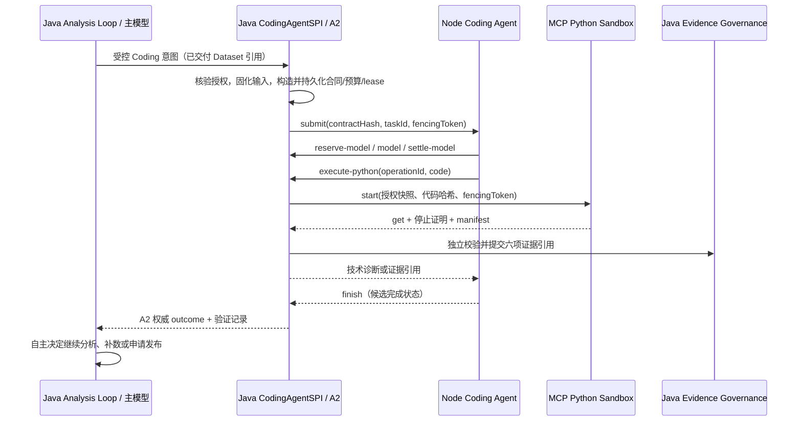

# Runtime OS Coding Agent：D1 验收与 D2 接线准备

日期：2026-10-15。结论：**D1 阻断，D2 不启动编码，G3 未通过。** 本报告依据当前源码和本轮重新运行的测试，不把 Node 容器健康、Java 控制器直调或确定性替身模型等同于生产跨进程验收。此前生产联调记录显示 Coding/Cline 未启用；本轮没有重新访问生产环境，也没有改动现有 API/MCP。

## 验证范围与结果

- `npm.cmd test`（`coding-agent-node`）：11/11 通过。覆盖 Cline SDK 使用确定性模型的技术错误修复循环、异步 Python 停止确认、工具拒绝、HTTP 会话鉴权、回调签名与 fencing 接管；**没有真实模型**。
- `mvn -pl chatchat-api -am test '-Dtest=CodingTaskPersistenceTest,CodingEvidenceDockerIntegrationTest,ClineCodingAdapterDispatchTest,ClineModelCallbackControllerTest,ClineCallbackAuthFilterTest,ClineModelReceiptStoreTest' '-Dsurefire.failIfNoSpecifiedTests=false' '-Dfrontend.skip=true' '-Dfrontend.install.skip=true' '-Dcoding.realDocker=true' -q`：39/39 通过。其中 A2 数据库并发/恢复 27 项，真实 Docker/H2 证据链 3 项，Java→Node HTTP 分发桩 1 项，模型回调 4 项，回调认证 3 项，模型回执 1 项。Docker 测试中的 Java 回调为控制器直调，模型为替身；未验证 Java HTTP→Node 容器→真实服务端模型→MCP 的完整链路。
- `mvn -pl chatchat-agents -am test '-Dtest=ModelNativeAnalysisHarnessTest,DataWorkspaceOperationsTest' '-Dsurefire.failIfNoSpecifiedTests=false' '-Dfrontend.skip=true' '-Dfrontend.install.skip=true' -q`：39 项中失败 26、错误 2。大量测试桩只实现 `ChatModel.chat(String)`，而 Harness 默认使用 `ChatModel.chat(ChatRequest)`；例如 `ModelNativeAnalysisHarness.java:125-128` 与 `ModelNativeAnalysisHarnessTest.java:65-67`。这是 D2 回归基线阻断；不能将这些失败简单归因于 D2 变更，因为本轮没有修改 Harness。

## D1 逐项验收

| 项目 | 源码位置 | 实际实现与证据 | 结论/缺口 |
| --- | --- | --- | --- |
| `submit` | `CodingAgentSPI.java:7`、`DurableCodingTaskService.java:46-67`、`ClineCodingAdapter.java:46-69`、`server.js:98-125` | A2 在返回前持久化接受状态；同 ID 同 hash 幂等，不同合同冲突；先领取 lease 再投递 Node。`CodingTaskPersistenceTest` 覆盖事务、重复提交与多连接竞争。 | **局部通过**。Java→Node 网络超时后没有可证明的分发收据；Node 会话仅内存，不能据此宣称生产提交闭环。 |
| `query` | `ClineCodingAdapter.java:72`、`DurableCodingTaskService.java:70-72`、`server.js:127-132` | SPI 查询返回 A2 权威快照；Node `/v1/runs/get` 只供适配器核对。A2 持久化测试通过。 | **通过权威查询**。Node 重启后其会话查询为 404，A2 仍可读，但未必能自动收敛到终态。 |
| `cancel` | `DurableCodingTaskService.java:74-80`、`ClineCodingAdapter.java:74-85`、`runner.js:61-62,181-184`、`CodingPythonExecutionBridge.java:90-95`、`PythonManagedExecutionService.java:125-161` | 先持久化停止请求，再通知 Node；已知 Python 操作还会通过 MCP 停止容器。A2 竞争测试及真实 Docker 取消测试通过。 | **部分通过**。Node 不可达时可留下停止请求与待核对执行；`aborted` SDK 状态没有提交 A1 `CANCELLED` 的完整路径，停止证明与终态收敛尚未验收。 |
| `resume` | `DurableCodingTaskService.java:82-113`、`ClineCodingAdapter.java:87-136`、`PythonManagedExecutionService.java:172-177,260-370` | 过期 lease 可用新 fencing 接管；已知 Python 操作查真实状态；已有模型回执可核对，未知模型调用不重放且保留预留。A2 文件数据库/独立 JVM 恢复测试通过。 | **部分通过**。Node `runs` 为进程内 `Map`（`server.js:89`）；重启丢失 Coding Loop。无启动意图或 Node 丢失会话的任务缺自动收尾策略；跨进程 D1 恢复未测。 |
| `subscribe` | `DurableCodingTaskService.java:297-356`、`ClineCodingAdapter.java:139-140`、`ClineModelCallbackController.java:131-133` | A2 从序号重放并每 250ms 追尾；A2 跨服务实例订阅测试通过。最近 128 条事件保留，旧游标明确返回 `EVENT_CURSOR_EXPIRED`。 | **A2 通过，D1 事件不完整**。Node `/event` 只收到 revision，没有把 SDK 事件写入权威日志；订阅只能看到 A2 状态/预算事件，不能恢复完整 Coding 过程事件。 |
| 状态、竞争与幂等 | `CodingTaskOutcome.java:20-136`、`DurableCodingTaskService.java:95-113,135-282`、`JdbcRuntimeEvidenceStore.java:79-112`、`PythonManagedExecutionService.java:51-115` | A1 限制合法转换与终态不可逆；A2 通过同一租户分区事务和 revision/fencing CAS 管理所有权、预算及事件；MCP 对同一操作校验请求 hash/fencing。A2 27 项测试和 Docker 回调重复请求通过。 | **基础设施通过**。Node 同 taskId 的旧内存会话遇新 fencing 返回 409；多次模型/工具执行的完整恢复仍需测试。 |
| 身份映射 | `CodingTaskContract.java:9-22`、`runner.js:12-16`、`CodingPythonExecutionBridge.java:76-84`、`McpPythonControlPlanePort.java:52-60` | task 唯一键是 tenant/user/run/taskId；Python `operationId=cline-SHA256(scope,taskId,toolCallId)`；A2 start intent 和 MCP 持久行共用该 operationId，MCP 另存 attempt=1、fencing token、稳定容器名。 | **语义部分清晰**。A1 没有独立 `attemptId`/`executionId`；D1 固定 attempt=1。不能把 Node SDK session ID、MCP operationId、Docker container ID 互称 executionId。后续重试必须定义新 operationId 与 attempt 关系。 |
| 超时、预算、异常终态 | `DurableCodingTaskService.java:207-282,418-426`、`ClineModelCallbackController.java:55-129,137-218`、`ClinePythonCallbackController.java:50-117`、`PythonManagedExecutionService.java:282-370` | 模型/代码执行先预留预算；未知费用保留预留；Docker 能确认停止及归档；SDK 正常完成且六项证据可信时提交 `COMPLETED`，无未知操作的 SDK `failed` 可提交 `FAILED`。 | **阻断**。截止时间和预算超额可形成持久停止请求，但缺后台终态收敛；`aborted`/容器 `TIMED_OUT`/`UNKNOWN`/Node 崩溃与 A1 终态映射不完整。不能把 HTTP 超时当作执行停止。 |

## D1 最小修复清单

1. **P0：统一停止与终态核对。** Java 根据 A2 停止原因、Node 状态及 MCP 的 `executorStopped`/receipt，分别形成 `CANCELLED`、`BUDGET_EXCEEDED`、`FAILED` 或持续 `RUNNING+reconciliationRequired`。覆盖取消发生在模型调用、Python 执行、归档和 Node 失联期间；未知执行不得伪造停止确认。
2. **P0：恢复与重复分发。** 为 Java→Node 投递定义可持久核对的 dispatch identity/receipt；Node 重启后先查 A2 与 MCP，明确“可安全重建 Coding Loop”与“必须保留未知结果”的分界。旧 fencing 会话不得阻挡合法新 owner，也不得重放已完成代码或模型调用。
3. **P0：真实 HTTP/模型验收。** 在隔离的 staging 环境以项目现有服务端模型配置验证 Java→Node→Python→Evidence，覆盖真实模型用量、代码报错修复、取消、预算、超时和容器重启；生产服务仍保持关闭，直至通过。
4. **P1：事件转换与断线续传。** 将安全、限长、去重的 SDK 事件转换为 A2 持久事件，明确 128 条历史窗口和过期游标回退到权威快照的规则；禁止把 Node 内存事件当权威状态。
5. **P1：工具契约对齐。** 当前 Java 仅接受 `python_execute`，而 Node 源码还定义 `metadata_read`/`artifact_read`；实现受控回调及预算/授权，或在 Node 入口同步拒绝并从可见能力中移除。保留原模板取数边界。

## D2 接线设计（仅设计，尚未编码）

源码中的主分析入口为 `AnalysisCoverageCoordinator.analyzeWithHarness`（`AnalysisCoverageCoordinator.java:173-204`），其 `ModelNativeAnalysisHarness` 已允许模型自主决定证据请求，但明确拒绝通用 `CALL_TOOL`（`ModelNativeAnalysisHarness.java:231-234`）。`HarnessToolAccess` 的 factory/字段未进入此路径，不作为 D2 接线点。当前公共请求类型是 `CodingTaskContract`，仓库中不存在 `CodingTaskRequest`。

主模型只在自己判断现有已交付 Dataset 需要程序化计算或技术验证时，提出**受控 Coding 意图**（目标、确切 datasetReference、期望产物）。它可以直接完成分析，无须调用 Coding。Java 从当前 run 的 Dataset 集合选择句柄，重新核验租户/用户/run、授权决定、模板来源、输出限制和累计预算；Java 构造合同、固定工具白名单，并调用 `CodingInputSnapshotService` 生成不可变输入。模型不能提交自己的 `decisionRef`、预算、文件路径、数据库连接或网络策略。

Node 接收 `CodingTaskContract` 与 fencing token，在 SDK 内决定编程、技术修复和工具顺序。候选代码经 `/execute-python`，错误诊断来自归档 stderr，执行产物仅为 MCP operationId 与六项 Runtime 证据引用。Java 用 `CodingEvidenceCollector` 独立验证代码哈希、manifest、Schema、行数、执行回执、输入血缘和业务校验；`COMPLETED` 只表示编程任务完成，业务 `validationStatus` 单独判断。D2 仅在证据已提交且校验满足分析使用策略时，通过 `registeredResult` 将派生 DatasetHandle 加入后续分析轮次，同时保留原始 Dataset；数据不足则返回结构化缺口，由主循环决定是否再次通过原有授权模板取数。Node 没有修改分析目标、取数授权或报告发布的接口。

## Java / Node / Python 契约差异

| 差异 | 当前事实 | D1/D2 处理要求 |
| --- | --- | --- |
| 状态 | A1 为 `CREATED/RUNNING/COMPLETED/PARTIAL/FAILED/CANCELLED/BUDGET_EXCEEDED`；Node SDK 使用 `completed/failed/aborted`；MCP 使用 `ACCEPTED/STARTING/RUNNING/SUCCEEDED/FAILED/CANCELLED/FENCED/TIMED_OUT/UNKNOWN`。 | 由 Java 明确映射，Node/MCP 状态只作为事实输入；终态需要停止证明与 A2 CAS。 |
| 身份 | A1 taskId；Node toolCallId 派生 operationId；MCP 同一 operationId 下固定 attempt=1、另存容器名。 | 定义 task、模型操作、代码操作、attempt、容器实例各自身份；不要暴露 Node session。 |
| 事件 | A2 可重放 128 条权威事件；Node `/event` 当前只获 revision。 | 持久化经校验的 SDK 事件；客户端保存游标，过期读权威快照。 |
| 预算 | A1 涵盖模型、Token、工具、代码执行、CPU、费用与输出；模型实际费用可能未知；MCP Docker 的瞬时资源限制与累计预算不同。 | 未知费用保留预留，不能按零结算；硬限制只对实际强制的维度承诺。 |
| 工具与结果 | A1 允许通用工具列表和多文件输出；D1 Java 只接受单一 `python_execute`、单输入快照、`main.py`、单 JSONL 结果；Node 源码仍含未贯通的元数据/产物工具。 | 先按已实现能力下发合同；新增工具逐项实现 Runtime 授权与预算，不开放自由 SQL、宿主 Shell 或通用 CALL_TOOL。 |
| 错误 | Java SPI 使用 `CodingAgentSPI.Error`；Node HTTP 主要返回状态码/message；MCP 回执另有失败原因。 | 统一稳定错误码、可重试性、已知执行引用；HTTP 超时只能标记未知结果。 |

## 端到端测试矩阵与下一阶段任务

| 场景 | 要验证的断言 | 当前证据 |
| --- | --- | --- |
| 不调用 Coding | 主模型直接用原模板 Dataset 完成分析，取数及发布路径不变 | D2 未接线；Harness 现有测试基线失败 |
| 授权数据 → 代码 → 证据 | 精确快照、一次容器、六项引用、派生 Dataset 可完整读取 | 本地控制器直调 + 真实 Docker/H2 通过；跨进程真实模型未测 |
| 技术错误修复 | SDK 至少两次代码尝试，操作 ID 不同，共享预算，不重复已完成操作 | Node 确定性模型测试通过；真实模型未测 |
| 故障注入 | 类型错、缺失交易日、重复记录、Decimal 精度、对账不一致；标准答案对 Node 不可见 | 部分固定 Decimal/重复记录校验已测；完整 D3 未测 |
| 并发与重试 | 同合同幂等、不同合同冲突、旧 fencing 拒绝、Java 超时不双启动 | A2/MCP 本地测试通过；Java→Node 跨进程超时未测 |
| 取消/预算/截止时间 | Node 停止生成、Docker 停止确认、A2 进入正确终态、迟到费用保留 | 停止传播与 A2 竞争分层测试通过；跨层终态映射阻断 |
| Node/Java/MCP 重启 | 查询已知执行、未知调用不重放、事件游标恢复、产物仍可读取 | A2 文件库/跨 JVM 和 MCP Docker 分层测试通过；整链路重启未测 |
| 越权与回归 | 跨租户、篡改快照、直接业务库/自由 SQL、未经授权元数据均拒绝；模板取数回归通过 | A2/B/C 分层测试部分覆盖；D2 主分析回归阻断 |

执行顺序：先修复 D1 的停止/恢复/事件缺口并完成真实 HTTP+模型+Docker 验收；再修复 Harness 结构化 `ChatRequest` 测试桩，取得稳定主分析回归基线；最后才实现 D2 的受控 Coding 意图、异步挂起/恢复及派生 Dataset 登记。每一步保持原授权模板取数链不变。

## 2026-10-15 后续实施与联机核对

本轮完成了以下最小代码改动，未接线 D2：

- `DurableCodingTaskService` 增加受当前 lease/fencing 和 revision CAS 保护的 `finishStoppedAfterReconciliation`。只有已收到停止请求且所有已启动操作均有可信停止证明，才能写入 `CANCELLED` 或 `BUDGET_EXCEEDED`；未知执行仍停留在待核对状态。增加只读合同与“曾启动外部操作”查询，防止 Node 重启后重放已执行的模型或 Python 操作。
- `ClineModelCallbackController` 接受签名且绑定当前 fencing 的 SDK `aborted` 完成回调，并在已接受停止请求时按 A2 状态结束任务。缺少操作停止证明返回冲突，迟到完成不得覆盖取消。`ClineCodingAdapter.resume` 重新传播停止请求、核对 Node 与 Python 状态；仅在 Node 会话缺失且从未启动外部操作时重派发。`submit` 也不会重放已有启动意图。
- Node `/v1/runs` 拒绝仍在运行的旧 fencing 会话并请求其停止；旧会话进入终态后，允许更高 fencing 重新创建 SDK 会话。新 fencing 可以查询及取消旧会话，旧 token 不能控制新会话。没有把 Node 内存状态提升为 A2 权威结果。

本地回归：`coding-agent-node` 的 `npm.cmd test` **11/11 通过**；Java 定向回归 **39/39 通过**，其中 A2 持久化测试 27、真实 Docker/H2 证据测试 3、Java→Node HTTP 分发桩测试 1、模型回调测试 4、回调认证测试 3、模型回执测试 1。覆盖取消早于模型调用、模型在途时禁止伪造终态、模型回执核对后取消，以及持久化未知执行拒绝终态。真实 Docker 测试仍为 Java 控制器直调及替身模型，不构成跨进程真实模型验收。

联机核对（服务器 `192.168.195.221`，未提交真实 Coding 任务）：现网 API `8080/` 为 200，MCP `8090/actuator/health` 为 200，隔离的 Node 暂存容器健康。容器到 Java `/internal/coding/cline/reserve-model` 为 **404**；部署中的 Java JAR 含 `ClineCodingAdapter.class`，但不含 `ClineModelCallbackController.class`，确认是部署产物缺少回调实现，而非容器网络故障。仅更新隔离的 Node 暂存容器，未替换生产 API/MCP。复核时发现暂存 `runner.js` 与本地版本不同，已同步并重建；最终镜像 `sha256:d9d213a2259cff76588bd47ee6bdecf59cbf330568d2a679a19b305d52699558b`，容器内 `server.js` SHA-256 为 `925391b0f8b254c27fd284335047972ab59ca0385ae0e2cda2a342d40b3be28f`、`runner.js` SHA-256 为 `8e4ec1f43399ff7c8a9be7cd966719d6278bc4436a41aba9fdf34bdee59d9ce5`，均与本地一致。旧镜像保留为 `runtime-coding-agent:before-d1-fencing`；中间镜像保留为 `runtime-coding-agent:before-runner-sync`。构建所需 Docker Registry 不可达，暂存镜像通过已部署的本地基镜像叠加源码文件产生。

更新后的暂存容器使用完全虚构的 `debug` 身份和无工具合同发起一次合成 HTTP 请求：`POST /v1/runs` 返回 202，稍后 `GET /v1/runs/get` 显示 Node 状态 `FAILED`，错误明确为 `internal/coding/cline/reserve-model` 路由不存在。该请求没有 A2 任务、授权业务数据或 Python 执行；它只验证网络与缺失回调的故障位置。

本地已通过 `mvn -pl chatchat-api -am package -DskipTests -Dfrontend.skip=true -Dfrontend.install.skip=true -q` 生成新 API JAR（399273148 字节，SHA-256 `282278779c500066386fb666e028d6f7408645220752c5df4aa2694e7dbbe611`），包内包含 `ClineModelCallbackController.class` 与 `ClineCodingAdapter.class`。该产物尚未部署；直接替换现网 8080 会越过隔离 Java 环境和真实模型验收，不作为此次联机调试步骤。

**D1 仍阻断。** Java 新回调尚未部署到隔离的 Java 暂存服务，真实服务端模型、Java HTTP→Node→Sandbox→Evidence 整链路未测；Node SDK 事件尚未转换为 A2 权威事件；外部操作已启动但 Node 会话丢失时仍只能保留未知状态与预算预留，不能安全重放或伪造停止。生产 Coding 开关继续关闭，D2 不启动编码。

## 2026-10-15 隔离 Java/Node 联机续验

前一段所述“Java 新回调尚未部署”是当时状态。本次已把修复后的 JAR 部署到**独立暂存目录** `/opt/coding-deploy-stage-20261015/java-stage`，并在 `172.30.91.1:18080` 启动独立 Java 实例；生产 API `8080`、MCP `8090` 和原 Node 暂存容器 `8791` 均未替换。暂存 Java 使用独立的 H2 文件库、关闭 MCP 中心和 OpenSearch、以仅供隔离验证的最小 Runtime 语义策略启动；它没有生产模型资源、真实业务数据或完整模板策略，不能代替生产验收。新 JAR 的本地与服务器 SHA-256 均为 `e19a5b5f42f8978b08cf3c539cddd95ab1599feacac037fa988333c4c308e1a7`。

启动暴露了 `ClineCallbackAuthFilter` 双构造器装配错误：Spring 曾尝试无参构造，应用无法启动。现在给生产构造器显式加 `@Autowired`，并新增 `ApplicationContextRunner` 装配回归。`mvn -pl chatchat-api -am test -Dtest=ClineCallbackAuthFilterTest -Dsurefire.failIfNoSpecifiedTests=false -Dfrontend.skip=true -Dfrontend.install.skip=true -q` 通过，重新打包通过，暂存实例完成启动。此前新 H2 无已发布语义策略、默认 OpenSearch 无授权也各自使启动失败；它们通过**仅暂存**的 H2 策略记录及 Lucene 配置解决，没有修改生产服务或数据库。

独立 Node 容器 `coding-agent-d1-stage` 位于 `172.30.91.11`，仅向宿主 `127.0.0.1:8792` 映射 HTTP，使用非 root、只读根目录、无 Docker Socket、无额外能力和 2 GiB 内存限制。最初 `host.docker.internal` 指向默认 Docker 网关 `172.17.0.1`，而 Java 只监听专用网关 `172.30.91.1`，导致 `ECONNREFUSED`。暂存 Node 的回调 URL 改为 `http://172.30.91.1:18080` 且白名单仅含此地址后，联通性恢复。

| 联机检查 | 实测 |
| --- | --- |
| 新 Java `/internal/coding/cline/reserve-model` 无签名请求 | 401；此前生产 JAR 对该路由为 404，证明暂存新 JAR 路由已生效。 |
| 来自白名单 Node 地址的签名回调，空 JSON | 400；请求通过签名/来源过滤，随后因缺任务绑定由控制器拒绝。 |
| Node `POST /v1/runs` 虚构、无工具、无业务数据的任务 | 202；稍后 Node 状态 `FAILED`，错误 `Coding task state rejected callback: NOT_FOUND`。这符合 Java A2 没有该任务的预期，证明 Node→Java 实际签名调用、路由和 A2 边界均参与。此请求没有触发模型或 Sandbox。 |
| 暂存 Node 鉴权健康接口 | 200。 |
| 原生产 API `/`、MCP `/actuator/health` | 分别 200、200；原服务继续运行。 |

**D1 仍阻断，G3 未通过，D2 未编码。** 本次仅完成跨容器回调传输与拒绝路径。由于当前 Java 没有可供隔离验收调用的 Coding 任务入口，且暂存 H2 没有服务端模型配置、授权 Dataset 快照及 Python 控制面配置，尚不能发起真实的 A2 Coding 任务，也不能证明模型→Python→六项证据链。下一步需建立受控的暂存任务驱动/夹具，把既有服务端模型配置安全引入隔离环境，完成真实 MCP Python 操作及证据回流；随后测试取消、预算、重启恢复和事件断线续传。不得把此次虚构任务的 202/FAILED 当作 D1 通过。

联调结束后已停止新增的 `coding-agent-d1-stage` 容器和 `18080` Java 实例，保留隔离暂存文件以供复验；复核生产 API/MCP 仍分别返回 200。原有 `8791` Node 暂存容器未改动。
