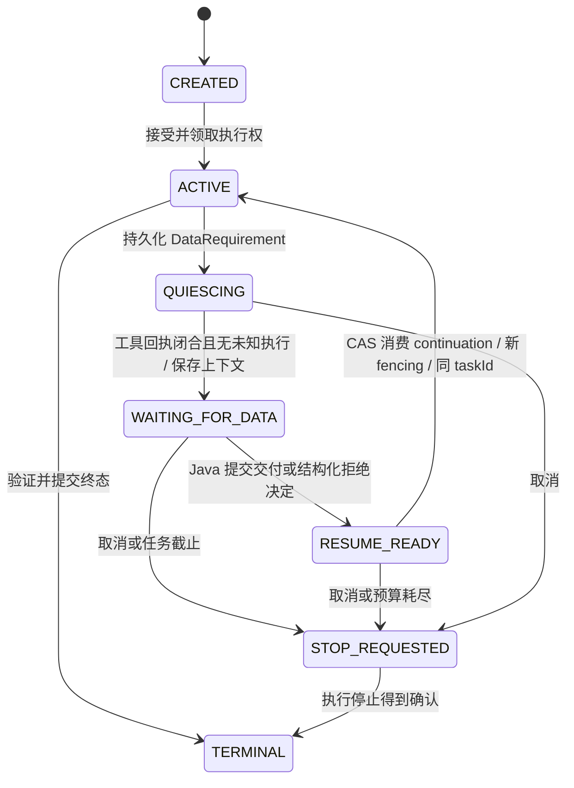
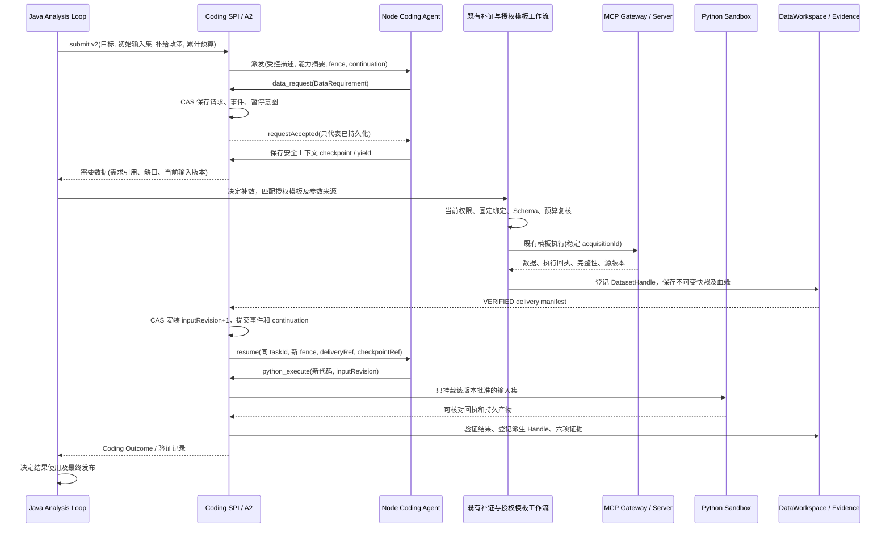

# Runtime OS Coding Agent 受控数据补给：源码审查与设计 v1

审查日期：2026-10-15。范围：当前工作区源码及已安装的 `@cline/agents@0.0.93`。本轮仅静态源码审查与协议设计；没有修改执行代码、部署服务或进行新的联机验收。此前工作区内的 D1 改动予以保留。

## 1. 结论与架构边界

采用 **Node 提出数据需求 → Java 主分析循环决定是否补数 → 既有授权模板工作流取数 → DataWorkspace 登记不可变快照 → 同一 Coding Task 增量继续**。

当前系统具备数据快照、受控模板执行、补证接口、A2 持久化及证据归集基础，但尚不支持 Coding Task 的等待补数与增量继续。不能把现有 `resume(scope, taskId)` 解释成已经支持新数据交付。

Node 不连接 MCP Server、数据库、元数据服务或业务 API。Node 的业务数据输入只能来自 Java 已批准的交付。原始数据文件保留在 Runtime 管理的 Sandbox 快照存储；Node 获得任务目标、不可变快照描述、完整 Schema、经批准的业务口径及能力摘要，必要的样例也必须经过明确授权。Node 发出的 Python 执行请求由 Java 决定挂载哪些文件。

**保留原有 MCP 资产发现 → 授权模板选择 → 参数绑定 → 执行模板 → DatasetHandle / Evidence Bundle 路径。** 补给协调器只连接既有能力，不实现新的模板目录、授权规则、SQL 执行入口或 Evidence Store。

## 2. 实际源码审查

以下“已有”仅表示源码实现存在，不表示对应能力已通过生产验收。

| 能力与源码定位 | 实际情况 | 复用或新增判断 |
| --- | --- | --- |
| [CodingAgentSPI](../chatchat-common/src/main/java/com/chatchat/common/runtime/coding/CodingAgentSPI.java)：`submit/get/cancel/resume/subscribe` | `resume` 没有 continuation、delivery 或 input revision 参数。没有数据需求接口。 | 复用 SPI 与任务身份；需要版本化补给扩展。 |
| [CodingTaskOutcome](../chatchat-common/src/main/java/com/chatchat/common/runtime/coding/CodingTaskOutcome.java)：`Status`、`validateAgainst` | 状态仅 CREATED、RUNNING 及五种终态，没有 WAITING_FOR_DATA。第 141 行起校验 Outcome 的 inputSnapshotRef 必须等于原合同引用。 | 冻结 v1；不能直接添加新输入引用而宣称兼容。 |
| [CodingTaskContract](../chatchat-common/src/main/java/com/chatchat/common/runtime/coding/CodingTaskContract.java)、[CodingProtocol](../chatchat-common/src/main/java/com/chatchat/common/runtime/coding/CodingProtocol.java) | 单个 inputSnapshotRef；固定 allowedDataRefs、验证计划与 budget；只接受 `runtime_os.coding.v1`。 | 新任务需协商 v2；既有 v1 任务保持固定输入。 |
| [DurableCodingTaskService](../chatchat-agents/src/main/java/com/chatchat/agents/runtime/coding/DurableCodingTaskService.java)：`submit/claim/reserve/startIntent/events` | 同 taskId 不同合同 hash 拒绝；预算身份、租约、fencing、revision CAS、任务事件已有实现。没有 input revision、delivery 或补给账本。 | 复用同一 A2 journal/事务，不新建任务管理系统；新增补给记录与控制转换。 |
| [CodingInputSnapshotService](../chatchat-api/src/main/java/com/chatchat/api/runtime/coding/data/CodingInputSnapshotService.java)：`capture/requireAuthorized` | 从当前 Analysis Loop 已交付 Dataset 中选取；扫描保存内容哈希与 Schema，上传后登记证据。要求精确行数、最多 64 MiB；`requireAuthorized` 要求 allowedDataRefs **恰好一个** fileId。行数检查不能证明可变分页源的一致性。 | 可复用快照生产和授权解析；多数据集、快照版本集与源一致性需要扩展。 |
| [CodingValidationPlanService](../chatchat-api/src/main/java/com/chatchat/api/runtime/coding/evidence/CodingValidationPlanService.java)：`register/validator` | 验证计划绑定具体 taskId 和 inputSnapshotRef。 | 新 input revision 必须产生或重绑定可信验证计划，不能照用旧计划。 |
| [DatasetHandle](../chatchat-agents/src/main/java/com/chatchat/agents/orchestration/analysis/dataset/DatasetHandle.java)、[PagedDatasetHandle](../chatchat-agents/src/main/java/com/chatchat/agents/orchestration/analysis/dataset/PagedDatasetHandle.java) | 有分页、扫描、contentSha256、descriptor；接口没有 datasetVersion、source watermark、delta、快照隔离保证。Paged 实现依赖 reader 的一致性。 | 可复用读取抽象；版本与源一致性放在外层快照描述，不整体改造 Handle。 |
| [SpillDatasetHandle](../chatchat-agents/src/main/java/com/chatchat/agents/orchestration/analysis/dataset/SpillDatasetHandle.java)、[DataWorkspaceOperations](../chatchat-agents/src/main/java/com/chatchat/agents/orchestration/analysis/graph/DataWorkspaceOperations.java)：`retain` | Spill 保存不可变分页内容；retain 以内容和运算请求产生派生 ref、血缘、handle 与 checkpoint。其数据集 map 本身不是完整跨进程数据集版本目录。 | 复用存储和登记形态；不把内容哈希误当源数据版本或一致性证明。 |
| [CodingEvidenceCollector](../chatchat-api/src/main/java/com/chatchat/api/runtime/coding/evidence/CodingEvidenceCollector.java)：`collect/registeredResult/resolve` | 已有 STAGED→VERIFIED→COMMITTED、独立回执验证及六项引用。registeredResult 返回现有 Dataset 形态，**不等于已接入主 Harness 的 sources map**。 | 复用收集器；增加精确到 input set/revision 的血缘和结果准入。 |
| [AgentEvidenceSupplementPort](../chatchat-common/src/main/java/com/chatchat/common/runtime/agent/AgentEvidenceSupplementPort.java)、[AgentToolRequest](../chatchat-common/src/main/java/com/chatchat/common/runtime/agent/AgentToolRequest.java) | 已有“远端提出需求，Runtime 决定本地操作”的接口；请求仅 evidenceType/minimumCount/reason，不能表达交易区间、粒度、字段等结构化需求。 | 复用职责与可信调用边界，新增 DataRequirement 到现有补证的映射；不能原样塞入 reason。 |
| [DefaultAgentComputeRuntime](../chatchat-agents/src/main/java/com/chatchat/agents/runtime/federation/DefaultAgentComputeRuntime.java)：第 92–135 行、`supplementRequirements` | 同步补证循环；attempt/deadline/requested 集合为方法内状态；按 requirement.type 去重；转换后丢失 AgentToolRequest.requestId；本地重新 invoke，远端 gateway.resume。 | 可复用补证结果合并原则，不能直接作为 Coding 的持久等待/同类多轮增量恢复实现。 |
| [KnowledgeAgentEvidenceSupplement](../chatchat-agents/src/main/java/com/chatchat/agents/runtime/federation/KnowledgeAgentEvidenceSupplement.java)：`supplementStructuredData` | 校验 skill/grants/scope；仅转发 Java request metadata 已有的 dataTemplateId、asset、environment、parameters；没有基于细粒度 DataRequirement 的语义选模板实现。 | 复用当前 STRUCTURED_DATA 分支的授权执行适配，补上 Java 侧需求解释和父工作流路由。 |
| [PreauthorizedStructuredDataOperator](../chatchat-api/src/main/java/com/chatchat/api/runtime/analysis/PreauthorizedStructuredDataOperator.java) → [RegisteredToolAnalysisOperator](../chatchat-api/src/main/java/com/chatchat/api/runtime/analysis/RegisteredToolAnalysisOperator.java) | 指定已批准模板，经 Skill/ToolRuntime 执行；前者当前固定最多 100 行、30 秒，校验 rows/rowCount/complete。 | 现有受控入口可复用；该分支并非任意规模数据下载器。截断结果不得包装成完整补给。 |
| [TemplateInvocationBridge](../chatchat-agents/src/main/java/com/chatchat/agents/runtime/toolcall/TemplateInvocationBridge.java)、[SchemaDrivenTemplateParameterBinder](../chatchat-agents/src/main/java/com/chatchat/agents/orchestration/SchemaDrivenTemplateParameterBinder.java)、[ToolRuntimeService](../chatchat-agents/src/main/java/com/chatchat/agents/runtime/tool/ToolRuntimeService.java) | 已有 Java 侧模板绑定、参数 Schema/来源审计、执行授权与恢复准入路径。 | 从父工作流调用现有入口，不在 Coding 层复制 binder 或调用底层工具跳过准入。 |
| [ModelNativeAnalysisHarness](../chatchat-agents/src/main/java/com/chatchat/agents/orchestration/analysis/graph/ModelNativeAnalysisHarness.java)：第 232 行；[AnalysisCoverageCoordinator](../chatchat-agents/src/main/java/com/chatchat/agents/orchestration/analysis/governance/AnalysisCoverageCoordinator.java)：`analyzeWithHarness` | Harness 明确拒绝 CALL_TOOL；主调用点直接 execute，未接入 withToolAccess。仅声明了 toolAccessFactory 并不代表主分析已可补数。 | 必须新增受控的父工作流交接/恢复点，不能开放通用 CALL_TOOL 或把 HarnessToolAccess 给 Node。 |
| [EvidenceGap](../chatchat-common/src/main/java/com/chatchat/common/runtime/analysis/recovery/EvidenceGap.java)、[EvidenceGapReason](../chatchat-common/src/main/java/com/chatchat/common/runtime/analysis/recovery/EvidenceGapReason.java) | 有 DATA_INCOMPLETE 等补证语义；字段主要面向 Claim/文档覆盖，不含结构化取数条件。 | 可关联 existing gapRef；不制造虚构 Claim，不强塞 SQL 参数。 |
| [Node runner](../coding-agent-node/src/runner.js)、[server](../coding-agent-node/src/server.js)、[runtime-model](../coding-agent-node/src/runtime-model.js) | 单输入硬约束；server 用内存 Map 保存会话，仅 start/get/cancel；runner 仅封装 run/abort/snapshot，snapshot 没有持久化。两个模型计数器创建时归零。 | 需要需求工具、安全暂停、checkpoint 与 continue 接线；恢复不能重置预算/模型 ordinal 或重放已运行工具。 |
| 本地 SDK `@cline/agents@0.0.93` 的 `dist/agent-runtime.d.ts` / `dist/index.js` | Agent 有 continue(input)、restore(messages)、snapshot()；restore 会清空 SDK usage、iteration、pendingToolCalls。没有平台 WAITING_FOR_DATA 的现成状态。 | SDK 提供继续上下文的基础，但不提供 Runtime 级幂等/持久恢复；必须由 adapter 补齐并测试。 |
| [Compose](../deploy/docker/coding-agent/compose.yml)、[Dockerfile](../coding-agent-node/Dockerfile)、[PythonDockerRuntime](../chatchat-mcp-server/src/main/java/com/chatchat/mcpserver/python/PythonDockerRuntime.java) | Node 已非 root、只读根目录、无业务挂载/Socket；Compose 没有出站默认拒绝策略。回调 host allowlist 只约束代码里的回调目标，不约束整个容器网络。Python 托管执行有 `--network none` 和按操作挂载。 | Python 隔离可复用；Node 强网络隔离仍需部署级强制措施，不能仅靠工具白名单宣称完成。 |

## 3. 版本与状态机决策

### 3.1 明确的兼容性影响

v1 不添加 WAITING 枚举，不修改旧合同 hash，不把等待映射成 CANCELLED/PARTIAL，也不通过更换 taskId 实现所谓续跑。旧任务的 `resume(scope, taskId)` 继续只有原有恢复语义。

动态补数采用**协商启用的 `runtime_os.coding.v2`**。原因不只是增加字段：v1 `validateAgainst` 强制原始输入引用相等，单文件授权和验证器也固定绑定。v2 必须明确以下差异后才能编码：

- 不可变任务合同固定 `initialInputSetRef`、目标、预算、父授权引用和补给策略；合同 hash 永远不随补数变化。
- 权威任务快照增加 `phase`、`inputRevision`、`effectiveInputSetRef`、待处理 requirementRefs、checkpointRef。主 status 仍用 CREATED/RUNNING/既有终态；等待时为 RUNNING + WAITING_FOR_DATA。
- v2 Outcome 的六项引用中，`inputSnapshotRef` 指向**最终操作实际使用的完整不可变输入 manifest**；验证规则改为匹配 A2 已批准的执行 inputRevision，而非等于初始输入。每个历史 operation 仍绑定自己的 manifest。
- JSON Schema、Java/Node DTO、canonical hash、能力协商、事件数据及校验器一起升级。v1 reader 不得把 v2 静默反序列化成 v1；不支持时返回 VERSION_UNSUPPORTED。
- 不在 v1 metadata/summary 里隐藏动态授权语义。新补给政策未在接受任务时持久化的任务，不允许中途自动获得补给能力。

### 3.2 Coding Task 阶段



QUIESCING、WAITING_FOR_DATA、RESUME_READY 都是 RUNNING 的内部阶段。QUIESCING 未确认安全边界时不能释放为“可继续”；未知 Python/model 操作仍走现有核对机制。TERMINAL 代表既有 COMPLETED/PARTIAL/FAILED/CANCELLED/BUDGET_EXCEEDED，保持终态不可逆。

A2 的 reserve/startIntent 必须同时检查 phase；仅检查 status=RUNNING 不够。WAITING_FOR_DATA 禁止新的模型/代码派发，父补证工作流使用其独立的受控执行身份。一次模型回复包含多个工具调用时，要先完成或明确处置全部调用并闭合结果，再保存安全 checkpoint；不能在未配对的 tool-call 中间恢复模型。

数据请求另有状态：`PROPOSED → APPROVED → ACQUIRING → FULFILLED/PARTIAL/EMPTY`；分支为 `DENIED/NEEDS_CLARIFICATION/TIMED_OUT/CANCELLED/FAILED/OUTCOME_UNKNOWN`。请求被拒绝不自动终止 Coding Task：Java 可以送回拒绝决定，主模型决定继续已有数据、澄清或结束。查询成功但零行是 EMPTY，不能混同授权拒绝或执行失败。

## 4. 受控交互时序



Node 没有到 W/M/业务源的网络调用。主分析循环是否补数、选择哪项已授权能力、是否继续分析，均由 Java 承载的主模型与现有治理流程决定。Runtime 校验边界，不按异常类型硬编码某种金融分析方法。

## 5. 建议接口契约（全部为待实现）

### 5.1 DataRequirement：需求不是执行计划

```json
{
  "schemaVersion": "runtime_os.coding.data_requirement.v1",
  "requirementId": "dr-001",
  "taskId": "coding-task-001",
  "contractSha256": "<root-contract-hash>",
  "baseInputRevision": 1,
  "capabilityCatalogRevision": "catalog-3",
  "objectiveRef": "objective:task-001",
  "reasonCode": "MISSING_REFERENCE_DATA",
  "reason": "现有交易快照无法判断区间内是否缺少交易日",
  "needed": {
    "semanticEntity": "交易日历",
    "fields": ["交易日期", "是否交易日"],
    "constraints": [{"field": "交易日期", "operator": "BETWEEN", "values": ["2026-01-01", "2026-01-31"]}],
    "grain": ["市场", "日期"],
    "completeness": "COMPLETE_RANGE_REQUIRED",
    "consistency": "COMPATIBLE_WITH_CURRENT_INPUTS"
  },
  "capabilityHintIds": ["cap-task-local-02"],
  "observedGapRefs": ["observation:missing-days-01"]
}
```

scope 由已鉴权的派发绑定解析，Java 不信任 Node 自填租户。请求采用严格 Schema、字段白名单、大小/次数上限；禁止 SQL、templateId、toolName、endpoint、凭据、宿主路径和任意 headers。语义筛选值是**未经授权的需求建议**，不是模板参数；主模型与 binder 必须用原用户目标、已有可信证据及参数来源规则重新核实。Node 提供的 gapRef 仅作观察，不能伪装成已验证的业务 Claim。

### 5.2 最小能力摘要

Java 在任务授权域内投影 `CapabilitySummary`：

```text
catalogRevision, expiresAt,
items[{ opaqueCapabilityId, semanticEntity, supportedMeasures,
        supportedDimensions, grain, units, supportedTimeSemantics,
        supportedSemanticFilters, scopeSummary, limitations }]
```

不下发真实模板 ID/源码、SQL、资产/数据库物理标识、连接地址、业务枚举全集、未授权字段或授权策略详情；opaque ID 只在该 task/catalogRevision 内有效，不能用于执行。敏感字段名和业务口径本身也需授权过滤。数量有界，目录缺省不代表该能力不存在，出现于目录也不代表取数已获准。目录过期时 Java 重新匹配和授权，禁止用旧摘要维持失效权限。

### 5.3 数据快照集与交付

`DatasetSnapshotDescriptor` 包含：任务内 alias、原 DatasetHandle ref、不可变 snapshotRef/version、内容哈希、Schema ref/hash、精确行数、字节数、完整性、覆盖范围、单位/币种/精度/时区/空值定义、源版本/水位线、可复现性限制与 lineageRef。空数据的 Schema 必须来自可信模板输出契约或受控元数据，不能仅靠采样推断。

`CodingDataDelivery` 包含：

```text
deliveryId, taskId, rootContractHash, requirementIds,
baseInputRevision, nextInputRevision, previousManifestRef,
inputSetManifestRef, inputSetHash, datasetSnapshots[],
decisionRef, acquisitionReceiptRefs[], validationPlanRef,
fulfillment{status, unmetNeeds, safeReasonCode}, committedAt
```

Java 权威 manifest 还记录补给授权决定、主工作流执行引用和 source/query/参数版本证据；Node 只接收其授权投影。不能要求 Node 上传一个 delivery 再信任其权限。

“增量交付”首先指**新增不可变数据集版本**，不代表自动按行追加。默认保留原快照并增加新 alias；更正版本显式声明 supersedes，不能覆盖旧文件。跨快照 join/去重由模型选择并由代码记录，Java 不猜测业务合并方法。一个 input revision 对应完整确定的输入集；每个 operation 绑定该版本及文件哈希，老操作不得看到后来补入的文件。

### 5.4 同任务继续

扩展现有 CodingAgentSPI，设计上可增加能力查询与 v2 重载，保持旧方法对 v1 的行为；不引入 AgentRuntimeProvider：

```java
CodingCapabilities capabilities();
CodingTaskSnapshotV2 submit(CodingTaskContractV2 contract);
CodingTaskSnapshotV2 inspect(KernelDataScope scope, String taskId);
CodingTaskSnapshotV2 resume(KernelDataScope scope, String taskId, CodingContinuation continuation);
```

新方法在未实现 adapter 上默认明确拒绝；旧 get/subscribe 不能把 v2 冒充 v1，必须按协商版本读取。`CodingContinuation` 包含 continuationId、expectedTaskRevision、deliveryOrDecisionRef、inputRevision、checkpointRef、checkpointHash。Java 从已提交引用解析内容，不接受 Node 控制任务状态、授权清单或已消耗用量。

内部 `CodingDataSupplyCoordinator` 仅承担请求持久化、父补证工作流关联、manifest 核验和恢复调度；调用现有授权服务，不实现自己的授权判断。Node→Java 新增 `data-request`、安全 checkpoint/yield 回调；Java→Node 新增 resume。Node 不拥有 commit-delivery 或授权接口。

同一 taskId、runId、budgetId 和根目标贯穿全部轮次。continuationId、modelCallOrdinal、toolOperationId 均持久化，不能重新从 `model-1` 起号。SDK 内存会话存活时使用 continue；进程重启后读取 Runtime 持久化的受控上下文，通过 restore/continue 重建供应商执行对象。重建 SDK 对象不等于重建业务任务，不重复执行历史工具。SDK restore 重置的内部计数不能作为权威用量。

安全 yield 是 adapter 新增的控制结果，不是调用现有 abort 后报告 CANCELLED。当前 runner 的 afterRun 总会调用 finish，server 也会把 SDK 返回映射为终态；这两个位置必须识别 WAITING 阶段并持久化暂停，而不是提交终态。代码版本、已完成工具回执和上下文 hash 都在 Java 保存；Node 自报 checkpoint 不能修改已验证执行事实。

## 6. 持久化、幂等、恢复与预算

- **事务边界**：请求状态、任务 phase、revision 和状态事件写入同一 A2 checkpoint journal，复用 RuntimeExecutionCheckpointPort 的事务/CAS。事务内只做纯状态变更，不执行 MCP 或模型请求。外部副作用通过已持久化 acquisition/start intent 驱动，未知结果先核对。
- **请求幂等**：键为 tenant/user/run/task/requirementId；相同规范化 payload hash 返回原请求，不同 hash 冲突。语义去重另用包含 baseInputRevision、实体、字段、范围、粒度和一致性要求的 fingerprint，不能再只按 STRUCTURED_DATA 类型去重。拒绝结果也持久化；不得通过换 requestId 无限重试。
- **规范化**：v2 明确 JSON canonicalization、UTC 时间、精确 Decimal 字符串、集合排序与有序数组的区别；Java/Node 共用跨语言 hash fixture。内容 hash、Schema hash、源版本与业务等价性分别记录，不能互相代替。
- **取数幂等**：保存稳定 acquisitionId 与主工作流 step/receipt。已执行模板只恢复/读取结果；HTTP 超时不代表未执行。现有模板节点若缺少执行端幂等或可查询回执，保持 OUTCOME_UNKNOWN，不宣称 exactly-once，也不盲目重复取数。
- **交付事务**：内容及 Schema 先保存和校验；delivery 复用 STAGED→VERIFIED→COMMITTED 原则；A2 CAS 安装已验证 manifestRef 与新 inputRevision，并产生恢复意图。存储间没有全局事务时，用不可变引用与可恢复提交状态衔接，不发布 STAGED 引用。重复 deliveryId 同内容返回原结果，异内容冲突。
- **继续幂等**：先识别已接受 continuationId，再处理 revision CAS；同 `(taskId, continuationId, inputRevision, fencingToken)` 不开启第二个 Coding Loop。等待期间释放活跃模型/工具调用，暂停时先保存完整工具调用/结果配对；恢复前提高 fence，旧 Node 回调不能提交结果。
- **恢复顺序**：先查 A2 请求/交付/恢复意图，再查主模板执行事实及 Python 事实，然后补齐归档和上下文，最后 continue。不能从“Node 会话不存在”推导“业务操作未执行”。无上下文 checkpoint 且无法从可信记录重建时，报告明确恢复缺口，不能伪称已续跑。
- **预算**：补给轮次、等待时长、快照行数/字节数有独立上限，受同一任务截止时间约束。语义匹配的模型调用、取数工具调用与 Coding 调用归入现有 run 预算并关联 task；同一调用只记账一次，不能在父补证与 Coding 两边重复扣费，也不能通过新建 request/task 重置预算。等待不产生模型轮询调用；未知费用保留预留。
- **取消竞争**：持久停止请求优先；正在取数的父 step 按其既有取消契约处理，无法确认停止则继续核对。迟到交付只记录隔离归档/核对引用，不触发 continue，不把终态改回 RUNNING；迟到费用/证据仅增加 revision。
- **授权变化**：匹配时、执行前、恢复取数结果和挂载前复核。原父模板固定绑定/授权域不足时，返回 NEEDS_CLARIFICATION 或 DENIED，由主分析循环走现有授权入口处理；不得让 DataRequirement 自动扩权。

## 7. 强隔离要求

1. Node 仅允许访问 Java 专用 Coding 回调入口；当前模型也由 Java 回调代调，因此无需 Node 外联模型网关。部署级出站默认拒绝，精确允许目的地址、端口及必要路径；仅允许服务器 IP 而开放其所有端口会同时暴露 8090。`expose`、只读文件系统、工具白名单和 callback host 校验均不能替代网络隔离。
2. 可使用现有部署平台的 NetworkPolicy 或 Docker 宿主机防火墙/受控反向代理实现；若 Java 与 MCP 共用主机，必须拒绝 Node 到 MCP、数据库、业务 API 及通用 Java 代理/SSRF 路由。局域网 IP 调用可以保留，但要验证该实际路径上的限制。
3. Node 不注入 MCP/数据库/业务 API 凭据，不挂 uploads、宿主目录或 Docker Socket；仅注入现有服务鉴权材料。任务委派凭据绑定 scope、task、contract、inputRevision、fence、有效期，由既有授权决定派生，不形成另一套业务授权策略。
4. 当前回调签名绑定 method/path/timestamp/nonce，没有覆盖 body 内容；生产数据补给需在可信传输层保护请求，并在版本化签名中绑定 body hash 与任务版本，防止传输中的数据替换。Node checkpoint 按租户加密保存、限大小，作为不可信模型上下文重新验证，不能授予工具权限。
5. Python 每操作独立工作区，`--network none`，输入与代码只读、输出专属可写；挂载清单由 Java 从该 operation 的已批准 manifest 生成。拒绝目录穿越、符号链接和任意 URL 下载，不挂整个 uploads。Node 只拿任务内 alias/固定受控路径，不决定宿主挂载路径。

## 8. 最小改造清单与验收

| 顺序 | 最小工作 | 复用点 / 验收重点 |
| --- | --- | --- |
| S0 | 冻结 v2 合同、快照、需求、交付、continuation、事件 Schema 及兼容性测试 | v1 hash/状态/输入绑定语义保持；未协商 v2 明确拒绝。 |
| S1 | 在 A2 journal 增加 phase、请求/交付/继续意图和 input revision | 沿用 CAS、lease、fencing、预算、事件事务；并发请求和取消不能丢失。 |
| S2 | CodingDataSupplyCoordinator 连接现有补证和父工作流 | 模板发现/授权/参数来源沿用既有路径；同类型不同范围请求都可处理；无通用 CALL_TOOL。 |
| S3 | 多快照 input-set manifest 与验证计划绑定 | 复用 snapshot/Spill/数据集登记；完整性、零行 Schema、源水位线、每次操作实际输入均可追溯。 |
| S4 | Node data_request、安全 yield、checkpoint、continue | 同 taskId 和预算；补数、拒绝、重启后均可继续；model ordinal 不归零；历史 Python 不重跑。 |
| S5 | 父分析循环受控等待与恢复、派生结果准入 | Harness 返回有类型的 pending action，由现有 workflow 调度；结果只经 registeredResult/验证后进入当前 sources map，不开放 HarnessToolAccess 给 Node。 |
| S6 | 部署网络与凭据边界验证 | Node 能访问 Coding 回调，但访问 MCP/数据库/元数据/业务 API 失败；Python 无网且跨任务文件不可见。 |

最小端到端验收矩阵：正常补给后同任务完成；同类数据两轮不同日期；重复/冲突 request 与 delivery；授权拒绝后继续已有分析；缺参澄清；成功零行与截断；源水位线不一致；取数超时但服务端已完成；归档中断；Node/Java 重启；暂停时有未配对工具消息；旧 fence/旧 input revision；交付与取消并发；授权撤销；超预算；跨租户引用；最终六项引用指向确切输入集且结果可完整读取。

门槛：本设计不改变既有 D1/G3 验收结论。D1 provider 超时未知结果及事件续传等未关闭项仍按原验收记录处理。数据补给协议与接口通过评审后再实施；当前不启用生产 Coding，也不以本设计宣称 D2 已完成。
