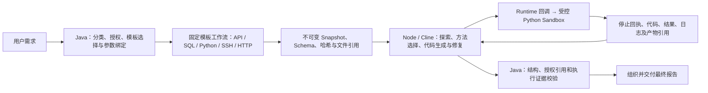

# Runtime OS / Coding Agent 架构改造交付记录（2026-10-20）

状态：候选已部署到指定验证环境，尚未通过生产替换门禁。代码提交 `a3edd427`（职责和 RAG 清理）、`40ad2e56`（联机发现的引用修复反馈及终态并发问题）。定向测试不能替代全量回归、真实模型业务正确性及性能验收。

## 1. 冻结基线与回退

| 项目 | 值 |
|---|---|
| 仓库 | `mschreinerhaw/Langchain4j-Chatchat` |
| 原分支 | `main`，冻结时工作区干净 |
| 基线 Commit | `4bd002584151cc2423ed6b08f377782243477e4b` |
| 备份分支 | `backup/runtime-os-before-coding-refactor` |
| Tag | `runtime-os-pre-coding-refactor-20261020`（annotated tag） |
| 开发分支 | `feature/runtime-os-coding-refactor` |

备份分支和 Tag 已原子推送，并以 `git ls-remote` 核对解析后的 Commit。当前基线已经包含上一轮 primary Coding 分析改造；不能把历史 `v1.1` 的性能数字当作本次冻结版本的实测。

父 POM 包含 19 个模块：data-migration、common、platform-spring、mcp-grpc、license、runtime-skill、agents、runtime-temporal、tools、runtime-mcp、runtime-news、runtime-market、knowledge-base、chat、enterprise、api、mcp-server、integration、e2e-tests（均带 `chatchat-` 前缀）。逐模块 Maven 依赖与源码扫描见证据目录中的 `baseline-source-audit.json`；根 POM 加模块共 20 份 POM。

源码回退采用独立工作目录，保留开发分支及其所有改动：

```powershell
git fetch origin --tags
git worktree add --detach ../runtime-os-pre-coding-refactor runtime-os-pre-coding-refactor-20261020
git -C ../runtime-os-pre-coding-refactor rev-parse HEAD
```

输出必须为上述基线 Commit。Tag 不包含运行时数据库、许可证、凭据及用户数据；环境恢复还需要部署前镜像、Compose/环境配置备份及原有持久卷。本次不进行数据库迁移，不删除历史向量索引或共享 OpenSearch 服务。

## 2. 架构与职责

旧链路历史上为：模板执行 → Java Evidence Analyzer → Java ModelNative Harness（读数、规划、计算、再委派 Coding）→ Java refinement → Java 最终改写。冻结版本已对 `DATA_ANALYSIS` 建立 primary Coding 分支，本次补上统一的归属检查以及旧入口的拒绝保护，防止兼容路径重新引入 Java 内容分析。

当前数据分析主链路：



- `RuntimeAnalysisOwnership` 供 Session 和 CoverageCoordinator 共用。已归 Coding 的数据分析误入 `ModelNativeAnalysisHarness` 或 `InterpretationPlanEvidenceAnalyzer` 时，在模型调用前报 `CODING_ANALYSIS_REQUIRED`。
- Node 的分析任务 Prompt 明确由 Coding 选择分析方法、生成代码、修复和撰写报告；固定模板的顺序、参数、授权及执行行为不交由 Coding 改写。
- 主链路沿用 `executePrimaryAnalysis` 一次性交付多个数据集；Java 记录 `primaryCodingDispatchCount`、`javaContentAnalysisModelCallCount`、阶段耗时及 Coding usage。
- `QA` 的既有正式入口由 `InteractionWorkflowCoordinator` 路由到 `DirectAnswerWorkflow`，不依赖旧 RAG 或 Python。用户选择的 Skills、模型和上下文继续有效。
- 旧 Harness 等类仍被兼容调用者及公共能力测试引用，未在缺少完整回归时直接删除。它们不属于正式 DATA_ANALYSIS 路径，并新增拒绝保护；这不等于宣称所有历史兼容代码已删除。

## 3. 代码变更清单

新增：`RuntimeAnalysisOwnership` 与其回归测试、`KnowledgeContextOrdering`、`CandidateLimitStage`、源码/测试/包体审计脚本及服务器候选装配脚本。

修改：`InterpretationAnalysisSession`、`AnalysisCoverageCoordinator`、旧 Harness / Evidence Analyzer 的入口约束、Node `runner.js` 的职责提示、知识上下文编译器、OpenSearch 文档索引、共享 Embedding 的配置判断、文档结果数量控制、五份应用配置及相关测试。

删除：`LangChain4jKnowledgeFusion`、`BgeDocumentCandidateReranker`、`DocumentCandidateReranker`、`CandidateRerankStage`，及相应专属旧测试。原融合测试转为上下文排序/Skills 保留测试，原可组合重排测试转为授权结果顺序与数量限制测试。

联机验证补充修改 `ClineModelCallbackController`、`ClineCodingAdapter` 及 Node：将报告的精确授权引用校验作为 `artifact_read` 反馈交回 Cline 修复，保留终态不可变约束，并在恢复提交竞争时返回已经持久化的终态。Java 不做业务语义重算或模型评审。

完整新增/修改/删除列表以 `git diff --name-status runtime-os-pre-coding-refactor-20261020...HEAD` 为准；机器清单和测试明细见 [交付证据目录](runtime-os-coding-refactor-20261020-evidence/)。

## 4. RAG 清理报告

已移除文档索引中的向量生成、KNN 查询、向量读取与本地余弦重排、混合向量评分、向量字段自动创建、KNN 初始化探测及相关统计字段。文档查询现在只走现有词法检索，并继续使用租户及显式授权文档范围。

已删除远程 BGE 重排 Bean、接口与配置；已删除 `dev.langchain4j.rag` 的上下文融合适配，改为对已授权 Skills 上下文进行确定性排序与去重，保留规则/约束的预算优先级。旧组件对应的类文件还必须从最终 JAR 中验证消失，防止增量编译保留已删除的 `.class`。

保留项及原因：

| 保留项 | 原因 |
|---|---|
| 模型 API、LangChain4j core / Skills | 通用模型、类型和 Skills 适配，不是 RAG 专属依赖 |
| `OpenSearchEmbeddingClient` / semantic schema | `DomainSkillIndexService`、`McpToolSemanticIndex` 共享；删除会破坏 Skills/MCP 目录能力 |
| OpenSearch 客户端与服务 | 业务元数据、模板、MCP、Skills 及通用词法检索仍使用；不属于可删除的 RAG 专属向量库 |
| MCP/新闻模块的语义业务检索 | 受控业务资源访问，Coding 不获得其执行器或凭据 |
| Python 模板语义索引、前端通用模型管理 | 仍被业务代码模板及共享模型配置使用，不是旧文档 RAG 入口 |
| Tika/OCR、文档版本、词法段落定位、显式文档访问 | 通用文档处理和授权访问，不因删除向量 RAG 而删除 |
| `KnowledgeEvidenceExpansionWorkflow` | 对已授权原文来源的确定性区段扩展，是仍有公共调用者的文档能力；不执行模型自由探索 |

没有发现可单独删除的 Maven RAG/Vector Store 专属依赖；本次不为“减少依赖数量”删除仍被公共能力使用的 core、Skills 或 OpenSearch 客户端。源码审计覆盖全部受跟踪源码、POM 与配置，同时列出反射/SPI/自动装配候选，逐项按调用者区分共享能力。`dev.langchain4j.rag` 源码导入由 3 处降为 0；剩余 14 处向量相关匹配均位于 Python 模板、Skills、MCP 和新闻业务索引。9 处间接装配候选涉及模板插件、元数据/迁移及驱动加载，没有发现退役组件的反射或 SPI 注册引用。

最终包除检查退役类外，还从五份内置默认配置移除文档 RAG 专属键。共享 API Key、模型名、Skills/MCP 配置及其他原始文本保留；装配脚本的独立测试验证作用域、字节保留及幂等性。

## 5. 任务契约

沿用 `CodingTaskContract`、`CodingInputManifest`、`CodingTaskOutcome` 和现有 Node HTTP / Runtime callback，不新增第二套任务协议。

| 边界 | 契约内容 |
|---|---|
| Java → Node | `schemaVersion`、task/scope、目标与验收引用、Snapshot/metadata/workspace 引用、授权、deadline/模型/Token/工具/CPU/内存/输出预算、输出 Schema、模型/Skills 快照 |
| 输入文件 | 版本化 Manifest、Schema、按模板/来源区分的数据分片；共享目录优先 Parquet，兼容 CSV；SHA-256、行数、逻辑列/存储列、null/missing 规则 |
| Node → Java → Python | 受控 `python_execute`，每次新 Sandbox；只绑定授权不可变输入，网络隔离；执行失败在同一 Coding 任务预算内修复 |
| 补数 | 仅通过已授权 `data_request`；Java 重查 Skill、模板、参数、字段和轮次，再生成输入修订；不能变更固定模板工作流或自行访问 MCP/数据库 |
| 结果 | 停止确认、代码哈希/产物、结果 Dataset、validation record、evidence bundle、日志/事件引用、usage；pending/unknown 不能充当结果 |
| 最终报告 | 单行 `reportMarkdown`、`evidenceReferences`、`limitations`；Java 验证结构和引用归属，结构成功不代表业务语义正确 |

`artifact_read` 对报告额外返回 `reportReferenceValidation`：精确引用是否属于当前任务的原始输入及受控补数快照，以及可使用的完整引用键。Node 将失败视为可修复工具结果；修复代码、重新执行并复核后才能完成。此校验不推断指标含义，也不将相似名称或缩写映射成授权来源。

取消、lease/fencing、幂等请求、检查点、恢复和重试继续由现有 DurableCodingTaskService/Node/Sandbox 协议管理。文件内容不反复送入模型 Prompt；现有显式允许的有界输入观察仍受契约限制。

## 6. 测试验收

首次完整基线命令：`mvn -Pbackend-only -Dfrontend.skip=true -Dmaven.test.failure.ignore=true test`。记录到了原有失败，且 Agents 的 RocksDB JNI 在 `HarnessToolRecoveryTest` 中触发 Windows `EXCEPTION_ILLEGAL_INSTRUCTION`，导致后续模块未执行；即使设置收集失败选项，Maven 仍失败。此选项用于收集失败，不用于通过门禁。

本轮定向 Java 组最初有一项 SQLGlot 环境条件未满足，随后在仓库临时目录安装 Python 3.11.9 / SQLGlot 30.23.0 并实际补跑，最终 **306/306 通过，0 跳过**。包含固定模板执行器 160 项，以及 primary Coding、越权拒绝、Snapshot/Parquet/CSV、回调认证、恢复、取消、知识上下文及文档检索检查。联机问题修复专项另有 **70/70 通过**，包括并发终态竞争和报告引用反馈。

Node 首轮为 40/41（恢复子进程启动超时），独立复跑恢复项成功；最终加入引用修复及拒绝错误完成场景后为 **43/43**。监控与 Python Coding 前端定向为 **6/6**。真实浏览器通过登录、只读会话、代码/哈希、XSS 文本呈现、模型、Skills、事件、离线恢复、搜索、移动布局、API 发现和退出等检查。

最终全量回归仍然失败：当前生成的 XML 共 **1,152 项，52 失败、39 错误、0 跳过**，此外有 RocksDB JNI 原生崩溃，后续依赖模块被 Maven 跳过；这些数值不是整个后端全部完成的总数。知识库模块 **174/174 通过**。具体失败为 Agents 51 失败/38 错误、迁移模块 `TargetBootstrapTest` 1 错误、新闻模块上下文测试 1 失败；完整名单见 `full-test-final-summary.json`。Agents 的数量与冻结基线一致，迁移错误也在基线存在；新闻模块在首次基线被前序失败阻断，不能直接宣称它是基线已有失败。

全量运行保留所有测试并收集失败，未移除/禁用失败测试来完成验收。`maven.test.failure.ignore` 仅使独立模块继续运行，最终判定依据包括 Maven 失败、XML 失败、原生崩溃及未执行模块，仍为不通过。

真实 QA 已通过，未创建 Coding 任务。第一次真实数据分析交付了两模板共 99 行 Parquet，Cline 完成两次 Python 执行并归档代码/结果，但因报告引用不属于精确授权键而被 Runtime 拒绝；另一个场景暴露了恢复与完成回调的终态竞争。两者已修复并重新部署，保留原始失败记录。

修复后的正式发布任务 **`c7741946-fcc1-383c-9c71-10bb24cbce8e` 为 `SUCCEEDED`，联机验收 `PASSED`**：两模板、98 行 Parquet、Cline 代码与结果归档、2 次 Python 执行、两个执行容器均已释放；执行器确认停止，无待对账标记。最终交付事件为 `coding_owned_analysis` 且 `modelCalls=0`，没有 Java 语义评审；Node 验证结束后活动会话为 0。`INCONCLUSIVE` / `STRUCTURE_AND_AUTHORIZED_REFERENCES` 明确表示结构和授权引用通过，不能冒充业务语义认证。此前历史报告的字段来源/业务口径问题仍需独立核对。

验收脚本也移除了旧的“必须出现 Java `CODING_SEMANTIC_REVIEW`”成功条件，改为验证上述经过引用门禁后的直接交付事件，并明确拒绝 Java 语义评审。脚本门禁有独立的正反向测试，不是简单跳过失败项。

## 7. 性能与部署

服务器为用户指定的 `192.168.195.221:5221`，验证环境根目录 `/opt/runtime-os-docker-stage`。凭据不写入交付文档。

冻结时镜像：API `runtime-os-api:protocol-recovery-87c4b3d27a0e`，Node `runtime-os-coding-agent:analysis-fast-461e165ad657`，MCP `runtime-os-mcp:protocol-recovery-e6ae569883d4`。依赖服务及容器状态记录在 `stage-before.json`。

新的实测基线使用正式任务 API、现有模板和注册模型，单独保存在服务器 `evidence/runtime-os-refactor-20261020/baseline`。该任务观测约 1,268 秒后取消，父任务 186 ms 内确认取消；补齐后台事件后确认已进入 Coding 模型调用、尚无 Python 执行。父任务显示 `PLANNING` 不能用于断言尚未取数；最初基于父状态的阶段判断已纠正。供应商侧请求终止没有得到确认。

首次候选场景约 611,563 ms 后失败（终态竞争），第一次两模板数据场景约 398,510 ms 后因引用门禁失败。失败/取消样本不能构成成功耗时改善对比；未采集到的 Java usage 必须记为未知，而非 0。历史 `v1.1` 的百分比不用于本轮性能验收。

最终成功的两模板样本测量如下，完整阶段和调用明细见 `performance-attempts.json`：

| 指标 | 本次成功样本 |
|---|---:|
| 端到端 | 462,433 ms（约 7 分 42 秒） |
| Java 模型调用 / 耗时 | 7 次 / 328,467 ms |
| Coding 模型调用 / 耗时 | 4 次 / 50,318 ms |
| 受控模板批次 / 耗时 | 1 次 / 482 ms |
| Python 执行 / 往返合计 | 2 次 / 6,831 ms |
| Java 输入 / 输出 Token | 30,252 / 32,547 |
| Coding 输入 / 输出 Token | 31,388 / 5,503 |
| Java 语义评审 | 0 次 |
| Python 容器待清理 | 0 |

这里的阶段耗时不应相加当作严格关键路径；它们的统计区间不同。主要已观测耗时仍在 Java 的上游规划、选择和参数绑定，尚不能宣称性能目标已达到。当前只有一个最终成功样本，而且冻结基线为取消、首轮候选为失败，不能计算可信的成功率改善、提速百分比或稳定 P50/P95。

最终候选只部署到验证环境：API `runtime-os-api:protocol-recovery-b34c60331f72`，Node `runtime-os-coding-agent:analysis-fast-b2d33c7e2bca`。装配器以运行中的 API 为基础，替换经 SHA-256 核验的 Agents/Knowledge 模块及白名单中的两个 Coding API 类家族，并清理五份默认配置中的退役键；其余 1,169 个归档条目及前端字节不变。配置清理保留模型/API/Skills/MCP 的原始文本。包体退役类残留为 0。

部署器在有活动任务时拒绝替换，备份配置和镜像，健康检查失败自动恢复。最终服务健康与网络隔离检查通过：Node 非 root、只读根目录、无 Docker Socket，业务库/MCP/外网连接探测均被阻断；未签名的回调与业务 API 返回 401。MCP 和其他容器保持原样，网关仅 reload。

性能报告必须包含成功/失败/取消样本、Java 与 Coding 模型次数、Token、取数与 Python 耗时以及未知值；一个样本不构成稳定 P50/P95。全量回归和真实业务正确性未通过前，候选不进入生产。

## 8. 环境回退顺序与剩余门禁

1. 通过官方任务控制 API 停止本轮任务，等待执行器停止/对账确认。
2. 如需回到最初冻结环境，恢复首次 API 部署前的 `/opt/runtime-os-docker-stage/evidence/runtime-os-refactor-20261020/backup-1792506826` 中的 Compose/环境配置，选择原 API `87c4b3d27a0e` 和 Node `461e165ad657` 镜像；保留持久卷及任务日志。后续备份对应中间候选，不应误作原始基线。
3. 按现有部署脚本重建受影响服务，恢复 worker 隔离规则，重载代理，检查健康与任务监控。
4. 核对原镜像和前端哈希；源码需要时从本报告 Tag 的独立 worktree 重建。

剩余门禁：修复全量失败并在兼容环境完成 RocksDB 相关回归，完成真实模型业务口径核对及同版本性能样本。九模板输入已有定向覆盖，但本轮真实 Parquet 场景是两模板约 100 行，不能冒充 6—9 模板的完整联机性能验收。Java usage、成本和资源计量缺失时应保留未知/不完整状态。兼容 Java 分析组件的进一步删除需要完整调用者迁移与回归，不能简单删除公共类来满足行数指标。未满足这些门禁前不替换生产版本。

服务器原始代码、执行日志、输入快照和任务事件留在原有受控存储及 `evidence/runtime-os-refactor-20261020`；不把凭据和源数据行提交到仓库。脱敏交付包为该目录下 `release-evidence.tar.gz`，本地副本为 `target/runtime-os-refactor-20261020/release-evidence.tar.gz`。仓库证据目录保留基线/最终源码审计、测试失败名单、模块/类覆盖哈希、部署备份位置、隔离结果和各次性能观测。
