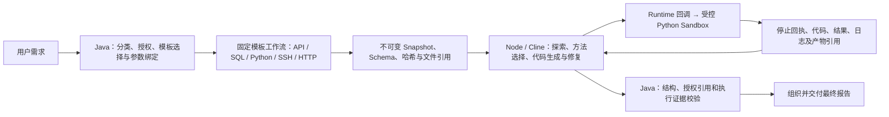

# Runtime OS / Coding Agent 架构改造交付记录（2026-10-20）

状态：候选改造，尚未通过生产替换门禁。定向测试不能替代全量回归、真实模型业务正确性及性能验收。

## 1. 冻结基线与回退

| 项目 | 值 |
|---|---|
| 仓库 | `mschreinerhaw/Langchain4j-Chatchat` |
| 原分支 | `main`，冻结时工作区干净 |
| 基线 Commit | `4bd002584151cc2423ed6b08f377782243477e4b` |
| 备份分支 | `backup/runtime-os-before-coding-refactor` |
| Tag | `runtime-os-pre-coding-refactor-20261020`（annotated tag） |
| 开发分支 | `feature/runtime-os-coding-refactor` |

备份分支和 Tag 已原子推送，并以 `git ls-remote` 核对解析后的 Commit。当前基线已经包含上一轮 primary Coding 分析改造；不能把历史 `v1.1` 的性能数字当作本次冻结版本的实测。

父 POM 包含 19 个模块：data-migration、common、platform-spring、mcp-grpc、license、runtime-skill、agents、runtime-temporal、tools、runtime-mcp、runtime-news、runtime-market、knowledge-base、chat、enterprise、api、mcp-server、integration、e2e-tests（均带 `chatchat-` 前缀）。逐模块 Maven 依赖与源码扫描见证据目录中的 `baseline-source-audit.json`；根 POM 加模块共 20 份 POM。

源码回退采用独立工作目录，保留开发分支及其所有改动：

```powershell
git fetch origin --tags
git worktree add --detach ../runtime-os-pre-coding-refactor runtime-os-pre-coding-refactor-20261020
git -C ../runtime-os-pre-coding-refactor rev-parse HEAD
```

输出必须为上述基线 Commit。Tag 不包含运行时数据库、许可证、凭据及用户数据；环境恢复还需要部署前镜像、Compose/环境配置备份及原有持久卷。本次不进行数据库迁移，不删除历史向量索引或共享 OpenSearch 服务。

## 2. 架构与职责

旧链路历史上为：模板执行 → Java Evidence Analyzer → Java ModelNative Harness（读数、规划、计算、再委派 Coding）→ Java refinement → Java 最终改写。冻结版本已对 `DATA_ANALYSIS` 建立 primary Coding 分支，本次补上统一的归属检查以及旧入口的拒绝保护，防止兼容路径重新引入 Java 内容分析。

当前数据分析主链路：



- `RuntimeAnalysisOwnership` 供 Session 和 CoverageCoordinator 共用。已归 Coding 的数据分析误入 `ModelNativeAnalysisHarness` 或 `InterpretationPlanEvidenceAnalyzer` 时，在模型调用前报 `CODING_ANALYSIS_REQUIRED`。
- Node 的分析任务 Prompt 明确由 Coding 选择分析方法、生成代码、修复和撰写报告；固定模板的顺序、参数、授权及执行行为不交由 Coding 改写。
- 主链路沿用 `executePrimaryAnalysis` 一次性交付多个数据集；Java 记录 `primaryCodingDispatchCount`、`javaContentAnalysisModelCallCount`、阶段耗时及 Coding usage。
- `QA` 的既有正式入口由 `InteractionWorkflowCoordinator` 路由到 `DirectAnswerWorkflow`，不依赖旧 RAG 或 Python。用户选择的 Skills、模型和上下文继续有效。
- 旧 Harness 等类仍被兼容调用者及公共能力测试引用，未在缺少完整回归时直接删除。它们不属于正式 DATA_ANALYSIS 路径，并新增拒绝保护；这不等于宣称所有历史兼容代码已删除。

## 3. 代码变更清单

新增：`RuntimeAnalysisOwnership` 与其回归测试、`KnowledgeContextOrdering`、`CandidateLimitStage`、源码/测试/包体审计脚本及服务器候选装配脚本。

修改：`InterpretationAnalysisSession`、`AnalysisCoverageCoordinator`、旧 Harness / Evidence Analyzer 的入口约束、Node `runner.js` 的职责提示、知识上下文编译器、OpenSearch 文档索引、共享 Embedding 的配置判断、文档结果数量控制、五份应用配置及相关测试。

删除：`LangChain4jKnowledgeFusion`、`BgeDocumentCandidateReranker`、`DocumentCandidateReranker`、`CandidateRerankStage`，及相应专属旧测试。原融合测试转为上下文排序/Skills 保留测试，原可组合重排测试转为授权结果顺序与数量限制测试。

完整新增/修改/删除列表以 `git diff --name-status runtime-os-pre-coding-refactor-20261020...HEAD` 和本次工作区差异为准；生成的机器清单保存在交付证据目录。

## 4. RAG 清理报告

已移除文档索引中的向量生成、KNN 查询、向量读取与本地余弦重排、混合向量评分、向量字段自动创建、KNN 初始化探测及相关统计字段。文档查询现在只走现有词法检索，并继续使用租户及显式授权文档范围。

已删除远程 BGE 重排 Bean、接口与配置；已删除 `dev.langchain4j.rag` 的上下文融合适配，改为对已授权 Skills 上下文进行确定性排序与去重，保留规则/约束的预算优先级。旧组件对应的类文件还必须从最终 JAR 中验证消失，防止增量编译保留已删除的 `.class`。

保留项及原因：

| 保留项 | 原因 |
|---|---|
| 模型 API、LangChain4j core / Skills | 通用模型、类型和 Skills 适配，不是 RAG 专属依赖 |
| `OpenSearchEmbeddingClient` / semantic schema | `DomainSkillIndexService`、`McpToolSemanticIndex` 共享；删除会破坏 Skills/MCP 目录能力 |
| OpenSearch 客户端与服务 | 业务元数据、模板、MCP、Skills 及通用词法检索仍使用；不属于可删除的 RAG 专属向量库 |
| MCP/新闻模块的语义业务检索 | 受控业务资源访问，Coding 不获得其执行器或凭据 |
| Tika/OCR、文档版本、词法段落定位、显式文档访问 | 通用文档处理和授权访问，不因删除向量 RAG 而删除 |
| `KnowledgeEvidenceExpansionWorkflow` | 对已授权原文来源的确定性区段扩展，是仍有公共调用者的文档能力；不执行模型自由探索 |

没有发现可单独删除的 Maven RAG/Vector Store 专属依赖；本次不为“减少依赖数量”删除仍被公共能力使用的 core、Skills 或 OpenSearch 客户端。源码审计覆盖全部受跟踪源码、POM 与配置，同时列出反射/SPI/自动装配候选，逐项按调用者区分共享能力。

## 5. 任务契约

沿用 `CodingTaskContract`、`CodingInputManifest`、`CodingTaskOutcome` 和现有 Node HTTP / Runtime callback，不新增第二套任务协议。

| 边界 | 契约内容 |
|---|---|
| Java → Node | `schemaVersion`、task/scope、目标与验收引用、Snapshot/metadata/workspace 引用、授权、deadline/模型/Token/工具/CPU/内存/输出预算、输出 Schema、模型/Skills 快照 |
| 输入文件 | 版本化 Manifest、Schema、按模板/来源区分的数据分片；共享目录优先 Parquet，兼容 CSV；SHA-256、行数、逻辑列/存储列、null/missing 规则 |
| Node → Java → Python | 受控 `python_execute`，每次新 Sandbox；只绑定授权不可变输入，网络隔离；执行失败在同一 Coding 任务预算内修复 |
| 补数 | 仅通过已授权 `data_request`；Java 重查 Skill、模板、参数、字段和轮次，再生成输入修订；不能变更固定模板工作流或自行访问 MCP/数据库 |
| 结果 | 停止确认、代码哈希/产物、结果 Dataset、validation record、evidence bundle、日志/事件引用、usage；pending/unknown 不能充当结果 |
| 最终报告 | 单行 `reportMarkdown`、`evidenceReferences`、`limitations`；Java 验证结构和引用归属，结构成功不代表业务语义正确 |

取消、lease/fencing、幂等请求、检查点、恢复和重试继续由现有 DurableCodingTaskService/Node/Sandbox 协议管理。文件内容不反复送入模型 Prompt；现有显式允许的有界输入观察仍受契约限制。

## 6. 测试验收

首次完整基线命令：`mvn -Pbackend-only -Dfrontend.skip=true -Dmaven.test.failure.ignore=true test`。记录到了原有失败，且 Agents 的 RocksDB JNI 在 `HarnessToolRecoveryTest` 中触发 Windows `EXCEPTION_ILLEGAL_INSTRUCTION`，导致后续模块未执行；即使设置收集失败选项，Maven 仍失败。此选项用于收集失败，不用于通过门禁。

本轮定向 Java 组：306 项，305 通过、0 失败、0 错误、1 项因未配置 `coding.sqlglotPython` 未运行。包含固定模板执行器 160 项，以及 primary Coding、越权拒绝、Snapshot/Parquet/CSV、回调认证、恢复、取消、知识上下文及文档检索检查。该 SQLGlot 项仍需补齐实际解释器后验证。

Node 首轮为 40/41（恢复子进程启动超时），独立复跑恢复项成功，完整重跑为 41/41。监控与 Python Coding 前端定向为 6/6。

完整回归、部署、真实模型、业务正确性和性能的最终结果在执行后补充。当前不能据定向测试宣告验收通过。此前已有真实模型报告存在字段来源和业务口径错误，必须继续视为阻断项，不能恢复 Java 语义分析来掩盖。

## 7. 性能与部署

服务器为用户指定的 `192.168.195.221:5221`，验证环境根目录 `/opt/runtime-os-docker-stage`。凭据不写入交付文档。

冻结时镜像：API `runtime-os-api:protocol-recovery-87c4b3d27a0e`，Node `runtime-os-coding-agent:analysis-fast-461e165ad657`，MCP `runtime-os-mcp:protocol-recovery-e6ae569883d4`。依赖服务及容器状态记录在 `stage-before.json`。

新的实测基线使用同一正式发布任务 API、现有模板和注册模型，单独保存在服务器 `evidence/runtime-os-refactor-20261020/baseline`。至少有一次规划模型请求长时间未返回，任务尚未取到数据时已经超过十分钟；不能把该时段记为 Coding 模型耗时，也不能据此宣称本次提速。

后续候选只部署到验证环境。装配器以当前运行的 API 为基础，仅替换经过 SHA-256 校验的 Agents/Knowledge 两个模块，其余归档条目及前端字节保持一致；检查退役 RAG 类不残留。部署器在有活动任务时拒绝替换，并备份镜像、Compose、环境配置，健康检查失败自动恢复。运行时配置保留原验证环境设置，移除源码中的 RAG 专属配置不触及共享模型/API 配置。

性能报告必须包含成功/失败/取消样本、Java 与 Coding 模型次数、Token、取数与 Python 耗时以及未知值；一个样本不构成稳定 P50/P95。全量回归和真实业务正确性未通过前，候选不进入生产。

## 8. 环境回退顺序与剩余门禁

1. 通过官方任务控制 API 停止本轮任务，等待执行器停止/对账确认。
2. 恢复本轮部署备份中的 Compose/环境配置及原 API/Node 镜像；保留持久卷及任务日志。
3. 按现有部署脚本重建受影响服务，恢复 worker 隔离规则，重载代理，检查健康与任务监控。
4. 核对原镜像和前端哈希；源码需要时从本报告 Tag 的独立 worktree 重建。

剩余门禁：修复或解释原有全量失败及 RocksDB 本机兼容性，补齐真实 SQLGlot/Sandbox 回归，获得同版本真实模型完成样本和业务口径核对，量化性能后才确定正式阈值。兼容 Java 分析组件的进一步删除需要完整调用者迁移与回归，不能简单删除公共类来满足行数指标。
