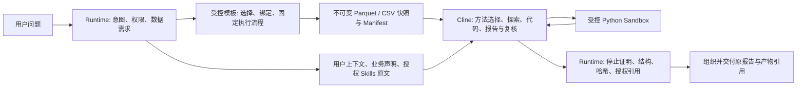

# Runtime OS / Cline 补充场景联机验证（2026-10-21）

> 后续 SQLStudio / PythonStudio 的 Cline 生成、最近会话持久化和浏览器源码保真修复，见 [Studio 专项验收](studio-cline-history-validation-20261021.md)。本页保留证券设计、主机运维和知识问答的原始版本观测。

本记录承接 [2026-10-20 改造交付记录](runtime-os-coding-refactor-20261020.md)，说明本轮新增问题、修复及最终部署。代码版本为 `eb571d57758866aaf85de33de844285d86dcba11`，开发分支为 `feature/runtime-os-coding-refactor`。验证环境为 `192.168.195.221:5221` 上的隔离项目 `runtime-os-app-stage`；生产版本未替换。

两个指定场景和补充知识问答均通过真实模型、Cline、Parquet、Python Sandbox、代码归档与最终发布闭环。生产发布门禁仍关闭：全量回归报告 1155 个测试、52 个失败、39 个错误、0 个 JUnit 跳过，另有 RocksDB JNI 崩溃，导致部分依赖模块未运行。不能把定向测试或联机闭环成功当作全量验收通过。

## 1. 修复的问题

| 问题 | 实证与处理 |
|---|---|
| 设计问题走 Java 作答 | 原证券持仓设计任务父状态成功，但无 Coding 子任务。新增 `CodingAnswerPort` / `ClineContextAnswerService`，复用现有快照、Coding SPI、Python Sandbox、结果与代码归档；不执行业务库 DDL。 |
| Java 先选择分析方法，再让 Cline 分析 | `SkillAnalysisContextService` 原先运行 ADK 多轮加载并编译 PLAN/ANALYSIS/VALIDATION/REPORT 方法。现只交付经授权、版本与内容复核的原文和参考资源，由 Cline 在其既有任务内选择方法。 |
| 其他 Java 推理入口 | 直接作答、角色会话、普通模型会话、资产用途建议均接入同一 Coding 端口。文档及 QA 类型进入旧分析器时也受共享 ownership 边界约束；故障不启动 Java 分析兜底。 |
| 模型回执落库后哈希不一致 | 主机场景失败于 `reconcileStopped`。模型工具参数原为 `ObjectNode`，落库回读为 Map 后排序规则不同。新回执统一 JSON 表示；旧回执仅重建原有工具参数表示，并继续比对原始 SHA-256。未重写旧证据或放松哈希校验。 |
| 第 9 个数据源不能构建执行配置 | 主分析接受 16 个源，而执行配置及共享上下文只接受 8 个。统一为协议资源上限 16，补测 6/8/9/16 及越界拒绝，并实际构造 9 源文件任务契约。 |
| 按数据量替换模型别名 | 新任务的复杂度配置不再替换发起端模型；已有任务继续使用其持久化契约。API 设置仍由授权的 Runtime 模型桥接复用，不向 Node 复制密钥。 |
| 未完成测试子任务 | 修复回执后，用正式取消/恢复接口收敛原失败任务，确认 `executorStopped=true`、`reconciliationRequired=false`。保留失败记录。 |

这轮改变的是推理归属，保留 Runtime 的身份权限、数据检索、模板参数绑定、固定步骤、数据交付、取消/超时/恢复和结构校验。未增加客户、资产名称、模板名称或证券业务字段的生产代码分支。

## 2. 最终调用链与任务契约



- **有业务数据**：既有 `CodingAnalysisService.executePrimaryAnalysis` 一次接收全部授权数据源，由 Cline 解析、计算、修复并复核。保留原模板工作流与 Snapshot Manifest，不向模型反复塞完整数据集。
- **上下文任务**：设计、概念问答和声明解释使用真实用户上下文快照，标注 `SUPPLIED_CONTEXT_NOT_OBSERVATIONS`。其中一行上下文不是一条业务观测；不虚构持仓记录，不强制业务取数。仍使用现有 JSONL 报告、代码归档与停止证明协议。
- **报告行**：`reportMarkdown`、`evidenceReferences`、`limitations`。Runtime 只接纳一行非空报告和已授权的精确引用，不用另一模型重写或语义裁决。
- **Skills**：原文分块无损交付，保留版本、SHA-256 和参考资源状态；脚本资源不作为执行工具交付。`DELIVERED` / `DELIVERED_WITH_LIMITS` 表示候选已交付，不能假称 Java 已激活方法。Java 规划投影和事件只含来源元数据，原文留在任务快照。
- **模型与生命周期**：复用发起端配置；认证交互请求可使用服务端生成的 request ID 创建运行记录。取消信号在交付、等待和返回前检查。任务、代码、回执与事件继续使用现有持久化设施。

输入继续以 Parquet 为主、兼容 CSV；输出仍是既有 JSONL。没有新增第二套 Runtime、Cline 框架、队列或 Sandbox。没有新增 Maven/Node 依赖或业务数据库迁移。

## 3. 联机任务与结果

测试输入位于 `scripts/scenarios/`，经已发布、已授权的助手接口提交，未使用测试专用分析实现。

| 场景 | 助手 | 修复前任务 | 最终任务 |
|---|---|---|---|
| 证券持仓建表与字段说明 | `financial_data_model`（金融数据模型设计助手） | `12542878-7e38-3af4-a2f4-6d6b1fca5715`：有回答、无 Coding，不满足新边界 | `129fa8d3-6f02-325e-aef0-ccce650a202e` |
| 指定 worker11 资产 CPU、内存、磁盘、系统负载、进程 | `server_ops_assistant`（服务器主机运维助手） | `7e0186e3-78f8-3e99-8053-54d584440bc7`：回执哈希校验失败 | `3a47391c-8f2a-375d-921e-a0b45984cc2a` |

最终候选实测如下；完整阶段、模板、代码及模型回执指标见 [脱敏证据](runtime-os-coding-scenarios-20261021-evidence/README.md)。Token 为各轮累计输入/输出，不代表唯一上下文长度。

| 最终场景 | 状态 | 端到端耗时 | Cline 模型调用 | Cline 输入/输出 Token | Python 执行 / 往返耗时 | Skills 供给耗时 |
|---|---|---|---|---|---|---|
| 证券持仓设计 | PASSED / SUCCEEDED | 420.351 秒 | 7 | 212462 / 24024 | 3 次 / 6.667 秒 | 1.229 秒 |
| 主机运维检查 | PASSED / SUCCEEDED | 599.277 秒 | 7 | 190859 / 17173 | 4 次 / 14.246 秒 | 0.679 秒 |
| 补充知识问答 | PASSED / SUCCEEDED | 108.453 秒 | 5 | 81467 / 9030 | 2 次 / 6.207 秒 | 0.708 秒 |

前两项模型均为助手配置的 `qwen3.7-plus`；补充问答使用数据库运维助手配置的 `hy3`，父任务为 `b366a8aa-5f8a-30a4-a766-d398d19e1fc1`。全部 Skills 供给为 `RUNTIME_CONTEXT_DELIVERY`、模型调用 0，没有 Java 分析语义复核事件。主机场景仍有 7 次 Java 上游取数规划、模板选择/绑定审查调用，累计输入 31231 / 输出 15273 Token、250.567 秒；它们决定交付哪些数据，没有计算主机健康结论。设计与问答的 Java 总调用遥测缺失，记为未知，不能记为 0。

主机场景实际执行 CPU、系统负载、磁盘、内存、进程 5 个既有模板，交付 12 个文本分块，进程输出包含约 358 条进程记录；不能把分块数当业务记录数。Cline 通过 `runtime_input.load_rows` 校验 Manifest 并解析实际输出，迭代修正后生成动态报告。证券场景交付的是用户设计上下文；最终提供两个方言各 56 字段的建表方案及字段口径说明。MySQL/Hive 建表片段分别通过 SQLGlot 语法解析，未对业务库执行 DDL。

全部最终任务执行器已停止、无需协调恢复，Node 活跃会话 0；9 次 Python 容器均已释放，无待清理项。失败的旧主机子任务通过正式接口取消并保留原始失败证据。

**性能限制：** 中间候选 `57771a95` 的设计、主机场景分别为 165.145 / 724.814 秒，仍包含旧 Java Skills 推理；最终设计输出更丰富且执行轮次增加。它们是单次不同版本观测，不是可比性能基准，不能计算稳定加速比例。本轮没有完成“约 100 条数据、6—9 个模板”的真实重复基准；9 源能力只通过契约与定向测试。最终三个任务均交付了同一批最多 6 个授权候选 Skills，状态 `DELIVERED_WITH_LIMITS`，原文在 Cline 多轮上下文中造成较高 Token 开销。授权候选范围与渐进加载、上游取数规划轮次仍需优化，性能目标未验收。

证券设计输出为设计提案，需按目标数据库与业务字典确认粒度、枚举及口径；测试不对业务数据库执行建表。运维结论只针对本次授权快照，不代表长期趋势或服务 SLA 认证。执行与结构校验的 `INCONCLUSIVE` 不等于业务正确性已经认证。

## 4. 测试与边界

- 25 个相关 Java 测试类，190 个测试通过，0 失败、0 错误、0 跳过。最终设计自检提示修改后，又重跑 3 类 35 个相关上下文/配置/分析测试，全部通过；不将重复执行计为新增覆盖。
- Node/Cline 44 个测试通过，含原文 Skills 交付、模型配置、哈希引用修复、恢复、取消及真实 SDK 循环。
- 监控页面本地浏览器 12 项检查通过，使用真实 SDK 与确定性网关夹具；这不是供应商模型联机数据。
- 打包与验收脚本 3 个测试通过。3 个旧工具策略测试补齐现有数据库意图绑定夹具，原有允许/拒绝断言保留，生产策略未添加工具名分支。
- 全量回归：248 个已报告测试类、1155 个测试、52 个失败、39 个错误、0 个 JUnit 跳过；Maven 返回 1。RocksDB JNI 崩溃使依赖模块缺失，因此不是完整通过的后端回归。
- 最终部署边界探测通过：Node 非 root、根文件系统只读、丢弃全部 capabilities、无 Docker socket；直连 MCP、业务数据库及外网均失败，未认证回调和任务 API 返回 401。

全量失败清单见 [回归报告](runtime-os-coding-scenarios-20261021-evidence/full-regression.json)。与前一轮 `375a89a9` 验收证据比较，91 个失败/错误用例的“模块、类、方法、异常类型”指纹相同，无新增或消失；这不等于与最初冻结版本比较，也不减轻失败门禁，见 [差异](runtime-os-coding-scenarios-20261021-evidence/regression-delta.json)。`maven.test.failure.ignore=true` 仅用于收集独立模块失败，未跳过失败测试，也不作为验收放行依据。

## 5. 变更与 RAG 保留边界

主要组件：`RuntimeAnalysisOwnership`、`SkillAnalysisContext`、`CodingAnswerPort`、`ClineContextAnswerService`、`CodingAnalysisService`、`CodingExecutionProfile`、`CodingRuntimeContext`、`ClineModelReceiptStore`、四类会话/建议入口、`SkillAnalysisContextService` 和 Node `runner.js`。完整文件清单见 [代码变更](runtime-os-coding-scenarios-20261021-evidence/code-changes.txt)。

前轮删除的文档 RAG、文档向量检索及专属 Reranker 没有恢复。最终扫描 `dev.langchain4j.rag` 导入为 0。仍保留的共享向量索引用于 Skills、MCP、Python 模板及业务元数据；它们不是被删除的旧文档 RAG。

旧 Java 分析兼容实现仍有源码引用，未未经测试删除公共 API。已分类 Runtime 分析入口受统一 Coding ownership 边界保护；静态命中不能当作实际调用链。未分类兼容调用仍须在生产替换前继续审计，不能将本轮结果解释为全仓库已无任何 Java 模型调用。任务分类、受控取数规划、参数绑定和会话摘要也不属于 Cline 业务分析结论生成。

## 6. 部署、证据与回退

最终代码：`eb571d57758866aaf85de33de844285d86dcba11`。

| 组件 | 最终验证镜像 |
|---|---|
| API | `runtime-os-api:protocol-recovery-1cba3b32e5ba` |
| Node | `runtime-os-coding-agent:analysis-fast-daebd60fa2d6` |
| MCP / 其他服务 | 保持原版本 |

API Jar SHA-256：`1cba3b32e5bac1d21fb62eb603a66cf0f19a92272cd2abb3b854f511309477cc`。仅替换已校验的四个模块和白名单 API 类；1169 个其他归档条目保持原字节。前端、监控控制台、模型/API/Skills/MCP 配置和无关容器均由部署脚本核验保持。

服务器原始证据：

- `/opt/runtime-os-docker-stage/evidence/runtime-os-refactor-20261020/scenario*-*.json`：原问题、任务、代码与运行证据，受控保留。
- `/opt/runtime-os-docker-stage/evidence/runtime-os-scenarios-final-20261021/`：最终包、模块/代码哈希、部署报告、边界证明与配置备份。
- 认证文件、业务原始行、完整 Prompt、完整运维报告和生成源码不提交仓库；仓库仅保存脱敏指标、引用、哈希和失败清单。

回退须先通过正式接口停止本次活跃任务并确认执行器停止，再恢复同一备份组中的 Compose 与环境文件。回退到本轮最终部署前的验证版本，使用：

`/opt/runtime-os-docker-stage/evidence/runtime-os-scenarios-final-20261021/backup-1792514126`

该备份包含一致的 API `8a9e5dbacf97` / Node `b8aeb7d22c44` 组合。恢复更早的冻结验证镜像及配置，使用主交付记录中的 `backup-1792506826`。不删除任务日志、不可变快照及归档产物，不回放状态未知的执行。

Git 基线仍为已推送的备份分支 `backup/runtime-os-before-coding-refactor` 和 Tag `runtime-os-pre-coding-refactor-20261020`，均解析到 `4bd002584151cc2423ed6b08f377782243477e4b`。推荐用独立工作树恢复，避免丢弃当前改动：

```powershell
git fetch origin tag runtime-os-pre-coding-refactor-20261020
git worktree add ../runtime-os-pre-coding-refactor runtime-os-pre-coding-refactor-20261020
```

在全量回归、真实业务口径及代表性性能场景通过之前，本候选只用于验证环境。
