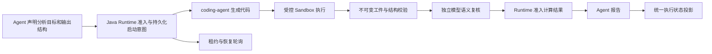

# IDS 分析请求的 Runtime OS 协议故障修复

## 联机证据

- 原任务：`d304e7ac-cd92-4b1b-9fa3-2ac33c0836a7`，Agent 为 `financial_indicator`（IDS数据稽核助手）。
- 北京时间 2026-10-20 07:30:17 提交，08:14:10 结束，队列状态为 `PARTIAL`；底层运行实际为 `FAILED`。
- 数据获取之后，四份已执行计算的语义复核响应均包含完整的 Markdown JSON 围栏。三份原始决策为 `SUPPORTED`，一份为 `UNSUPPORTED`。解析器全部误判为无效决策，因而没有准入分析结果，主模型持续更换请求重算。
- 最后一个代码子任务的首轮程序错误地读取 `manifest["inputManifest"]["columns"]`，进程失败后应由代码模型修复。第二轮模型启动意图已提交，但在模型真正调用前续租出现 `INVALID_STATE_TRANSITION`；没有第二轮模型回执。恢复轮询随后每五分钟重新取得租约，直到子任务截止。
- 运行日志保留 `CODING_RECONCILIATION_REQUIRED`，应用层最终却显示“执行已结束，但结果整理失败”，掩盖了执行失败。

## 架构与修复边界

1. **复核协议层**：支持裸 JSON 或完整的单个 JSON 代码围栏。仍然要求合法决策枚举、原因和不支持字段列表；`SUPPORTED` 不得携带不支持字段。夹杂说明、多个文档、不完整围栏以及其他代码语言继续拒绝。围栏中的 `UNSUPPORTED` 仍被拒收。
2. **Runtime 并发控制层**：新增有界的任务版本重试，仅针对持久化日志 CAS 版本冲突。模型预算预留、启动意图、续租、回执结算和观测事件使用最新版本；租约失效、隔离令牌变化、执行结果未知等错误不重试。模型调用本身不进入重试，且在续租成功后才原子消费一次性调用许可。真实回执仍是确认执行停止的唯一依据。
3. **状态投影层**：生命周期异常结果明确带有 `runtimeExecutionFailed`、`FAILED` 公共状态和原始错误原因，避免落入“没有可展示结果”的通用兜底。
4. **MCP 资产范围契约**：`assetName` 与既有的 `toolName/name` 一样参与模板检索范围限制，同时支持顶层和 `filters` 内的字段。范围先于检索排名生效；指定资产不存在时返回空结果，不能退回全量模板。此修复不涉及业务参数映射或默认值。
5. **检索预算边界**：资产描述、字段说明等目录元数据继续作为候选说明返回，不再自动扩展成调用方未声明的独立查询。已有资产范围直接约束候选集合；显式请求的独立查询仍受原有预算限制。
6. **输入文件契约与修复反馈**：控制接口描述包与磁盘清单内容分别声明。新增版本化的 `fileLayout/inputLayout`，从实际清单记录定义取得根字段，并提供授权清单路径、外部清单哈希及分片路径规则。初始上下文与 Python 失败回执均可取得这一结构说明；不回传源数据、异常中的业务值或原始 stdout/stderr。没有在磁盘格式中新增自引用哈希，也没有兼容性猜测或业务缺省值。

未引入客户号、Agent 名称、数据集字段、财务公式或勾稽关系判断规则。业务计算和结论继续由模型基于授权证据生成；没有降低结构校验或语义复核门槛。

## 首次修复验证与部署

- 72 项回归测试通过，覆盖复核协议、确定性模拟恢复轮询与续租冲突、模型调用只发生一次、旧令牌拒绝、停止与恢复、分析准入及失败状态投影。
- Maven 后端打包成功；部署包 SHA-256：`8a32c470a59648722c498a4235e115d8a518d345984378ea3695b15db44626b0`。
- 服务器：`192.168.195.221`，API 镜像 `runtime-os-api:protocol-recovery-8a32c470a596`。
- API 页面资源与原部署逐字节一致；仅替换 API 及共享其网络命名空间的代理容器，网关原地重载，其余容器不变。
- 回滚配置：`/opt/runtime-os-docker-stage/evidence/ids-runtime-20261020/backup-1792458287`，最初 API 包另保存在同级 `before.jar`。
- 原始请求经正式应用任务接口重新提交，使用新会话和幂等标识；原始失败任务保留不变。联机验证任务：`f7de9fa1-fd36-3095-89a2-59142b917653`，运行：`att-1-58dc855b-18d2-48c7-b545-d20c48c4a829`。
- 详细事件、原始复核响应和验证记录位于本地 `target/ids-runtime-20261020/` 与服务器同名 evidence 目录，未将原始客户记录写入本文。

## 首次重跑暴露的资产范围缺口

任务 `f7de9fa1-fd36-3095-89a2-59142b917653` 在 499 秒后以真实 `FAILED` 状态结束，未将取数失败伪装为“结果整理失败”。该次运行尚未进入代码分析，不能用来证明语义复核的联机链路已经通过。

工具计划传入了从发现结果取得的 `filters.assetName`，而 MCP 模板检索仅识别 `toolName/name/service/target`。范围条件被忽略，检索返回了无关模板：部分缺少必要参数，另一个无关模板访问上游时返回 `UNAVAILABLE: NameResolver returned no usable address`。修复的是范围约束丢失，不是将不可用上游伪造为可用，也没有为缺失账户或日期填入猜测值。

范围修复后的联机探针进一步发现，目录元数据被自动扩展成 24 个独立查询，超过原有 16 个查询的预算。已消除自动扩展，没有提高预算。第二次诊断任务 `1f289048-11dc-3bde-b5b4-8326d8cb463f` 已通过正式接口取消，以便部署此补充修复；用户原始任务未取消。

模板检索测试类现有 20 项全部通过，包括丰富元数据不会耗尽查询预算、显式超量查询仍被拒绝；与前述测试合计 92 项通过。

MCP 最终镜像：`runtime-os-mcp:protocol-recovery-ace089ca6944`，包 SHA-256 为 `ace089ca694423b5bff5a2f7afff6dd1cf6ea4c9d151c4035cecd2136123a623`。MCP 页面资源保持不变，HTTP 与 gRPC 就绪检查通过。配置回滚目录：`/opt/runtime-os-docker-stage/evidence/ids-runtime-20261020/backup-1792460077`；最初的 MCP 包保存在同级 `mcp-before.jar`。

通过正式鉴权的 `/api/v1/mcp/runtime/invoke` 联机验证：从前一轮计划取得的原样 `assetName` 仅返回对应的一个模板；随机不存在的资产返回零个模板，两者均为 `SUCCESS`，没有预算异常。证据文件：服务器同目录 `live-scope-r2.json`。

## 最终完整请求验证

任务 `b7e1f5d1-e2bb-314f-a643-6eaffeec010f` 在 09:44 被租户请求取消，未恢复该终态。用户随后明确要求继续完整验证，因此通过正式接口另建任务 `b83de804-f68a-342e-88b3-a723d1bf5ebc`，运行 `att-1-90e6556f-a004-4b45-9249-db98b3825f0d`，仍使用原始问题、Agent、模型和授权配置。

该任务已取得可用数据并进入自主分析。首个代码子任务 `analysis-coding-787ed7032159b621dd556b83ade87a139eca2c66c9325bfdb04cbfcd7bfa2cfb` 已归档执行结果，独立复核决策为 `SUPPORTED`，结果已返回主分析，后续代码任务继续执行。复核明确标注 `MODEL_SEMANTIC_REVIEW_NOT_MATHEMATICAL_PROOF`，没有将结构校验或模型复核冒充财务勾稽关系的数学证明。

后续子任务反复在输入读取阶段触发 `KeyError`。受保护的代码工件显示，程序试图用 `manifest['sha256']` 检查清单自身哈希，并读取 `manifest['inputManifest']`；实际磁盘文件是扁平 `CodingInputManifest`，清单哈希只存在于外部控制描述中。原有错误反馈仅保留异常类别和行号，无法说明这种描述层级差异。该诊断轮次已通过正式接口停止并保留证据，用于部署第六项通用修复。

输入布局修复后的 Agent/API 相关测试 89 项通过，包含真实记录结构对应、PARQUET/CSV、失败工具回执、脱敏及旧格式隔离；加上 MCP 检索测试 20 项，合计 109 项通过。打包成功。

## 参数默认值协议边界补充

完整重跑 `3edd3c68-c300-3274-9720-cba1aa2383b4`（运行 `att-1-d5ebc484-0d4f-40a6-a048-6e3255a1e58c`）在 703 秒后以 `FAILED` 终止。模板发现正确，但模型在证据协议中重复写入 schema 默认值，使用 `source=template_default` 且未提供 evidence，八个子调用因此全部被审计拒绝。没有执行无证据参数调用，也没有生成虚构的业务结论。

第七项修复位于通用 `TemplateInvocationBridge`：仅当模型声明的默认值与 Runtime 已绑定模板 schema 的真实默认值一致时，丢弃模型副本，由既有编译器重新应用权威默认值并生成 Runtime 来源记录。schema 未声明默认值或者模型改写默认值时仍然拒绝；用户查询和工具结果来源的覆盖参数继续按原有证据规则验证。未引入字段名、日期、客户号或业务映射。回归测试覆盖重新应用默认值、篡改默认值和伪造默认来源。

输入布局修复部署版本：`runtime-os-api:protocol-recovery-731d0cccc145`，包 SHA-256 `731d0cccc1452769bdf4da041155fe0ed21843ce95c3de9074d00a5e60ad8a0d`，配置备份目录 `backup-1792462695`。最初 API 包为服务器证据目录中的 `before.jar`；`pre-deploy.jar` 为最近一次替换前的版本。最终参数协议补充版本及联机结果见后续记录。

最终 API 镜像：`runtime-os-api:protocol-recovery-4ed29e165b10`，包 SHA-256 `4ed29e165b10522921d32b624297ebf40bb405a243d81e582b1b86dd3c7d9c2c`，配置备份目录 `backup-1792463828`。部署检查确认页面字节一致、无关容器未替换、网关原地重载。补充回归测试共 31 项通过（参数桥接 22、schema 绑定 5、输入布局 4），Maven 打包成功。

最终完整联机任务为 `ebef26c3-ff22-30f4-94ae-fe05c991e2e3`，运行 `att-1-a7534a3d-54ea-4545-a9a4-16b66e39c4ff`，证据文件 `acceptance-r6.json`。取数批次包含 8 个模板调用并成功完成，进入自主分析。模型早期缺少变更理由及引用错误数据集的请求被拒绝；模型随后自行修正后创建代码任务，没有增加业务引用别名或绕过审计。

首个代码任务 `analysis-coding-27dc9633866b271a248d36306a942307a405082c6715c24ab56f67e9906b4b7f` 完成 Python 执行，两个模型调用均有真实成功回执。独立语义复核返回完整 JSON 围栏中的 `SUPPORTED`，已被正确准入，原始复核记录保存在 `semantic-reviews-r6.txt`。第二个交易偏好代码任务 `analysis-coding-eb1bc112622cc295f82c03b6d206554e6c37139bc96aec21c33b3785ee403256` 也已完成 Python 执行及归档。结构验证状态 `INCONCLUSIVE` 与独立模型语义复核分别记录，不能将任一结果当作数学证明。

## 最终验证结论

- 原问题、原 Agent 的完整联机任务在 975.2 秒后结束，队列状态 `SUCCEEDED`，应用回答与完成事件均为 `SUCCESS`，共 161 个任务事件。
- 8 个模板调用全部成功，真实远端调用数为 8，失败、阻断和跳过均为 0；其中一个空内容数据集仍保留排除标记。
- 两个代码子任务均已归档、执行停止已确认，两个独立语义复核均为 `SUPPORTED`，`unsupportedFields=[]`；早上的围栏解析失败、调用前续租冲突和清单读取循环未复现。
- 应用已返回资产盈亏、交易偏好及勾稽差异报告；原始回答保存在忽略目录 `target/ids-runtime-20261020/acceptance-r6-answer.txt`，没有将客户财务明细写入仓库文档。
- 报告列出的差异来自本轮模型声明的计算口径；模型复核支持代码与目标的一致性，不等于证明业务数据错误或定位上游根因。统计时间范围、业务口径及上游数据完整性仍应按业务规则核对。
- 分阶段执行的相关回归共 136 项通过（原 109 项加参数桥接与 schema 绑定 27 项，重复执行的输入布局 4 项不重复计数），测试报告均无失败或错误；后端打包与 `git diff --check` 通过。
- 最终服务器检查确认 API、MCP、网关及代理运行中，coding-agent 节点健康；运维页继续使用 coding-agent 品牌版本。
