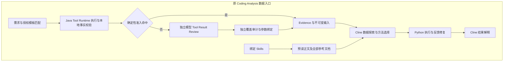
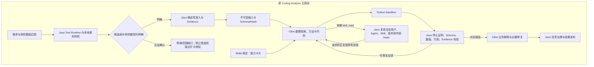

# Runtime OS 调用链变化

日期：2026-10-26，Asia/Shanghai。架构继续使用 Java Runtime OS、Node/Cline 与 Python Sandbox。

`CodingDataSupplyService → PreauthorizedStructuredDataOperator → RegisteredToolAnalysisOperator → ToolRuntimeService` 保留原数据授权、模板范围、字段、预算、取消和输入版本检查。该支路不创建模型 Reviewer。

同步执行通过 `InterpretationAnalysisSession` 传递职责属性；持久执行通过 `AgentPlanPhaseActivityCoordinator` 从 continuation 取回同一属性并传给准入回调。恢复任务不能因遗漏属性重新进入旧 Reviewer。

固定模板执行与普通 QA 的消费者保留 `LocalToolResultReviewer`、`MandatoryWorkflowResultReviewer`、候选身份校验及旧模型审核接口。`toolResultReviewTimeoutMs` 等仍被非 Coding 路径使用，没有删除有效配置。

删除原 `AdkAnalysisSkillSource` 和对应测试：切换按需加载后已无生产消费者。原 Google ADK 依赖仍由 `GoogleAdkSkillRuntimeAdapter` 等使用，继续保留。

`SKILLS_AVAILABLE` 表示能力登记，`SKILLS_LOADED` 仅在实际读取正文或资源后发出。能力登记不再冒充正文已加载或方法已应用。旧任务的完整 Skills 快照会在新的 Coding Prompt 投影中去除正文；原任务契约与 Hash 不被改写。

`ClineToolProfiles.ANALYSIS` 同时约束 dispatch 与模型回调。`skill_read` 只有在冻结目录非空时才加入授权工具；读取时仍复核当前 Agent/用户权限、目录中的版本、内容 Hash 和资源大小，拒绝脚本、路径穿越及同版本内容漂移。绑定技能不会扩大取数权限。

实际 Docker 链路仍包含 Java 的需求规划与检索匹配调用。其职责止于明确资产及已授权供数模板，模板 stdout 的探索、统计和解释均由 Cline 完成；这三次 Java 调用在性能报告中单独计数。
