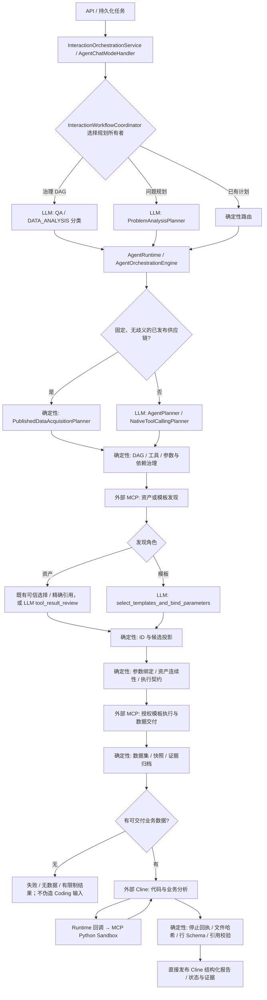

# Runtime OS 模板关系与审查机制源码审查

审查日期：2026-11-02（Asia/Shanghai）。基线：`main`，`0d2f5f8cc`。本次只新增审查材料，没有修改业务实现、发布服务或调用线上模型。任务书末尾在“Java 层重复进行业”处截断；以下覆盖已收到的 A—F 要求。

本文的“存在”指当前源码中有可追踪的调用路径；“历史证据”指仓库归档记录，不代表本次线上复现。文末 S 编号给出完整文件路径、方法和行号，正文每项关键判断均引用这些编号。行号相对于上述基线。

## 1. 审查结论与优先级

**Runtime 应保留模板执行关系与契约治理，业务相关性、模板组合和 Join 推断应交给 Agent。当前实现已完成后半段分析职责收敛，尚未完成前半段数据获取决策的交接。不能直接删除整个 Review、Workflow Plugin 或 Semantic Policy。**

| 编号 | 级别 | 发现、触发条件与影响 | 源码证据 |
| --- | --- | --- | --- |
| F1 | 高 | 数据分析型 Cline 只拿到已交付快照；它不能发现新业务模板、调整供应参数并重新获取数据。Java 前置模型仍掌握模板业务选择。直接删除前置选择会切断供应链，不能据此宣称已实现 Agent 自主决策。 | S05、S06、S11、S12；测试 S29 |
| F2 | 高 | 普通资产发现即使成功，只要没有模型选择或受信任的既有选择，仍可能因缺少 `selectedAssetIds` 使计划步骤失败。它是“发现成功但选择未完成”，不等于 MCP 执行失败或权限不合法。补充发现有降级例外，必需数据供应仍可能在 Cline 启动前终止。 | S07、S08、S10、S11 |
| F3 | 中 | SQL 输入编译仍会按 `tableName`、目标层级、模板语义和策略推断自动替换模板；没有替代模板时抛出 `SQL_TEMPLATE_TARGET_SCOPE_MISMATCH`。这超出了单纯验证声明参数是否合法的边界，可能覆盖上游模型选择。 | S14；实测替换测试 S30 通过，拒绝测试存在失败，见第 9 节 |
| F4 | 中 | 选择与供应仍通过裁剪后的候选输出、`parameterProtocols`、`runtimeSelectedTemplateIds` 等隐式状态耦合；对“当前页返回 ID”的校验不能当成全局授权集合。已有按 ID 补查 MCP 契约的路径，但它没有暴露为 Cline 的探索工具。 | S06、S09、S13、S15 |
| F5 | 中 | 通用资产审查仍要求模型先证明部分跨资产业务关系，再决定保留候选。此约束存在于提示词，未找到按业务关系置信度阈值拒绝供应的确定性代码；也未找到“模板关系分析服务 → 独立关系 LLM → 独立评审 LLM”这一固定流水线。 | S05、S16、S17 |
| F6 | 中 | 老式 `templateRelationships` 会被追加到数据集 `relationships`，与来源本身声明的关系放入同一列表。迁移时需要保留“Agent 假设”与“发布契约声明”的来源，避免把模型关系意见升级为供应约束或已验证事实。新选择函数本身不产出这个字段，故不能声称每次新任务都会触发此路径。 | S09、S17 |

已完成、不可重复申报的整改：模板发现的选择和参数提取已合并为一次 Function Calling；资产既有选择和严格字面匹配可以绕过模型；成功模板执行、成功元数据发现及 Coding 所有的非候选结果已有确定性准入；Coding 分析之后已有禁止 Java 再次业务探索和直接发布结构化报告的路径。（S05、S06、S11、S18、S28）

## 2. A：真实执行链路

### 2.1 入口与分支

同步入口是 `/api/v1/interactions/chat`，流式入口是 `/api/v1/interactions/chat/stream`；Agent 异步入口是 `/api/v1/agent/tasks`。流式 Agent 请求可提交持久化任务，任务工作者最终调用 `InteractionOrchestrationService.chat`，进入 `AgentChatModeHandler.handle`。（S01—S03）

`InteractionWorkflowCoordinator.execute` 先选规划所有者，不能把所有分支叠成一次固定的多轮规划：

| 分支 | 实际行为 | 类型 |
| --- | --- | --- |
| 用户文件 / SQL 源码输入 | `analyzeFiles` / `analyze`，决定是否需要业务数据、执行还是解释 | Java 发起 LLM |
| 已维护治理工作流 | `classify` 返回 `QA` 或 `DATA_ANALYSIS`；QA 转直接回答，数据分析进入治理运行时 | Java 发起 LLM + 确定性路由 |
| 已有问题计划 | 复用计划，再选择能力工作流 | 确定性 |
| 无所选能力 | 进入直接回答工作流 | 确定性路由，后续回答有独立模型链 |
| 其余需要问题规划 | `analyze`，再选择工作流 | Java 发起 LLM |

依据：S03、S04。`classify` 与完整 `analyze` 不是每次请求都先后必跑。

### 2.2 数据分析主链图



图表示已确认的条件路径，不代表一次运行一定拥有单独资产发现节点，也不代表所有 MCP 都走模板发现。插件允许无需资产发现的已绑定模板发现；工具元数据和实际返回的 `stage` 参与角色判定。（S05、S19）

### 2.3 已知工作流类逐项确认

以下六个插件均实际存在，并通过 Java SPI 注册；Registry 按 priority 选择，同优先级歧义会拒绝编译。它们没有调用 LLM，负责发布协议、发现与执行之间的连接。（S19、S35）

| 实现 | 实际职责 | 审查处置 |
| --- | --- | --- |
| SqlTemplateWorkflowPlugin | SQL 资源类型 / `mcp.sql-template.v1` 适配，兼容 template 输入绑定 | 保留确定性协议适配 |
| ApiTemplateWorkflowPlugin | API 服务的多种协议声明；从资产输入复制 filters，或把 query 转成 intent/queryTerms | 保留输入适配；不将 query 转换误计为 LLM 需求分析 |
| PythonTemplateWorkflowPlugin | `mcp.python-template.v1` 与 Python 资源类型适配 | 保留，与 Studio 发布及分析 Sandbox 调用分别评估 |
| SshTemplateWorkflowPlugin | SSH 资源协议，template 输入路径，资产 stage 转 template stage | 保留，防止移除后 staged discovery 断链 |
| HttpTemplateWorkflowPlugin | HTTP 资源协议和 template 输入路径 | 保留，不承担跨资产业务关系判断 |
| LegacyRoleOnlyTemplateWorkflowPlugin | 最低优先级通用回退；仅允许同一标准化 protocol family 连接 | 保留旧发布者兼容，按使用量和协议迁移再退役 |

`RuntimeSemanticPolicy` 同时保存工具角色、执行/发现映射、环境与方言规范化、模板后缀等内容。应收缩的是模板后缀/业务语义替代决策，不能一起删除 SQL_EXECUTE 等角色识别和协议连接。`McpToolPublicationReviewer` 实际检查名称、描述、Schema、descriptor 身份、弃用信息与可见性，没有关系 LLM；必须保留。（S35）

| 审查项 | 实际入口、职责及关键阻断点 | 证据 |
| --- | --- | --- |
| Task Planning | 固定供应链可跳过计划 LLM；否则 `AgentPlanner.plan` 生成和校验计划，可修复协议 | S04、S05 |
| Template Discovery | 从授权工具、固定发布组、目录、检索及参数契约获取候选；检索排序不等于执行授权 | S19—S21、S25 |
| Candidate Selection | 资产普通审查；模板 Function Calling 同时选择及提取参数 | S05、S06 |
| Template Relationship | 旧审查提示词和上下文字段；执行拓扑由插件、DAG 和声明依赖处理 | S16、S17、S19、S24 |
| Tool Result Review | 本地事实检查在前；再根据角色决定是否调用模型；缺 ID 可阻断依赖步骤 | S05、S08、S10 |
| Execution Planning | 输入编译、补查契约、模板调用桥、参数协议、环境和资产一致性 | S13—S15 |
| Coding Invocation | 数据集经快照交付到 `CodingTaskContract`，通过 `ClineCodingAdapter.submit` 发给 Node | S11、S12、S26 |
| Data Supply | MCP 实时权限、模板状态、参数 Schema、数据源、SQL 安全和预算；补充请求服务另有固定 grant | S20—S25、S27 |
| Result Validation | 结构、原始输入、停止证明、文件和来源哈希、证据引用；不重新裁定业务答案 | S11、S26、S28 |
| Final Answer | 已校验 Cline 报告进入直接发布分支；不能把旧 Java synthesis 模型计作必跑后审 | S11、S18、S28 |

## 3. B：LLM 调用与重复审查

| 调用位置 | 触发 / 输入 | 输出与业务决策 | 是否阻塞 / 与 Cline 的关系 | 已有监控 |
| --- | --- | --- | --- | --- |
| `ProblemAnalysisPlanner.classify`，S03 | 治理 DAG 入口；问题、摘要、Agent 描述、工具用途 | 单字段 `taskType`；决定分析执行策略 | 同步；失败返回 null，入口给阻断响应。与后续 Agent 理解目标有重叠，但承担入口路由 | `TASK_CLASSIFICATION` 开始/结束/失败事件；该方法使用 String chat，未取得本次真实 tokenUsage |
| `ProblemAnalysisPlanner.infer`，S03 | 文件、SQL 或问题规划入口；问题、历史、文件与能力用途 | objective / tasks / evidence requirements / clarification 等 | 同步；不可执行计划阻断。不是每次与 classify 叠加 | `PROBLEM_ANALYSIS_PLAN` 生命周期；未测本次 token / 时长 |
| `AgentPlanner` / `NativeToolCallingPlanner`，S04 | 未由固定供应链编译满足的请求；问题、工具元数据、既有观察、约束 | 执行计划或工具决策 | 同步；格式/计划错误可进行有界修复。重复理解需求，但包括可执行 DAG 生成 | Planner 日志与运行事件；本次未测线上消耗 |
| `reviewInterpretationPlanToolResult` 的 String chat，S05 | 未被跳过的资产发现、普通 QA 工具结果等；问题、步骤、候选及已有证据 | satisfied、selected_asset_ids、evidence gaps、next actions 等 | 同步；资产遗漏选择可使发现步骤失败。Cline 在此之前尚未启动 | promptChars、estimatedTokens、modelDurationMs、totalDurationMs；estimatedTokens 不是真实账单 token |
| `SchemaDrivenTemplateParameterBinder.selectionDecision`，S06 | 成功模板发现且未复用既有合法选择；当前问题、返回候选 Schema、资产及前序记录 | `status` + `selections[{templateId, parameters, ...}]` | 一次选择+绑定；指定协议错误最多一次修正。掌握数据分析前的业务选择，Cline 后续重新理解分析目标 | `selectionModelCalls`、modelDuration、totalDuration、真实 response.tokenUsage；缺 usage 时明确标记 unavailable |
| Node `runner` / Cline，S12、S26 | 已接受的 CodingTaskContract、输入描述、Skills、执行回执 | 程序、修复、结构化报告；reviewed 模式有 Agent 读回结果确认 | 受预算与恢复协议约束。这里的业务结果自审不能算成 Java 模板关系审查 | Coding durable 事件、usage、primaryCodingDurationMs |

**未发现一个额外的“模板关系专用 LLM 服务”作为所有数据分析任务的必经环节。** 当前模板发现的成功分支在 S05 的 3499 行就进入 `selectPublishedTemplates` 并返回，故 4004 行以后遗留的模板关系评审提示词，不足以证明本次路径还会另调一次关系模型。新 Function Calling 输出也没有关系置信度、关系图或逐候选评分的必填字段。（S05、S06、S16）

`SearchQueryOptimizer` 默认构造的 QueryRefiner 为 null；源码的可选 refiner 接口不等于默认多一次 LLM。检索、Embedding 与业务模板关系 LLM 也应分别统计。（S31）

不应再重复“取消”的现有路径：成功模板执行在 S05:3523 确定性接受；成功元数据发现在 3554 接受；Coding 所有的非候选结果在 3507 接受；有序批处理在 S08:2906 跳过模型；新模板选择复用在 S06 对应调用方 S05:3854 完成。候选发现被明确排除在 Coding 跳过逻辑之外。

仓库有历史实测：`docs/tool-review-production-evidence/live-model-metrics.json:1` 对一个历史 run 记录资产审查 28698ms、模板审查 44934ms、覆盖审查 17305ms，对应 estimatedTokens 为 2490、4204、3692。**这些是旧链路样本；当前成功模板发现已改走合并选择函数，不能拿旧覆盖审查耗时计算当前可节省时间。** 本次没有新线上 A/B、真实流量分位数或成本测量，不给出性能收益百分比。

## 4. C：自主性、关系裁决与过度约束

| 问题 | 源码判定 |
| --- | --- |
| Java 强制唯一模板吗？ | 没有全局“只允许一个模板”的规则。选择函数返回 selections 数组，允许互补模板、多个资产、同模板多个绑定；受批量上限约束。插件的 `[0]` 是桥接默认字段，不能单独证明只执行第一模板。（S06、S13、S19） |
| Agent 选完后 Java 再做业务匹配吗？ | 主分析 Cline 根本没有前置业务模板选择权；Java 主导的另一个模型先选择。其后一般候选 evaluator 只做成员与协议校验；SQL 编译器仍有自动改选/拒绝这一例外。（S06、S09、S14） |
| 当前候选集是否等于所有允许资源？ | evaluator 将选择限制在当前发现输出，这是该次响应的身份校验；它不是全局授权边界。当前实现缺少向 Cline 暴露下一次授权发现的通道。直接计划执行还可按 templateHint 补查授权 MCP 契约，说明并非整个 Runtime 永远只认最初候选集。（S07、S09、S12、S15） |
| 能否使用后来发现的合法模板？ | Java 的计划/契约解析路径具备补查能力；当前主分析 Cline 不具备发现与执行新模板的工具。不能把 Java 能补查等同于 Cline 能自主补查。（S12、S15） |
| 按关系置信度拒绝数据吗？ | 在所查选模、关系字段消费与供应链里未找到此规则。普通资产评审提示词要求跨资产关系有证据，模型可能因此不选，但这是语义提示约束，不是数值置信度阈值治理。（S07、S09、S16、S17） |
| 格式不对会拒绝整任务吗？ | 通用 review 无法解析时先保留成功工具证据，但候选选择仍可因缺 ID 被步骤层拒绝；模板函数允许一次协议纠正，仍无合法选择时阻断供应。若是必需供应且无业务数据，Coding 不启动。不是所有格式错误都无条件导致整任务 FAILED。（S05—S08、S11） |
| 无匹配是否立刻失败？ | 本地空模板结果会拒绝依赖执行；有效空选择可以标记还有下一页；supplemental discovery 可降级为 `SUPPLEMENTAL_UNAVAILABLE`。因此要区分当前步骤失败、还有下一页、可选能力缺失和必需供应终止。（S08—S11） |
| 多模板、跨模板分析被禁止吗？ | 没有普遍禁止。当前支持多个数据集交付 Cline，也支持模板/资产批次组合。但 Cline 只能在已供应集合内分析，不能补齐自己认为必要的业务来源。（S06、S11—S13） |
| 是否有真实业务误判案例？ | 本次确认历史“选择协议阻断”，没有重新执行线上业务样本来证明某个关系推断结论为错。SQL 自动替换是可验证程序行为；“会误伤哪些业务”需要保留原始合法请求与执行契约后再做用例验收，不能混称已观测业务错误。（S14、S30、S32） |

## 5. D：selected asset ID 历史问题

### 5.1 身份生成与传递

资产 ID 来自持久化配置的 canonical ID，不应由显示名称、排名或模型生成。API 路径中检索 hit.id 与配置 `byId` 连接，资产响应写入 `asset.id`。通用资产工厂同样使用 host/datasource/endpoint 的 getId。（S21）

普通 review 输出 `selected_asset_ids`，S05:3678 将它写入 metadata.selectedAssetIds；S07 投影至发现结果；S08 / S10 写入 runtimeSelectedAssetIds、SelectedCount 和 Applied，再检查依赖步骤是否可继续。模型说“有合适候选”与模型真正发出合法 canonical ID 是两个不同条件。

### 5.2 历史故障与现状

归档 `docs/runtime-template-supply-20261027/original-failure-evidence.json:1` 包含 `REQUIRED_MCP_DATA_UNAVAILABLE`，原因是“the model did not select an asset id from the returned candidate set”；该记录没有成功业务数据、Coding receipt 或最终回答。它证明一次历史运行在选择边界失败，单靠这份裁剪记录不能判断模型是否曾输出错误 ID。

提交 `04a833148`（2026-10-27）修改候选准入的先后顺序，当前 S05 的 candidateDiscovery 明确不走 Coding 非候选结果的 skipped 路径；既有 queryIr.asset.selected 可以复用。`9877a9012`、`e6eba0291`、`50a1ce606` 增加并收紧精确资产引用，保留比较/否定/歧义范围。这些均为已合入修复，不应重新提案。（S05、S07、S10、S32）

当前修复覆盖：

1. MCP 已声明选择：`RUNTIME_DECLARED_ASSET_SELECTION`，不再要求额外 LLM 重复产生 ID。
2. 完整授权页中用户明确引用唯一 canonical 名称：`RUNTIME_EXACT_CANONICAL_ASSET_REFERENCE`，返回规范 ID；否定、比较、多目标、截断、重复 ID 或相关 unavailable 身份冲突时不走捷径。
3. 普通模糊业务发现：仍要求显式 selectedAssetIds；“只返回一个候选”不自动视为用户已选择。相应拒绝测试是当前设计意图。（S07、S10、S29）

归因：历史问题至少包含**状态/控制流与契约设计问题**，不能统一归罪于模型输出；“先跳过选择，后强制要求选择”的不一致已修复。剩余缺 ID 分支是显式保守契约，既不等于权限错误，也不能在不确认业务目标的情况下盲取第一候选。若目标改为 Cline 自主决策，应让 Agent 发起带 canonical reference 的真实执行意图，Runtime 解析并重新授权；缺选择只返回可恢复的 `SELECTION_REQUIRED`，不要污染已成功发现的执行状态。

可靠替代身份方案：以 `tenant + templateKey + publication/revision + resourceId + executor` 的服务端解析结果生成不透明引用；模型只回传引用与参数。供应端验证引用、版本和实时权限。显示名称仅用于解释，别名只能通过已授权目录解析。新发现允许产生新引用，不能因为不在首轮候选页就拒绝；也不能仅凭模型提供 ID 就越过 live authorization。（方案；可复用 S20、S22 的 revision、固定 binding 和 trusted caller。）

## 6. E：保留能力与责任落点

| 能力 | 目标责任方 | 当前差距 / 保留依据 |
| --- | --- | --- |
| 理解需求、业务相关性、模板组合、业务关系和 Join 推断 | Agent | 当前在入口、Java 发起的模板模型和 Cline 分散发生；收敛前需给 Agent 供应工具。（S03—S06、S12） |
| 模板目录、Schema、授权元数据 | Runtime / MCP | 保留目录和发布者；把输出作为可再发现目录，不是业务选择最终裁决。（S19—S22） |
| 显式依赖、输出到参数映射、DAG 类型与成功前置条件 | Runtime | 保留。DatabaseQuery 声明 upstream 参数源必须也是 dependency，交由执行图验证；不要从业务相关性推导硬依赖。（S23、S24） |
| 访问权限、租户/用户/Agent 隔离、数据源范围 | Runtime / MCP | 保留实时授权、签名 caller、固定资源 binding 和权限撤销检查。（S20、S22、S25、S27） |
| 字段保护 | Runtime / MCP | SQL 在交付前按敏感字段/表脱敏；补充数据请求有 requiredFields grant。所查实现不能证明所有协议都有统一字段级 ACL，不应把脱敏宣称为完整字段授权。（S23、S27） |
| 模板真实性、发布状态、版本 | Runtime / MCP | 统一能力工具检查 RUNNING 及 revision，SQL Studio/ Python Studio 有试运行指纹。旧发现执行协议仍需逐适配器携带版本，不能假定全链统一。（S20、S22、S25） |
| 必填、类型、约束、默认值、来源绑定 | Runtime | 保留确定性 Schema 和参数来源；Agent 提议值，不让 Java 猜业务实体。SQL 自动改模板应改为提示诊断。（S06、S13、S14、S22、S23） |
| 执行预算、并发、超时、停止 | Runtime | 保留 Coding budget、lease、operation admission、MCP 并发及 SQL timeout。多轮新 requestId 不能重置累计预算。（S26、S27） |
| 数据交付完整性、哈希、血缘 | Runtime | 保留 immutable snapshot、完整性标记、行数、文件哈希、lineage；部分数据应明确限制，不能伪装完整数据。（S11、S26、S27） |
| 代码生成与技术修复 | Coding Agent | 已主要实现；Node 按原程序 hash 修复，Runtime 不重新业务解读。（S12、S26） |
| 代码执行 | Python Sandbox，经 Runtime/MCP | 保留 network policy、授权工具、环境和停止回执。（S12、S26） |
| 执行结果与证据 | Runtime | 校验结果 Schema、文件、来源和引用，不据业务置信度否决合理选择；当前主分析直接发布已有这一边界。（S11、S26、S28） |

发布校验与运行时安全复验不是重复语义审查：发布测试证明某个版本可用；运行时必须检查权限是否撤销、版本是否变化、当前参数是否合法。应共享契约和校验实现，不能取消 runtime reauthorization。（S20、S22、S25）

## 7. F：删除 / 收缩影响矩阵

| 消费面 | 直接全删的影响 | 最小兼容调整 |
| --- | --- | --- |
| 普通对话 / 文档 / Web QA | `codingOwnsToolAdmission` 有意比 codingOwnsAnalysis 更窄，普通 QA 仍消费 review、选 URL、引用及恢复动作 | 只对明确协商的新 Agent 选模模式取消模板语义审查，保留普通工具结果处理。（S05、S18） |
| 模板驱动查询 | 若删 evaluator/桥接，`[0]` 边、参数协议、批次和必需模板守卫失去输入 | 保留插件和身份编译器，让 Agent 的执行意图替代旧模型 review 元数据。（S09、S13、S19） |
| SQL Studio | 发布/测试/revision 不是 Runtime 关系审查；Studio Coding 另有 workspace_metadata/workspace_validate | 保留试运行、版本、权限和项目提案链；共享目录服务，别把 Studio 整套编辑工具直接授给分析任务。（S22、S25、S26） |
| Python Studio | `PythonTemplateToolRegistry` 当前负责移除旧逐模板 Agent 工具，不能按类名当成普通注册器删除；MCP 发布有源码哈希校验 | 保留发布状态、试运行证据、同步与旧工具清理。（S25） |
| Coding Agent | 仅删前置选择后，Cline 无业务供应工具且可能根本不启动 | 先加受控发现/获取能力，再分模式迁移选模权。（S11、S12、S29） |
| MCP 模板发布与执行 | 已有 tpl_* 直接能力可在调用时绑定真实版本、资源和调用人；老父子目录还有兼容协议 | 复用统一能力的 availability / invoke，不撤掉 MCP 实时授权。（S20—S22） |
| 数据交付与恢复 | 改输入哈希、工具列表或契约版本会影响已有 task 身份；重放未知开始的操作可能重复查询/执行 | 冻结旧合同；新版本只用于新任务；恢复先核对 hash、lease 和 receipt。（S26、S27、S33） |
| 权限与审计 | 删除候选业务评审不代表取消资源权限或审计 | 保留 signed caller、tenant/user/Agent scope、source lineage、publication revision 和执行审计。（S20、S22、S26） |
| 前端任务状态 | 旧 UI 消费 MODEL_INFERENCE、TOOL_REVIEW_STAGE、业务模板匹配事件 | 保留旧事件解析；新事件标注 Agent 决策/确定性校验，不伪造旧 LLM 阶段。发现成功与选择待补全分开显示。（S08、S34） |

恢复特别要求：S33 的 PlanCheckpointCoordinator 只复用 committed attempt、有效身份及一致恢复 token；Runtime 又比对 workflowExecutionAttempt、planExecutionScope 和步骤定义。移除一个旧 review 节点或修改校验语义，不能让旧 checkpoint 直接被当成新版本的授权证明。Coding `submit` 遇到未知 start 进入恢复，数据请求已有 requestHash 复用和拒绝不明结果重放，必须延续。

## 8. 最小整改方案与验收

### 阶段一：保留当前供应链，先收缩确定性治理中的业务替代

1. 将 S14 的自动替换模板改为返回结构化诊断，附当前模板参数/targetLevel 与可选目录引用，由 Agent 决定下一次调用。保留明确声明的目标/输入契约不合法时拒绝实际执行；不要仅因出现 `tableName` 就断言必须使用 metadata 模板。
2. 区分 discovery execution、selection status、supply execution 三种事实。缺 ID、NO_MATCH、需要参数和无下一页分别表达；必需供应仍可阻止无授权执行，但不要改写 MCP 已成功发现的事实。保留 supplemental 与 partial 语义。
3. 保留合并 Function Calling 和已完成的 skip 优化；对已退出现行模板路径的关系提示词先标注消费者，再移除死分支。关系上下文拆成 publisherDeclaredRelationships 和 agentHypotheses，避免继承为强制依赖。

这一步不声称实现了 Cline 自主获取数据；它只是降低 Runtime 对模型合理选择的替代，并厘清状态。（S05—S17）

### 阶段二：以独立协商模式交接模板选择

1. 在现有 Java 网关提供受控的“发现目录 / 读取契约 / 按引用获取数据”操作，底层复用目录和 `TemplateCapabilityService.invoke`，不开放数据库连接、凭据或任意外部 URL。
2. Cline 在分析启动前获取授权目录，选择一个或多个模板并提交规范引用和参数；Runtime 只做实时权限、版本、Schema、显式依赖、预算和交付校验。选其他已授权模板时重新解析，不能依据首轮 candidate membership 拒绝。
3. 用新的 Coding 契约/profile 明确开启工具列表、输入版本与数据轮数；当前 `data_request` 只支持配置式 SQL grant、枚举参数和限定字段，不能简单加 allowedTools 就称其为通用多协议发现工具。（S12、S27）
4. 对使用新模式的新任务，跳过 Java 模板语义选择和资产业务关系 review；入口仅保留必要的生命周期路由，逐步让 Agent 输出有结构的公开计划。旧模板驱动工作流继续走现有选择器。

这是达到目标架构所需的最小能力增量。仅移除一次模型调用而不交接获取能力，不满足任务目标。

### 阶段三：兼容与验收门槛

- 新任务模式及契约版本落盘；旧任务恢复保留旧工具/profile/model/参数指纹，不重新生成操作身份，不自动重放未知 start。
- 验收：首轮候选遗漏但后来发现的已授权模板可执行；多个模板/多个资源组合；无匹配可继续探索或返回 INPUT_REQUIRED；关系未知不否决授权数据获取；资源跨租户、权限撤销、下线/版本漂移、非法参数和字段范围仍被拒绝。
- 验收：部分数据、缺文件、哈希错、引用越界、超时及预算耗尽保持可解释状态；已开始的 Python 或数据获取只做原 operation 的恢复；新 requestId 不重置预算。
- Studio 发布、回滚、历史发布查询、MCP 直接调用、普通 QA 与文档检索均做兼容回归；前端对旧匹配事件和新 Agent 发现事件都能收敛终态。
- 在同一模型、同一题集和数据快照上记录每阶段 calls、真实 input/output tokens、duration、重试、成功率及人工业务验收；没有数据前不承诺节省量。

## 9. 本次验证及限制

执行已有定向测试，未新增镜像实现的测试，未修改失败断言来获得绿灯。

| 测试类 / 方法 | 本次结果 |
| --- | --- |
| EvidenceBasedAssetCandidateEvaluatorTest | 7 / 7 通过，含 singleton 缺选择拒绝、非法 ID、queryIr 已选身份 |
| CanonicalAssetReferenceReviewerTest | 9 / 9 通过，含精确引用、歧义、否定/比较和 unavailable 边界 |
| EvidenceBasedTemplateCandidateEvaluatorTest | 26 / 26 通过 |
| SchemaDrivenTemplateParameterBinderTest | 17 / 17 通过 |
| TemplateWorkflowPluginRegistryTest | 15 / 15 通过 |
| RuntimeAnalysisOwnershipTest | 1 / 1 通过 |
| ToolReviewerOptimizationTest | 14 / 14 通过，含候选发现不误入 Coding skip、模板一次函数选择、既有资产选择跳过模型 |
| InterpretationPlanRuntimeTest.repairsUsingExplicitTemplateSemanticMetadataBeforeNameInference | 通过，确认输入编译能将 GENERIC_INSTANCE_STATUS 改成 PG_CUSTOM_TABLE_METADATA |
| InterpretationPlanRuntimeTest.rejectsTableScopedGlobalTemplateWhenDialectCannotBeInferred | 失败：期望抛异常，但实际未抛。单独重跑同样失败；不能把这条旧断言当成当前拒绝路径的通过证据 |

合并执行 **91 项，90 通过、1 失败、0 error、0 skipped**。首批 75 项是上述前六类的子集，不能与 91 相加。日志：`target/runtime-template-audit-tests-20261102.log`；隔离复跑：`target/runtime-template-audit-isolated-20261102.log`。Surefire 报告位于 `chatchat-agents/target/surefire-reports/`；隔离复跑会覆盖该类 XML，所以汇总以合并日志为准。

可长期复核的测试计数、基线和日志 SHA-256 见同目录 [测试摘要](runtime-template-responsibility-audit-20261102-tests.json)。合并测试命令（PowerShell）：

```powershell
mvn -pl chatchat-agents -am test `
  '-Dtest=EvidenceBasedAssetCandidateEvaluatorTest,CanonicalAssetReferenceReviewerTest,EvidenceBasedTemplateCandidateEvaluatorTest,SchemaDrivenTemplateParameterBinderTest,TemplateWorkflowPluginRegistryTest,RuntimeAnalysisOwnershipTest,ToolReviewerOptimizationTest,InterpretationPlanRuntimeTest#repairsUsingExplicitTemplateSemanticMetadataBeforeNameInference+rejectsTableScopedGlobalTemplateWhenDialectCannotBeInferred' `
  '-Dsurefire.failIfNoSpecifiedTests=false' '-DfailIfNoTests=false' '-Dstyle.color=never' -B
```

失败说明：当前源码的拒绝分支确实存在，但这个缺少完成契约/工具元数据的旧 fixture 没触发预期异常。是否由角色识别、参数桥接或其他条件导致，需要单独诊断；本次不将未定位原因包装成生产故障或已修复问题。

本次没有运行完整 API/MCP/前端测试、线上回放、真实模型性能基准或所有协议的权限穿透测试。API 层工具授权结论同时引用实际源码及现有回归测试源文件，**不宣称该模块测试已在本次运行**。历史样本仅用于说明已发生的失败及旧链路消耗。

## 10. 源码证据索引

以下路径均相对仓库根目录。每项给出实际方法/入口和基线行号；正文引用对应 S 编号即可追溯。

| 编号 | 文件、方法与行号 |
| --- | --- |
| S01 | `chatchat-api/src/main/java/com/chatchat/api/controller/chat/InteractionController.java`：chat:61、streamChat:84、提交异步任务:96；`chatchat-api/src/main/java/com/chatchat/api/agent/task/AgentTaskController.java`：submit:86、taskService.submit:112 |
| S02 | `chatchat-chat/src/main/java/com/chatchat/chat/task/core/AgentTaskService.java`：submit:141、工作者调用 orchestrationService.chat:1197、恢复:1008、数据库分派:2078；`chatchat-chat/src/main/java/com/chatchat/chat/interaction/service/InteractionOrchestrationService.java`：chat:78 |
| S03 | `chatchat-chat/src/main/java/com/chatchat/chat/interaction/service/handler/AgentChatModeHandler.java`：handle:151、协调器:164、executeGovernedAgent:175、executeThroughRuntime:402；`chatchat-chat/src/main/java/com/chatchat/chat/interaction/service/InteractionWorkflowCoordinator.java`：execute:28、文件规划:37、SQL:58、治理分类:89、问题规划:101；`chatchat-chat/src/main/java/com/chatchat/chat/interaction/service/ProblemAnalysisPlanner.java`：classify:50、chat:74、失败:85、analyzeFiles:112、infer:153 |
| S04 | `chatchat-agents/src/main/java/com/chatchat/agents/orchestration/AgentPlanner.java`：plan:127、Native 分支:205、修复循环:241、String chat:252；`chatchat-agents/src/main/java/com/chatchat/agents/orchestration/planning/generation/NativeToolCallingPlanner.java`：decide:59、ChatRequest 调用:81 |
| S05 | `chatchat-agents/src/main/java/com/chatchat/agents/orchestration/AgentOrchestrationEngine.java`：executeAgent 内固定计划:1035、planner.plan:1095；reviewInterpretationPlanToolResult:3466、资产已有选择:3479、模板提前分流:3499、Coding 非候选准入:3507、模板执行:3523、元数据:3554、review chat:3607、解析降级:3626、selected IDs:3678；selectPublishedTemplates:3849、复用:3854、binder:3879、指标:3890 |
| S06 | `chatchat-agents/src/main/java/com/chatchat/agents/orchestration/SchemaDrivenTemplateParameterBinder.java`：selectAndBind:58、6000 字符边界:61、一次纠正:70、selectionDecision:86、函数 Schema:122、调用:137、usage:156、协议/ID 校验:164、asset 绑定:180、参数协议:196 |
| S07 | `chatchat-agents/src/main/java/com/chatchat/agents/runtime/plan/selection/EvidenceBasedAssetCandidateEvaluator.java`：evaluate:16、既有选择:23、缺字段失败:38、投影:66、declaredSelection:118、identity:141 |
| S08 | `chatchat-agents/src/main/java/com/chatchat/agents/runtime/plan/InterpretationPlanRuntime.java`：reviewToolResult:2901、批次跳过:2906、固定集合完整性:2932、review:2983、selectionError:3020、supplemental:3021、步骤失败:3033、部分证据:3087；applyRuntimeTemplateSelection:3216、翻页:3255；semanticCandidateSelectionError:3383；审查次数:4110 |
| S09 | `chatchat-agents/src/main/java/com/chatchat/agents/runtime/plan/selection/EvidenceBasedTemplateCandidateEvaluator.java`：evaluate:27、返回 ID 校验:50、requirementMatch:112、关系字段:132、retrievalOutcome:136、parameterProtocolInvocations:310、project:348；`chatchat-agents/src/main/java/com/chatchat/agents/runtime/plan/selection/SemanticCandidateAdmissionPolicy.java`：decide:20、成员/冲突校验:29 |
| S10 | `chatchat-agents/src/main/java/com/chatchat/agents/runtime/plan/review/CanonicalAssetReferenceReviewer.java`：review:19、完整页和比较限定:21、canonical ID:35、接受:46；`chatchat-agents/src/main/java/com/chatchat/agents/runtime/plan/InterpretationPlanRuntime.java`：applyRuntimeAssetSelection:8880、semanticCandidateSelectionError:3405 |
| S11 | `chatchat-agents/src/main/java/com/chatchat/agents/orchestration/analysis/governance/AnalysisCoverageCoordinator.java`：analyze 中无数据处理:84、分流:112、analyzeWithCoding:227、策略:244、executePrimaryAnalysis:258、结果/引用校验:281、报告归档:306 |
| S12 | `chatchat-api/src/main/java/com/chatchat/api/runtime/coding/analysis/CodingAnalysisService.java`：executePrimaryAnalysis:110、executeObserved:199、run:236、快照/计划:278、无新模板工具说明:329、allowedTools:337、授权:430、业务未评估回执:500、持久化模型一致性:568；`coding-agent-node/src/runner.js`：允许工具检查:100、data_request 条件工具:241、workspace 元数据:260、Python:325、结果读回:448 |
| S13 | `chatchat-agents/src/main/java/com/chatchat/agents/runtime/plan/protocol/PlanStepInputCompiler.java`：compile 输入处理:16、契约补查:35、桥接/校验:37、SQL 修复:42；`chatchat-agents/src/main/java/com/chatchat/agents/runtime/plan/InterpretationPlanRuntime.java`：runtimeOwnedReviewedTemplateBatch:4530、bridgeTemplateInvocation:4903、参数证据:4976、bindReviewedTemplatesToSelectedAssets:7516 |
| S14 | `chatchat-agents/src/main/java/com/chatchat/agents/runtime/plan/InterpretationPlanRuntime.java`：removeRoutingSchemaMistakes:6544、repairTableScopedSqlTemplate:6577、范围拒绝:6607、替换:6617、isTableScopedSqlTemplate:6629、tableMetadataTemplateId:6651、tableMetadataTemplateFromCompleted:6694；编译调用方见 S13:42 |
| S15 | `chatchat-agents/src/main/java/com/chatchat/agents/runtime/plan/InterpretationPlanRuntime.java`：resolveTemplateContractFromMcp:5160、授权 allowedTools:5217、解析结果注入:5235、validateRequiredExecutionTemplate:7089、enforceCanonicalAssetContinuity:7276、名称核验:7307 |
| S16 | `chatchat-agents/src/main/java/com/chatchat/agents/orchestration/AgentOrchestrationEngine.java`：CROSS_ASSET_RELATIONSHIP_REVIEW_RULE:168、appendToolResultReviewRules:3995、模板提示词分支:4004、关系约束:4017/4020、输出格式:4034 |
| S17 | `chatchat-agents/src/main/java/com/chatchat/agents/orchestration/AgentOrchestrationEngine.java`：review 解析 templateRelationships:3747；`chatchat-agents/src/main/java/com/chatchat/agents/orchestration/analysis/dataset/AnalysisEvidenceCoordinator.java`：withTemplateRequirementMatch:597、追加关系:620 |
| S18 | `chatchat-agents/src/main/java/com/chatchat/agents/orchestration/analysis/contract/RuntimeAnalysisOwnership.java`：codingOwnsToolAdmission:10、codingOwnsAnalysis:17、禁止 Java 探索:25；`chatchat-agents/src/main/java/com/chatchat/agents/orchestration/InterpretationAnalysisSession.java`：initialAnalysis:345、Coding 提前分支:352 |
| S19 | `chatchat-agents/src/main/java/com/chatchat/agents/runtime/plan/template/TemplateWorkflowPlugin.java`：supports:24、accepts:27、acceptsDiscoveryRelation:45、ID 传输:57、requiresAssetDiscovery:76；同目录 `SqlTemplateWorkflowPlugin.java`、`PythonTemplateWorkflowPlugin.java`、`SshTemplateWorkflowPlugin.java`、`HttpTemplateWorkflowPlugin.java`：构造器:9；`ApiTemplateWorkflowPlugin.java`：构造器:12、templateDiscoveryInput:19；`LegacyRoleOnlyTemplateWorkflowPlugin.java`：accepts:23；`PublishedDataAcquisitionPlanner.java`：compile:14 |
| S20 | `chatchat-mcp-server/src/main/java/com/chatchat/mcpserver/templatepublication/admin/TemplateCapabilityService.java`：publish:59、available:119、invoke:133、实时授权:137、Schema:160、固定 binding:165、身份:172、audit:196 |
| S21 | `chatchat-mcp-server/src/main/java/com/chatchat/mcpserver/templatepublication/catalog/TemplateAssetCatalogService.java`：目录类:38；`chatchat-mcp-server/src/main/java/com/chatchat/mcpserver/templatepublication/binding/TemplateQueryBindingService.java`：resolvePolicy:131、调用者:151、授权 revision 缓存键:166、逐模板授权:213；`chatchat-mcp-server/src/main/java/com/chatchat/mcpserver/api/publication/ApiAssetDiscoveryMcpToolPublisher.java`：query 连接 byId/hit.id:255/274、asset.id:431；`chatchat-mcp-server/src/main/java/com/chatchat/mcpserver/routing/asset/AssetMetadataFactory.java`：sshAsset:48、sqlDatasource:76、httpEndpoint:109 |
| S22 | `chatchat-api/src/main/java/com/chatchat/api/controller/datascience/SqlStudioPublicationController.java`：write:39、源版本/hash:45、权限:51；`chatchat-mcp-server/src/main/java/com/chatchat/mcpserver/sql/template/SqlTemplateAuthoringService.java`：test:113、publish:133、activate:154、授权源:229、乐观锁/源一致性:268、requireTest:274、指纹:309 |
| S23 | `chatchat-mcp-server/src/main/java/com/chatchat/mcpserver/sql/template/SqlTemplateService.java`：preparePublished:179、参数 validator:212；`chatchat-mcp-server/src/main/java/com/chatchat/mcpserver/sql/execution/workflow/SqlQueryExecutionWorkflow.java`：validateInput:68、validateTemplateArgumentContract:223；`chatchat-mcp-server/src/main/java/com/chatchat/mcpserver/sql/execution/SqlQueryExecuteService.java`：executeInternal:72、数据源/限制:83、JDBC timeout:467、字段交付前脱敏:478 |
| S24 | `chatchat-mcp-server/src/main/java/com/chatchat/mcpserver/database/definition/DatabaseQueryConfigService.java`：SQL step 依赖标准化:437、upstream 参数源校验:480、图验证:489；`chatchat-mcp-server/src/main/java/com/chatchat/mcpserver/database/execution/DatabaseQueryInvokeService.java`：依赖工作流选择:371；`chatchat-agents/src/main/java/com/chatchat/agents/runtime/plan/contract/PlanEdgeContractValidator.java`：validate:25、check:62 |
| S25 | `chatchat-api/src/main/java/com/chatchat/api/datascience/python/PythonDataScienceService.java`：publish:165、试运行指纹:175、MCP hash:213；同目录 `PythonTemplateToolRegistry.java`：registerPublished:21、register:26；`chatchat-mcp-server/src/main/java/com/chatchat/mcpserver/sql/tool/PreauthorizedSqlTemplateAnalysisPublisher.java`：execute:99、validate:104、allowlist:121、发布状态:125 |
| S26 | `chatchat-api/src/main/java/com/chatchat/api/runtime/coding/cline/ClineCodingAdapter.java`：submit:72、durable accept:96、未知开始:105、resume:128；同目录 `ClinePythonCallbackController.java`：execute:139、Python start:189、get:204、输出契约反馈:327；`chatchat-api/src/main/java/com/chatchat/api/runtime/coding/evidence/CodingEvidenceCollector.java`：collect:165、输入哈希:245、lineage:283、openResult:376、resolve:518、verifyArtifact:554；`coding-agent-node/src/code-repair.js`：repairSourceContext:4、prepareProgram 修复检查:31 |
| S27 | `chatchat-api/src/main/java/com/chatchat/api/runtime/coding/data/CodingDataSupplyService.java`：grants:36、requireAuthorized:47、request:93、参数/字段 grant:100、requestHash 复用:112、累计预算:118、未知开始拒绝:125、授权重检:127、完整性:141、recover:170 |
| S28 | `chatchat-agents/src/main/java/com/chatchat/agents/orchestration/analysis/graph/AnalysisFinalizationPolicy.java`：directPublicationReason:10；`chatchat-agents/src/main/java/com/chatchat/agents/orchestration/analysis/nodes/synthesis/FinalSynthesisNode.java`：synthesizeFinal:54、旧模型发布:80、Coding 分流:130 |
| S29 | `chatchat-agents/src/test/java/com/chatchat/agents/runtime/plan/selection/EvidenceBasedAssetCandidateEvaluatorTest.java`：rejectsMissingSelectionEvenForUniqueCandidate:42；`chatchat-agents/src/test/java/com/chatchat/agents/runtime/plan/review/CanonicalAssetReferenceReviewerTest.java`：精确选择与歧义/不可用测试:14/26/51；`chatchat-agents/src/test/java/com/chatchat/agents/orchestration/ToolReviewerOptimizationTest.java`：canonical 引用:57、declared selection:71、固定绑定 NO_MATCH:91；`chatchat-api/src/test/java/com/chatchat/api/runtime/coding/analysis/CodingAnalysisServiceTest.java`：newAnalysisTasksReceiveSnapshotsWithoutBusinessAcquisitionCapabilities:75 |
| S30 | `chatchat-agents/src/test/java/com/chatchat/agents/runtime/plan/InterpretationPlanRuntimeTest.java`：repairsUsingExplicitTemplateSemanticMetadataBeforeNameInference:4633、替换断言:4714；rejectsTableScopedGlobalTemplateWhenDialectCannotBeInferred:4723、异常断言:4752 |
| S31 | `chatchat-common/src/main/java/com/chatchat/common/retrieval/query/SearchQueryOptimizer.java`：默认构造:34、prepare:112、可选 refiner 调用:217；`chatchat-mcp-server/src/main/java/com/chatchat/mcpserver/routing/asset/AssetDiscoveryService.java`：默认优化器:33、query:143 |
| S32 | 历史数据：`docs/runtime-template-supply-20261027/original-failure-evidence.json:1`；Git 提交 `04a833148`、`9877a9012`、`e6eba0291`、`50a1ce606`；现行实现与测试见 S05、S07、S10、S29 |
| S33 | `chatchat-agents/src/main/java/com/chatchat/agents/runtime/plan/persistence/PlanCheckpointCoordinator.java`：recover:47、committed attempt:69、identity:81、恢复 token:101；`chatchat-agents/src/main/java/com/chatchat/agents/runtime/plan/InterpretationPlanRuntime.java`：hydrateCompletedExecutionsFromEvents:4149、身份校验:4186、samePlanExecutionScope:8867 |
| S34 | `chatchat-api/web-app/src/js/utils/runtimeObservationPresentation.js`：模型阶段展示:82、TOOL_REVIEW_STAGE:150、MODEL_INFERENCE:428；`chatchat-api/web-app/src/js/views/ChatAssistantView.js`：生命周期进行中判断:1139；`chatchat-agents/src/main/java/com/chatchat/agents/runtime/plan/InterpretationPlanRuntime.java`：recordTemplateRequirementMatchingEvent:3284、确定性事件 ID:3292 |
| S35 | `chatchat-agents/src/main/java/com/chatchat/agents/runtime/plan/template/TemplateWorkflowPluginRegistry.java`：load:34、builtIns:43、resolve:50；`chatchat-agents/src/main/resources/META-INF/services/com.chatchat.agents.runtime.plan.template.TemplateWorkflowPlugin:1`；`chatchat-agents/src/main/java/com/chatchat/agents/runtime/plan/RuntimeSemanticPolicy.java`：hasRole:157、isTableScopedTemplate:204、canonicalToolName:210；`chatchat-mcp-server/src/main/java/com/chatchat/mcpserver/tool/McpToolPublicationReviewer.java`：review:46、validateInputSchema:72、governedSpecification:98 |
