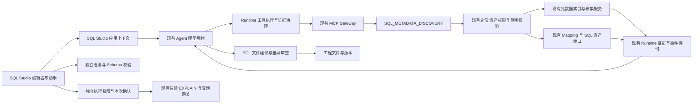

# SQL Studio 联机元数据技术方案

2026-10-14 修订：第一阶段浏览与补全见 [Schema Explorer 实施方案](20-schema-explorer-phase-one.md)，计划门槛以 [InterpretationPlan 动态规划修订](21-interpretation-plan-dynamic-governance.md) 为准。模型 SQL/ETL 开发必须先经过计划，Runtime 强制契约、模型自主决定探索和修订；本地确定性编辑操作无需完整规划工作流。

本方案在 SQL Studio 应用层绑定授权逻辑资产和元数据证据，继续使用已有 Agent 模型规划、Runtime 执行与 MCP Gateway。新增的 `SQL_METADATA_DISCOVERY` 是元数据领域执行工作流，不承担生成推理，也不引入一个新的通用 SQL Agent。

现状和复用依据见[架构审查](12-online-metadata-architecture-review.md)。本文描述拟实施行为，不代表当前接口已经支持。

## 组件关系

图中的检索与生成循环由模型决定。授权、执行、证据登记是每次调用必须经过的治理边界，不是一条“先搜表、再查字段、再查关系”的固定业务 DAG。

## 三种互相独立的上下文

**工程上下文**保存文件、文件版本、方言偏好和用户选中的 Mapping/案例。工程拥有者权限继续由现有对象访问服务判断。

**发现会话**保存 `discoveryId`、授权逻辑资产绑定、元数据证据引用和用户确认的业务假设。普通续问沿用同一发现会话；前端点击新建会话创建新的发现上下文，不删除工程或审计记录。服务端绑定 tenant、user、project 与会话归属，不从模型参数取这些身份字段。

**执行授权**只针对一次明确操作，绑定 SQL 内容摘要、逻辑资产、环境、数据库/Schema、方言、操作类型和有效期。发现会话与生成结果都不携带默认查询执行权。可见的元数据、可生成的代码和可执行的 SQL 分别判断。

当前每轮独立 Runtime session 的隔离方式可以保留。跨轮连续性由服务端 `discoveryId → authorized evidence refs` 连接，并将按预算裁剪的证据投影传给现有模型规划器。不能仅把 `historyWindow` 改大，也不能把模型提供的 evidenceId 当作授权证明。

## 数据源上下文绑定

SQL Studio 的绑定对象是现有 MCP 逻辑资产及其执行目标，包含源与目标角色：

- Query 模式通常绑定一个查询资产；ETL 可分别绑定源资产、目标资产及其 catalog/schema。
- 资产列表先由已有 RBAC/Scope 投影过滤，再返回浏览器所需的 ID、展示名、环境、数据库类型与可用能力。不得返回 JDBC URL、口令、原始管理配置或隐藏资产数量。
- 客户端的 assetId、assetName 与 environment 只是选择请求。服务端解析成不可变、带版本的 `bindingId`，每次 MCP 调用再次计算“绑定范围 ∩ 当前权限 ∩ 数据源限制”。权限撤销立即生效。
- 模型可在该交集中自主选择对象和工具；请求其他资产只能得到拒绝或要求用户重新绑定，不能通过名称相似或路由回退扩大范围。
- 企业 `data_source` 与 MCP `mcp_sql_datasource` 不建立第二套主数据同步。优先使用现有逻辑资产/执行目标映射；未映射时明确返回配置缺口。

数据源管理员的后台管理权限与普通开发者的浏览权限保持分离，Schema 浏览器不得直接调用管理列表接口。

## 元数据工作流的执行方式

`SQL_METADATA_DISCOVERY` 按现有 `SqlQueryExecutionWorkflow` 的领域扩展形式实现，复用 `AbstractStagedExecutionWorkflow` 和 MCP 工具发布机制。现有 `sql_schema_context_query` 入口委派到该工作流，继续通过通用 `McpExecutionWorkflow` 进入 Gateway。

模型仍由原有 `agent_chat` 规划和调用工具；每次模型选定的 SEARCH、DESCRIBE、RELATIONS 或 REFRESH 对应一次领域工作流调用，同一个 `discoveryId` 聚合全部调用。SEARCH 与 DESCRIBE 没有先后依赖；已有精确对象证据时无需重搜目录。模型也可直接查 Mapping、补充关系或检查 Schema 变化。

领域工作流只做：解析模型选定操作、绑定可信上下文、调用现有权限判断、执行元数据操作、验证结果结构、登记脱敏证据与事件。它不根据自然语言决定表、JOIN 键、业务规则或生成 SQL。SQL 模型提示和输出策略留在 SQL Studio 应用与既有模型编排层。

注册分为两层，避免把不同接口混为一谈：

1. 本期默认沿用 MCP Contributor/ToolRegistry 的工具发布和 `tool_workflow_contract.v1` 声明，领域工作流声明 `workflowId=SQL_METADATA_DISCOVERY`。元数据工具角色使用现有 `DIRECT`，不新增通用核心枚举。
2. 只有异步长刷新需要持久化执行时，才在应用适配配置中通过现有 `WorkflowRuntime.register("SQL_METADATA_DISCOVERY", Input.class, Output.class, definition)` 注册类型；后续 `start/find/cancel` 使用原有 Local/Temporal 适配器。不能把一次 MCP 同步请求包装成第二次完整 Agent 执行，也不能在 Temporal 确定性工作流代码中直接调用模型或 JDBC。

现有 `StructuredDataAnalysisWorkflow` 的固定查询执行阶段不参与生成路径。元数据应用 profile 不设置固定 mandatoryTools 顺序，也不撤销其他业务已有的 mandatoryTools、契约或确认规则。

## 元数据结果与增量探索

优先复用现有 Collector、MetadataIndex、RocksDB 快照和刷新器。新增字段与操作在原实现扩展，不能新建独立连接管理或元数据缓存服务。

每个对象返回稳定身份、完整 catalog/schema/path、数据库类型、表类型、字段、主键、外键和来源证据。复合键包含字段序号和两端对应关系。业务关联必须区分数据库外键、已批准 Mapping、资产中明确声明的关联、模型推测；模型推测只能进入待确认假设，不能冒充物理约束。

新增统一证据头：`snapshotId`、`objectVersion`、`collectedAt`、`sourceUpdatedAt`、`sourceKind`、`freshness` 和 `visibilityRevision`。对象版本取已授权可见结构的规范化内容摘要；数据库更新时间无法获取时为 null。现有 `configurationFingerprint` 留在内部作缓存失效依据，不公开，不充当 Schema 版本。

分页游标绑定调用者、绑定版本、过滤条件和快照版本，不能只是可编辑 offset。授权过滤必须发生在排名、计数、分页和摘要之前。换快照或权限变化时旧游标失效，返回可恢复错误而不是混合两份目录。兼容旧 Top 5 响应；新操作提供完整的分页与 `truncated/nextCursor`，不一次加载全库。

每次模型调用可声明 `knownEvidenceRefs` 和期望新鲜度。按对象刷新失败时保留旧快照，但返回 STALE/UNAVAILABLE 与原因；不得用空列表解释为“表不存在”。补齐 ADDED、CHANGED、REMOVED 和增量保留边界；超过变更历史保留范围时返回 `SNAPSHOT_EXPIRED`，要求重取目录。

## SQL Query Generation

联机生成仍使用现有生成任务接口和 Agent 编排。应用提供已授权的元数据工具集合、绑定引用、当前文件内容及版本、选区、用户需求和已验证证据引用。模型决定是否继续探索及如何改写代码。

工具集合由应用 profile、现有目录和当前授权取交集，并在执行时再次校验。请求体中的 availableTools、Agent 配置或工具自动补充逻辑不能放宽这个集合。该模式只允许元数据和授权资产检索，不允许 `sql_query_execute` 或间接具有业务数据执行副作用的模板/复合工具。必要的窄策略扩展经 P1 验证后接入现有 ToolRuntimePolicyProvider，不替换全局安全体系。

生成结果保留现有文件包与差异审查，并增加引用证据和假设。代码补全、选区替换和插入使用请求发起时的文件版本、内容摘要和位置；文件变化后阻止旧建议覆盖，供用户重新生成。全文件替换、多文件创建复用现有版本保存事务。

源库类型来自元数据证据；输出方言来自确认的目标引擎。MySQL 源库到 Spark 目标 ETL 不能被自动识别源库类型改写成 MySQL 输出。跨引擎引用须明确说明外部表、连接器或已有数据落地前提，不虚构直接跨库 JOIN 能力。

数据库报错作为带来源的输入附件交给模型；修复前可补查相关 Schema。Runtime 只展示结构化错误、脱敏和审计，不采用硬编码字段替换或 SQL 模板来“修好”模型输出。

## ETL SQL Engineering

ETL 与 Query 共用发现会话、工具治理和文件工程能力，使用不同 `purpose` 和输出目标信息，不新增另一套 Agent。

模型可按需求检索授权源表、目标表、Mapping 与历史 ETL 案例，自主选择需要补充的元数据。Mapping 和案例经文档权限端口或工程文件归属校验后检索；大文档按命中片段返回，附文档版本、sheet/行号或代码范围。查询不到不能用前 500 条本地过滤来声称完整覆盖。

增量、全量、分区加载、MERGE 和多文件组织由模型根据需求及证据提出。主键、增量水位、更新删除语义、时区、分区、幂等与重跑方式等没有确认时进入 `assumptions`，包含确认状态和影响文件。模型不可仅凭字段命名把 created_time 认作业务水位、把 id 认作主键。

可以生成目标引擎支持的 INSERT、MERGE 或 DDL 文件；保存文件不执行文件。本期复用的网关是只读查询网关，不能拿它执行 ETL 写入。未来写入执行若纳入范围，必须单独审查已有执行能力与权限，不通过本方案扩大授权。

## 校验与执行分离

| 阶段 | 能力 | 结果状态 | 是否运行生成 SQL |
| --- | --- | --- | --- |
| 生成 | 模型生成文件和假设 | GENERATED / NEEDS_CONTEXT / NEEDS_CONFIRMATION | 否 |
| 语法校验 | 复用方言 parser；未支持方言返回能力状态 | PASSED / FAILED / UNSUPPORTED / UNAVAILABLE | 否 |
| Schema 校验 | 在授权快照中解析表、字段、别名、CTE、派生列及引用 | PASSED / FAILED / INDETERMINATE / STALE | 否 |
| EXPLAIN | 本次授权确认后通过现有查询执行网关 | 独立 operationId 和执行结果 | 是，数据库规划操作 |
| 查询 | 本次授权确认后运行只读 SQL | 独立 operationId 和查询结果 | 是 |
| ETL 写入 | 本期不接入执行 | NOT_SUPPORTED | 否 |

Schema 校验不是字符串搜索：不能把 CTE 列或 SELECT 别名误报为源字段，也不能因 parser 不支持某方言便返回通过。视图定义、动态 SQL、UDF、跨引擎对象等无法确定时返回 INDETERMINATE，并标明原因。元数据未刷新时，不把缓存缺失当作字段不存在。

服务端优先扩展 MCP 模块已有 JSqlParser 依赖及元数据治理解析适配，不重复引入数据库访问框架。已有用法主要是 DDL 和企业标准比对，SELECT/CTE 绑定仍是待实现的校验适配；前端 `dt-sql-parser` 诊断不能作为服务端执行授权依据。各引擎的语法覆盖通过独立用例确认，超出覆盖范围明确返回 UNSUPPORTED。

EXPLAIN 和查询分别检查现有权限与确认策略。SQL 文本、参数、环境、资产或版本任何一项变化均使先前确认失效。确认请求不能由模型自行构造即获得授权；使用已有 Runtime 确认记录。若现有记录不能绑定完整内容摘要，先做窄契约扩展和负向测试，不能用前端布尔值替代。

## Vue 集成

左侧保留工程文件树，追加独立的数据源/Schema 树：懒加载、分页检索、刷新时间与状态、表字段与关系。点击表字段可以引用到助手，也可加入 Monaco 的授权补全集合。引用包含对象 ID 和快照，而不是只拼接一段可伪造表名文本。

右侧保留解释、生成、修复模式，并增加 Query/ETL 用途和绑定信息。探索面板显示真实的工具调用、对象摘要、新鲜度、补充探索和拒绝原因，不展示模型隐藏推理。事件按 run/task/discoveryId 与 sequence 去重续传。

输出文件显示证据、校验状态和待确认假设，沿用现有红绿差异对比。插入、替换、创建文件均需显式应用；解释模式没有代码应用按钮。刷新 Schema、调用元数据工具、保存文件都不能触发查询执行。

## 持久化与兼容

复用现有 SQL 工程表及版本表。拟在应用迁移中增量保存发现上下文、绑定版本、Generation 的 evidence refs、purpose、dialect 和 validation refs；数据证据实体仍存现有 EvidenceStorePort，不能再复制一个全量证据仓库。保存的是引用和必要的应用投影，不保存连接凭据。

`sql-studio.output.v1` 离线输出继续支持。联机输出采用 v2，以严格解析器验证证据引用、文件路径和假设；v1 不能被默认为联机验证通过。既有离线 Agent/模型切换保持兼容，联机入口明确要求具备工具调用能力的现有模型编排通道。

上线采用 SQL Studio 应用功能开关和小范围授权资产灰度。关闭开关后回到现有离线生成；新增应用记录保留审计。功能开关不修改全局 Runtime、RBAC 或其他业务工作流行为。
