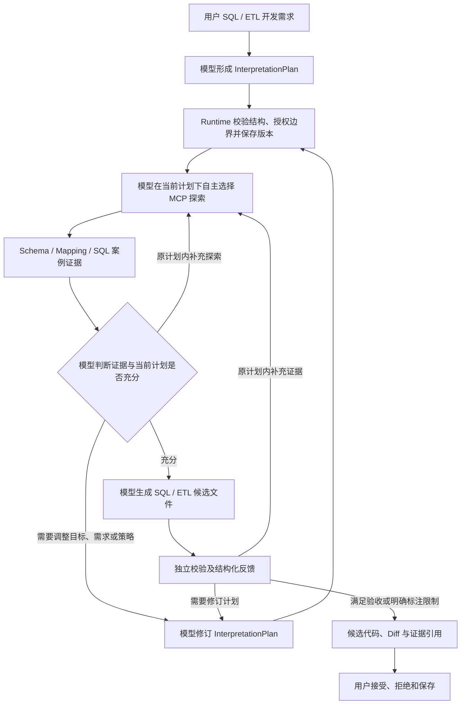

# SQL Studio InterpretationPlan 动态规划修订与源码审查

本修订撤回第 20 号方案中的“SQL 代码计划默认跳过、planRequested=true 才启用”建议。模型自主生成、修改、修复、优化与 ETL 工程开发必须遵守现有 InterpretationPlan 契约。没有明确步骤的自然语言任务先由模型理解与规划，再进入工具探索和代码生成。Runtime 校验、授权、执行、版本和证据治理；目标、探索内容、表字段、工具选择与修订方案由模型决定。

## 实际源码审查结论

下表 Runtime 路径以 chatchat-agents/src/main/java/com/chatchat/agents/ 为根，API 路径以 chatchat-api/src/main/java/com/chatchat/api/ 为根，前端路径以 chatchat-api/web-app/ 为根。Runtime 已有动态规划基础，不需要新建 SQL 规划框架或另一个 Agent 循环。

| 能力 | 已核验源码及入口 | 结论与限制 |
| --- | --- | --- |
| 统一计划结构 | runtime/plan/InterpretationPlan.java：Intent、Context、Plan、Step、依赖及绑定 | 直接复用。version 是协议格式版本，不等同于任务修订次数；领域说明使用现有 intent/context/step.input，禁止创建 SqlPlan 平行结构 |
| 计划契约校验 | InterpretationPlanValidator.validateAnalysisPlan / validate | 前者校验公开分析纲要；后者校验可执行 DAG、可用工具、依赖及执行策略。不能拿分析票据冒充已获准执行的 Runtime 计划 |
| 证据驱动的修订 | orchestration/InterpretationAnalysisSession.refinementGate / refinementPlan / refinementData | 读取执行结果与 evidenceHistory，调用模型重写，校验后保存并继续执行。已有多轮循环，不局限于第一次探索 |
| 模型制定新计划 | runtime/plan/InterpretationPlanRewriter.rewrite(RewriteRequest) | 输入原计划、失败步骤、观察、证据历史、可用工具和预算；模型输出修订后的 InterpretationPlan，Runtime 重新校验。不由 Runtime 构造业务 JOIN 或选择表 |
| 局部修订与复用 | InterpretationPlanIncrementalRepair.region / apply；persistence/PlanCheckpointCoordinator.seedReusable / recover | 可修订失败节点及消费者并冻结无关节点；只复用身份、定义和依赖结果一致的已提交检查点。旧版本 final_answer 不直接复用为新版本结果 |
| 修订准入与预算 | orchestration/analysis/loop/AnalysisRefinementCoordinator.admitModelRefinement；AnalysisLoopCoordinator | 已有模型自主重规划准入。SQL 接入应沿模型自治路径，不能将 legacy admitRefinement 中“是否有新工具”判断当成所有 SQL 修订前提；同一工具换 Schema、参数或版本仍可能是有效探索 |
| 版本存储 | runtime/plan/persistence/InterpretationPlanStore.savePlan / getSnapshot / listVersions；runtime/store/InMemoryAgentRunStore、RocksDbAgentRunStore | 已有当前快照、完整版本和 DAG 持久化。每次 savePlan 产生记录版本，状态快照也可能增加版本，不能把每条存储记录都显示成一次模型 Replan |
| 计划与执行证据关联 | orchestration/planning/snapshot/InterpretationPlanSnapshotService.saveGenerated / saveExecution；planning/evolution/AgentPlanEvolutionAuditor.rewriteSummary / repairContext；runtime/plan/EvidenceCompressionGate | 已有 taskId、planId、snapshotVersion、执行 DAG、step 输出、观察和证据历史。压缩视图带 evidenceRef，完整证据仍归 Runtime。SQL 文件到具体 Schema 证据的引用还需应用层接入 |
| 查询计划和历史 | API agent/task/AgentTaskController.java：GET /agent/tasks/{taskId}/plan、/plan-dag、/plan/versions | 已有接口，复用。SQL 页面读取前须校验工程、Generation、任务归属与租户；不能仅凭客户端 taskId/tenantId 放行 |
| 前端已有可复用展示 | web-app/src/services/api.js：fetchAgentTaskPlan / fetchAgentTaskPlanDag / fetchAgentTaskPlanVersions；src/js/views/TasksView.js；src/components/PlanDagGraph.vue | 任务页已有版本与 DAG 读取能力。SQL 助手当前尚未接入这些任务快照，不应另建版本 API 或宣称动态展示已完成 |

这些源码提供的是通用机制，不代表 SQL Studio 已完成全链路接入。尤其 InterpretationPlanSnapshotService 当前对部分持久化异常只记录日志；要求证据完整的 SQL 任务接入时，需要在应用治理边界阻止缺少有效持久化计划的后续探索和交付，不能以日志成功替代计划落库。

## SQL Studio 实际缺口

1. StudioCodePlanService.create 创建的是 ANALYSIS_READY 初始分析计划，使用独立 studio-code-* 标识保存；SqlStudioService.prepare 将它附加进 query 和 toolInput。它尚未成为实际 taskId 下持续演进的权威执行计划。
2. 默认 llm_chat 入口是工具隔离的离线上下文生成；提供一段计划提示词不会自动进入 InterpretationAnalysisSession，也无法完成联机探索与 Replan。不得只修改 mode 字符串或偷偷选择默认 Agent 代替能力、权限和模型选择治理。
3. SqlAssistantPanel 只读取 prepared.taskRequest.toolInput.studioCodePlan，当前不能显示后续 Runtime 计划版本、变更原因和证据图。
4. SQL Schema/Mapping/案例的元数据快照已有来源和版本，但 Generation.files[] 尚未逐文件关联计划版本、工具调用及验证证据。
5. 生成、静态验证、联机 Schema 验证、EXPLAIN 与执行仍须独立建模；规划本身不能将 metadata-only 生成会话升级为可执行业务 SQL 的会话。

## 修订后的计划门槛

| 操作 | 处理 |
| --- | --- |
| 本地语法提示、Monaco 表字段补全、格式化、缩进、人工编辑、Diff 浏览 | 使用现有本地编辑器能力。补全读取元数据时仍经现有授权接口，但不启动模型规划循环 |
| 用户点击 Schema Explorer 浏览目录、展开字段、选择上下文 | 人工确定的只读操作，由现有 MCP 元数据接口执行和授权；不伪装成模型探索计划 |
| 自然语言生成查询/ETL、多文件工程、模型改写、修复、优化、模型代码解释 | 先有有效 InterpretationPlan。计划失败、不合法、身份/代码/需求已变或存储失败时不得继续该轮模型开发 |
| 用户已提供明确步骤 | 由模型理解、核对并形成或确认现有计划；不必额外制造无业务意义的探索，但不能信任客户端自称“已经规划”来绕过契约 |
| EXPLAIN、查询、写入、部署 | 单独权限与确认，计划通过不代表获准执行 |

Runtime 强制的是“当前有效计划先于相应探索/生成，修订后重新校验且有证据可追踪”。计划不是固定调用脚本：不能强制先列所有库、再列所有表、再取所有字段，也不能限制每轮必须换工具名。预算、资产授权、快照一致性、输入绑定及结构校验属于治理约束。

## 计划公开内容与动态循环

复用 intent.goal 表达目标；context.key_facts / missing_info / assumptions / constraints 表达已知数据、数据需求及待确认业务口径；模型在 steps[].input 中明确 exploration direction、预期产物及验收条件。必要字段应在应用提交契约中检查，不能仅靠自然语言提示词保证。验收条件可复用已有 TaskContract 的目标及证据要求，具体领域映射只在 Studio 适配层完成，不修改通用计划语义。

页面只展示公开任务摘要，不展示模型私有推理。Runtime 不填入具体表名、字段、JOIN 路径或业务映射来代替模型制定计划；来自授权上下文的既有绑定是边界，不是模型的表选择策略。

该图描述状态契约，不规定工具执行顺序。循环使用既有 RewriteRequest、模型仲裁和预算机制；校验错误作为证据反馈。已确认不能取得权限或预算耗尽时明确停止并列出缺口，不无限重试或猜造字段。

## 最小接入方案与交付边界

本轮实际代码修正：恢复 SqlStudioService.prepare 的初始计划必经门槛，兼容保留 planRequested 输入但忽略其绕过含义（false 同样先规划）；计划失败在 Generation 与 Runtime 会话创建前阻断。复用 StudioCodePlanService 提示补充五类公开内容及允许证据驱动修订，恢复前端规划状态并更新回归测试。不修改 Runtime 核心，不新增 SqlPlan、数据库连接或 Agent 框架。

修改位置为 API datascience/sql/SqlStudioService.java、datascience/StudioCodePlanService.java 及对应测试；前端 src/js/components/sql-studio/SqlAssistantPanel.js、src/js/views/SqlStudioView.js、src/js/utils/sqlTaskPresentation.js、src/components/editor/StudioCodePlan.vue 及现有测试/浏览器脚本；同步修订第 13、19、20 号方案。共享初始计划提示与卡片也用于 Python Studio，只增强公开内容说明和初始版本标记，未改变 Python 的权限、执行或计划调用顺序。

上述修正只是撤回上一轮应用层旁路，不能冒充“Runtime 已强制完整 SQL 动态循环”。后续最小接入按以下顺序落地：

1. **统一任务身份和准入**：在现有 SQL 适配与任务提交链路，把初始计划与实际 taskId/runId、租户、用户、工程及请求摘要关联；服务器决定规划必需性，不信任 toolInput 中的客户端标志。进入已有模型规划执行路径，校验缺失/伪造/过期计划及直接提交绕过。初始计划转为可执行计划时仍由模型决定其内容，不能用固定 SQL DAG 转换器生成业务步骤。
2. **复用动态执行**：接入 InterpretationAnalysisSession、InterpretationPlanRewriter 和现有模型自主 Replan 准入；每次有效修订沿用快照/版本存储，工具执行继续经过 ToolRuntimeService、MCP 与原授权。只在证据允许的情况下复用步骤，不复用被撤权或旧 Schema 的结果。持久化失败时在必需计划的调用边界停止，不全局更改通用 Runtime 行为。
3. **补足展示投影**：SqlStudioService 在现有 GenerationView 或已有任务接口适配层聚合最新计划、版本摘要、DAG、修订原因、实际事件和证据引用；复用 access.requireTask 与工程归属。SqlAssistantPanel 复用 PlanDagGraph 和任务页 API；初始纲要与当前运行版本分别标识，未执行的计划步骤不显示为成功。
4. **候选代码证据与验证**：在既有 Generation 与 Candidate 输出兼容增加 plan/task/run/step/evidence/snapshot 引用及逐文件诊断，至少包含计划内容修订标识、Schema 对象身份和证据类别。存储版本与计划内容 hash 区分状态更新和语义修订。未核验注册元数据、推断关系、未确认业务口径不能自动升级为 VERIFIED_SCHEMA。保留原 baseVersions、Diff 接受/拒绝和原子保存。

预留的展示关联形状（不是新增规划协议）：{taskId, runId, planId, snapshotVersion, planContentHash, stepId, invocationId, evidenceRef, metadataSnapshotId, candidatePath, validationResultRef}。实际字段来源沿用已有快照与执行证据，缺失时明确标记未知，不在前端伪造。

## 必须补足的验收

- 未提供计划、planRequested=false、伪造计划或无效计划不能绕过模型开发门槛；本地编辑能力不额外调用模型。
- 模型可针对同一意图采用不同合法探索顺序，Runtime 均接受；同一 MCP 工具改变命名空间/参数的有效补充探索不因“工具未变化”而被拒绝。
- 初次探索缺字段、关系不明、Schema 版本变化或校验报错后，模型自主 Replan；保存可追踪新版本，并重新校验与授权。
- 重放、取消恢复和计划修订保留正确证据身份；旧版本终态不冒充新版本完成；撤权后不复用旧检查点。
- 页面可查看初始计划、当前计划、修订原因、真实工具事件、Schema 证据、候选文件与验证结果；对尚未完成的接入不标记已支持。
- 生成不会自动执行；候选结果仍由用户接受或拒绝。真实模型、实库和普通用户部署验收需单独记录。

## 本轮验证记录（2026-10-14）

后端 88 项通过：InterpretationPlanRewriterTest 14、InterpretationPlanIncrementalRepairTest 1、AnalysisRefinementCoordinatorTest 8、AnalysisLoopCoordinatorTest 7、InMemoryAgentRunStoreTest 11、RocksDbAgentRunStoreTest 12、SqlStudioIntegrationTest 29、StudioCodePlanServiceTest 6。覆盖既有修订/证据循环和存储机制，以及本轮默认计划门槛、false 不绕过、失败阻断和初始计划说明。命令使用 Java 17、Maven -pl chatchat-api -am test，关闭重复前端构建。日志 target/interpretation-plan-correction-tests.log。

前端 npm run test:sql-studio 50 项通过；Chromium/Monaco 浏览器回归和 Vite 生产构建通过（target/schema-explorer-web）。测试使用模型及 HTTP 夹具，存储测试包含已有 RocksDB 实现；没有真实 SQL 模型动态循环、实库或部署验收。初始计划卡片明确标注“初始”，不将其描述为已完成探索或已接通运行版本展示。

Schema Explorer 上一轮 55/66 项结果属于历史批次；本轮 88/50 项及现有 Runtime 单测均不能替代尚待接入的 SQL Runtime 动态链路验收。未声称上述四项后续接入已经实现。
