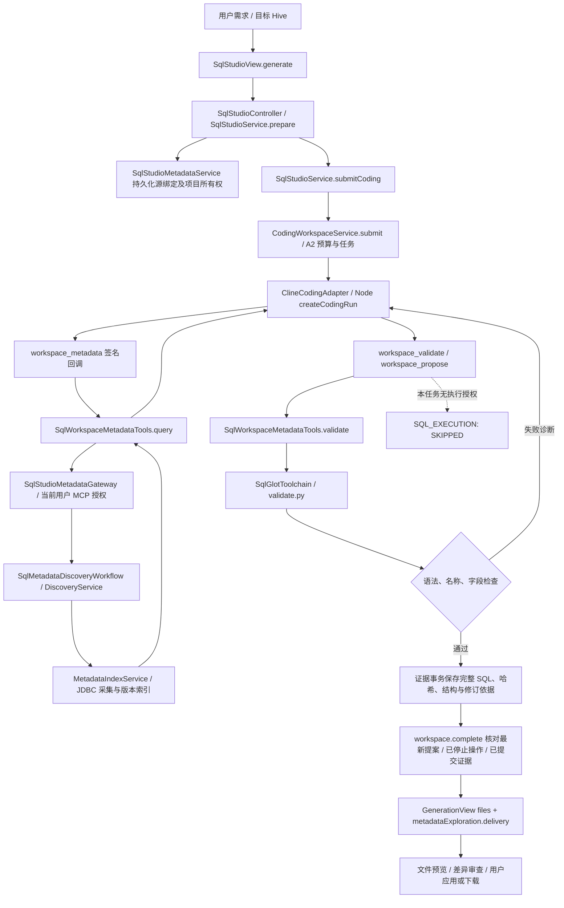
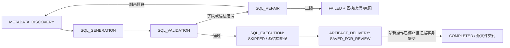

# SQL Studio P0：失败任务根因与最小整改

## 事实基线

只读审计截图中的 `sql-coding-104d7c7e-d3a3-43ef-bf9b-a8ccf3aebef5`，保存原任务的模型回执、元数据工具回执、8 份 SQL 提案以及最终发现快照；没有修改历史失败状态、重置预算或伪造成功。

用户确认本次目标为 **Hive ETL SQL，Oracle 仅提供源表结构**。原任务快照中的目标方言确实为 `hive`，源绑定为 Oracle；不能因 UI 显示 Oracle 就用 Oracle 方言复现此错误。

真实回执已证实：Cline 调用了 `workspace_read`、`LIST_BINDINGS`、多轮 `DESCRIBE/SEARCH/LIST_NAMESPACES` 和 `workspace_validate`，取得两张表的 58/23 个字段。故“Cline 没有调用元数据工具”不是本次根因。

## 完整调用链

主要位置：`chatchat-api/web-app/src/js/views/SqlStudioView.js`；API 的 `datascience/sql/SqlStudioService.java`、`SqlStudioMetadataService.java`、`SqlWorkspaceMetadataTools.java`；`runtime/coding/cline/ClineModelCallbackController.java`；`runtime/coding/workspace/CodingWorkspaceService.java`；`coding-agent-node/src/runner.js`；MCP 的 `sql/metadata/SqlMetadataDiscoveryWorkflow.java`、`SqlMetadataDiscoveryService.java` 和 `MetadataIndexService.java`。方法及文件对应行号见 [源文件证据](30-p0-evidence/verification.json)。

## 根因和修复

| 项 | 修复前的真实问题 | 最小修复及证据 |
| --- | --- | --- |
| R1：规范化不一致 | `validate.py` 注册元数据时 `MappingSchema` 按 Hive 规范化，但前置 `schema.find(source)` 直接使用 SQL 原始大写表名。查找在 `qualify` 之前失败，同一真实表被误判为未解析 | 在前置查找前调用已有 `normalize_identifiers`，保持相同方言。用生产 JAR 提取的原解析脚本复现，再用同一 SQL/快照回放：8 份提案由 0 通过变为 8 通过，未关闭字段校验。 |
| R2：限定名比较不一致 | Hive 解析后的 Schema 为小写，Oracle 返回真实大写 Schema；Java `matches` 对命名空间进行无条件精确比较，可先于 Python 再次误判缺失 | 分别保留表/Schema/Catalog 的引号及目标方言大小写语义；Hive 反引号仍不区分大小写，PostgreSQL 双引号保持精确。授权查询仍使用服务端绑定的实际命名空间。 |
| R3：引用字段和结构证据 | 结构审查在 SQL 已规范化后仍直接比较原始元数据大小写；元数据字段名作为普通字符串可能丢失 PostgreSQL 带引号字段的大小写 | 同方言规范化结构投影，保留带引号字段身份；从真实 `qualify` 作用域记录实际引用字段，不用全文正则推断 CTE/别名。 |
| R4：失败诊断丢失 | `/finish` 将工作区失败统称为 `Coding loop failed without a verified result`，用户看不到最新字段/元数据诊断 | 失败汇总读取当前任务最后一份不可变校验回执；未确认停止的操作仍必须先对账，不能直接终止。 |
| R5：反复修订与证据 | 24 次模型预算和 64 次工具预算写死；虽然有最终预算，缺少独立 SQL 修订上限和直接可查的前后关联 | 模型/工具次数可配置；SQL 修订次数在任务输入中冻结。达到上限返回 STOP，Node 在同一 SDK 循环中停止。每轮保存前一回执、源哈希、受限替换差异、模型说明和真实验证结果。 |
| R6：交付说明不足 | 文件和校验已保存在证据事务，但返回界面未完整组织源方言、目标方言、版本、引用字段和未执行原因 | 新增 `sql-studio.delivery.v1`，与原文件索引在同一证据事务提交。保存非空完整文件、哈希、字段依据、源版本、关系状态、修订记录和执行跳过原因；结果查询返回该清单。 |
| R7：元数据操作不全 | 已有 `LIST_NAMESPACES/SEARCH/DESCRIBE` 可探索，但缺少明确的分层、列搜索、结构 DDL 和刷新入口 | 复用同一授权协议和索引，补充 Catalog/Schema/Table、列搜索、关系、可见结构 DDL 和刷新操作。资产鉴权在刷新之前执行。DDL 投影不冒充原始 DDL。 |

## 最小改动顺序

1. 只读提取失败证据，以真实目标 Hive 重放原 SQL，先确认 R1。
2. 修复名称规范化与命名空间/引号一致性；验证不存在字段、同名表和带引号大小写仍被正确拒绝。
3. 保留现有授权和 SDK 回路，补齐元数据操作、错误分类与任务级冻结预算。
4. 完善现有文件证据事务的交付投影及修订链接；不增加通用数据库连接权限或新的分析 Agent。
5. 用真实 JDBC、实际 Cline SDK 和真实模型分别验收；对数据库试执行明确区分范围。

## 状态、成功和失败边界

“COMPLETED”只表示授权范围内的源文件交付完成，交付清单同时明确 `businessSemantics=NOT_EVALUATED` 和 `sqlExecuted=false`。没有空文件交付、模型 JSON 成功即任务成功或把元数据查询当作 SQL 执行的分支。原 `complete` 对最新提案、停止证明和已提交证据的检查保留。

配置项：`chatchat.coding.workspace.sql-metadata-max-model-calls`（默认24，上限32，与 SDK 一致）、`sql-metadata-max-tool-calls`（默认64）、`max-sql-repair-attempts`（默认8次修正，不含首次提案）；时间和 token 预算继续复用既有配置。已开始的任务不会因配置改变重置预算。

## 明确未新增的能力

按用户本轮确认，没有增加向 Oracle 试执行 Hive SQL 的路径。Oracle 是元数据源，源连接与目标执行权限不能混用。没有修改普通数据分析的工具集合、Python Sandbox 网络策略或数据供给边界。

本实现没有把静态字段校验升级为 Hive 集群实际执行或业务指标认证，也没有实现通用数据库执行异常的自动修复。原始 Oracle DDL、未采集约束和实时数据库对象存在性，不由可见结构投影或旧快照伪证。完整 P0 的剩余验收项见 [验收报告](32-acceptance-20261030.md)。
