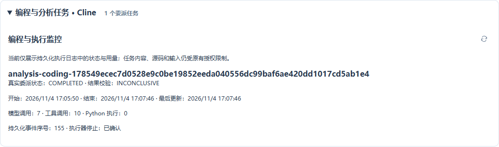

# 任务监控 403 与错误空状态修复

运行版本 `6ef1db93d3209c7b6466619d0f628319efce7e5d` 已部署至 <http://192.168.195.221:18100>。

截图对应任务 `a3087ed0-4596-30de-afa7-866ee700169f`，运行 `att-1-a49e450f-1272-44c3-8b3f-fdb0de88b877`。
实机基线确认：父任务 PARTIAL，真实 Coding 委派数量 1，委派状态 COMPLETED；创建者读取详情成功，admin 读取原详情接口返回 403。

## 根因与修复

任务列表按 `platform:tasks:all` 允许全租户监控，但原 Coding 详情接口只允许任务创建者，且内容还受实时来源授权约束。
前端忽略了两个读取范围的差异，在 403 后把初始空数组显示为“0 个委派任务”和“暂无记录”，并每 2.5 秒重试。
“已保留加载的历史记录”在首次加载失败时也没有事实依据。

现在新增 `/coding/status`：创建者或具有同租户全任务监控权限的用户，可读取持久化日志中的 ID、状态、时间、枚举原因码和用量。
使用明确的只读 DTO，不返回目标、配置、摘要、源码、输入或来源引用；原详情、输入与操作接口仍执行原有权限检查。
来源复核不影响这类无业务内容的运行事实读取。DTO 专用分支有类型检查，伪造普通 JSON 标记不能跳过来源校验。

任务内容受限或明确属于其他创建者时，页面直接读取运行状态；后续详情返回 403 时清除旧详情，再读取运行事实。
两种读取都失败时明确显示“委派记录未能读取”，不会推断零任务。终态记录不再持续轮询详情。
同时移除笼统断言“证据已失效”的提示，按已知原因说明内容限制，未知原因保持未知。

## 实机证据

[基线](task-monitor-403-20261104-evidence/baseline.json)、[后端验证](task-monitor-403-20261104-evidence/monitor-live-verification.json)证明：

- admin 和创建者的运行状态接口均返回 200，显示同一个真实委派。
- admin 的原详情和输入接口仍返回 403，没有扩大内容权限。
- 读取前后持久化 Coding 日志摘要完全一致：`bdb4ce3202b538dc6f51f56aae36b49c`。未改写任务历史。
- 父任务仍为 PARTIAL，委派仍为 COMPLETED。委派完成表示这次受控分析已交付结果，不表示父任务所有业务证据充分；校验仍为 INCONCLUSIVE。

[真实浏览器验证](task-monitor-403-20261104-evidence/browser-verification.json)使用 admin 实际登录、原任务选择入口，没有注入模拟任务。
8 秒观察中只有一次 `/coding/status` 200 请求，Cache-Control 为 no-store；没有受限详情请求、403 重试、页面脚本错误或失败 API。
首页、任务页、Coding 监控模块的线上 SHA-256 与完整 Maven 构建 JAR 一致。

21 项后端测试、22 项前端测试通过，完整前后端构建通过，见[测试记录](task-monitor-403-20261104-evidence/tests.json)。
[部署记录](task-monitor-403-20261104-evidence/deployment.json)保留原容器与配置，无数据库迁移；MCP、采集和 Worker 容器保持原实例。
本轮只修复监控读取与显示，未重新执行该任务、未伪造调用/执行记录、未将原失败或部分完成状态改为成功。
