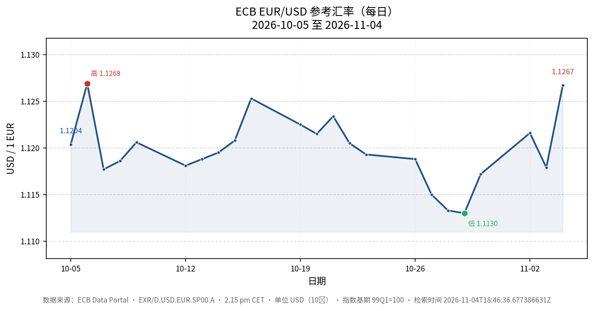

# 欧洲央行 EUR/USD 参考汇率近一月报告

## 数据概要

本报告基于欧洲央行（ECB）官方数据接口发布的 **EXR/D.USD.EUR.SP00.A** 序列，取最近 23 个观测值，覆盖 **2026-10-05** 至 **2026-11-04** 共 23 个交易日 [数据来源](runtime-evidence:knowledge:6e9a1aa3d47817623bdad7d12b2ac5bd742379b8cf58b729fb4ad5c66dca7e6c)。该序列含义为 **1 欧元兑多少美元**（USD per EUR），计价币种为 USD，分母币种为 EUR，汇率类型为即期（SP00），取每日 14:15 CET 参考汇率，序列变体为平均值（A），指数基期为 1999Q1=100 [数据来源](runtime-evidence:knowledge:6e9a1aa3d47817623bdad7d12b2ac5bd742379b8cf58b729fb4ad5c66dca7e6c)。

## 区间走势

- **期初值**（2026-10-05）：1.1204 USD/EUR [数据来源](runtime-evidence:knowledge:6e9a1aa3d47817623bdad7d12b2ac5bd742379b8cf58b729fb4ad5c66dca7e6c)
- **期末值**（2026-11-04）：1.1267 USD/EUR [数据来源](runtime-evidence:knowledge:6e9a1aa3d47817623bdad7d12b2ac5bd742379b8cf58b729fb4ad5c66dca7e6c)
- **区间变动**：+0.0063（+0.56%）[数据来源](runtime-evidence:knowledge:6e9a1aa3d47817623bdad7d12b2ac5bd742379b8cf58b729fb4ad5c66dca7e6c)
- **区间最高**：1.1269（2026-10-06）[数据来源](runtime-evidence:knowledge:6e9a1aa3d47817623bdad7d12b2ac5bd742379b8cf58b729fb4ad5c66dca7e6c)
- **区间最低**：1.1130（2026-10-29）[数据来源](runtime-evidence:knowledge:6e9a1aa3d47817623bdad7d12b2ac5bd742379b8cf58b729fb4ad5c66dca7e6c)
- **区间均值**：1.1199；标准差：0.0036 [数据来源](runtime-evidence:knowledge:6e9a1aa3d47817623bdad7d12b2ac5bd742379b8cf58b729fb4ad5c66dca7e6c)

整体看，EUR/USD 在该月内呈先稳后落再回升的走势：10 月上旬至中旬围绕 1.12 上下窄幅波动；10 月下旬起逐步走低至 10 月 29 日的区间低点 1.1130；11 月初回升，11 月 4 日收在 1.1267，为区间次高，仅低于 10 月 6 日的 1.1269 [数据来源](runtime-evidence:knowledge:6e9a1aa3d47817623bdad7d12b2ac5bd742379b8cf58b729fb4ad5c66dca7e6c)。

## 图表

## 局限性

- 本序列仅提供每日一个参考汇率值（14:15 CET 均值），不含日内高/低、成交量或买卖价差，无法反映盘中波动。
- CSV 未提供每条观测的"发布时间"字段（PUBL_ECB / PUBL_MU / PUBL_PUBLIC 列均为空），因此无法从该 CSV 确定每条汇率的具体发布时点。
- 观测仅覆盖工作日，周末与欧元区/美国公共假日缺失，属正常交易日安排而非数据缺失。
- 报告仅基于该 CSV 直接支持的数值，不引入未从来源取得的外部发布时点或事件归因。
- CSV 中 OBS_STATUS 全部为 A（正常），OBS_CONF 全部为 F（自由），无特殊状态标记。