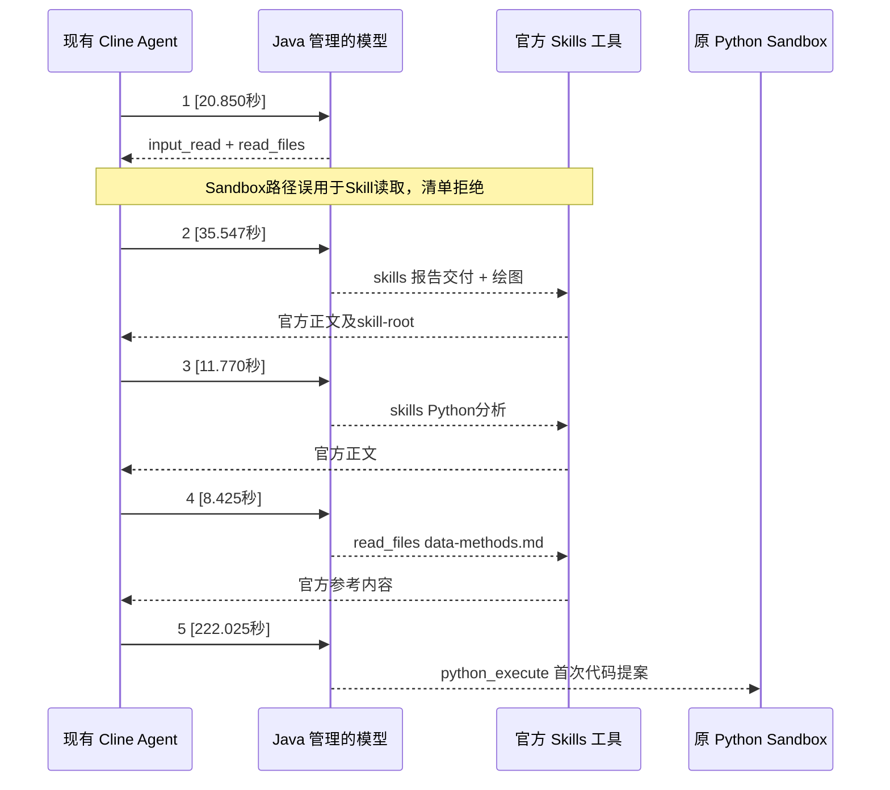

# Coding Node 原生 Skills 验收记录

运行时实际使用当前 Cline 0.0.93 的官方包发现器、配置服务、Skills 执行器、原生工具及文件执行器，并由原来的 `@cline/agents` 自主选择。已部署到 192.168.195.221，未新增系统 Prompt 规则、第二个 Agent Loop 或完整 ClineCore 迁移。架构能力已接入；真实任务和报告质量的失败仍列为失败，本记录不表示全部验收项通过。

调查见[官方 API 核对](../audits/cline-native-skills-api-review.md)，删除清单、授权边界和迁移风险见[迁移记录](../audits/cline-native-skills-migration.md)。

## 自动化门禁

| 范围 | 结果及证据 |
|---|---|
| Windows Node | R1、R2 各 240/240，0 跳过；[R1日志](evidence/cline-native-skills-20261106/windows-node-tests.log)、[R2日志](evidence/cline-native-skills-20261106/windows-node-tests-r2.log) |
| Linux 只读、禁网、去 capabilities 候选 | R1、R2 各 240/240，0 跳过；[R1](evidence/cline-native-skills-20261106/linux-node-tests-r1.log)、[R2](evidence/cline-native-skills-20261106/linux-node-tests-r2.log) |
| 真实 Docker Python | 两候选各 10/10；含八类技术失败、连续修复/恢复、10000 行局部 SDK Patch；[R1](evidence/cline-native-skills-20261106/docker-sandbox-tests-r1.log)、[R2](evidence/cline-native-skills-20261106/docker-sandbox-tests-r2.log) |
| Java | 84 个不同用例通过：Analysis 45、Dispatch 5、SkillReader 11、ModelBridge 23；另有 13 个 SQLGlot 用例因未配置本机 Python 跳过，不算通过。[初轮日志](evidence/cline-native-skills-20261106/java-base-tests.log)、[最终 Reader/Bridge 34 项](evidence/cline-native-skills-20261106/java-native-schema-and-authorization-tests.log) |
| 浏览器 | SDK fixture 通过；当前部署真实 CSV 任务只读检查通过、页面错误 0，验证 build、原生发现事件、实际工具、预算/代码/Python 观测。[fixture](evidence/cline-native-skills-20261106/browser-fixture.log)、[真实浏览器证明](evidence/cline-native-skills-20261106/browser-r2.json)、[概览](evidence/cline-native-skills-20261106/monitor-overview-r2.png)、[模型明细](evidence/cline-native-skills-20261106/monitor-models-r2.png) |

原生专题 14 项直接运行已安装 SDK，不以 Markdown Parser 或自研 Loader 代替发现/加载。它们采用受控模型或直接工具调用验证协议、隔离及恢复，不冒充真实 Provider 的自主选择。

## 十项要求的实际覆盖

| 要求 | 验证与边界 |
|---|---|
| 简单 CSV 可直接编码 | 同一个真实 SDK Agent 自动化通过；真实 CSV 可在 0 正文加载时编码、执行。`skillReads` 是工具尝试数，不能替代成功正文事件 |
| Parquet 适用 Skill | 原生分析 Skill 与 data-methods 加载自动化通过；真实简单 Parquet 样本可自主跳过。未强迫这些样本读取，不能把跳过冒称正向选择证明 |
| 图文报告选择报告 Skill | R1 visual-1 真实自主选择报告、绘图、Python Skill 并读取原始参考。正文加载已证明；图像质量与完整可视化报告交付另列，不等于全项通过 |
| 多 Skill 协作 | 受控工具测试通过；同一真实 visual-1 选择三个 Skill，无固定数量限制 |
| 无关 Skill 不加载 | 自动化断言正文未注入初始消息；真实逐任务加载身份见 lifecycle 文件，发现 15 项不代表模型已读 15 项 |
| 动态授权隔离 | Java 授权/版本固定、两租户/任务私有目录、跨任务及宿主拒绝、撤销后拒绝缓存正文和参考均通过；不宣称已做真实多租户 Provider 并发业务验收 |
| 原包/资源一致 | 全镜像 Skill/资源逐字比较，七份第三方原件及许可证保留；八个自有 Skill 只移动不合法的顶层 version，正文 hash 不变。[正文证明](evidence/cline-native-skills-20261106/own-frontmatter-body-proof.json) |
| 压缩后继续使用 | 已安装 SDK 实际压缩/移除旧正文后可再次加载；真实 R1 visual-0 第 9 轮压缩，消息序列从 138850 缩到 18749 字节，第 10 轮再经原生工具加载。该任务最终执行失败，不能冒称完整恢复成功 |
| Node 重启后发现 | 两个独立真实 Node 进程重新发现相同身份/任务路径；R1→R2 换 Worker 后继续真实发现。原生检查点/同一 session 的重分发自动化通过 |
| Python 修复/报告 | SDK Editor/Patch/Checkpoint、STOP、预算、报告引用门禁及 Docker 修复均通过；真实成功率/报告问题如下，尚不足以宣称真实质量完全不退化 |

## 真实模型数据

两批各 12 项，固定合成文件、qwen3.8-flash、同一预算和并发 2，每类两次。问题未指定 Skill 名称，也没有新增必须读 Skill 的规则。所有请求先落盘，不重放未知请求。R1 与 R2 分开保留；R2 只修正原生文件工具的授权范围说明。

为与前一轮比较，下表排除新增的两个图文任务，每组保留相同五类 × 两次。时间从 Node 接受任务计，单位秒；首次结果是工具回执有可用结果，不代表最终报告质量。Python 列是 Node 派发时刻；实际执行器时间另见[R1归档回执](evidence/cline-native-skills-20261106/executor-clocks-r1.json)、[R2归档回执](evidence/cline-native-skills-20261106/executor-clocks-r2.json)。缺测不补零。

| 批次 | 样本 | 确认执行完成 | 首提案中位 | 首次新代码中位 | Python派发中位 | 首结果中位 | 调用总数 | 已知Token合计 |
|---|---:|---:|---:|---:|---:|---:|---:|---:|
| 原性能整改 recovery | 10 | 10/10 | 90.49 | 90.72 | 90.77 | 212.06 | 41 | 875393 |
| 原生 R1 | 10 | 8/10 | 58.09 | 67.99 | 58.35 | 144.74 | 62 | 1446350 |
| 原生 R2 | 10 | 10/10 | 70.72 | 71.56 | 71.10 | 166.50 | 56 | 1286227 |

确认执行完成要求 Node COMPLETED、结果可用及有 stop proof 的实际 Python 执行，不等于 businessValidation=PASSED。相同十项中，R2 首次提案中位 70.72 秒，原性能整改样本为 90.49 秒；但调用总数 56 对 41、已知 Token 1286227 对 875393，未证明总体调用/Token 成本下降。首次提案前请求字节中位 39670.5 对 36306；原生元数据归入工具 Schema，不能把 Skills 字节桶降为零当作整体上下文缩小。

这不是随机对照实验；小样本、模型输出与顺序差异都影响耗时。不能因首次代码更快就忽略总 Token、修复和报告失败。全部 24 个任务：

| 批次/任务 | API / Node 状态 | 首次提案秒 | 模型调用 | 已确认 Python | 正文 / 参考成功加载 |
|---|---|---:|---:|---:|---:|
| r1/complex-0 | COMPLETED / COMPLETED | 121.16 | 8 | 1 | 0 / 0 |
| r1/complex-1 | COMPLETED / COMPLETED | 14.74 | 4 | 3 | 0 / 0 |
| r1/csv-0 | COMPLETED / COMPLETED | 67.87 | 3 | 1 | 0 / 0 |
| r1/csv-1 | COMPLETED / COMPLETED | 48.36 | 3 | 1 | 0 / 0 |
| r1/join-0 | COMPLETED / COMPLETED | 67.82 | 5 | 2 | 0 / 0 |
| r1/join-1 | COMPLETED / COMPLETED | 79.02 | 7 | 2 | 0 / 0 |
| r1/parquet-0 | FAILED / FAILED | 23.74 | 10 | 4 | 0 / 0 |
| r1/parquet-1 | COMPLETED / COMPLETED | 42.85 | 8 | 4 | 0 / 0 |
| r1/repair-0 | COMPLETED / COMPLETED | 13.36 | 6 | 4 | 0 / 0 |
| r1/repair-1 | FAILED / FAILED | 81.29 | 8 | 6 | 0 / 0 |
| r1/visual-0 | FAILED / FAILED | 104.30 | 12 | 3 | 3 / 0 |
| r1/visual-1 | COMPLETED / COMPLETED | 305.90 | 9 | 2 | 3 / 1 |
| r2/complex-0 | COMPLETED / COMPLETED | 207.60 | 5 | 2 | 0 / 0 |
| r2/complex-1 | COMPLETED / COMPLETED | 136.07 | 11 | 4 | 0 / 0 |
| r2/csv-0 | COMPLETED / COMPLETED | 66.41 | 3 | 1 | 0 / 0 |
| r2/csv-1 | COMPLETED / COMPLETED | 45.67 | 3 | 2 | 0 / 0 |
| r2/join-0 | COMPLETED / COMPLETED | 61.43 | 7 | 3 | 0 / 0 |
| r2/join-1 | COMPLETED / COMPLETED | 50.97 | 6 | 2 | 0 / 0 |
| r2/parquet-0 | COMPLETED / COMPLETED | 76.32 | 2 | 1 | 0 / 0 |
| r2/parquet-1 | COMPLETED / COMPLETED | 22.57 | 5 | 3 | 0 / 0 |
| r2/repair-0 | COMPLETED / COMPLETED | 97.82 | 9 | 3 | 0 / 0 |
| r2/repair-1 | COMPLETED / COMPLETED | 75.03 | 5 | 4 | 0 / 0 |
| r2/visual-0 | COMPLETED / COMPLETED | 286.11 | 11 | 3 | 5 / 0 |
| r2/visual-1 | COMPLETED / COMPLETED | 46.97 | 8 | 3 | 0 / 0 |

完整调用时间、输入/输出 Token、Provider/SDK finish reason、原生选择身份、正文/参考来源 hash 和诊断码见 [R1 lifecycle](evidence/cline-native-skills-20261106/native-lifecycle-r1.json)、[R2 lifecycle](evidence/cline-native-skills-20261106/native-lifecycle-r2.json)。原始 Journal、模型正文和报告留在私有发布目录；公开文件采用字段白名单。旧 `skill_read` 未出现在新模型工具注册中。

## 首次代码前的真实调用

R1 visual-1 首次提案 305.902 秒。实际时序（方括号为一次模型请求耗时，工具及 Java 交接另计）：

第 2～4 轮产生新正文/参考，不是无进展重复规划；第 5 轮生成代码占时最长。R2 的范围说明是准确的工具接口约束，仍有 CSV 样本尝试 Sandbox 路径，不能宣称已消除全部无效请求。未增加系统 Prompt 或固定调用次数终止逻辑。

## 独立报告复核和未通过项

[质量复核](evidence/cline-native-skills-20261106/report-quality-review.json)绑定报告 hash，不以 COMPLETED 替代质量。

- R1 有 9/12、R2 有 12/12 技术执行完成；其中仍有报告措辞、日历天数及图表交付失败，不能视为质量全通过。
- R1 visual-1 的两张原始 PNG 已验证 hash/size/任务归属；趋势图存在标注溢出和标题裁切，保留原图。
- R2 两个文本入口图文任务均只有 Markdown 图片链接，没有注册的最终图表文件。代码把图写到 results 归档通道之外；保留现有归档权限。
- 正式探索入口另跑两项：一项 COMPLETED/PARTIAL，五张图的标题含带样式 span，被现有 Plotly 校验拒绝；另一项达到原有 20 分钟预算，无有效结果。
- 正式探索两项均未成功加载 Skill 正文；它们证明模型可以跳过 Skill，也暴露图表格式与耗时问题，不是报告 Skill 选择成功样本。
- 没有放宽图表安全规则、执行预算、来源/授权或结果验证要求，也没有通过新增 Prompt 规则或重跑挑选成功样本。

R1 两张 PNG 已通过 owner 认证的归档接口核验任务绑定、size/hash 和 PNG 头；[证明](evidence/cline-native-skills-20261106/report-artifacts-r1.json)。[趋势图原件](evidence/cline-native-skills-20261106/r1-visual1-weekly-trend.png)有标注溢出与标题裁切，[比较图原件](evidence/cline-native-skills-20261106/r1-visual1-region-comparison.png)保留原样。该文件分析入口返回文本结果字段而非完整 visualReport 清单，不能据此证明所有可视化报告入口均已验收。

## 发布、失败记录及回滚

当前运行工件（R4 API + R2 Worker）：`runtime-os-coding-agent:cline-native-skills-20261106-r2`，镜像 `sha256:84a9df62e9ec1acffbaf54589294334b6002d69292302af8a03fca7b302232cb`，运行源码 `bca0930864ab8f25e511f657d46401312490ffbc`。API：`runtime-os-api:cline-native-skills-cfe765b0b7af`，镜像 `sha256:46c5fc6aaedd10ddeaa15eeed025ce5be5d66b61e2245ef7476dca27d2137ba0`，JAR `cfe765b0b7af4a7e46d50d24ce5729734d26281bb8a3e5fa11b8763581463818`，源码 `20be5718f71a1e49ae070572bfbd6f7be4a1547b`。文档/诊断提交不改变这些运行工件。

R1 初始发布中，Java 正常 Maven 编译的 20 个 class 属六个必要类族，实际仅六个顶层 class 与旧 JAR 不同，其他条目、依赖、前端不变；见 [工件证明](evidence/cline-native-skills-20261106/api-artifact-proof.json)。[API部署](evidence/cline-native-skills-20261106/deployment-api.json)、[Worker部署](evidence/cline-native-skills-20261106/deployment-worker-r2.json)验证原 HostConfig/有效 Mounts、签名回调通过及未签名拒绝。API 的共享网络代理仅重新绑定新 API 命名空间，保留原镜像、白名单和配置。

R1 首次打包漏 Python adapter，隔离 Node 233 通过/7 失败，未切流；[失败日志](evidence/cline-native-skills-20261106/linux-node-packaging-failure-r1.log)。补齐完整公共运行资源后重新全通过。R2 首次缺测试辅助脚本，Node 通过、Docker 门禁中断，未切流；[失败日志](evidence/cline-native-skills-20261106/docker-sandbox-helper-missing-r2.log)。补齐后重跑全部门禁；源码新增缺件预检，打包器校验必要条目及归档 SHA。[R2包清单](evidence/cline-native-skills-20261106/worker-bundle-r2.json)。

采集与 HTTP 完成存在边界：R1 首次快照中 visual-1 的 Node 仍 RUNNING，暂计 8；等待原 Node 结束后只读重采集为 9，没有重跑任务。[早期快照](evidence/cline-native-skills-20261106/metrics-r1-before-node-finish.json)和[最终快照](evidence/cline-native-skills-20261106/metrics-r1.json)均保留。最终状态以 Worker、Java 与 stop proof 综合核对。

仅回退 R2 的说明修正可恢复 Worker 备份 `runtime-os-app-stage-coding-agent-1-before-sdk-reuse-e8c4ab67b547`，与当前原生 API 匹配。完整回退本次迁移则恢复 R1 保存的迁移前 Worker `runtime-os-app-stage-coding-agent-1-before-sdk-reuse-ced2f2d9bd07`，API `runtime-os-app-stage-api-1-before-native-skills-7dfe4a7682b2` 与代理 `runtime-os-app-stage-node-proxy-1-before-native-skills-db294877c88f` 成对恢复，使用 `/opt/chatchat-releases/cline-native-skills-20261106-r1/{backup,api-proxy-deployment-backup}` 内原配置；当前 Worker 配置备份在 R2/backup。先停止新准入并确认父任务、Node、Python 均空闲，再恢复网络别名/白名单、重新登录并验证认证健康与签名。旧 skill_read 检查点不能静默改成新任务。备份可用性已核对，未执行破坏性回滚演练。

[本机启动测量](evidence/cline-native-skills-20261106/startup-local.json)为 10 次独立 Node 进程、暖 OS 缓存：模块导入 P50 2.860 秒，授权分发及官方发现 P50 0.349 秒，显式原生正文调用 P50 0.00549 秒；15 项元数据 4657 字节、初始正文加载 0。这些是测量区间，不是 Provider 时延或完整进程退出耗时。

## R3 授权清单完整性与阶段部署

R3 源码提交为 `e34f0f7db5fecdb381b30a2ff0c5f6fe4fad897e`。删除上游六项限制、单次查询截断与配置 ID 的 128 项截断；既有授权元数据 API 以 100+23 查询交付全部 123 项。上下文仅对两条精确 Skill 元数据列表路径移除数量限制，保留元素类型、敏感字段、不可变性、文本/嵌套/其他列表边界，以及原有传输、模型、预算治理。并非增加 Skills 选择器或 Loader。

| R3 增量验证 | 结果 |
|---|---|
| Windows / Linux Node 全量 | 各 **241/241**，0 跳过；[Windows](evidence/cline-native-skills-20261106/windows-node-tests-r3.log)、[Linux](evidence/cline-native-skills-20261106/linux-node-tests-r3.log)。新用例使用真实 SDK 发现 15+123=138 项，初始正文加载为 0 |
| Java 授权清单、冻结、配置快照 | **21/21**：8+9+4；[日志](evidence/cline-native-skills-20261106/java-catalog-tests-r3.log) |
| 三种真实 JSON Schema 与 Java 往返 | **1/1**，每种均保留 150 项；[日志](evidence/cline-native-skills-20261106/java-wire-schema-tests-r3.log) |
| Java 唯一通过用例合计 | 原 84 + 新覆盖 22 = **106**；另 13 项 SQLGlot 跳过不计入 |
| 首次失败记录 | 新测试先捕获通用 128 列表限制，保留[失败日志](evidence/cline-native-skills-20261106/java-catalog-limit-failure-r3.log)，修复后才发布 |
| API 工件差异 | 三个 Maven 编译 class、三个 Schema；两个内嵌库仅替换白名单条目，其余条目逐字一致，嵌套 JAR 仍为 STORED；[证明](evidence/cline-native-skills-20261106/api-artifact-proof-r3.json) |
| 部署与健康 | [部署证明](evidence/cline-native-skills-20261106/deployment-api-r3.json)、[26 项结束后的最终健康](evidence/cline-native-skills-20261106/final-health-r3.json)：18180/18100 认证 200，父任务/Node/Python 活动数均为 0，签名回调通过、未签名拒绝 |

本轮未修改 Worker 运行时代码，Worker 保持 R2 镜像和源码 bca0930；R3 Linux 在该镜像中使用新增测试重新验证，Docker 执行代码不变，未重复声称重跑 Sandbox 十项。R3 API 未重复执行原 26 项模型任务：它们使用零动态绑定，新增的批量授权路径由上述 123/150 项定向测试验证。不能把部署后的健康检查说成再次完成真实模型回归。

R3 API 为 `runtime-os-api:cline-native-skills-628a08eb9125`，镜像 `sha256:f0e19c6aa8220c39f2a4af7111875004f85dad789e5d5c15a951060dc031b289`，JAR `628a08eb91258af5624ae620250147ccf196ff4901c528d8ce34021d35e7e1f5`。部署只替换 API 及其共享网络命名空间代理，其他容器保持。回退 R3 时成对恢复 API `runtime-os-app-stage-api-1-before-native-skills-8513c853bf6a`、代理 `runtime-os-app-stage-node-proxy-1-before-native-skills-95d866a25e00` 和 `/opt/chatchat-releases/cline-native-skills-20261106-r3/api-proxy-deployment-backup` 中的配置；这只回退授权清单修复。完整迁移回退仍采用前节 R1 保存的迁移前 Worker/API/代理。均需先停新准入并确认没有在途任务。

## 正式数据探索入口的两项额外验收

主批次 24 项走文件分析文本入口，不能证明结构化 visualReport 交付。额外两项实际走现有数据探索 execute → analyzeVisual 路径，固定同一合成 complex.csv、ISO 周问题、qwen3.8-flash、并发 2 及原 20 分钟预算。问题不指定 Skill，也不要求读 Skill。此处为直接文件分析，**未使用外层财经 Agent**，不能冒充华是科技行情或财经 Agent 验收。

| 正式探索任务 | 结果 | 首次提案秒 | 模型调用 | 已知 Token |
|---|---|---:|---:|---:|
| visual-0 | API/Node COMPLETED；visualReport **PARTIAL**，5/5 图不可用 | 398.531 | 7 | 230856 |
| visual-1 | API BUDGET_EXCEEDED；Node CANCELLED，无结果 | 959.487 | 7 | 120012 |

合计 14 次模型调用中只有 12 次有 usage，另外两次未知，不能补零。两项均有真实 SDK 发现，但没有成功加载正文/参考；read_files 的 Sandbox 路径尝试被清单拒绝。证据：[指标](evidence/cline-native-skills-20261106/metrics-exploration.json)、[逐轮时序与工具](evidence/cline-native-skills-20261106/native-lifecycle-exploration.json)、[执行器时钟](evidence/cline-native-skills-20261106/executor-clocks-exploration.json)、[图表与数值核验](evidence/cline-native-skills-20261106/visual-quality-exploration.json)。这些失败不覆盖主批次的原生报告 Skill 正向选择证据。

visual-0 的 ISO 数值表正确：总金额 1218、数量 140，周金额 30/168/315/462/243，覆盖日 4/7/7/7/3。但模型给每张 Plotly 图标题加入带样式的 ``，现有 `VisualReportArtifacts.checkPlotly` 只接受有限文本标签，五图均被拒绝。已通过 owner 认证、注册文件 size/hash 与逐字段规则核对找到具体匹配位置；没有放宽校验，也没有手工替换图或重跑选成功样本。

visual-1 前五次调用：#1 读取输入并误用 Skill 文件工具，6.450 秒；#2 STOP 无工具，154.525 秒；#3 回调拒绝/300.471 秒，usage 未知；#4 STOP 无工具，214.520 秒；#5 生成首次代码，274.202 秒。此前合计加交接时间约 959.487 秒，随后 Python PACKAGE_API_UNAVAILABLE、code_read 修复探索，最后达到原预算。无工具的 STOP 并不证明没有输出，但它没有产生新工具证据或有效代码；不能将这段耗时解释为必要 Skill 读取。最终第七轮未得到完整 finish/usage。Provider finish 为 Java/LC4j 归一化值，非原始 HTTP 字段；模型调用区间包含 Java 回调耗时。

只读浏览器看到 visual-0 的不可用图表提示和数值表；visual-1 的 API 已失败，界面却显示“等待分析”并继续展示上一节点成果，**失败状态展示验收未通过**。未点击恢复或重新执行，工作区版本、回执和模型 usage 前后不变；只有既有工作区偏好 PUT。[浏览器记录](evidence/cline-native-skills-20261106/browser-exploration.json)。这属于额外发现，未在本轮 Skills 迁移中扩大前端修改范围。

R2 两个文本图文任务也没有注册的图片：[visual-0](evidence/cline-native-skills-20261106/report-artifacts-r2.json)、[visual-1](evidence/cline-native-skills-20261106/report-artifacts-r2-visual1.json)。保留图表文件归档及证据治理。

## 完成范围与剩余验收缺口

原生生命周期代码、重叠框架删除、授权隔离、原件分发、测试、部署、时序和回滚证据已交付。模型可自主选择多个 Skills、读取参考，也可跳过；真实压缩后再次原生加载已观测。OpenAI/Anthropic 固定原包的 [Node 格式/资源兼容门禁](evidence/cline-native-skills-20261106/vendor-original-packages.json) 使用受控网关，不冒充动态库发布或真实模型选择；Java 发布风险与来源检查仍可拒绝特定包。

**整体业务验收尚未全部通过**：正式图表交付、预算内复杂报告完成、失败节点界面、部分报告质量，以及 Parquet 正向自主 Skill 选择的真实证据仍有缺口。原生 Skills 元数据还需要最小工具参数描述适配，删除条件见 API 调查。不能据此宣称完整质量不退化、总 Token 下降或所有十项均通过。

## 最终路径边界补强与运行状态（R4）

最终源码 `20be5718f71a1e49ae070572bfbd6f7be4a1547b` 用转义后的 JSON Pointer 区分精确字段路径，防止名为 `skills.skills`、`skills/skills` 或 `skills~1skills` 的普通字段借用清单数量例外。未改变授权清单语义。重新执行同一组 8 项上下文测试和 1 项三协议往返，**9/9** 通过；这是原用例的加强和重跑，不重复计入 106 个唯一 Java 用例。[日志](evidence/cline-native-skills-20261106/java-exact-path-tests-r4.log)。

[最终工件](evidence/cline-native-skills-20261106/api-artifact-proof-r4.json)仅再更新 common 内嵌库的一个 class，其余字节条目保持；[部署](evidence/cline-native-skills-20261106/deployment-api-r4.json)保留安全配置与无关容器。最终 API 为 `runtime-os-api:cline-native-skills-cfe765b0b7af`、镜像 `sha256:46c5fc6aaedd10ddeaa15eeed025ce5be5d66b61e2245ef7476dca27d2137ba0`、JAR `cfe765b0b7af4a7e46d50d24ce5729734d26281bb8a3e5fa11b8763581463818`。Worker 仍为已验证的 R2。最终只读[健康记录](evidence/cline-native-skills-20261106/final-health-r4.json)核对全部 26 个原始任务均结束、父任务/Node/Python 活动数为 0、双入口认证 200 和签名回调。此后未新增模型任务。

仅回退 R4 时，成对恢复 API `runtime-os-app-stage-api-1-before-native-skills-4b091bb24720`、代理 `runtime-os-app-stage-node-proxy-1-before-native-skills-8fac83cbe197` 与 `/opt/chatchat-releases/cline-native-skills-20261106-r4/api-proxy-deployment-backup` 配置；继续回退 R3 或整个迁移则使用前述阶段备份。先停止新准入并确认无在途执行，随后核验健康、签名和网络白名单。

证据日志统一为 UTF-8/LF 并移除行尾空白；原始日志留在私有发布目录。本地 Maven 的既有终端代码页会使部分编译器中文诊断乱码，未重写诊断内容；测试名称、计数与成功/失败原样保留。[脚本语法及缺失辅助文件预检](evidence/cline-native-skills-20261106/python-script-gate.json)在远端 Python 3.11 验证。
