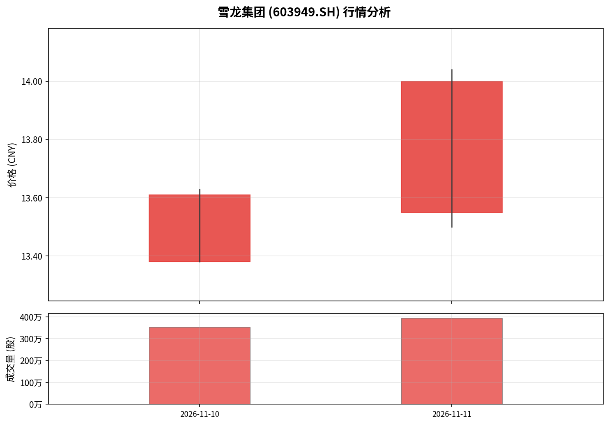

# 雪龙集团 (603949.SH) 股票行情分析报告

> **免责声明**：数据来自上海证券交易所官方公开页面，仅用于内部市场研究和资讯检索，不构成投资建议；请以上交所最新披露为准。

## 一、数据来源与核验

| 项目 | 值 |
|------|-----|
| **股票代码** | 603949 |
| **股票名称** | 雪龙集团 |
| **数据来源** | 上海证券交易所 (SSE) — `sse_daily_snapshot` |
| **数据集** | `market_quote_daily`（交易所每日行情快照） |
| **传输通道** | `sse-daily-quote-api` |
| **数据文件** | `input/data/0/source-1.jsonl` |
| **上下文文件** | `input/data/1/source-1-context.json` |
| **文件行数** | 14 行 |
| **SHA-256** | fba8f9a1d0ef2574c95fb1bdc8a65b976aca431358a79465bebb323c21a7ef01 |
| **数据集引用** |  |
| **输入状态** | DELIVERED_SNAPSHOT |

## 二、实际可用行情数据

在 14 行数据中，**仅 2 行为雪龙集团的实际行情数据**，
其余 12 行为其他公司公告/新闻（如春雪食品、龙源电力、金龙汽车等），
与雪龙集团无直接关联，系语义检索误匹配。

### 行情明细

| 交易日期 | 开盘价 | 最高价 | 最低价 | 收盘价 | 涨跌额 | 涨跌幅(%) | 成交量(股) | 成交额(CNY) |
|----------|--------|--------|--------|--------|--------|-----------|------------|-------------|
| 2026-11-10 | 13.38 | 13.63 | 13.38 | 13.61 | +0.31 | +2.33% | 3,535,800 | 47,852,154 |
| 2026-11-11 | 13.55 | 14.04 | 13.50 | 14.00 | +0.39 | +2.87% | 3,950,200 | 54,706,900 |

### 汇总统计

| 指标 | 值 |
|------|-----|
| **数据覆盖交易日** | 2 天（2026-11-10 至 2026-11-11） |
| **区间最低价** | 13.38 CNY |
| **区间最高价** | 14.04 CNY |
| **区间收益率** | +2.87% |
| **累计成交量** | 7,486,000 股 |
| **累计成交额** | 102,559,054 CNY |
| **日均成交量** | 3,743,000 股 |
| **日均成交额** | 51,279,527 CNY |
| **平均涨跌幅** | +2.60% |

## 三、价格走势

**图注**：采用 financial-cn 配色约定——**红色 (#E53935) 表示上涨**，**绿色 (#43A047) 表示下跌**，符合中国A股市场惯例。

## 四、走势简评

- **2026-11-10**：开盘 13.38，收于 13.61，涨幅 +2.33%，振幅 1.88%，成交量 3,535,800 股。
- **2026-11-11**：开盘 13.55，收于 14.00，涨幅 +2.87%，振幅 3.97%，成交量 3,950,200 股。
- **两日累计涨幅**：从 13.30 到 14.00，累计上涨 0.70 元 (+5.26%)
- **量能变化**：2026-11-11 成交量较前日 放大 11.7%，配合价格上涨呈量价齐升态势。

## 五、缺失数据说明

| 缺失字段 | 说明 |
|----------|------|
| `pe_ratio` (市盈率) | 全部记录为 null，未提供 |
| `market_time` (交易时间) | 全部为 null，仅有交易日日期 |
| `amount10_k_cny` / `amount100_m_cny` | 单位换算字段均为 null |
| `volume10_k_units` | 单位换算字段为 null |
| `index_count` | 为 null，非指数数据 |
| 历史行情 | 仅覆盖 2026-11-10 和 2026-11-11，无法计算均线、MACD 等技术指标 |
| 基本面数据 | 无财务数据、股东信息、行业分类等 |
| 新闻公告 | 本地数据中无雪龙集团相关公告，其余12行均为其他公司股票公告 |

## 六、结论

本次分析基于上海证券交易所每日行情快照，**仅验证了 2 个交易日的行情数据**。
雪龙集团 (603949) 在 2026-11-10 至 2026-11-11 期间连续上涨，累计涨幅约 +2.87%，
量价配合良好。受数据覆盖范围限制，无法进行中长期趋势、技术指标或基本面分析。

---

*报告生成时间：2026-11-12 15:35:46 | 分析模式：本地数据验证 | 联网状态：不可用*