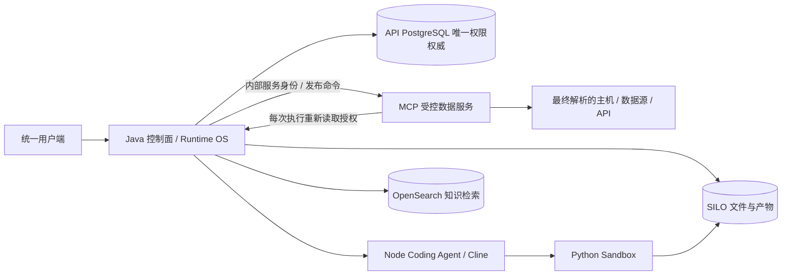

# Runtime OS 统一管理独立版本

## 基线与范围

2026-10-22：工作区干净，fetch --all --tags --prune 后 main 与 origin/main 相同。
基线 `5d5bc834fbe414755a99e38bcb03b6a69471c8a2`，保护标签
`baseline/runtime-os-unified-management-20261022`；开发分支
`feature/unified-management-workspaces`。原 `tag` 分支保留。

## 现状盘点与职责

| 模块 | 现状与问题 | 目标与依赖 |
|---|---|---|
| API / enterprise | sys_user、sys_role、sys_permission、sys_role_permission、mcp_tool_permission、resource_grant 已在中央数据库 | 保留为唯一授权权威，复用登录与审计；功能授权和资源授权为不同维度，不能互相替代 |
| WorkspaceService | 数据库 Manifest、后端授权与许可投影已存在 | 复用，增加权限管理和 MCP 工具发布空间，不另建登录 |
| MCP authorization | 从 API 取快照，但仍写 mcp_authorization_role 镜像，并代理权限增删 | 移除客户权限维护 API；角色改为中央快照投影，不写第二套角色表 |
| TemplateQueryBindingService | 保存即发布，绑定兼有角色/模板范围；无草稿或不可变版本 | 保留受控绑定执行，发布控制面增加版本、Schema、校验、测试和发布历史 |
| TemplateQueryMcpToolPublisher | 根据 enabled 绑定发布子能力，调用委派给父工具 | 保留固定路由、模板参数绑定与执行器；未发布草稿不可进入绑定表 |
| Runtime / Coding / Sandbox | Java 编排、Node 分析、Python 隔离、SILO 产物、OpenSearch 检索 | 保留边界，不恢复自由探索式业务数据获取 |
| MCP admin UI | 用户/角色权限、动态发布与 API 管理功能重复 | 迁移客户入口，必要内部管理 API 只允许控制面服务身份 |

权限权威：API PostgreSQL 中现有身份、功能权限、工具权限和资源授权表共同构成统一权限模型。
MCP 快照仅是执行投影，控制面不可达时执行拒绝；每次执行从权威读取以支持即时撤权。
模型能力识别只决定路由，不能授予工具或数据访问权。

## 实施与验收记录

此文件随实现更新。只有实际通过的检查才能记为完成；部署、迁移、真实模型查询及远程回归必须分别记录证据。
数据库清理须先备份与核对，不直接删除历史业务数据。

## 目标架构

权限模型沿用 `sys_user`、`sys_org`、`sys_role`、`sys_user_role`、`sys_permission`、`sys_role_permission`、菜单映射及 `resource_grant`。`mcp_tool_permission` 是同一控制面的 MCP 调用和范围授权，资源授权是针对 Agent/文件/知识资源的额外约束，两者共享用户、角色和租户，不是两套身份或 RBAC。

MCP 的模板角色绑定表示“该发布工具选用哪一组固定模板”，执行时与中央授权取交集，不能产生授权。MCP 角色列表来自中央快照；不再通过角色镜像决定权限，也不再写入角色镜像。

## 发布模型与扩展

`mcp_tool_release` 保存稳定 logical_id、版本号、类型、名称、说明、输入/输出 Schema、固定执行定义、测试证据、操作人及发布时间。草稿没有执行绑定；经过校验和真实固定范围检索测试后，发布才创建/更新原有受控执行绑定。

发布定义与测试证据由 PostgreSQL 触发器保护，后续变更生成新版本。发布和回滚重新检查中央授权；下线停用执行绑定、刷新 MCP 注册与 API 工具目录。历史配置回滚不能恢复已经撤销的资源访问权。

`ToolReleaseExecutor` 是受控工具类型扩展端口。当前适配现有模板执行体系，后续受控类型复用相同版本、权限、Schema、测试、发布和审计流程，无需另建管理控制台。公开 Schema 与认证、路由传输字段分离；后者不能充当用户输入授权。

执行安全还在两个位置收口：固定工具的资源身份来自服务器发布元数据；动态路由在解析出真实主机、SQL 数据源或 HTTP 端点后重新向中央授权服务校验，不能用另一个资源的 scope 声明代替实际目标。
