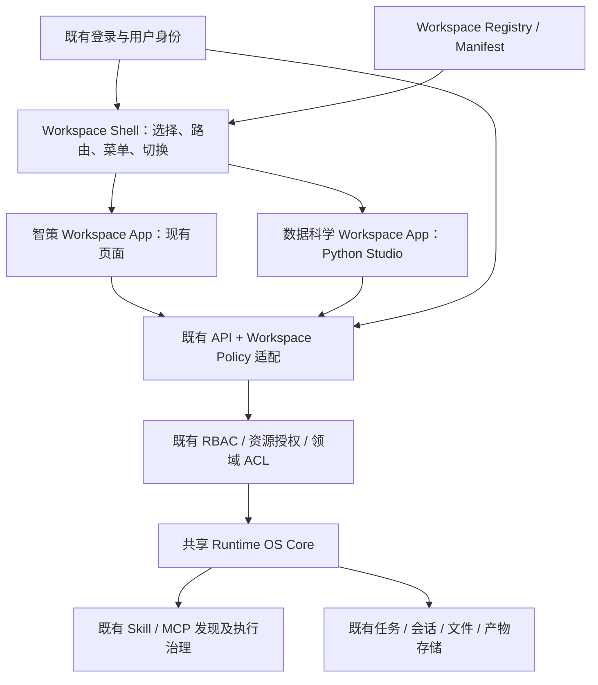

# T02：Workspace 架构设计与实施计划

状态：待用户确认的方案，尚未实施。依据：[T01 实际代码审查](01-current-architecture.md)。本轮不创建开发分支、不改业务代码、不执行迁移或部署。后续开发分支建议为 `feature/runtime-workspaces`；第二轮仅在方案确认后开始。

## 1. 架构与职责



Workspace 是同一身份下的应用入口、界面与工作上下文，不是新租户、新 Agent、新执行环境或新的授权体系。一个 Spring 应用内继续共享既有 Runtime 服务和队列，部署原有多实例系统时也不按 Workspace 增加 Runtime 实例。

| 组件 | 最小实现 | 不重复建设 |
| --- | --- | --- |
| Registry | 企业模块中的配置实体、Repository 和小型服务；API 模块提供管理/个人查询端点 | 不新增注册中心进程、远程配置平台或 MCP 能力注册体系 |
| Manifest | JSON DTO + schema/version 校验，引用本地 pageKey、菜单 code 和既有能力 ID | 不下载任意 JS，不重新发明菜单权限或工具合同 |
| Shell | 扩展 App/AssistantLayout，新增选择页、切换器、路由适配模块 | 不替换现有工程，不引入微前端框架 |
| Context | 前端组合模块保存空间状态；服务端请求上下文及对象来源关联 | 不创建 Agent 状态机或新的事件存储 |
| Policy | 复用企业权限服务与资源授权，在 API 边界检查空间及资源 | 不使用前端隐藏代替鉴权，不把业务流程硬编码进 Core |

## 2. Registry 与配置存储

现有配置实体均为专用字段；MCP capability_registry 强制 service/tool 关系。复用它们会混淆职责，因此增加小型关系表，比泛化整个配置系统更小。

拟议增量结构（本轮不提供可执行迁移；实施时三个方言必须同时交付）：

| 表 | 关键字段/约束 | 阶段 |
| --- | --- | --- |
| `sys_workspace` | id；tenant_id + workspace_id 唯一；manifest_json；enabled；sort_order；is_default；revision 乐观锁；创建/更新审计字段；access_permission_code 由管理策略控制 | T03 |
| `sys_workspace_user_preference` | tenant_id + canonical user_id 唯一；default_workspace_id、last_workspace_id、revision、updated_at | T03/T04 |
| `sys_workspace_resource_binding` | tenant_id + resource_type + resource_id 唯一；origin_workspace_id；owner_id（已有对象所有者）；visibility（private/shared）；审计字段 | T05 最小关联，T08 补齐恢复验证 |

Manifest 版本与行 revision 分开：schemaVersion 判断格式兼容，appVersion 描述 App 版本，configVersion 描述配置，revision 防止并发覆盖。先保存完整 JSON 和行 revision，不另建全套发布流水线或不可变版本仓库；更新前后记录现有企业审计。

注册 API 只允许管理员操作其租户。入口、布局、pageKey 必须在前端已发布目录白名单中；菜单/能力/Skill 引用必须存在且符合服务端校验。校验“存在”不会为访问者授予权限。首期新 App 通过单工程编译注册页面模块，再通过配置启用；未来可独立开发包并接入这一目录，不能承诺首期任意外部 App 热加载。

每租户最多一个系统默认空间，更新时对租户记录加锁并在同一事务校验；不依赖跨方言行为不同的布尔唯一索引。停用默认空间前须指定可用替代默认，否则拒绝。用户个人默认/上次空间可能因停用或撤权失效，读取时重新校验并降级。所有并发管理写入使用 expectedRevision，冲突返回 409。

注册查询分两类：管理员列出全部（包括停用），普通用户只得到当前可访问的启用空间；Manifest 读取单独校验空间权限。Registry 的存在或其名称不得成为其他租户的可枚举信息。

## 3. Manifest 契约

示例仅说明目标格式；menuCode 与能力 ID 在开发时从实际配置读取、验证，不把示例字符串当现有数据库记录：

```json
{
  "schemaVersion": "workspace-manifest.v1",
  "workspaceId": "data-science",
  "name": "数据科学",
  "icon": "flask",
  "description": "Python 开发与数据分析",
  "appVersion": "1.0.0",
  "configVersion": "1",
  "entryRoute": "#/w/data-science/python/environment",
  "layout": "studio",
  "pages": [
    {"pageId": "environment", "pageKey": "pythonStudio", "route": "python/environment", "initialTab": "environment"},
    {"pageId": "develop", "pageKey": "pythonStudio", "route": "python/develop", "initialTab": "develop"}
  ],
  "menus": [{"menuCode": "<existing-python-menu-code>", "pageId": "environment"}],
  "requiredCapabilities": ["<existing-python-capability-id>"],
  "defaultSkills": [],
  "extensions": [{"id": "sql-studio", "status": "reserved"}]
}
```

实际数据科学 Manifest 补齐我的数据、我的脚本、领域 Skills 与 AI 助手入口。SQL 扩展 reserved 表示未实现，不生成可执行菜单或授权按钮。

页面注册目录维护 pageKey → lazy component、页面族、允许布局/参数和现有权限映射。菜单配置只控制入口排列；服务端从用户当前菜单权限生成 filtered manifest/menu，不把所有原始管理配置暴露给普通用户。允许的路径须属于该空间，禁止跨空间 entryRoute、`..`、外部 URL 和未注册组件。

requiredCapabilities 表示入口前置条件或功能依赖；可选能力可按页面标注。它不是 MCP 工具 allowlist。defaultSkills 只是默认候选，须通过现有 Skill 授权后才可使用；没有权限时明确提示或忽略该偏好，不给角色自动新增 grant。

## 4. Workspace Policy 与授权边界

服务端按以下层次独立检查：

1. 既有 ApiAuthenticationFilter 得到当前 canonical userId、tenantId；不接受 Manifest、header 或 body 自报身份。
2. ApiPermissionAuthorizationFilter 判断当前 HTTP 接口权限，保留最具体路径规则。
3. WorkspacePolicy 校验当前租户、注册状态和空间访问权。`zhice` 兼容模式要求用户有原有可达菜单；新空间使用既有 SysPermission/SysRolePermission 配置的 `workspace:<id>:access`，管理员管理权限与个人读取权限分开。
4. 空间菜单/页面实际权限 = Manifest 声明 ∩ 当前既有菜单/功能权限。能力执行继续走现有 ResourceAuthorizationPort、Skill scope、MCP grants、Agent 绑定与领域 ACL，任何 DENY 不被空间访问权覆盖。
5. 对任务、会话、产物和文件按资源原有身份、租户/所有权/共享/管理员规则独立校验，再校验空间来源或既有共享策略。知道资源 ID、改变 header 或切换空间均不会新增资源权限。

Workspace 查询/偏好等新接口需要新增数据库功能权限及角色关联种子。个人接口只赋予现有启用用户所需的查询/自身偏好功能，不自动赋予新空间 access、新菜单、Skills 或 MCP。管理接口复用既有管理员权限 code 并补充精确资源路径策略；不能假定一条相同 code 的新行满足已有唯一约束。

**现有对象边界是实施检查点。** T01 中发现的租户级历史接口必须先列出动作（读、列、写、删除、确认、取消、下载）与个人/管理员权限矩阵。对新个人空间路径使用小型对象访问适配层；已有明确的租户管理接口保留管理权限语义。若现有权限 code 无法区分这些语义，先补充精确接口权限/聚合端点并验证兼容，暂停对应入口上线。禁止仅在 UI 过滤结果，禁止为“隔离”而删除旧历史或重写全套授权。

对象来源方案采用独立 binding 表，避免给任务执行引擎新增 Workspace 状态。来源在创建时由服务端验证后写入，不随页面切换改变；可共享对象必须由既有资源授权和服务端共享规则共同允许，Manifest 不能把 private 改成 shared。Python 环境、脚本和数据资产继续使用现有 tenant+owner 边界，可在用户已获授权的两个空间中复用同一资产；它们不会因为复用自动对其他用户可见。新会话、任务、会话产物默认空间私有。

旧对象无 binding 时按 `zhice` 处理，仅保留原来合法的访问范围，不批量迁移消息、事件、文件或产物内容。不允许无 binding 的新空间对象自动回退到旧空间；创建路径必须原子写入关联。任务提交和会话创建需利用已有事务/提交边界，在队列 dispatch 前完成可信关联；若现有提交顺序不能保证这一点，暂停新空间任务提交并做最小事务适配，不另建执行状态机。幂等重试命中已有任务时必须返回原来源，跨空间请求不能重绑定或冒用既有 idempotency key。

空间来源只控制应用访问，不替代运行时资产授权。来源可经既有请求上下文传递或边界适配供关联服务使用，不添加业务规划规则；工具发现仍使用现有授权范围和治理协议。

## 5. Shell、路由与登录恢复

沿用 Hash 模式，新增 `#/workspaces` 选择页与 `#/w/<workspaceId>/<pageRoute>`。保留 `#/login`、`#/chat`、`#/dataScience*`、`#/system*` 等原地址与别名，通过旧路由适配固定指向 zhice 对应原页面，而非随当前空间改变旧链接含义。查询参数由新解析器显式处理，不沿用当前截断后丢弃信息的行为。

登录后按以下优先级解析目标，每一步都重新查询服务端可访问范围：授权深链接 → 有效上次使用空间 → 有效个人默认空间 → 有效租户默认 zhice → 第一个可访问空间。首次使用且没有明确目标时默认进入 zhice，同时提供选择入口；多个空间的用户可主动打开选择页并设默认。这同时满足选择能力和原用户默认进入智策的兼容要求，不强制每次登录都多一步。无可用空间显示可理解的无权限页，不执行空页面请求。

切换过程：保存当前编辑/选择状态 → 请求并验证目标 Manifest → 验证成功后一次性提交 activeWorkspace/menu/route → 激活目标缓存 → 成功后更新个人 lastWorkspace。网络失败或撤权时不提交部分状态；401 走原有退出流程，403 清除目标缓存并显示访问限制。浏览器回退、手输地址、收藏链接使用同一路由和权限流程。

左上角切换器加入 AssistantLayout；布局类型仅映射已编译的布局变体，首期 default/studio，复用同一个根 Shell。智策保留所有当前授权菜单，包括旧 Python Studio 入口；不能把旧入口从智策删掉作为“迁移”。

T03～T06 注册 zhice 为默认；data-science 可登记为停用/预留，T07 再启用实际页面。基础阶段用测试环境配置的第二个受权测试空间验证切换，不给生产凭空新增一个业务空间，也不宣称 T07 已提前完成。

## 6. Context、编辑恢复与后台任务

共享层仅保留认证身份、可用空间列表、任务通知汇总；空间层保存当前页面、会话选择、pendingDraft、文件选择、工作台过滤及页签。身份切换/退出清空内存上下文；浏览器持久化键使用 canonical tenant/user/workspace。缓存是 UI 优化，权限撤销后清除或失效，读取时必须再次授权。

KeepAlive key 为身份 + 空间 + 页面族：Python 四个页签都属于 pythonStudio 页面族，同空间不销毁 Monaco，跨空间不共用未保存表单。设置有限缓存容量，避免每次访问空间都永久保留 Monaco/事件监听实例；为卸载/缓存淘汰设计编辑草稿恢复。首期仅保存必要的用户编辑内容到合适的本地存储并提示敏感内容策略，不把服务端文件或权限判断复制到本地。浏览器刷新恢复与单纯空间切换恢复分别测试。

所有请求在发起时固定空间及身份快照，不能在 await 完成后把结果写入新的 activeWorkspace。统一 header 构造覆盖 apiRequest、SSE、multipart、下载与其他直接 fetch；不能只修改 apiRequest 一处。请求缓存加入作用域，退出及权限变化清理。

`X-Workspace-Id` 是不可信的请求声明，服务端验证后才使用；旧请求未带 header 按 zhice 兼容路径处理，但不得以“缺少 header”绕过新空间对象 binding。运行中的任务拥有不可变来源；切换只改前端显示，不调用 cancel/kill，不重建 Runtime、任务线程或计划。

后台任务继续使用现有 durable task 和 events；返回原空间后按既有 task/session ID、事件序列继续订阅和恢复。SSE 重连必须带任务原空间且重新鉴权，不能从全局当前空间推导。后台回调仅更新原任务上下文；可展示受权全局通知，不把旧任务输出插入新空间会话。Python 执行保留现有 MCP/HTTP 执行方式，本轮不把同步接口另改为新队列；切换期间页面请求结果要写回来源上下文。

停用空间/撤销访问权只影响后续界面访问和接口授权，不隐式取消后台任务；运行中的工具动作继续由原有授权机制决定。对任务的显式取消、确认、重试等操作继续独立鉴权。

## 7. 拟议接口和路由（尚未新增）

| 接口 | 用途与独立校验 |
| --- | --- |
| `GET /api/v1/workspaces` | 当前身份可访问的启用空间；客户端不能用 tenantId 切换租户 |
| `GET /api/v1/workspaces/{id}/manifest` | 返回授权过滤后的 Manifest；校验空间访问 |
| `GET /api/v1/workspaces/preferences` | 读取自身默认/上次及有效降级结果 |
| `PUT /api/v1/workspaces/preferences` | 更新自身默认/上次；目标必须可访问；不接受其他 userId |
| `GET /api/v1/enterprise/workspaces` | 管理员查看本租户注册记录及状态 |
| `POST /api/v1/enterprise/workspaces` | 注册并校验 Manifest，记录审计 |
| `PUT /api/v1/enterprise/workspaces/{id}` | 更新配置/启停/租户默认，expectedRevision 控制并发 |

静态 `preferences` 路由与 `{id}` 路由必须用实际 Spring 路由测试验证；不新增 delete，优先停用以保持历史来源可解析。后续对象聚合端点仅在权限语义检查确有需要时增补，不预建所有业务 API 的副本。

前端新增 `/workspaces` 和 `/w/:workspaceId/:pageRoute` 的 Hash 解析规则，不是服务端 Servlet 路由；现有 API 地址均保留。第三轮数据科学路由拟为 python/environment、python/develop、python/data、python/scripts、skills 和 assistant；助手优先复用 IDE 面板，是否需要独立页面由实际组件复用确认，不重复开发助手。

## 8. 迁移、兼容、回退

实施时为 MySQL/PostgreSQL/H2 增加对应 `V<实际日期>_<序号>__workspace_registry.sql` 及资源关联增量脚本，并同步 database/init。脚本保证重复执行不覆盖已有配置/角色授权：新增表/索引、精确接口权限、按已有租户 seed zhice、仅指定角色的新空间授权。不要把 `default` 租户 seed 当成全部已有租户迁移。

脚本与应用启动初始化职责分开：DDL 先执行；初始化服务只为未注册租户补默认配置，不修改管理员定制菜单或 grants。不能用 ddl-auto update 替代经过验证的迁移。三方言验证包括重复执行、已有用户/菜单/历史保留、唯一约束、并发默认更新及拒绝跨租户写入。

前后端共同设置 Workspace 功能开关。未迁移时保持旧入口，显式禁用新机制并给管理端说明；不能尝试新表失败后让新空间请求降级绕过校验。回退应用和关闭新入口时保留新增表与来源信息；已有空间数据不删除。新功能上线后旧版直连新对象的权限风险须在回退演练中验证，必要时保留访问适配层而只回退 Shell。

## 9. 分阶段任务、文件范围与验收

| 阶段 | 开发范围 | 预计涉及的实际路径/新增目录 | 完成条件 |
| --- | --- | --- | --- |
| 本轮 T01/T02 | 审查、方案、影响与计划 | 仅 docs/workspace/01、02 | 文档证据及基线验证；等待方案确认 |
| T03 | 轻量注册、Manifest、用户偏好、状态/默认、审计 | chatchat-enterprise 企业配置实体/Repository/服务；API 企业管理与 workspace 控制器；三个数据库 migration/init | 单元/接口测试、三个方言迁移验证、后端构建 |
| T04 | 选择器、切换器、空间路由、授权菜单、恢复 | web-app/src/App.vue、src/js/App.js、现有 AssistantLayout 与 src/js/components 配对脚本、新 workspace 模块、services/api.js | Hash/旧链接/切换/失败回滚测试，前端构建 |
| T05 | 请求级空间策略、对象适配和最小来源关联 | API/security 或独立 workspace 适配目录；既有创建/读取边界必要小改；企业策略服务 | 直接请求绕过 UI、伪造 header/身份、跨用户/租户/空间、下载/SSE/取消/重试拒绝；旧管理员权限兼容 |
| T06 | zhice 默认 Manifest、旧页面映射 | 配置 seed 和页面目录适配 | 原菜单、对话、Skills/MCP、历史与文件回归；默认登录兼容 |
| T07 | 数据科学 Manifest 与已有组件挂接 | 现有 DataScienceView、DomainSkillsView、助手面板，仅必要适配 | 六类既有能力保持执行方式，旧 Python 入口仍有效 |
| T08 | 根状态隔离、编辑恢复、事件/产物来源传播 | App/workspace context、已有 ChatAssistantView/DataScienceView、边界关联适配 | 切换不终止任务、切回草稿/结果恢复、异步结果不串空间 |
| T10 | 自动化/浏览器/真实环境回归 | 补充有行为意义的测试；docs/workspace/03-test-report.md | 报告实际执行命令、结果、环境和未覆盖项，不以 mock 代替端到端结论 |

第二轮必须在独立分支完成，并逐任务记录构建、自动化结果。第三轮仅在第二轮验证通过后开始。任何对象授权歧义、DDL 风险或认证兼容重大冲突都暂停受影响任务并提交问题及替代方案。未改的执行引擎仍需共享实例/行为回归证据，不能只凭“未改代码”认为不会受影响。

## 10. 后续验证矩阵与风险

| 场景 | 必须验证的结果 |
| --- | --- |
| 旧用户登录/旧深链接 | 默认智策、旧页可达、同一 Token、角色菜单不扩大 |
| 两个授权空间切换、刷新、前进后退 | 正确空间和菜单；默认/上次按权限重新判断 |
| 非授权空间、停用空间、无可用空间 | 前端限制 + 服务端拒绝；不泄露另一租户 Manifest |
| 用户 A/B、租户 A/B 请求同一个对象 ID | 所有读写/下载/事件/确认动作按独立对象规则执行 |
| 同时运行任务与切换 | 服务端原任务继续；新空间不收到原会话结果；恢复序列正确 |
| Python 编辑未保存、数据/脚本选择、AI 助手异步回调 | 同空间页签连续，跨空间隔离，切回可恢复 |
| 原 Skill/MCP 和授权资产发现 | 无新增权限；模型仍可自主发现/计划；无固定工具流程 |
| 三方言升级、重复迁移、回退 | 原数据 ID/内容不变；新增机制可关闭；新对象访问不被回退绕过 |
| 单服务/既有多实例运行 | 不因 Workspace 多创建 Runtime/执行队列/Agent 状态机 |

风险优先级：高——租户级旧接口的对象授权语义、来源关联与提交原子性；中——前端全局事件/缓存、canonical user ID 与历史 username 差异、默认/停用并发、普通 Token 重启失效；待现场验证——生产数据库与权限种子、消息/文件实际存储及外部执行依赖。本轮不更改这些实现，避免把待确认设计误报成已修复。

T09 暂缓，只预留 SQL Studio 的页面/能力标识。基础稳定后再输出 SQL Generation Skill 独立方案，研究受权 SQL 案例和 Mapping 文档、源目标映射、方言、校验工具与可下载文件；不写进 Runtime Core，本次不开发 SQL 生成逻辑。

## 11. 第一轮实际交付

实际新增仅本文件与 01-current-architecture.md。数据库迁移脚本、业务接口和前端路由均未修改；03-test-report.md 留待 T10 的真实多空间回归。

基线结果见 [T01 第 10 节](01-current-architecture.md)：前端 271 项测试通过，前端构建和后端编译通过；选定后端测试 12 项通过、3 项因缺少发布语义策略而在上下文启动阶段 error。它是第二轮验证前需处理的基线阻碍，不是 Workspace 功能失败或已经完成的回归。本方案确认后才进入独立分支开发。

## 12. 后续批次实施记录（2026-10-13）

用户授权“把剩下工作分批次做完”后，在 `feature/runtime-workspaces` 分支进行 T03～T08 实施，T10 记录实际验证，T09 仅输出设计。本节描述实际落地差异，前文保留第一轮设计依据。

Registry 使用企业模块的三个小型附加表及既有 RBAC、菜单、审计服务，没有另建配置平台。内置空间按租户惰性注册。Manifest 的 requiredCapabilities 引用现有功能权限，defaultSkills 只返回已明确授权的 Skill ID；它们不授予任何资产权限。

Shell 使用原 Hash 路由和受信任组件表，按 Manifest 选择现有组件。Python 四个页面共享同一空间内的 Studio 实例，但不同用户、空间使用不同缓存键。加载页、拒绝页使用独立键，避免登录期间将占位组件误当业务组件缓存。异步组件引用按当前键更新，防止迟到的已离开页面覆盖当前编辑器引用。切回空间恢复原页面，旧链接仍定位智策空间。

Workspace Context 是请求边界 ThreadLocal 和前端空间上下文，不是新的 Agent 状态机。任务来源在进入既有队列前登记，后台产物从父任务继承来源；原非 Agent 异步交互显式传递请求上下文。数据库分页在查询和总数计算前按绑定过滤，低分反馈任务内容同样过滤。原运维租户聚合统计范围未重构。

新绑定的会话、任务和产物采用用户私有来源关联，没有开发跨空间分享授权表。既有无绑定对象留在智策空间并继续原权限判断；Python 文件、脚本与环境使用原用户/租户授权，两个空间可以通过兼容菜单访问同一已授权资产。空间配置不生成新的资源授权。

注册入口目前为现有企业 API，没有额外的 Registry 管理页面；独立 App 后续在单工程中注册组件和菜单，不直接执行 Manifest 中的远程代码。SQL Studio 只预留设计标识，未启用页面或开发生成逻辑。

构建、测试、实际文件清单及未覆盖项见 [03-test-report.md](03-test-report.md)。迁移和降级方案见 [05-migration-and-operations.md](05-migration-and-operations.md)。SQL Skill 预研见 [04-sql-generation-design.md](04-sql-generation-design.md)。原认证兼容、原生数据库迁移、真实远端执行及来源与提交非单事务的问题需继续按报告验收，不能据本地通过直接宣布生产完成。
