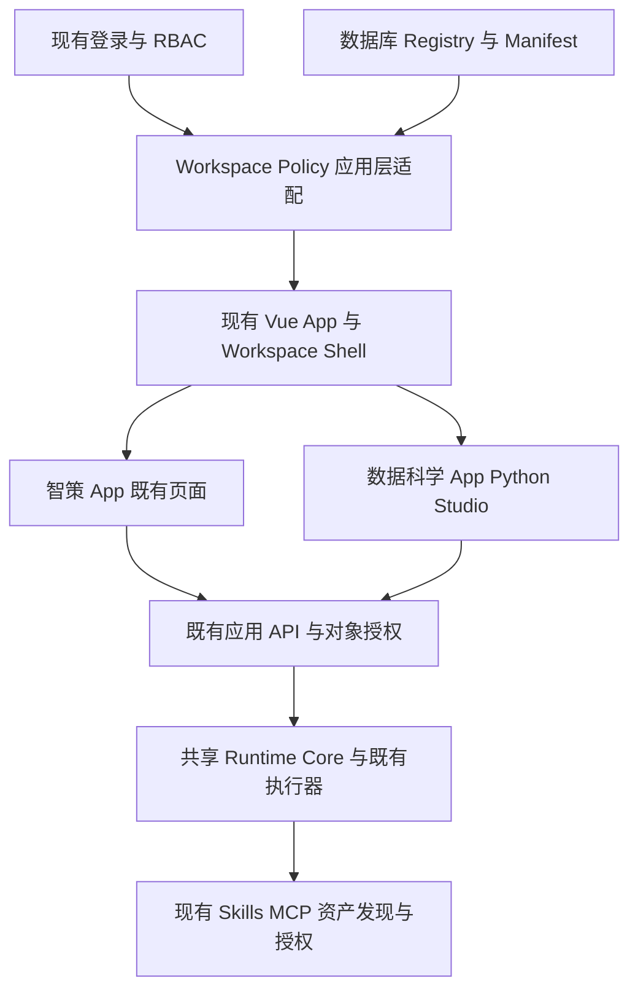

# T02：Workspace 架构设计与开发计划

日期：2026-10-13。状态：**用户已确认第二轮 T03～T08；已实施本地最小版本，待审查，未部署**。基于 [T01 代码审查](01-current-architecture.md)。以下设计保留审查依据；实际实现差异以本节为准。

## 第二轮实际实现与设计收敛

- Registry 使用现有 Enterprise JPA、数据库权限、审计体系；新增三张附加表，无独立注册服务器。内置智策、数据科学 Manifest 位于 API `resources/workspace`，不是 Core 工作流。
- Shell 扩展现有 `App.js` 哈希路由和 Vue KeepAlive；保留单工程与既有组件映射。Manifest 引用已编译 `componentKey`，不能注入远程脚本或任意布局代码。独立新 App 仍需在前端注册组件再发布；本期没有热加载第三方代码的机制。
- Policy 使用已有功能权限、菜单投影、Skill 发布与授权查询。`requiredCapabilities` 是需要既有权限的声明，`defaultSkillIds` 是授权后过滤的建议，均不生成工具或资源授权。后台 API 继续独立鉴权。
- 系统默认值是 Registry 的全局 `default_workspace` 标记，不修改 `sys_tenant`；用户默认及上次空间按 `tenant_id + user_id` 存储。暂未实现租户各自的系统默认空间。旧哈希链接优先选择 Registry 默认空间，避免上次使用数据科学空间使原智策链接失效。
- Workspace Context 的资源关联采用 `workspace_resource_origin`，仅记录创建来源。源标记不参与资源授权；不将现有会话、任务、文件按 Workspace 重新分区、不批量回填来源。只有新建会话才校验来源空间；复用已授权的旧会话时过期/伪造的来源头不改变裁决，也不能重标来源。任务/产物通过已持久化 session/task 关系读取来源；既有资源没有来源时返回空值。
- 统一 `ObjectAccessService + ObjectAccessInterceptor + ObjectRequestAdvice` 从认证主体与数据库 owner/tenant 裁决会话、历史记录、任务、SSE、运行记录和任务关联产物。请求体的 user/tenant 被核验或归一化；`X-Workspace-Id` 仅作为已授权创建来源，不能授予跨用户或跨组织权限。
- 会话维持所有者访问；组织成员关系不新增会话共享权限。任务管理保留已有 `platform:tasks:all`，仅作用于同租户任务及关联产物，不扩展为所有会话读取。无法验证所属任务的旧孤立产物保留数据但返回 404，需要后续受控修复归属。
- Python 环境、脚本、数据文件继续使用现有服务端 owner 校验与 MCP 执行方式。AI 编程助手保持原请求流程；SQL Studio 仅显示 Manifest 中的预留能力，不实现 SQL 工作流。
- Vue 缓存键包含 tenant、稳定用户 ID、Workspace 和组件类型。同一 Workspace 内多个 Python 页签共享一个编辑器，切换空间后缓存分别保留。草稿与运行恢复标记按三者隔离；重载时脚本草稿需与服务端最新授权脚本/环境列表交叉核验。无身份归属的旧浏览器缓存不自动读取，数据库历史不受影响。
- Workspace 模块不创建 AgentRuntime/WorkflowRuntime Bean、执行线程池或状态机，不修改 Agent Loop、模型调用、资产发现与工具授权。后台任务仍由现有 `AgentTaskService` 执行。
- 一次性兼容授权只追加等效入口权限：已有菜单查询权限的角色获得 Workspace 查询入口，已有菜单权限的角色获得智策入口，已有角色授权能力的 SUPER_ADMIN 获得注册管理权限。迁移标记阻止重启/重复迁移重新授予已撤销权限，不追加 Python、Skill、MCP 或文件授权。

接口、迁移操作与剩余限制见 [实施审查清单](04-implementation-review.md)。原设计下文中尚未实施的设想不代表交付功能。

## 1. 决策与边界

一个 Runtime OS Core，多个 Workspace App。Workspace 是产品入口、布局、菜单、页面和能力声明，既不是租户，也不是 Agent 数据处理 Workspace，更不是新的执行引擎。



不得在 Core 根据 `workspaceId == data-science` 选择 SQL 流程、Python 工具、固定计划或提示词。Workspace 模块不得创建 Runtime Bean、新建执行池、复制 Agent Loop 或改变模型自主分析。每次任务仍使用既有的运行上下文与隔离规则，共享 Core 不表示把不同任务合成一个运行实例。

## 2. Registry：薄配置存储与现有管理方式

已审查到菜单 CRUD、专用配置服务和 JPA Repository，未发现能原样存储完整 Workspace Manifest 的通用配置实体。因此建议复用 **持久化与管理模式**，增加薄 Registry，复用认证、权限和菜单服务。无需新注册中心进程、复杂插件服务或独立权限体系。

建议应用层 `com.chatchat.api.workspace` 负责 DTO、Controller、Manifest 校验、菜单投影与 Policy；enterprise 放 Registry/Preference/Origin 的实体和 Repository。只有实际出现跨模块需求时才提取 common 端口，初期不预造抽象体系。

注册行独立维护 ID、状态、App 版本、入口、配置版本和可访问权限码。Manifest 不得在运行时自行授予权限；访问策略改变由管理权限控制，并记录审计。

初始数据库 seed 包含 `zhice` 和 `data-science` 两个产品定义。这些是 Workspace App 配置，不能成为 Runtime Core 的业务分支。新 App 在单工程提供受信任组件适配与 Manifest 后，管理员注册即可使用；初期不支持运行时下载 JS 或执行任意远程 URL。

## 3. Manifest 契约

示意结构，字段与权限码待实施迁移时绑定真实菜单/权限记录：

```json
{
  "schemaVersion": "workspace-manifest.v1",
  "configVersion": 1,
  "workspaceId": "data-science",
  "appVersion": "1.0.0",
  "name": "数据科学",
  "icon": "flask",
  "description": "Python 开发、数据与领域 Skills",
  "entryPage": "python-environment",
  "layoutType": "studio",
  "menus": [{"menuCode": "<existing-menu-code>", "pageId": "python-environment"}],
  "pages": [
    {"id": "python-environment", "componentKey": "python-studio", "props": {"initialTab": "environment"}},
    {"id": "python-develop", "componentKey": "python-studio", "props": {"initialTab": "develop"}}
  ],
  "requiredCapabilities": ["python.workbench"],
  "optionalCapabilities": [{"id": "sql.generation", "state": "reserved"}],
  "defaultSkillIds": []
}
```

数据/脚本/Skills 页面在实施时补全；AI 助手第一阶段保留在 Python 编辑页，不另建 Agent。

校验规则：唯一且稳定 ID；支持的 schemaVersion；递增 configVersion；entryPage 必须存在；页面与菜单引用必须有效；componentKey/icon/layoutType 来自受信任前端注册表；props 仅允许组件声明字段，禁止传入用户身份、授权 Token、执行代码和模型系统指令；禁止远程脚本和任意重定向。注册更新采用版本条件比较，冲突返回 409。

`requiredCapabilities` 表示进入 App 必须具备的能力；可选能力缺失时不开放对应入口。它们通过已维护权限及能力服务解析，未知能力不可用。`reserved` SQL 入口只能显示规划状态，不得发起生成或查询。`defaultSkillIds` 只是候选：服务端再次验证 Skill 状态、版本、资源授权与 Agent 约束，没有授权的候选不加载且不改变发现结果。

## 4. Policy：逐层取交集

```text
Workspace 可用 = 已认证有效用户 ∩ 注册启用 ∩ 服务端维护的 Workspace 访问许可
页面可用      = Workspace 可用 ∩ Manifest 页面声明 ∩ 现有授权菜单
能力可用      = Workspace 可用 ∩ Manifest 能力声明 ∩ 既有 API/Skill/MCP 授权
资源可用      = 当前租户和身份 ∩ 既有对象/资源授权 ∩ 新来源对象的 Workspace 访问约束
```

复用 `EnterpriseAdminService.getUserView()/listAuthorizedMenus()` 和既有资源授权，Policy 不重建角色、组织、工具授予或模板绑定。Workspace 默认 Skills 不等于授予工具权限。

注册管理权限与访问权限分开。迁移为原有用户提供智策兼容许可时，仅对既有可访问菜单的有效角色进行一次等价绑定；不周期性重授予，不创建工具/文件/Skill grant。数据科学访问许可由管理员明确分配；不能因为具有普通登录能力就开放。管理员角色的既有特殊规则需在测试中核实，不增加前端判断用户名为 admin 的捷径。

任何传入 workspaceId 都不改变 CURRENT_USER_ID/CURRENT_TENANT_ID。新增入口及带 Workspace 上下文的旧入口校验注册与用户访问许可；**省略 header 不能绕过新对象的来源限制**，必须读取服务端 origin 信息。对已有共享资源继续执行原授权，不把来源空间变成授予。

T01 的会话/产物对象权限缺口是实施前置问题：统一检查当前身份与对象 owner、授权共享规则，再附加 Workspace 约束。不能只改 Controller 入参或以同租户等同所有权；必须梳理浏览、修改、删除、任务事件、文件下载与分享的调用链。未确认共享契约前，不直接改变既有共享业务，也不宣称 T05 完成。

## 5. Shell、路由与菜单

保留 `App.vue/App.js` 为根，复用 `AssistantLayout`；新增选择视图和左上角切换器，以 manifest/layoutType 控制布局槽位，不复制整套 App。组件注册表在前端打包时汇总，各 App 的组件和 props 定义放其适配模块。

计划路由：

| 地址 | 行为 |
| --- | --- |
| `#/login` | 原登录界面 |
| `#/workspaces` | 已授权 Workspace 选择页 |
| `#/w/:workspaceId/:pageId` | 统一解析、鉴权和异步页面加载 |
| 原 `#/chat`、`#/tasks`、`#/dataScienceDevelop` 等 | 通过兼容映射解析原页面，不删除旧地址 |

旧链接应在可访问的原智策 App 内打开；当该 App 不可访问而同一组件在另一个授权 App 可用时，选择明确的适配映射；无授权则拒绝，不能静默替换成同名页面或加载任意 App。`dataScience` 和 `system` 等原别名仍兼容。

登录后默认解析顺序：有效的显式授权深链 → 该用户的有效上次空间 → 用户默认 → 租户默认（初始智策）→ 授权列表首项。零空间显示无权限状态。多个空间的用户可通过选择页选定，恢复逻辑不强制每次弹选择页；无保存选择时仍默认智策，满足原用户默认进入要求。

切换流程：递增加载序号 → 请求并校验目标可访问 Manifest → 获取授权菜单并投影 → 准备布局/页面 → 原子提交当前 Context/hash → 保存上次空间。失败保留原空间；旧请求晚到不得覆盖新选择。刷新/403 后重新评估许可并移除失权入口，不能从浏览器缓存降级放行。

菜单名称、层级、图标继续来自现有菜单配置；Manifest 只声明成员关系及页面映射。目录只有保留授权子项时显示。智策 Manifest 使用兼容适配纳入原菜单，不迁移页面实现。数据科学 Manifest 引用环境、开发、我的数据、我的脚本、领域 Skills 现有菜单，保留原 Python 执行路径。

## 6. Context 与状态隔离

维护 `{tenantId, userId, workspaceId, configVersion, pageId, conversationId, taskId, selectedFileIds}`。租户/身份只来自认证；Context 是导航来源与编辑状态，不是独立执行状态机。

- 浏览器 preference/cache 按 `(tenantId, stableUserId, workspaceId)` 命名。Python owner 仍用既有身份兼容规则；不能据此重写数据库 owner。
- KeepAlive 使用组件声明的状态域与 workspaceId 作为 key。Python 的四个子页共用该空间的一个编辑组件实例；不同空间的同一组件不可共享可变表单。不能简单按 pageId 生成四个 Python 编辑器来制造状态丢失。
- 会话选择、草稿、文件选择、待执行快捷操作均归当前 Context；异步回调捕获启动时 Context，不能将原空间结果写入新空间。
- 运行任务 observer 继续复用 taskId/eventSequence 和既有恢复机制；失活只暂停/恢复观察，不能调用 kill/cancel。切回后查询持久快照并续订事件，日志与序列去重沿用现有机制。
- `chatRuntimeState.js` 增加版本与身份/Workspace 维度。旧缓存只在匹配服务端会话及当前身份后恢复至智策；不能把无法验证归属的全局缓存显示给新用户。
- Python 布局旧键在首次迁移到当前用户的数据科学 Context 后不再作为跨用户通用回退。草稿仅保存必要编辑状态，有大小/版本限制，数据库脚本仍为真实已保存版本。
- 切换不登出、不清 Token、不重建执行器；退出登录清理本用户观察者与敏感临时状态。停止浏览器事件流与取消服务器任务区分处理。

刷新草稿恢复、缓存淘汰、长任务断网与 Python 同步执行须分别测试，不能用 KeepAlive 的存在代替验证。

## 7. 数据方案与兼容迁移

建议新增三个薄表，最终 DDL 在 T03/T08 按实际数据库验证后交付：

| 表 | 主要字段 | 目的 |
| --- | --- | --- |
| `workspace_registry` | workspace_id PK、status、app_version、config_version、entry_page、access_permission_code、manifest_json、version、审计字段 | 唯一产品配置及管理状态 |
| `workspace_user_preference` | tenant_id + user_id 联合 PK、default_workspace_id、last_workspace_id、审计字段 | 用户默认及上次使用空间；每次读取重验访问资格 |
| `workspace_resource_origin` | tenant_id + resource_type + resource_id 联合唯一键、workspace_id、creator_user_id、created_at | 来源关联，不保存执行状态、不替代对象 ACL |

租户默认空间使用现有租户实体新增可空字段，而不是使用用户偏好伪造系统用户；T03 需对应三方言增量迁移与实体修改。空值解析为兼容智策默认，只有授权时使用。若实际通用租户配置可复用则优先复用并取消该列扩展。

菜单定义不加 workspaceId 外键，保持跨 App 复用。注册 Manifest JSON 用现有数据库文本/LOB 方式兼容三方言，不要求数据库原生 JSON 执行。Registry 版本修改、默认更新用事务/乐观锁约束。

资源 origin 在授权的新会话/任务创建事务中写入，不能晚到结果按“当前 UI 空间”补写。任务继承经校验会话来源；产物继承真实任务来源。Python 文件/脚本来源在既有保存事务中记录，真正业务对象不移动。原对象无 origin 时视为 legacy 来源，继续原授权；新 Workspace 调用丢失 origin 的创建应失败，不能静默放宽。通用 SQL/脚本请求不得根据客户端伪造 origin 或 owner。

不批量修改旧 session/task/file ID，不复制历史，不更改 sourceChannel 的既有语义。origin 是服务端来源记录；已有授权共享资源可跨空间引用，仍需对象权限，非共享新对象还需来源空间可访问资格。

迁移必须提供 MySQL/PostgreSQL/H2 对应脚本、init 同步、幂等 seed、权限绑定标记、预检查、迁移前后计数及回滚说明。Schema 扩展先于新包发布，seed 不覆盖已有管理员配置，禁用 Workspace 不删除历史或取消任务。应用回滚保留附加表与列，禁止以删数据回滚。当前尚未产生迁移脚本或确认线上数据库方言，不执行线上 DDL。

## 8. 计划接口（尚不存在）

所有接口使用原 `/api/v1`、Bearer 和 `ApiResponse`，新增路径必须配置 `sys_permission` 的方法/路径策略。

| 接口 | 许可与语义 |
| --- | --- |
| `GET /workspaces` | 当前身份可访问且启用的摘要；不返回未授权 Manifest |
| `GET /workspaces/{id}/manifest` | 独立检查目标许可，返回授权菜单/能力投影 |
| `GET /workspaces/preferences` | 只读当前身份的默认与上次选择 |
| `PUT /workspaces/preferences` | 仅修改当前用户偏好，拒绝未授权/停用空间 |
| `GET /enterprise/workspaces` | 管理权限：全部注册项，含停用项 |
| `PUT /enterprise/workspaces/{id}` | 管理权限：版本校验后注册/修改 Manifest、启停 |
| `PUT /enterprise/workspaces/default` | 管理权限且租户范围有效：设置租户默认 |

避免新增专门的切换登录/Token 接口。旧业务接口保持地址与请求语义，必要时通过兼容的可选 Workspace 上下文标识来源；平台 UI 的新创建操作必须提供有效来源。Agent API Token 和既有非 UI 调用的来源规则单独适配，不能因全局新 header 破坏已发布 Agent 接口。针对资源读取，授权依据服务端归属，而非是否携带 header。

## 9. 分轮开发与验收

**当前轮 T01/T02**：代码审查、设计、影响分析、实际基线报告。文档交付后按任务第十三节确认方案；没有业务代码变更，也没有部署可供验收的 Workspace 实现。

**第二轮 T03–T06**：

1. 核对线上数据库方言、实际部署布局及共享对象契约；修复过时测试路径/夹具并核实真实依赖边界问题。若授权兼容无法安全界定，先交替代方案，不改旧共享数据。
2. 新增薄 Registry/Preference 与可验证迁移，seed 智策和数据科学定义、API policy、一次性兼容 Workspace 许可；复用菜单与角色管理。
3. 实现用户列表、Manifest、管理和偏好接口及越权负例；实现服务端 Policy，不授予工具资源。
4. 扩展 App Shell、选择器、切换器和兼容 hash；智策布局与所有旧功能保留。最小可运行版本只宣称这些已验证内容。
5. 验证认证、权限和智策回归，构建完整包；部署前备份包/配置/数据库，记录校验和、启动与回滚方式；只发布需要变化的服务。

**第三轮 T07/T08/T10**：

1. 数据科学 App 复用现有 Python/Skills 页面及 AI 助手，SQL 入口保持 reserved。
2. 增加来源关联、草稿/布局缓存隔离及任务观察恢复；对象权限修复必须已通过负例验证。
3. 联机验证两个授权空间切换、低权限账户拒绝、旧链接、长任务持续运行、切回编辑恢复、历史和文件完整、运行服务实例不增加。
4. 更新 [测试报告](03-test-report.md) 为实际验收结果并部署经验证的包；记录未完成项，不把 T03–T06 的基础界面当作全量验收。

**T09**：仅在基础机制稳定后输出 SQL Generation Skill 方案。案例、Mapping 文档、方言选择、校验工具、SQL 文件输出依赖现有 Skill/资源/MCP/产物端口。该能力属于数据科学 App，不在 Core 硬编码，也不在本次设计阶段开发 SQL 生成逻辑。

## 10. 去重复与验收风险

已去除：第二套认证/角色体系、菜单数据库、前端工程、Agent 执行器、任务状态机、Skill/MCP 注册协议、文件仓库和 Runtime semantic policy 中的 Workspace 业务字段。必要新增仅是产品注册、用户偏好、来源关联及 UI 导航适配。

上线验收需要两类普通账户（有/无数据科学许可），管理员实测不能证明防越权。当前未执行浏览器切换、长任务、Python 环境创建或真实模型工具调用回归；因此不能声明 T03–T10 已完成。现有构建/测试失败、对象访问边界和进程内 Token 重启兼容限制见 T01 与测试报告。
